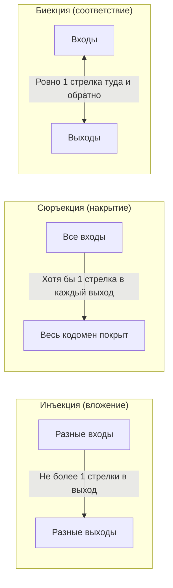

# Лекция 7: Функции, отображения и асимптотический анализ

> **Дисциплина**: Дискретная математика  
> **Лектор**: Константин Чухарев (ФИТиП (ИС), Университет ИТМО, осенний семестр 2026)  
> **Ключевые темы**: Определение функции, функция как бинарное отношение, тотальные и частичные функции, графики функций и критерий вертикальной прямой, образ и прообраз, инъекция, сюръекция, биекция, левая и правая обратные, ядро функции $\operatorname{ker} f$, принцип Дирихле и пределы сжатия данных, канторова пара и нумерация $\mathbb{N}^2 \to \mathbb{N}$, композиция отображений и её свойства, алгебра образов и прообразов, характеристические функции, нотация Айверсона, пол и потолок, лямбда-абстракция и каррирование, символы Ландау ($O, \Omega, \Theta, o, \omega$), предельный критерий, иерархия классов сложности алгоритмов.

---

## 1. Понятие функции и отображения

Функция — базовый строительный блок дискретной математики, теории алгоритмов и функционального программирования.

> «Функция ненасыщена (*ungesättigt*): она содержит пустое место, которое заполняется аргументом.»  
> — *Готлоб Фреге*

### 1.1. Классическое определение

> [!NOTE] **Определение 1 (Функция / Отображение)**  
> Пусть $A$ и $B$ — непустые множества. **Функцией** (или **отображением**) из множества $A$ в множество $B$ (обозначается $f: A \to B$) называется правило, сопоставляющее каждому элементу $a \in A$ **ровно один** элемент $b \in B$:  
> $$\forall a \in A \;\; \exists! b \in B : \quad f(a) = b$$

- Множество $A$ называется **областью определения** (*domain*).
- Множество $B$ называется **кодоменом** (областью прибытия, *codomain*).
- Элемент $b = f(a)$ называется **образом** элемента $a$, а $a$ — **прообразом** элемента $b$.

#### Критическое правило однозначности:
- Разные входы могут давать один и тот же выход: $2^2 = (-2)^2 = 4$ — это допустимо.
- Один вход **не может** давать два разных выхода: уравнение окружности $x^2 + y^2 = 1$ не задает функцию, так как при $x = 0$ имеем $y = 1$ и $y = -1$.

---

### 1.2. Функция без аналитической формулы и функция Дирихле

В школьной алгебре функции часто отождествляют с аналитическими формулами ($x^2 + 1, \sin x$). Однако в современной математике функция — это закон соответствия, который может не иметь единой замкнутой формулы.

> [!NOTE] **Определение 2 (Функция Дирихле, 1837)**  
> Функция $D: \mathbb{R} \to \{0, 1\}$ определяется правилом:  
> $$D(x) = \begin{cases} 1, & \text{если } x \in \mathbb{Q} \text{ (рациональное число)}, \\ 0, & \text{если } x \notin \mathbb{Q} \text{ (иррациональное число)}. \end{cases}$$

Функция Дирихле исторически разрушила догму о том, что функция обязана задаваться непрерывной кривой. График функции Дирихле невозможно нарисовать: между любыми двумя рациональными точками лежит иррациональная, и наоборот.

---

## 2. Теоретико-множественный фундамент: функция как отношение

Функция строго определяется как специальный вид бинарного отношения между множествами $A$ и $B$.

> [!NOTE] **Определение 3 (Функция как бинарное отношение)**  
> Подмножество $f \subseteq A \times B$ называется **функцией из $A$ в $B$**, если выполнены два аксиоматических условия:  
> 1. **Тотальность (всюду определенность)**: для каждого входа существует выход:  
>    $$\forall a \in A \;\; \exists b \in B : \quad (a, b) \in f$$  
> 2. **Функциональность (однозначность)**: у входа не более одного выхода:  
>    $$\forall a \in A, \; \forall b_1, b_2 \in B : \quad \Big( (a, b_1) \in f \land (a, b_2) \in f \Big) \implies b_1 = b_2$$

### 2.1. Подсчет числа функций
Пусть $|A| = n$, $|B| = m$.
- Число всех подмножеств декартова произведения (всех бинарных отношений) равно $2^{|A \times B|} = 2^{nm}$.
- Для построения функции каждому из $n$ элементов множества $A$ необходимо независимо назначить один из $m$ выходов множества $B$.
- **Число функций из $A$ в $B$**:
  $$|B^A| = |B|^{|A|} = m^n$$

*Сравнение объемов*: при $|A| = |B| = 10$ число функций равно $10^{10}$, а число отношений — $2^{100} \approx 1.27 \times 10^{30}$. Требование функциональности отсекает колоссальное число связей.

---

### 2.2. Тотальные и частичные функции

> [!NOTE] **Определение 4 (Частичная функция)**  
> **Частичной функцией** из $A$ в $B$ ($f: A \rightharpoonup B$) называется отношение, удовлетворяющее свойству функциональности, но не обязательно тотальное. То есть $f$ определена лишь на некотором собственном подмножестве $\operatorname{Dom}(f) \subset A$.

#### Связь с Computer Science и теорией вычислений:
- Любая компьютерная программа, принимающая входные данные, задает **частичную функцию**: на некоторых входах она может зависнуть в бесконечном цикле или аварийно завершиться (выбросить `panic` / исключение).
- В строгих функциональных языках и верификаторах (Coq, Agda) все функции обязаны быть доказанно тотальными.
- В языке Rust частичность вычислений выносится в систему типов через тип `Option<T>` (например, метод `get(index)` возвращает `None`, если индекс выходит за границы массива).

---

### 2.3. График функции и критерий вертикальной прямой

> [!NOTE] **Определение 5 (График функции)**  
> **Графиком функции** $f: A \to B$ называется само множество пар:  
> $$\Gamma_f = \{(a, f(a)) \mid a \in A\} \subseteq A \times B$$

> [!IMPORTANT] **Теорема 1 (Критерий вертикальной прямой)**  
> Множество точек на плоскости является графиком функции $f: \mathbb{R} \to \mathbb{R}$ тогда и только тогда, когда любая вертикальная прямая $x = x_0$ пересекает данное множество **ровно один раз** (для тотальной функции) или **не более одного раза** (для частичной).

---

## 3. Образ и прообраз множества

Пусть $f: A \to B$ — функция.

> [!NOTE] **Определение 6 (Образ и прообраз)**  
> 1. Для подмножества $X \subseteq A$ **образом** $f(X)$ называется множество всех значений, принимаемых функцией на элементах $X$:  
>    $$f(X) = \{f(x) \mid x \in X\} = \{b \in B \mid \exists x \in X : f(x) = b\} \subseteq B$$  
> 2. Для подмножества $Y \subseteq B$ **полным прообразом** $f^{-1}(Y)$ называется множество всех элементов $A$, переходящих в $Y$:  
>    $$f^{-1}(Y) = \{a \in A \mid f(a) \in Y\} \subseteq A$$

> [!WARNING] **Важное предостережение**  
> Обозначение $f^{-1}(Y)$ для прообраза множества определено **для абсолютно любой функции**, даже если сама функция $f$ необратима! Запись $f^{-1}(b)$ означает множество всех прообразов точки $b$ (оно может быть пустым, одноточечным или бесконечным).

---

## 4. Классы отображений: инъекция, сюръекция, биекция

### 4.1. Инъективность (Injection)

> [!NOTE] **Определение 7 (Инъекция / Одно-однозначное отображение)**  
> Функция $f: A \to B$ называется **инъективной**, если различные элементы области определения имеют различные образы:  
> $$\forall a_1, a_2 \in A : \quad a_1 \ne a_2 \implies f(a_1) \ne f(a_2)$$  
> *(Эквивалентная контрапозиция)*:  
> $$\forall a_1, a_2 \in A : \quad f(a_1) = f(a_2) \implies a_1 = a_2$$

- **Для конечных множеств**: существование инъекции $f: A \to B$ возможно $\iff |A| \le |B|$.
- **Связь с монотонностью**: всякая строго монотонная функция $f: \mathbb{R} \to \mathbb{R}$ строго инъективна.
- **Ядро функции**: отношение $\operatorname{ker} f = \{(a_1, a_2) \in A^2 \mid f(a_1) = f(a_2)\}$ называется **ядром**. Ядро всегда является отношением эквивалентности. Функция инъективна $\iff \operatorname{ker} f = \operatorname{id}_A$.

> [!IMPORTANT] **Теорема 2 (Левая обратная для инъекции)**  
> При $A \ne \emptyset$ функция $f: A \to B$ инъективна тогда и только тогда, когда существует **левая обратная** функция $g: B \to A$, такая что:  
> $$g \circ f = \operatorname{id}_A$$

*Доказательство*:  
1. Если $f$ инъективна, для каждого $b \in f(A)$ существует ровно один прообраз $a$. Положим $g(b) = a$. Для $b \notin f(A)$ положим $g(b) = a_0$ (произвольный фиксированный элемент из $A$). Тогда $g(f(a)) = a$.  
2. Обратно: если $g \circ f = \operatorname{id}_A$ и $f(a_1) = f(a_2)$, то подставляя $g$: $a_1 = g(f(a_1)) = g(f(a_2)) = a_2$. Функция инъективна. $\blacksquare$

---

### 4.2. Сюръективность (Surjection)

> [!NOTE] **Определение 8 (Сюръекция / Отображение «на»)**  
> Функция $f: A \to B$ называется **сюръективной**, если каждый элемент кодомена имеет хотя бы один прообраз:  
> $$\forall b \in B \;\; \exists a \in A : \quad f(a) = b \iff f(A) = B$$

- **Для конечных множеств**: существование сюръекции $f: A \to B$ возможно $\iff |A| \ge |B|$.
- *Пример*: $f(x) = e^x$ как отображение $\mathbb{R} \to \mathbb{R}$ **не сюръективна** (отрицательные числа недостижимы), но как отображение $\mathbb{R} \to \mathbb{R}^+$ — строго **сюръективна**. Сюръективность зависит от выбора кодомена!

> [!IMPORTANT] **Теорема 3 (Правая обратная для сюръекции)**  
> Функция $f: A \to B$ сюръективна тогда и только тогда, когда существует **правая обратная** функция $g: B \to A$ (сечение), такая что:  
> $$f \circ g = \operatorname{id}_B$$

*(Замечание: для бесконечных множеств одновременный выбор прообраза $g(b) \in f^{-1}(b)$ для каждого $b \in B$ эквивалентен **аксиоме выбора Цермело**)*.

---

### 4.3. Биективность (Bijection)

> [!NOTE] **Определение 9 (Биекция / Взаимно однозначное соответствие)**  
> Функция $f: A \to B$ называется **биективной**, если она одновременно **инъективна и сюръективна**:  
> $$\forall b \in B \;\; \exists! a \in A : \quad f(a) = b$$

- **Для конечных множеств**: биекция существует $\iff |A| = |B|$.
- **Обратная функция**: только у биекции существует полноценная двусторонняя **обратная функция** $f^{-1}: B \to A$:  
  $$f^{-1} \circ f = \operatorname{id}_A \quad \text{и} \quad f \circ f^{-1} = \operatorname{id}_B$$

> [!IMPORTANT] **Теорема 4 (Единственность обратной функции)**  
> Если для функции $f: A \to B$ существуют обратные функции, то обратная функция $f^{-1}$ **строго единственна**.

*Доказательство*:  
Пусть $g_1$ и $g_2$ — две обратные функции к $f$. Тогда:
$$g_1 = g_1 \circ \operatorname{id}_B = g_1 \circ (f \circ g_2) = (g_1 \circ f) \circ g_2 = \operatorname{id}_A \circ g_2 = g_2 \quad \blacksquare$$

---

## 5. Принцип Дирихле и пределы сжатия информации

> [!IMPORTANT] **Теорема 5 (Принцип Дирихле / Pigeonhole Principle)**  
> Если $|A| > |B|$, то ни одна функция $f: A \to B$ не может быть инъективной: найдутся хотя бы два различных элемента $a_1 \ne a_2$, таких что $f(a_1) = f(a_2)$.

### Практическое следствие: Архиваторы и сжатие без потерь
Существует распространенное заблуждение: «можно создать архиватор, который сжимает любой файл». Принцип Дирихле строго доказывает невозможность этого:
- Файлов длины ровно $n$ байт существует $256^n$.
- Строк длины строго меньше $n$ байт существует:
  $$1 + 256 + 256^2 + \dots + 256^{n-1} = \frac{256^n - 1}{255} < 256^n$$
- Для взаимно однозначного сжатия (без потерь) функция архивации обязана быть **инъективной**.
- Так как мощность множества сжатых файлов строго меньше мощности исходных, по принципу Дирихле **ни один алгоритм сжатия без потерь не может сжимать все файлы**: обязательно найдутся файлы, размер которых после сжатия **увеличится**.

---

## 6. Канторова нумерация пар ($\mathbb{N} \times \mathbb{N} \to \mathbb{N}$)

В теории кодирования и теории вычислимости фундаментальную роль играет упаковка двух целых чисел в одно.

> [!NOTE] **Определение 10 (Канторова функция спаривания)**  
> Функция $J: \mathbb{N}_0 \times \mathbb{N}_0 \to \mathbb{N}_0$ определяется формулой:  
> $$J(k_1, k_2) = \frac{(k_1 + k_2)(k_1 + k_2 + 1)}{2} + k_1$$

- Пары нумеруются по диагоналям с постоянной суммой $s = k_1 + k_2$:
  - $s = 0$: $(0, 0) \mapsto 0$
  - $s = 1$: $(0, 1) \mapsto 1, \; (1, 0) \mapsto 2$
  - $s = 2$: $(0, 2) \mapsto 3, \; (1, 1) \mapsto 4, \; (2, 0) \mapsto 5$
- **Теорема**: Функция $J$ является **биекцией**.
- **Алгоритм распаковки числа $n$ в пару $(k_1, k_2)$**:
  1. Находим наибольшее $s$, такое что треугольное число $T_s = \frac{s(s+1)}{2} \le n$;
  2. Вычисляем $k_1 = n - T_s$;
  3. Вычисляем $k_2 = s - k_1$.

---

## 7. Алгебра образов и прообразов

Операции над множествами переносятся под действием функции $f: A \to B$ по разным правилам.

> [!IMPORTANT] **Теорема 6 (Свойства образов и прообразов)**  
> Для любых $A_1, A_2 \subseteq A$ и любых $B_1, B_2 \subseteq B$:  
> 1. $f(A_1 \cup A_2) = f(A_1) \cup f(A_2)$ (образ объединения равен объединению образов).  
> 2. $f(A_1 \cap A_2) \subseteq f(A_1) \cap f(A_2)$ (образ пересечения вложен в пересечение образов).  
>    **Критерий**: $f(A_1 \cap A_2) = f(A_1) \cap f(A_2)$ для всех подмножеств $\iff f$ **инъективна**!  
> 3. $f^{-1}(B_1 \cup B_2) = f^{-1}(B_1) \cup f^{-1}(B_2)$ (прообраз сохраняет объединение).  
> 4. $f^{-1}(B_1 \cap B_2) = f^{-1}(B_1) \cap f^{-1}(B_2)$ (прообраз **всегда точно сохраняет пересечение**).  
> 5. $f^{-1}(B_1 \setminus B_2) = f^{-1}(B_1) \setminus f^{-1}(B_2)$ (прообраз сохраняет дополнение и разность).

*Контрпример для пункта 2*: $f(x) = x^2$, $A_1 = \{-1\}$, $A_2 = \{1\}$.  
$A_1 \cap A_2 = \emptyset \implies f(A_1 \cap A_2) = \emptyset$.  
Однако $f(A_1) \cap f(A_2) = \{1\} \cap \{1\} = \{1\} \ne \emptyset$. Равенство нарушено из-за неинъективности.

---

## 8. Композиция функций и её обращение

> [!NOTE] **Определение 11 (Композиция отображений)**  
> Для функций $f: A \to B$ и $g: B \to C$ композицией $g \circ f: A \to C$ называется функция:  
> $$(g \circ f)(a) = g(f(a)) \quad \forall a \in A$$

### 8.1. Свойства композиции:
1. **Ассоциативность**: $h \circ (g \circ f) = (h \circ g) \circ f$.
2. **Некоммутативность**: в общем случае $g \circ f \ne f \circ g$.
3. **Сохранение классов**:
   - $f, g$ инъективны $\implies g \circ f$ инъективна.
   - $f, g$ сюръективны $\implies g \circ f$ сюръективна.
   - $f, g$ биективны $\implies g \circ f$ биективна.
4. **Обратные импликации**:
   - $g \circ f$ инъективна $\implies f$ инъективна (но $g$ может не быть!).
   - $g \circ f$ сюръективна $\implies g$ сюръективна (но $f$ может не быть!).
5. **Обращение композиции биекций**:
   $$(g \circ f)^{-1} = f^{-1} \circ g^{-1}$$
   *(Порядок сомножителей меняется на противоположный!)*

---

## 9. Функции в дискретной математике и Computer Science

### 9.1. Характеристическая функция (Индикатор)
Для подмножества $X \subseteq U$ **характеристическая функция** $\chi_X: U \to \{0, 1\}$ равна:
$$\chi_X(x) = \begin{cases} 1, & x \in X \\ 0, & x \notin X \end{cases}$$
- Пересечение: $\chi_{A \cap B} = \chi_A \cdot \chi_B$
- Объединение: $\chi_{A \cup B} = \chi_A + \chi_B - \chi_A \chi_B = \max(\chi_A, \chi_B)$
- Дополнение: $\chi_{U \setminus A} = 1 - \chi_A$
- В Unix-системах права доступа `rwx` (`chmod 754`) представляют собой вектор из трех характеристических функций.

### 9.2. Пол, потолок и нотация Айверсона
- $\lfloor x \rfloor$ (**пол / floor**): наибольшее целое, не превышающее $x$ ($\lfloor 3.7 \rfloor = 3, \; \lfloor -3.7 \rfloor = -4$).
- $\lceil x \rceil$ (**потолок / ceil**): наименьшее целое, не меньшее $x$ ($\lceil 3.7 \rceil = 4, \; \lceil -3.7 \rceil = -3$).
- Связь: $\lceil x \rceil = -\lfloor -x \rfloor$.
- **Нотация Айверсона**: $[P] = 1$, если логическое утверждение $P$ истинно, и $0$, если ложно.  
  Символ Кронекера: $\delta_{ij} = [i = j]$.

### 9.3. Лямбда-исчисление и каррирование
- **Лямбда-абстракция**: $\lambda x. e(x)$ — безымянная функция от аргумента $x$.
- **Каррирование (Currying)**: преобразование функции двух аргументов $f: (A \times B) \to C$ в функцию одного аргумента, возвращающую функцию:
  $$\operatorname{curry}(f): A \to (B \to C), \qquad \operatorname{curry}(f) = \lambda x. \lambda y. f(x, y)$$
  Каррирование задает естественную биекцию между пространствами функций: $C^{A \times B} \cong (C^B)^A$.

---

## 10. Асимптотические обозначения и шкала времени

> [!NOTE] **Определения асимптотических классов для $f, g: \mathbb{N} \to \mathbb{R}^+$**  
> - **$O(g(n))$**: $\exists C > 0, n_0 \;\; \forall n \ge n_0 : f(n) \le C \cdot g(n)$ (рост не быстрее).  
> - **$\Omega(g(n))$**: $\exists c > 0, n_0 \;\; \forall n \ge n_0 : f(n) \ge c \cdot g(n)$ (рост не медленнее).  
> - **$\Theta(g(n))$**: $f(n) \in O(g(n)) \cap \Omega(g(n))$ (точный порядок роста).  
> - **$o(g(n))$**: $\forall c > 0 \; \exists n_0 \; \forall n \ge n_0 : f(n) \le c \cdot g(n) \iff \lim \frac{f(n)}{g(n)} = 0$.  
> - **$\omega(g(n))$**: $\lim \frac{f(n)}{g(n)} = \infty$.

### Предельный критерий:
$$\lim_{n \to \infty} \frac{f(n)}{g(n)} = L \implies \begin{cases} L = 0 \implies f \in o(g) \\ 0 < L < \infty \implies f \in \Theta(g) \\ L = \infty \implies f \in \omega(g) \end{cases}$$

### Бюджет операций при $10^9$ оп/сек ($n = 10^6$):
| Класс сложности | Время работы при $n = 10^6$ | Характерная задача |
| :--- | :--- | :--- |
| $\mathcal{O}(n)$ | $1$ миллисекунда | Линейный поиск, проход по массиву |
| $\mathcal{O}(n \log n)$ | $\approx 20$ миллисекунд | Быстрая сортировка (QuickSort, MergeSort) |
| $\mathcal{O}(n^2)$ | $\approx 17$ минут | Вложенные циклы, сортировка пузырьком |
| $\mathcal{O}(2^n)$ | $2^{10^6}$ операций ($\approx 10^{301030}$ лет) | Полный перебор подмножеств (NP-полные задачи) |

---

## 11. Решение контрольных вопросов лекции (Слайд 99)

### Вопрос 1
> **Условие**: Какие из отношений $R \subseteq \{1, 2, 3\} \times \{a, b\}$ являются функциями?  
> $R_1 = \{(1, a), (2, b), (3, a)\}$, $R_2 = \{(1, a), (1, b), (2, a)\}$, $R_3 = \{(1, a), (3, b)\}$.
- **Решение**:  
  - $R_1$: **является функцией**, так как каждый вход из $\{1, 2, 3\}$ имеет ровно один выход.  
  - $R_2$: **не является функцией**, нарушена однозначность (входу 1 соответствуют два выхода $a$ и $b$).  
  - $R_3$: **не является функцией** из $\{1, 2, 3\}$ (это лишь частичная функция), так как вход $2$ не имеет выхода.

### Вопрос 2
> **Условие**: Найдите $f(A)$ и $f^{-1}(B)$ для $f(x) = x^2$ при $A = \{-2, -1, 0, 1, 2\}$ и $B = \{0, 1, 4, 9\}$.
- **Решение**:  
  - Образ: $f(A) = \{(-2)^2, (-1)^2, 0^2, 1^2, 2^2\} = \{0, 1, 4\}$.  
  - Прообраз: решения уравнений $x^2 = 0, 1, 4, 9$. Получаем $f^{-1}(B) = \{-3, -2, -1, 0, 1, 2, 3\}$.

### Вопрос 3
> **Условие**: Приведите пример функции $f: \mathbb{N} \to \mathbb{N}$, сюръективной, но не инъективной.
- **Решение**: Функция $f(n) = \lfloor \frac{n+1}{2} \rfloor$:  
  - $f(1) = 1, f(2) = 1, f(3) = 2, f(4) = 2, \dots$  
  Она сюръективна (любое число $k$ достигается, например, при $n = 2k$), но не инъективна ($f(1) = f(2) = 1$).

### Вопрос 4
> **Условие**: Докажите: если $g \circ f$ инъективна, то $f$ инъективна.
- **Решение**: Пусть $f(a_1) = f(a_2)$. Применим функцию $g$ к обеим частям: $g(f(a_1)) = g(f(a_2)) \iff (g \circ f)(a_1) = (g \circ f)(a_2)$.  
  Так как композиция $g \circ f$ инъективна, отсюда немедленно следует $a_1 = a_2$. Значит, $f$ инъективна. $\blacksquare$

### Вопрос 5
> **Условие**: Почему $(g \circ f)^{-1} = f^{-1} \circ g^{-1}$, и почему порядок меняется?
- **Решение**: Проверим композицию: $(f^{-1} \circ g^{-1}) \circ (g \circ f) = f^{-1} \circ (g^{-1} \circ g) \circ f = f^{-1} \circ \operatorname{id}_B \circ f = f^{-1} \circ f = \operatorname{id}_A$.  
  Порядок меняется, так как функция $g$ применялась последней, и чтобы «размотать» преобразование назад, необходимо сначала снять внешнюю операцию $g$ (применив $g^{-1}$), а затем внутреннюю $f$ (применив $f^{-1}$).

### Вопрос 6
> **Условие**: Почему прообраз сохраняет пересечение, а образ — не всегда?
- **Решение**: Принадлежность прообразу $a \in f^{-1}(B_1 \cap B_2) \iff f(a) \in B_1 \cap B_2 \iff f(a) \in B_1 \land f(a) \in B_2 \iff a \in f^{-1}(B_1) \cap f^{-1}(B_2)$ сохраняется в силу однозначности функции (у элемента $a$ ровно одно значение $f(a)$).  
  Для прямого образа разные точки $a_1 \in A_1$ и $a_2 \in A_2$ при неинъективной функции могут склеиться в один выход $f(a_1) = f(a_2) = b$, из-за чего образ пересечения окажется строго меньше пересечения образов.

### Вопрос 7
> **Условие**: Запишите лямбда-абстракцию, удваивающую свой аргумент.
- **Решение**: $\lambda x. 2 \cdot x$ (или в коде: `lambda x: 2 * x`).
