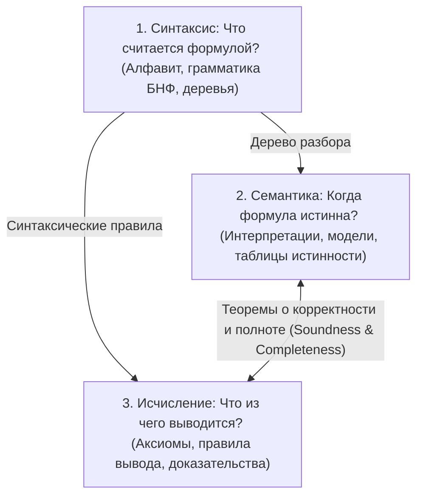
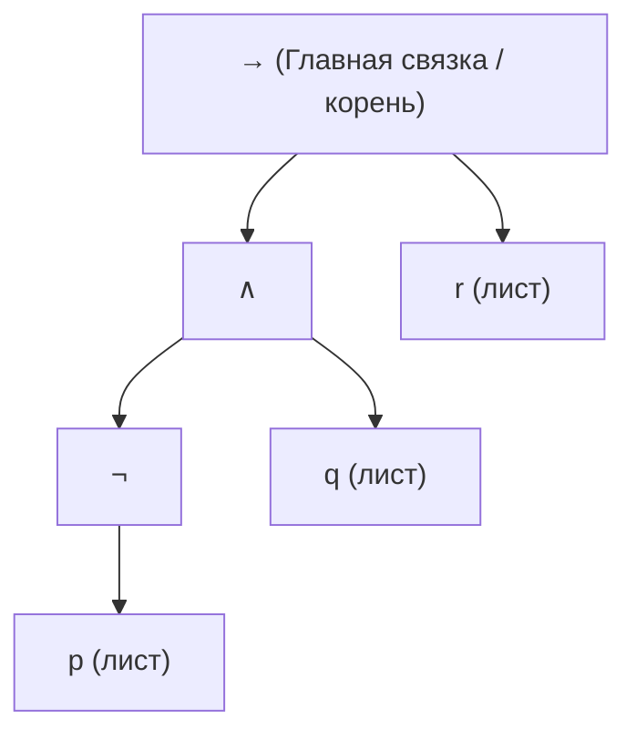
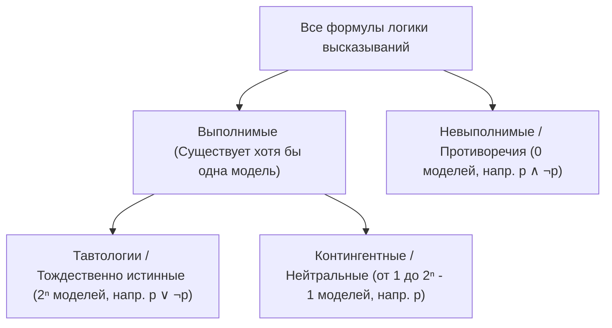
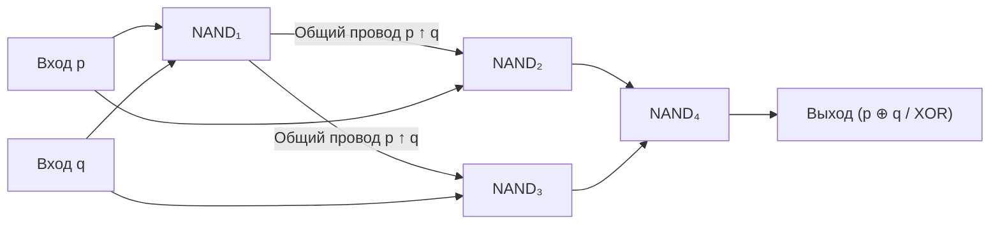
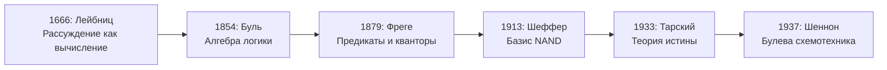

# Лекция 10: Язык и истина: синтаксис формул, семантика, булева алгебра, функциональная полнота и теорема компактности

> **Дисциплина**: Дискретная математика  
> **Лектор**: Константин Чухарев (ФИТиП (ИС), Университет ИТМО, осенний семестр 2026)  
> **Ключевые темы**: Три слоя формальной логики (синтаксис, семантика, исчисление), синтаксическая неоднозначность и висячий `else`, правильно построенные формулы (WFF), дерево разбора и главная связка, баланс скобок и теорема об однозначности разбора, соглашения о приоритетах, парсер рекурсивного спуска и индуктивные типы данных (Rust/ML), количественные соотношения формул (число связок и листьев), семантика и интерпретации $\nu: V \to \{0, 1\}$, продолжение оценки, композициональность, формула как булева функция, логическая эквивалентность $\varphi \equiv \psi$, классы формул (тавтологии, выполнимые, невыполнимые, контингентные), логическое следствие $\Gamma \models \psi$, сведение к невыполнимости ($\Gamma \models \psi \iff \Gamma \cup \{\neg\psi\}$ невыполнимо), задача SAT и теорема Кука, перебор с отсечением ветвей, семантическая теорема о дедукции, принцип подстановки, фактор-алгебра и булева алгебра, законы булевой алгебры и импликации, функциональная полнота, базис Шеффера (NAND), нормальные формы (СДНФ и СКНФ), теорема компактности логики высказываний (Мальцев, Гёдель), лемма Кёнига о бесконечной ветви, конечные свидетели, теорема де Брёйна — Эрдёша о раскладке по слотам (раскраска бесконечных графов), логические схемы из вентилей и Шенноновская схемотехника (1937), ретроспектива: Лейбниц, Буль, Фреге, Шеффер, Тарский, Шеннон.

---

## 1. Рекомендуемая литература

* **Н. К. Верещагин, А. Шень — «Языки и исчисления»**  
  *Часть 1: «Исчисление высказываний» (§1: Синтаксис формул, деревья разбора, индукция по построению; §2: Семантика, таблицы истинности, нормальные формы; §3: Исчисление и теорема о полноте; §4: Компактность логики высказываний).*
* **Э. Мендельсон — «Введение в математическую логику»**  
  *Глава 1: «Пропозициональное исчисление» (Синтаксис, булевы функции, функциональная полнота, компактность).*
* **Ф. А. Новиков — «Дискретная математика для программистов»**  
  *Глава 2: «Математическая логика» (§2.1: Логика высказываний, булевы алгебры, минимизация форм).*
* **Учебные материалы курса ФИТиП ИТМО (2026)**:
  * Модуль `m01`: разделы *«Синтаксис формул»*, *«Структурная индукция»*, *«Семантика: таблицы истинности»*, *«Законы и тождества»*, *«Нормальные формы»*, *«Функциональная полнота системы связок»*, *«Компактность»*.
  * Модуль `m02`: разделы *«Что такое система вывода»*, *«Системы Гильберта»*, *«Натуральная дедукция»*, *«Корректность и полнота»*.
  * Модуль `m11`: раздел *«Логические вентили и схемы»*.
  * Модуль `m14`: раздел *«Задача SAT»*.

---

## 2. Архитектура формальной логики: Три слоя

Естественный язык страдает неустранимой двусмысленностью (синтаксической и семантической). Классический пример из компиляторов и языков программирования — **проблема висячего else (dangling else)**:

```c
if (a)
    if (b)
        x();
else
    y();
```

Из плоской записи невозможно понять, к какому `if` относится ветка `else`:
1. **else у внутреннего if**: если $a = \text{true}$ и $b = \text{false}$, то вызывается $y()$; при $a = \text{false}$ не выполняется ничего.
2. **else у внешнего if**: если $a = \text{false}$, вызывается $y()$.

В языке Си и большинстве современных языков введено специальное грамматическое соглашение: `else` привязывается к ближайшему предшествующему открытому `if`. В строгой формальной логике подобные двусмысленности устраняются на фундаментальном уровне через разделение логики на три независимых слоя:



| Слой | Основной вопрос | Что задаёт? | Пример / Образец |
| :--- | :--- | :--- | :--- |
| **Синтаксис** | Что считается корректной формулой? | Алфавит, грамматика, скобки | $(p \wedge q) \vee r$ |
| **Семантика** | Когда формула истинна? | Интерпретации $\nu$, оценка, модели | $\nu(p) = 1, \nu(\varphi) = 1$ |
| **Исчисление** | Что из чего выводится чисто механически? | Аксиомы, правила вывода (Modus Ponens) | $p, p \to q \vdash q$ |

Все три слоя задаются конечным набором абсолютно точных механических правил. В языках программирования этой тройке строго соответствуют **грамматика (синтаксис)**, **семантика выполнения (runtime semantics)** и **система типизации / верификация (type system / calculus)**.

---

## 3. Синтаксис логики высказываний

### 3.1. Алфавит и правильно построенные формулы

Алфавит пропозициональной логики состоит из:
1. Счётного множества пропозициональных переменных (атомов): $V = \{p, q, r, s, p_1, p_2, \dots\}$.
2. Логических связок: унарной $\neg$ (отрицание), бинарных $\wedge$ (конъюнкция), $\vee$ (дизъюнкция), $\to$ (импликация), $\leftrightarrow$ (эквивалентность).
3. Вспомогательных символов: круглых скобок `(` и `)`.

> [!IMPORTANT] **Определение 1 (Правильно построенная формула, WFF — Well-Formed Formula)**  
> Множество правильно построенных формул задаётся индуктивно (рекурсивно):  
> 1. **База индукции**: Каждая пропозициональная переменная $p \in V$ является формулой (атомарной формулой).  
> 2. **Шаг индукции (отрицание)**: Если $\varphi$ — формула, то $(\neg \varphi)$ — формула.  
> 3. **Шаг индукции (бинарные связки)**: Если $\varphi$ и $\psi$ — формулы, то $(\varphi \wedge \psi)$, $(\varphi \vee \psi)$, $(\varphi \to \psi)$, $(\varphi \leftrightarrow \psi)$ — формулы.  
> 4. **Ограничение**: Ничто иное формулой не является.

В форме Бэкуса — Наура (БНФ):
$$\langle\text{formula}\rangle ::= p \mid (\neg \langle\text{formula}\rangle) \mid (\langle\text{formula}\rangle \wedge \langle\text{formula}\rangle) \mid (\langle\text{formula}\rangle \vee \langle\text{formula}\rangle) \mid (\langle\text{formula}\rangle \to \langle\text{formula}\rangle) \mid (\langle\text{formula}\rangle \leftrightarrow \langle\text{formula}\rangle)$$

Строка — это любая конечная последовательность символов алфавита. Далеко не всякая строка является формулой:
* $p$, $(\neg p)$, $((p \wedge q) \to r)$ — **формулы**.
* $p \wedge$ — **не формула** (бинарная связка без правого операнда).
* $\to qr$ — **не формула** (строка начинается со связки без открывающей скобки).
* $((p))$ — **не формула** строго по грамматике (скобки добавляются только вместе со связкой).

---

### 3.2. Дерево разбора и главная связка

У каждой формулы есть история её индуктивной сборки снизу вверх, однозначно кодируемая **деревом разбора (parse tree)**:
* **Листья** дерева — атомы (переменные $p, q, r$).
* **Внутренние узлы** — логические связки.
* **Корень** дерева — последняя применённая связка, называемая **главной связкой формулы**.

Для формулы $((( \neg p) \wedge q) \to r)$:



Смысл формулы полностью определяется её деревом разбора, а не плоским порядком символов в строке. Дерево конечно, поэтому любая рекурсивная обработка формулы гарантированно завершается.

---

### 3.3. Баланс скобок и теорема об однозначности разбора

> [!NOTE] **Определение 2 (Баланс строки)**  
> **Балансом** строки (или префикса строки) называется разность между числом открывающих и числом закрывающих скобок:  
> $$\operatorname{bal}(s) = \operatorname{count}('(', s) - \operatorname{count}(')', s)$$

> [!IMPORTANT] **Теорема 1 (О балансе скобок формулы)**  
> 1. Для любой правильно построенной формулы $\varphi$ её полный баланс равен нулю: $\operatorname{bal}(\varphi) = 0$.  
> 2. Для любой неатомарной формулы $\varphi$ любой её непустой собственный префикс $u$ (где $\varphi = uv, v \ne \varepsilon$) имеет строго положительный баланс: $\operatorname{bal}(u) > 0$.

#### Доказательство (структурной индукцией по построению $\varphi$):
* **База**: $\varphi = p \in V$. Скобок нет, $\operatorname{bal}(p) = 0$. Непустых собственных префиксов нет.
* **Шаг для отрицания**: $\varphi = (\neg \psi)$. Первая скобка даёт $\operatorname{bal}('(') = 1$. Для любого собственного префикса внутри $\psi$ баланс неотрицателен по индукционному предположению, следовательно, общий баланс префикса не менее $1 + 0 = 1 > 0$. Вся формула замыкается скобкой `)`, возвращая баланс в $1 - 1 = 0$.
* **Шаг для бинарной связки**: $\varphi = (\psi_1 \circ \psi_2)$. Формула начинается с `(`, задавая баланс 1. Любой префикс, заканчивающийся внутри $\psi_1$, на символе $\circ$ или внутри $\psi_2$, оставляет первую открывающую скобку незакрытой, поэтому его баланс $\ge 1 > 0$. В конце формулы последняя скобка `)` обнуляет баланс. $\blacksquare$

> [!IMPORTANT] **Теорема 2 (Об однозначности синтаксического разбора)**  
> Каждая правильно построенная формула $\varphi$ обладает **ровно одним** деревом синтаксического разбора.

#### Доказательство:
Индукция по длине строки (или числу связок в формуле):
* **База**: Для атома $p$ связок нет — дерево состоит из единственного листа.
* **Шаг**: Пусть утверждение верно для всех формул с числом связок $< k$. Рассмотрим формулу $\varphi$ с $k \ge 1$ связками. Формула обязана начинаться с символа `(`.
  * Если вторым символом идёт $\neg$, то $\varphi = (\neg \psi)$. По теореме о балансе закрывающая скобка для первого `(` может стоять только в самом конце строки, откуда $\psi$ выделяется единственным образом. К $\psi$ применимо предположение индукции.
  * Если второй символ отличен от $\neg$, то $\varphi = (\psi_1 \circ \psi_2)$. При чтении слева направо после начальной скобки баланс равен 1. Подформула $\psi_1$ — это первый префикс после начальной скобки, на котором суммарный баланс скобок (считая от начала $\psi_1$) впервые обратится в 0. По теореме 1 такой префикс определяется **единственным образом**! Следующий за ним символ обязан быть связкой $\circ \in \{\wedge, \vee, \to, \leftrightarrow\}$, а оставшаяся часть до финальной скобки — формулой $\psi_2$. Деревья разбора для $\psi_1$ и $\psi_2$ единственны по предположению индукции. Следовательно, дерево для $\varphi$ также единственно. $\blacksquare$

---

### 3.4. Приоритеты связок и синтаксический сахар

Чтобы избавить математические тексты от избыточных скобок, вводят соглашение о старшинстве (приоритетах) связок и ассоциативности:

| Приоритет | Связка | Название | Ассоциативность | Пример записи | Канонический вид WFF |
| :---: | :---: | :--- | :--- | :--- | :--- |
| **1 (наивысший)** | $\neg$ | Отрицание | Префиксная | $\neg p \wedge q$ | $((\neg p) \wedge q)$ |
| **2** | $\wedge$ | Конъюнкция | Левая | $p \wedge q \wedge r$ | $((p \wedge q) \wedge r)$ |
| **3** | $\vee$ | Дизъюнкция | Левая | $p \vee q \vee r$ | $((p \vee q) \vee r)$ |
| **4** | $\to$ | Импликация | **Правая** | $p \to q \to r$ | $(p \to (q \to r))$ |
| **5 (наинизший)** | $\leftrightarrow$ | Эквивалентность | Левая | $p \leftrightarrow q \leftrightarrow r$ | $((p \leftrightarrow q) \leftrightarrow r)$ |

> [!WARNING]
> Импликация **правоассоциативна**: запись $p \to q \to r$ строго означает $p \to (q \to r)$, а не $(p \to q) \to r$. Это напрямую соответствует каррированию типов функций в функциональном программировании: $A \to B \to C \equiv A \to (B \to C)$.

---

### 3.5. Формула как индуктивный тип данных и парсер

В Computer Science формула представляется индуктивным алгебраическим типом данных (ADT):

```rust
#[derive(Debug, Clone, PartialEq, Eq)]
pub enum Formula {
    Atom(String),
    Not(Box<Formula>),
    And(Box<Formula>, Box<Formula>),
    Or(Box<Formula>, Box<Formula>),
    Imply(Box<Formula>, Box<Formula>),
    Iff(Box<Formula>, Box<Formula>),
}
```

Любая функция над формулой является **свёрткой (catamorphism)** по дереву. Например, подсчёт числа атомов:

```rust
pub fn count_atoms(f: &Formula) -> usize {
    match f {
        Formula::Atom(_) => 1,
        Formula::Not(sub) => count_atoms(sub),
        Formula::And(a, b) | Formula::Or(a, b) | Formula::Imply(a, b) | Formula::Iff(a, b) => {
            count_atoms(a) + count_atoms(b)
        }
    }
}
```

> [!IMPORTANT] **Теорема 3 (О соотношении числа бинарных связок и листьев)**  
> В любой правильно построенной формуле с $b$ бинарными связками и $l$ листьями (вхождениями атомов) выполнено соотношение:  
> $$b = l - 1$$

*Доказательство структурной индукцией*:
* Для атома: $b = 0$, $l = 1$, равенство $0 = 1 - 1$ верно.
* Отрицание не меняет ни $b$, ни $l$.
* Для $\varphi = \psi_1 \circ \psi_2$: $b = b_1 + b_2 + 1 = (l_1 - 1) + (l_2 - 1) + 1 = (l_1 + l_2) - 1 = l - 1$. $\blacksquare$

---

## 4. Семантика логики высказываний

### 4.1. Интерпретация и продолжение оценки

> [!NOTE] **Определение 3 (Интерпретация)**  
> **Интерпретацией (или означиванием атомов)** называется функция $\nu: V \to \{0, 1\}$, сопоставляющая каждой пропозициональной переменной значение истины (1) или лжи (0).

> [!IMPORTANT] **Определение 4 (Оценка формулы)**  
> Оценка формулы — это единственное гомоморфное продолжение функции $\nu$ на всё множество формул, задаваемое правилами истинности связок:  
> * $\nu(\neg \varphi) = 1 - \nu(\varphi)$  
> * $\nu(\varphi \wedge \psi) = \min(\nu(\varphi), \nu(\psi))$  
> * $\nu(\varphi \vee \psi) = \max(\nu(\varphi), \nu(\psi))$  
> * $\nu(\varphi \to \psi) = \max(1 - \nu(\varphi), \nu(\psi))$  
> * $\nu(\varphi \leftrightarrow \psi) = 1 - |\nu(\varphi) - \nu(\psi)|$

> [!NOTE] **Теорема 4 (Принцип композициональности Тарского — Фреге)**  
> Значение истинности формулы $\varphi$ при интерпретации $\nu$ зависит **исключительно** от значений, которые $\nu$ приписывает переменным, непосредственно входящим в формулу $\varphi$.  
> Если $\nu_1(p) = \nu_2(p)$ для всех $p \in \operatorname{Vars}(\varphi)$, то $\nu_1(\varphi) = \nu_2(\varphi)$.

Следствие: для формулы от $n$ различных переменных достаточно рассмотреть ровно $2^n$ ограничений интерпретации, которые сводятся в **таблицу истинности**.

---

### 4.2. Классы формул

Интерпретация $\nu$, на которой $\nu(\varphi) = 1$, называется **моделью** формулы $\varphi$. Если $\nu(\varphi) = 0$, то $\nu$ называется **опровергающей интерпретацией**.



1. **Тавтология (общезначимая формула)**: истинна при любой интерпретации ($\models \varphi$).
2. **Невыполнимая формула (тождественно ложная, противоречие)**: ложна при любой интерпретации.
3. **Выполнимая формула**: истинна хотя бы при одной интерпретации.
4. **Контингентная (опровержимая выполнимая)**: имеет как минимум одну модель и как минимум одну опровергающую интерпретацию.

---

## 5. Логическое следствие и задача SAT

### 5.1. Семантическое следование и сведение к невыполнимости

> [!IMPORTANT] **Определение 5 (Семантическое следование)**  
> Формула $\psi$ **логически следует** из множества посылок $\Gamma$ (обозначается $\Gamma \models \psi$), если любая интерпретация $\nu$, являющаяся моделью для всех формул из $\Gamma$ ($\forall \gamma \in \Gamma: \nu(\gamma) = 1$), делает истинной и формулу $\psi$ ($\nu(\psi) = 1$).  
> Интерпретация, обращающая все формулы $\Gamma$ в 1, а $\psi$ в 0, называется **контрмоделью к следованию $\Gamma \models \psi$**.

> [!IMPORTANT] **Теорема 5 (Сведение следования к невыполнимости)**  
> $$\Gamma \models \psi \iff \Gamma \cup \{\neg \psi\} \text{ невыполнимо}$$

#### Доказательство:
* $(\implies)$ Пусть $\Gamma \models \psi$. Предположим от противного, что $\Gamma \cup \{\neg \psi\}$ выполнимо. Тогда существует модель $\nu$, на которой все формулы из $\Gamma$ истинны и $\nu(\neg \psi) = 1 \implies \nu(\psi) = 0$. Но тогда $\nu$ является контрмоделью к $\Gamma \models \psi$, что противоречит определению следования.
* $(\impliedby)$ Пусть $\Gamma \cup \{\neg \psi\}$ невыполнимо. Это означает, что не существует интерпретации, на которой одновременно истинны все формулы из $\Gamma$ и ложна $\psi$. Следовательно, на любой интерпретации, где истинны все формулы $\Gamma$, формула $\psi$ обязана принимать значение 1, то есть $\Gamma \models \psi$. $\blacksquare$

---

### 5.2. Задача SAT и метод перебора с отсечением ветвей

Сведение следования к вопросу выполнимости выводит на первый план фундаментальную проблему Computer Science:
> [!IMPORTANT] **Задача SAT (Boolean Satisfiability Problem)**  
> По заданной пропозициональной формуле $\varphi$ определить, существует ли интерпретация $\nu$, на которой $\nu(\varphi) = 1$.  
> **Теорема Кука — Левина (1971)**: Задача SAT является $\mathbf{NP}$-полной.

Таблица истинности требует экспоненциального времени $O(2^n \cdot |\varphi|)$. Современные SAT-решатели (CDCL, DPLL) используют **перебор с отсечением несовместных ветвей (Branch and Prune)**:
1. Выбирается переменная $p$.
2. В ветке $p = 0$ подставляется значение; если часть ограничений делает формулу тождественно ложной, вся подветка отсекается целиком без перебора её $2^{n-k}$ листьев.
3. В ветке $p = 1$ процедура повторяется.

---

### 5.3. Семантическая теорема о дедукции

> [!IMPORTANT] **Теорема 6 (Семантическая теорема о дедукции)**  
> Для любого множества формул $\Gamma$ и формул $\varphi, \psi$:  
> $$\Gamma \cup \{\varphi\} \models \psi \iff \Gamma \models (\varphi \to \psi)$$

*Доказательство*:
* $(\implies)$ Пусть $\Gamma \cup \{\varphi\} \models \psi$. Пусть $\nu$ — произвольная модель $\Gamma$.
  * Если $\nu(\varphi) = 0$, то по определению импликации $\nu(\varphi \to \psi) = \max(1 - 0, \nu(\psi)) = 1$.
  * Если $\nu(\varphi) = 1$, то $\nu$ — модель для $\Gamma \cup \{\varphi\}$, следовательно, $\nu(\psi) = 1$, откуда $\nu(\varphi \to \psi) = 1$.  
  В обоих случаях $\nu(\varphi \to \psi) = 1$, значит, $\Gamma \models \varphi \to \psi$.
* $(\impliedby)$ Пусть $\Gamma \models \varphi \to \psi$. Пусть $\nu$ — модель $\Gamma \cup \{\varphi\}$. Тогда $\nu$ — модель $\Gamma$, значит, $\nu(\varphi \to \psi) = 1$. Так как $\nu(\varphi) = 1$, из истинности импликации необходимо следует $\nu(\psi) = 1$. $\blacksquare$

При $\Gamma = \emptyset$ получаем фундаментальное следствие:
$$\varphi \models \psi \iff \models (\varphi \to \psi) \quad (\text{формула } \varphi \to \psi \text{ является тавтологией})$$

---

## 6. Алгебраическая структура и булева алгебра

### 6.1. Принцип подстановки и отношение эквивалентности

Формулы $\varphi$ и $\psi$ называются **логически эквивалентными** ($\varphi \equiv \psi$), если при любой интерпретации $\nu(\varphi) = \nu(\psi)$.

> [!IMPORTANT] **Теорема 7 (Принцип подстановки эквивалентного)**  
> Если $\varphi \equiv \psi$, и формула $\chi$ содержит $\varphi$ в качестве подформулы, то замена одного или нескольких вхождений $\varphi$ на $\psi$ приводит к формуле $\chi'$, логически эквивалентной $\chi$: $\chi \equiv \chi'$.

Отношение $\equiv$ рефлексивно, симметрично и транзитивно, то есть является **отношением эквивалентности** на множестве всех формул. Фактор-множество формул по этому отношению образует **булеву алгебру Линденбаума — Тарского**.

### 6.2. Фундаментальные законы алгебры логики

| Закон | Для конъюнкции ($\wedge$) | Для дизъюнкции ($\vee$) |
| :--- | :--- | :--- |
| **Коммутативность** | $p \wedge q \equiv q \wedge p$ | $p \vee q \equiv q \vee p$ |
| **Ассоциативность** | $(p \wedge q) \wedge r \equiv p \wedge (q \wedge r)$ | $(p \vee q) \vee r \equiv p \vee (q \vee r)$ |
| **Дистрибутивность** | $p \wedge (q \vee r) \equiv (p \wedge q) \vee (p \wedge r)$ | $p \vee (q \wedge r) \equiv (p \vee q) \wedge (p \vee r)$ |
| **Идемпотентность** | $p \wedge p \equiv p$ | $p \vee p \equiv p$ |
| **Поглощение** | $p \wedge (p \vee q) \equiv p$ | $p \vee (p \wedge q) \equiv p$ |
| **Нейтральный элемент** | $p \wedge 1 \equiv p$ | $p \vee 0 \equiv p$ |
| **Доминирование** | $p \wedge 0 \equiv 0$ | $p \vee 1 \equiv 1$ |
| **Дополнение** | $p \wedge \neg p \equiv 0$ | $p \vee \neg p \equiv 1$ |
| **Двойное отрицание** | $\neg \neg p \equiv p$ | |
| **Законы де Моргана** | $\neg (p \wedge q) \equiv \neg p \vee \neg q$ | $\neg (p \vee q) \equiv \neg p \wedge \neg q$ |

Законы для импликации:
* **Выражение через дизъюнкцию**: $p \to q \equiv \neg p \vee q$.
* **Закон контрапозиции**: $p \to q \equiv \neg q \to \neg p$.
* **Отрицание импликации**: $\neg(p \to q) \equiv p \wedge \neg q$.
* **Закон экспортации**: $(p \wedge q) \to r \equiv p \to (q \to r)$.

---

## 7. Функциональная полнота и нормальные формы

### 7.1. Функциональная полнота и штрих Шеффера (NAND)

> [!NOTE] **Определение 6 (Функциональная полнота)**  
> Набор логических связок называется **функционально полным**, если любая булева функция $f: \{0, 1\}^n \to \{0, 1\}$ может быть выражена формулой, использующей только связки из этого набора.

> [!IMPORTANT] **Теорема 8 (Полнота штриха Шеффера / NAND)**  
> Одной связки Шеффера $p \uparrow q = \neg(p \wedge q)$ (NAND) достаточно для выражения всех логических функций.

Выражение базовых связок через штрих Шеффера:
1. **Отрицание**: $\neg p \equiv p \uparrow p$.
2. **Конъюнкция**: $p \wedge q \equiv \neg(p \uparrow q) \equiv (p \uparrow q) \uparrow (p \uparrow q)$.
3. **Дизъюнкция**: $p \vee q \equiv \neg p \uparrow \neg q \equiv (p \uparrow p) \uparrow (q \uparrow q)$.
4. **Импликация**: $p \to q \equiv p \uparrow \neg q \equiv p \uparrow (q \uparrow q)$.

---

### 7.2. Совершенные нормальные формы (СДНФ и СКНФ)

Любая формула может быть алгоритмически приведена к нормальным формам по таблице истинности:
* **СДНФ (Совершенная дизъюнктивная нормальная форма)**: дизъюнкция минтермов для всех строк таблицы истинности, где функция принимает значение **1**:
  $$p \to q \equiv (\neg p \wedge \neg q) \vee (\neg p \wedge q) \vee (p \wedge q)$$
* **СКНФ (Совершенная конъюнктивная нормальная форма)**: конъюнкция макстермов (запретов) для всех строк таблицы истинности, где функция принимает значение **0**:
  $$p \to q \equiv (\neg p \vee q) \quad (\text{единственная запрещенная строка } p=1, q=0)$$

---

## 8. Теорема компактности логики высказываний

Формулы по определению конечны, однако множество посылок $\Gamma$ может быть **бесконечным**.

> [!IMPORTANT] **Теорема 9 (Теорема компактности Мальцева — Гёделя)**  
> Множество пропозициональных формул $\Gamma$ выполнимо (то есть обладает общей моделью $\nu$) тогда и только тогда, когда выполнимо **каждое конечное подмножество** $\Delta \subseteq \Gamma$.

Прямое направление ($\implies$) тривиально: если $\nu$ выполняет всё $\Gamma$, то та же модель $\nu$ выполняет любое конечное подмножество $\Delta \subseteq \Gamma$. Обратное направление ($\impliedby$) нетривиально и требует перехода от конечных приближений к бесконечному объекту.

### 8.1. Лемма Кёнига о бесконечной ветви (1927)

> [!IMPORTANT] **Лемма Кёнига**  
> Всякое бесконечное дерево, у которого каждый узел имеет конечное число непосредственных потомков (конечно ветвящееся дерево), содержит хотя бы одну **бесконечную ветвь**.

#### Доказательство:
Начнём с корня $v_0$. Поскольку всё дерево бесконечно, у корня бесконечно много потомков. Так как число непосредственных детей узла $v_0$ конечно ($k < \infty$), по принципу Дирихле хотя бы у одного из детей $v_1$ поддерево также содержит бесконечно много вершин. Выбираем этот узел $v_1$. Применяя данное рассуждение индуктивно для каждого шага $m$, получаем бесконечную последовательность вершин $v_0, v_1, v_2, \dots$, образующую бесконечную ветвь. $\blacksquare$

---

### 8.2. Доказательство теоремы компактности

Занумеруем все пропозициональные переменные алфавита: $p_1, p_2, p_3, \dots$ (язык высказываний всегда имеет счётный алфавит).
Построим бинарное дерево частичных означиваний:
* На уровне $n$ узлы задают частичные интерпретации $\sigma: \{p_1, \dots, p_n\} \to \{0, 1\}$.
* У каждого узла ровно 2 потомка: продолжения с $p_{n+1} = 0$ и $p_{n+1} = 1$. Дерево конечно ветвится.
* Назовём частичный набор $\sigma$ **хорошим**, если для любого конечного подмножества $\Delta \subseteq \Gamma$ существует модель $\nu_\Delta$, согласующаяся с $\sigma$ на первых $n$ переменных: $\forall i \le n: \nu_\Delta(p_i) = \sigma(p_i)$.

1. **Корень** (пустой набор $\emptyset$) хорош по условию теоремы (любое конечное $\Delta$ выполнимо).
2. **Шаг**: Покажем, что у любого хорошего узла $\sigma$ хотя бы один потомок ($\sigma \cup \{p_{n+1}=0\}$ или $\sigma \cup \{p_{n+1}=1\}$) также хорош.  
   *От противного*: пусть оба потомка плохи. Тогда найдутся такие конечные подмножества $\Delta_0, \Delta_1 \subseteq \Gamma$, что ни одно из них не имеет модели, продолжающей $\sigma$ со значением 0 и 1 соответственно. Рассмотрим объединённое подмножество $\Delta^* = \Delta_0 \cup \Delta_1$. Множество $\Delta^*$ конечно, следовательно, по предположению хорошести $\sigma$ оно обязано иметь модель $\nu^*$, продолжающую $\sigma$. Но в модели $\nu^*$ переменная $p_{n+1}$ обязана принять некоторое значение $b \in \{0, 1\}$, а значит, $\nu^*$ является моделью и для $\Delta_b$, продолжающей $\sigma \cup \{p_{n+1}=b\}$, что противоречит предположению.
3. По лемме Кёнига в дереве существует бесконечная ветвь хороших узлов, которая однозначно задаёт тотальную интерпретацию $\nu: V \to \{0, 1\}$.
4. Проверим, что $\nu$ — модель для всего $\Gamma$. Пусть $\varphi \in \Gamma$ — произвольная формула. Формула $\varphi$ конечна и содержит переменные с индексами не выше некоторого $N$. На уровне $N$ ветвь проходит через хороший узел $\sigma_N$. Рассматривая одноэлементное подмножество $\Delta = \{\varphi\}$, заключаем, что существует модель $\nu_{\{\varphi\}}$, совпадающая с $\sigma_N$ на $p_1, \dots, p_N$. По теореме о композициональности значение $\varphi$ зависит только от значений этих переменных, следовательно, $\nu(\varphi) = \nu_{\{\varphi\}}(\varphi) = 1$. Формула $\varphi$ произвольна, значит, $\nu$ выполняет всё множество $\Gamma$. $\blacksquare$

---

### 8.3. Следствие: Конечные свидетели логического следования

> [!IMPORTANT] **Следствие 1 (О конечных свидетелях)**  
> Если формула $\psi$ семантически следует из бесконечного множества посылок $\Gamma \models \psi$, то существует **конечное подмножество** $\Gamma_0 \subseteq \Gamma$, такое что $\Gamma_0 \models \psi$.

*Доказательство*:  
По теореме 5, $\Gamma \models \psi \iff \Gamma \cup \{\neg \psi\}$ невыполнимо. По теореме компактности невыполнимо некоторое конечное подмножество $\Delta \subseteq \Gamma \cup \{\neg \psi\}$. Положим $\Gamma_0 = \Delta \setminus \{\neg \psi\} \subseteq \Gamma$. Множество $\Gamma_0$ конечно, и $\Gamma_0 \cup \{\neg \psi\}$ невыполнимо, откуда по теореме 5 получаем $\Gamma_0 \models \psi$. $\blacksquare$

---

### 8.4. Приложения: Теорема де Брёйна — Эрдёша (1951)

> [!IMPORTANT] **Теорема 10 (Де Брёйн — Эрдёш, 1951)**  
> Пусть $G = (V, E)$ — бесконечный граф. Граф $G$ правильно раскрашиваем в $k$ цветов тогда и только тогда, когда любой его **конечный подграф** правильно раскрашиваем в $k$ цветов.

#### Доказательство через компактность логики высказываний:
Для каждой вершины $v \in V$ и каждого цвета $i \in \{1, \dots, k\}$ введём пропозициональную переменную $p_{v, i}$ («вершина $v$ окрашена в цвет $i$»). Запишем бесконечную систему условий $\Gamma$:
1. **Каждая вершина имеет цвет**: для каждого $v \in V$ формула:
   $$p_{v, 1} \vee p_{v, 2} \vee \dots \vee p_{v, k}$$
2. **Вершина не может иметь два цвета**: для каждого $v \in V$ и всех $1 \le i < j \le k$:
   $$\neg(p_{v, i} \wedge p_{v, j})$$
3. **Смежные вершины имеют разные цвета**: для каждого ребра $\{u, v\} \in E$ и каждого цвета $i \in \{1, \dots, k\}$:
   $$\neg(p_{u, i} \wedge p_{v, i})$$

Любое конечное подмножество $\Delta \subseteq \Gamma$ затрагивает лишь конечное множество вершин $V_\Delta \subset V$ и рёбер $E_\Delta \subset E$, порождая конечный подграф. По условию этот конечный подграф $k$-раскрашиваем, следовательно, $\Delta$ выполнимо.  
По теореме компактности Мальцева выполнима вся бесконечная система $\Gamma$. Её модель $\nu$ задаёт корректную раскраску всего бесконечного графа $G$! $\blacksquare$

---

## 9. Логические схемы и историческая ретроспектива

### 9.1. Логические вентили: от деревьев к DAG

Формула разворачивается в синтаксическое дерево. Однако при физической реализации в кремнии или микросхемах одни и те же промежуточные подвыражения не дублируются, а используются повторно, превращая дерево формулы в **направленный ациклический граф (DAG)** схемотехники:



### 9.2. От Лейбница до Шеннона



1. **1666 — Готфрид Вильгельм Лейбниц** (*«Dissertatio de arte combinatoria»*): идея «Characteristica Universalis» и «Calculus Ratiocinator» — сведение любого спора и рассуждения к математическому вычислению: *«Calculemus!»* («Посчитаем же!»).
2. **1854 — Джордж Буль** (*«An Investigation of the Laws of Thought»*): создание алгебры логики, кодирование логических связок алгебраическими операциями над числами 0 и 1.
3. **1879 — Готлоб Фреге** (*«Begriffsschrift»*): рождение современной математической логики, строгая аксиоматизация, введение кванторов и предикатов.
4. **1913 — Генри Шеффер**: открытие универсального функционально полного базиса из единственной операции NAND (штрих Шеффера).
5. **1933 — Альфред Тарский** (*«Понятие истины в языках дедуктивных наук»*): формальное математическое определение истины через отношение выполнения между структурами и формулами («Снег бел» истинно тогда и только тогда, когда снег бел).
6. **1937 — Клод Шеннон** (магистерская диссертация в MIT): открытие изоморфизма между булевой алгеброй и электрическими переключательными релейными схемами, заложившее теоретический фундамент всей современной цифровой электроники и компьютеров.
