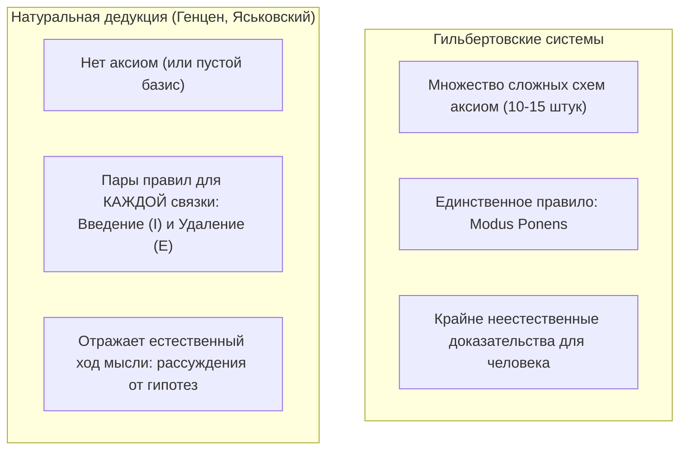
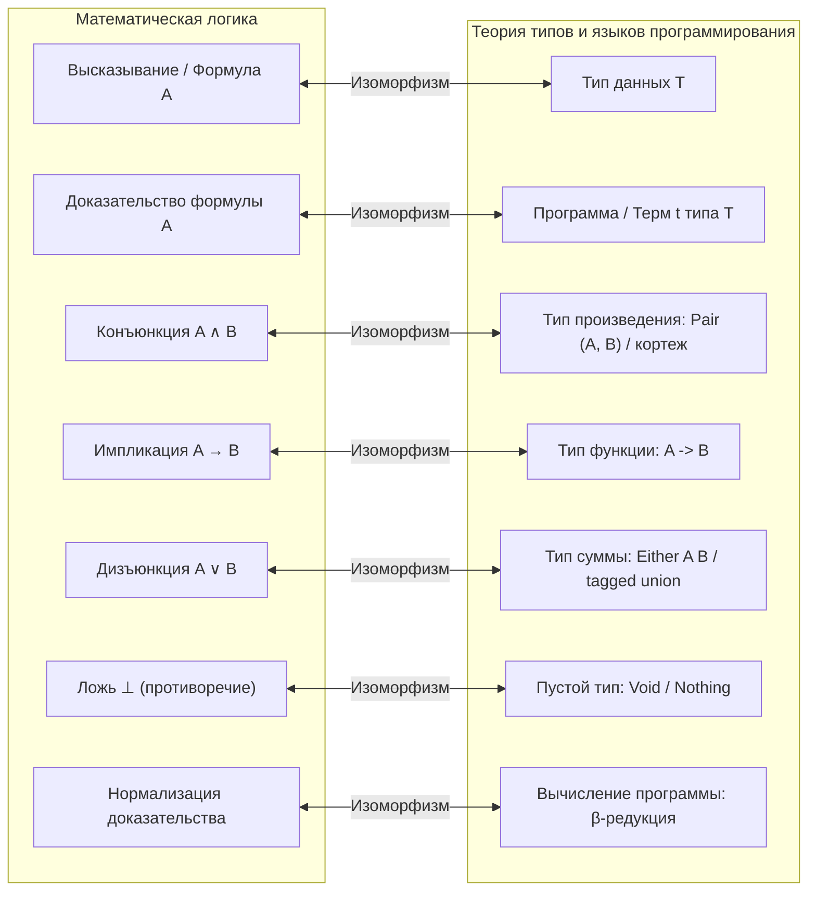
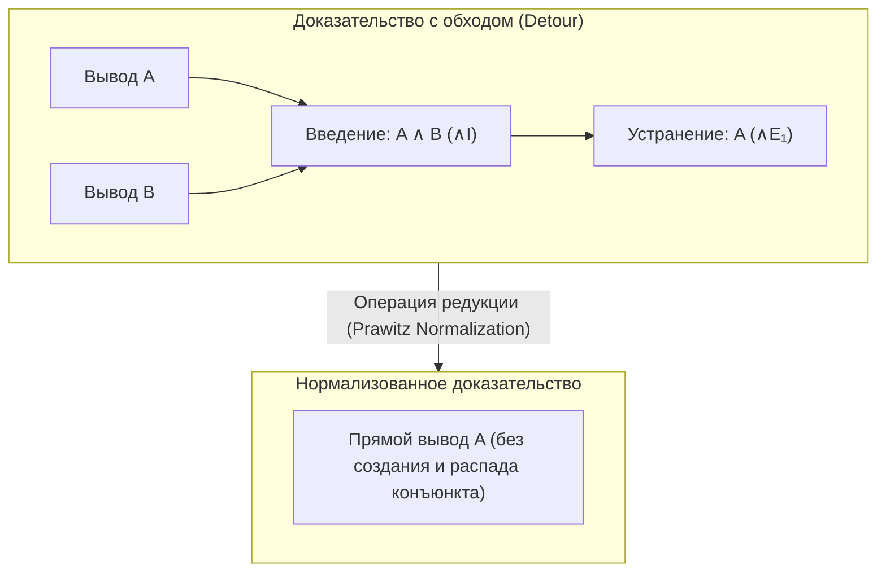
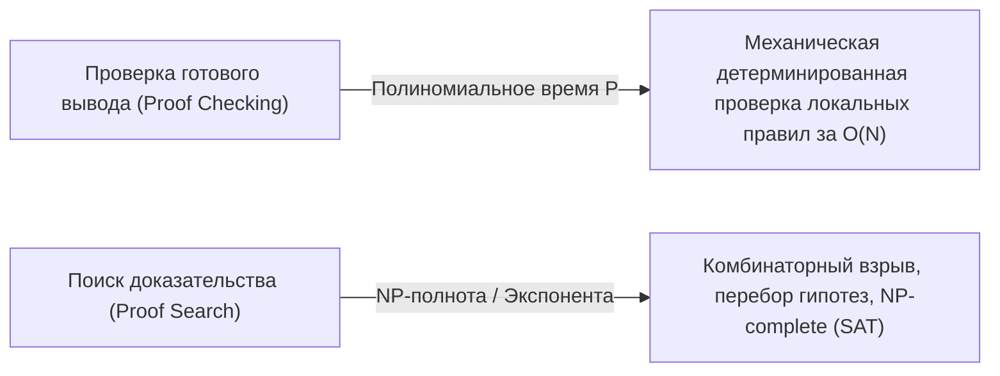
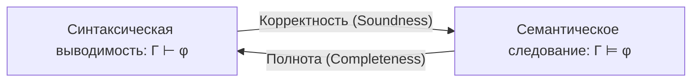

# Лекция 11: Натуральная дедукция: системы Генцена и Яськовского, нотация Фитча, изоморфизм Карри — Говарда, нормализация доказательств, теоремы о корректности, полноте и компактности

> **Дисциплина**: Дискретная математика  
> **Лектор**: Константин Чухарев (ФИТиП (ИС), Университет ИТМО, осенний семестр 2026)  
> **Ключевые темы**: Проблема неестественности систем гильбертовского типа, натуральная дедукция (Герхард Генцен, Станислав Яськовский, 1934–1935), нотация Фитча (контексты, subproofs, вертикальные границы, локальные гипотезы и их снятие), правила введения и устранения связок ($\wedge I, \wedge E_1, \wedge E_2, \vee I_1, \vee I_2, \vee E, \to I, \to E, \neg I, \neg E$), ложь $\bot$ и принцип взрыва ($\bot E$ / Ex Falso Quodlibet), интуиционистская логика (NJ) против классической (NK), закон исключенного третьего (LEM), снятие двойного отрицания (DNE) и косвенное доказательство (IP / Reductio ad Absurdum), принципиальное различие между $\neg I$ и IP, вычислительный смысл доказательств и изоморфизм Карри — Говарда (типы как формулы, $\lambda$-термы как доказательства, декартово произведение, дизъюнктное объединение, типы функций и пустой тип $\text{Void}$), нормализация доказательств (Даг Правич, 1965), устранение обходных путей (detours) и сечений (cut elimination), свойство подформульности (subformula property), алгоритмическая разрешимость проверки доказательства и нетривиальность поиска доказательства, синтаксическая выводимость ($\Gamma \vdash \varphi$) и семантическое следование ($\Gamma \models \varphi$), теорема о корректности (Soundness), понятие непротиворечивости, теорема о полноте (Completeness), лемма Линденбаума о максимальном непротиворечивом расширении, каноническая модель и лемма об истинности (Truth Lemma), вывод теоремы компактности из теоремы полноты и конечности формального вывода, архитектурное сравнение систем доказательств: системы Гильберта, натуральная дедукция и секвенциальное исчисление Генцена ($LK$ / $LJ$).

---

## 1. Рекомендуемая литература

* **Н. К. Верещагин, А. Шень — «Языки и исчисления»**  
  *Часть 1: «Исчисление высказываний» (§3: Исчисления гильбертовского типа и правила вывода; §4: Натуральное исчисление; §5: Полнота и корректность исчисления высказываний; §6: Интуиционистская логика).*
* **Ж.-И. Жирар, И. Лафон, П. Тейлор — «Proofs and Types» (Доказательства и типы)**  
  *Главы 1–3: «Натуральная дедукция», «Синтаксис исчисления предикатов и высказываний», «Изоморфизм Карри — Говарда», «Теорема о нормализации доказательств».*
* **Д. Правич (Dag Prawitz) — «Natural Deduction: A Proof-Theoretical Study»**  
  *Фундаментальная монография по теории доказательств, операциям редукции и теореме о нормализации.*
* **М. Хут, М. Райан — «Logic in Computer Science: Modelling and Reasoning about Systems»**  
  *Глава 1: «Propositional Logic» (§1.2: Natural deduction; rules for connectives, derived rules, provable equivalence; §1.4: Semantics, soundness, and completeness).*
* **Конспекты и материалы курса ФИТиП ИТМО (2026)**:
  * Слайды лекции 11: *«Натуральная дедукция. Логика высказываний: системы вывода»* (К. Чухарев).
  * Модули `m02` и `m03` учебной платформы ITMO IS.

---

## 2. Мотивация: Почему не системы Гильберта?

На предыдущих лекциях мы изучили семантику логики высказываний (таблицы истинности, булевы функции, выполнимость SAT, семантическое следование $\Gamma \models \varphi$). Однако проверка истинности через таблицы истинности требует экспоненциального перебора ($2^n$ строк). Встает задача построения **синтаксического вывода (исчисления)**: чисто символического манипулирования формулами по строгим механическим правилам ($\Gamma \vdash \varphi$).

Исторически первыми строгими формальными системами были **исчисления гильбертовского типа (системы Гильберта — Аккермана, Фреге, Рассела)**. 

### Архитектура гильбертовских систем
В системах Гильберта имеется:
1. **Обширный набор схем аксиом** (часто 10–15 сложных тавтологий, например:
   * $A \to (B \to A)$
   * $(A \to (B \to C)) \to ((A \to B) \to (A \to C))$
   * $\neg\neg A \to A$ и т. д.).
2. **Минимум правил вывода**: обычно всего одно правило — **Modus Ponens** (правило отделения):
   $$\frac{A \quad A \to B}{B}$$



### Главный изъян гильбертовских систем
Хотя гильбертовские системы математически просты для доказательства метатеорем (благодаря индукции всего по одному правилу вывода), строить реальные доказательства в них человеку **крайне тяжело и противоестественно**.

Даже тривиальнейшее утверждение $A \to A$ («из $A$ следует $A$») в системе Гильберта требует громоздкого искусственного трюка из 5 шагов с подстановкой гигантских аксиом:
1. $(A \to ((A \to A) \to A)) \to ((A \to (A \to A)) \to (A \to A))$ *(Аксиома 2)*
2. $A \to ((A \to A) \to A)$ *(Аксиома 1)*
3. $(A \to (A \to A)) \to (A \to A)$ *(Modus Ponens из 1 и 2)*
4. $A \to (A \to A)$ *(Аксиома 1)*
5. $A \to A$ *(Modus Ponens из 3 и 4)*

Ни один математик в здравом уме так не рассуждает! Человек доказывает $A \to A$ естественно:
> *«Предположим $A$. Тогда у нас есть $A$. Следовательно, из $A$ следует $A$.»*

Именно эту идею рассуждения **от временных гипотез с последующим их снятием (discharge)** реализовали независимо друг от друга в 1934–1935 годах немецкий математик **Герхард Генцен (Gerhard Gentzen)** и польский логик **Станислав Яськовский (Stanisław Jaśkowski)**, назвав её **натуральной дедукцией (Natural Deduction)**.

---

## 3. Нотация Фитча: Структура доказательства и контексты гипотез

Американский логик **Фредерик Фитч (Frederic Fitch)** в 1952 году предложил исключительно наглядную графическую систему записи натурального вывода, ставшую де-факто мировым стандартом в математической логике и Computer Science.

В нотации Фитча доказательство представляет собой вертикальную последовательность строк:
* Каждая строка нумеруется и содержит: `номер строки`, `формулу` и `обоснование (имя правила и ссылки на номера строк)`.
* **Вертикальная черта слева** обозначает область видимости (scope) гипотезы (или текущий контекст).
* **Горизонтальная черта** отделяет принятую гипотезу от следствий, выводимых внутри данного контекста.

```
│ 1. P             Гипотеза
│ ────
│ 2. Q             Обоснование
│ │ 3. R           Вложенная гипотеза (subproof)
│ │ ────
│ │ 4. S           Обоснование
│ 5. R → S         Введение импликации (закрытие subproof, гипотеза R снята!)
```

### Фундаментальные принципы видимости в нотации Фитча
1. **Открытие гипотезы (Subproof)**: в любой момент доказательства разрешается открыть вложенный блок рассуждений и выдвинуть произвольное предположение $A$.
2. **Изоляция контекста**: всё, что выведено внутри блока с предположением $A$, опирается на истинность $A$.
3. **Закрытие гипотезы (Discharge)**: когда блок закрывается, гипотеза $A$ **снимается**. Полученный результат (например, импликация $A \to B$) экспортируется во внешний контекст.
4. **Запрет утечки гипотез (Lexical Scoping)**: формулы, находившиеся внутри закрытого блока, становятся недоступными снаружи! Нельзя ссылаться на строку из завершенного subproof.

> [!NOTE] **Аналогия с программированием: Лексическая область видимости (Scope)**  
> Subproof в натуральной дедукции в точности эквивалентен блоку `{ ... }` или телу локальной функции в языках программирования:
> * Гипотеза $A$ — это аргумент функции `fn(x: A)`.
> * Логический вывод внутри блока — это локальные вычисления.
> * Закрытие блока — это возвращение результата наружному коду. Локальные переменные уничтожаются при выходе из стека вызовов!

---

## 4. Правила вывода: Введение и Устранение связок

В натуральной дедукции каждая логическая связка определяется **симметричной парой правил**:
* **Правило введения (Introduction, $I$)**: показывает, как построить (доказать) формулу с данной главной связкой.
* **Правило устранения / удаления (Elimination, $E$)**: показывает, как использовать (разобрать) формулу с данной связкой для извлечения информации.

Рассмотрим правила для всех базовых связок пропозициональной логики.

---

### 4.1. Конъюнкция ($\wedge$)

Конъюнкция отражает одновременную истинность двух высказываний.

#### Правило введения конъюнкции ($\wedge I$)
Чтобы доказать $A \wedge B$, необходимо иметь доказательство $A$ и доказательство $B$:
$$\frac{A \quad B}{A \wedge B} \; (\wedge I)$$

В нотации Фитча:
```
│ k. A          Обоснование
│ m. B          Обоснование
│ n. A ∧ B      ∧I, k, m
```

#### Правила устранения конъюнкции ($\wedge E_1$ и $\wedge E_2$)
Из конъюнкции $A \wedge B$ разрешается извлечь любой из её конъюнктов:
$$\frac{A \wedge B}{A} \; (\wedge E_1) \qquad \frac{A \wedge B}{B} \; (\wedge E_2)$$

В нотации Фитча:
```
│ k. A ∧ B      Обоснование
│ m. A          ∧E₁, k
│ n. B          ∧E₂, k
```

---

### 4.2. Импликация ($\to$)

Импликация моделирует условное рассуждение: «если дано $A$, то верно $B$».

#### Правило введения импликации ($\to I$)
Чтобы доказать $A \to B$, мы временно предполагаем $A$, выводим внутри этого предположения $B$, после чего закрываем контекст и заключаем $A \to B$ (гипотеза $A$ снимается):
$$\frac{\begin{matrix} [A] \\ \vdots \\ B \end{matrix}}{A \to B} \; (\to I)$$

В нотации Фитча:
```
│ │ 1. A        Гипотеза
│ │ ────
│ │ ...
│ │ k. B        Вывод B внутри гипотезы A
│ m. A → B      →I, 1–k  (гипотеза A снята!)
```

#### Пример 1: Доказательство закона рефлексивности $P \to P$
```
│ │ 1. P        Гипотеза
│ │ ────
│ │ 2. P        Повторение (Reiteration), 1
│ 3. P → P      →I, 1–2
```
*Сравните с 5-шаговым кошмаром системы Гильберта!*

#### Правило устранения импликации ($\to E$ / Modus Ponens)
Если доказано, что из $A$ следует $B$, и доказано само $A$, то мы получаем $B$:
$$\frac{A \quad A \to B}{B} \; (\to E)$$

В нотации Фитча:
```
│ k. A → B      Обоснование
│ m. A          Обоснование
│ n. B          →E, k, m
```

---

### 4.3. Дизъюнкция ($\vee$)

Дизъюнкция моделирует логическое «или».

#### Правила введения дизъюнкции ($\vee I_1$ и $\vee I_2$)
Если доказано утверждение $A$, то верно и $A \vee B$ (для любого произвольного высказывания $B$):
$$\frac{A}{A \vee B} \; (\vee I_1) \qquad \frac{B}{A \vee B} \; (\vee I_2)$$

В нотации Фитча:
```
│ k. A          Обоснование
│ m. A ∨ B      ∨I₁, k
│ n. C ∨ A      ∨I₂, k
```

#### Правило устранения дизъюнкции ($\vee E$ / Разбор случаев)
Если известно, что истинно $A \vee B$, и мы показали, что цель $C$ выводится как из предположения $A$, так и из предположения $B$, то утверждение $C$ истинно безусловно:
$$\frac{A \vee B \quad \begin{matrix} [A] \\ \vdots \\ C \end{matrix} \quad \begin{matrix} [B] \\ \vdots \\ C \end{matrix}}{C} \; (\vee E)$$

В нотации Фитча открываются **два параллельных подвывода**:
```
│ 1. A ∨ B      Обоснование
│ ────
│ │ 2. A        Гипотеза 1
│ │ ────
│ │ 3. C        Вывод C из A
│ 
│ │ 4. B        Гипотеза 2
│ │ ────
│ │ 5. C        Вывод C из B
│ 
│ 6. C          ∨E, 1, 2–3, 4–5
```

---

### 4.4. Ложь ($\bot$), Отрицание ($\neg$) и Принцип взрыва

Символ $\bot$ («ботум», ложь, абсурд) обозначает тождественно ложное высказывание или логическое противоречие.

#### Устранение противоречия / Введение лжи ($\neg E$)
Если у нас одновременно выведены формула $A$ и её отрицание $\neg A$, возникает противоречие:
$$\frac{A \quad \neg A}{\bot} \; (\neg E)$$

#### Введение отрицания ($\neg I$)
Если предположение $A$ привело к противоречию ($\bot$), значит, предположение неверно: гипотеза $A$ снимается, и мы заключаем $\neg A$:
$$\frac{\begin{matrix} [A] \\ \vdots \\ \bot \end{matrix}}{\neg A} \; (\neg I)$$

В нотации Фитча:
```
│ │ 1. A        Гипотеза
│ │ ────
│ │ ...
│ │ k. ⊥        Получено противоречие!
│ m. ¬A         ¬I, 1–k  (гипотеза A снята)
```

#### Принцип взрыва ($\bot E$ / Ex Falso Quodlibet / Absurdity Rule)
В классической и интуиционистской логике из противоречия следует абсолютно всё что угодно:
$$\frac{\bot}{A} \; (\bot E)$$
> *«Ex falso sequitur quodlibet»* (лат. «Из лжи следует всё что угодно»). Если мир противоречив, в нём истинна любая теорема.

---

## 5. Интуиционистская логика (NJ) против Классической логики (NK)

Все правила, перечисленные выше ($\wedge I, \wedge E, \to I, \to E, \vee I, \vee E, \neg I, \neg E, \bot E$), образуют **интуиционистскую систему натуральной дедукции (NJ — Natürliche Junktoren-Logik)**.

Интуиционистская логика требует **конструктивности**: доказательство формулы должно представлять собой эффективный метод её построения. Например:
* Доказать $A \vee B$ интуиционистски — значит указать, *какой именно* из членов верен ($A$ или $B$), и предъявить его доказательство.
* Доказать $\exists x P(x)$ — значит явно сконструировать свидетель $x_0$ и доказать $P(x_0)$.

### Правило косвенного доказательства (IP) и классическая дедукция (NK)
В классической логике (система **NK**) к правилам NJ добавляется закон косвенного доказательства (рассуждение от противного):

#### Правило косвенного доказательства (IP — Indirect Proof / Reductio ad Absurdum)
Чтобы доказать утверждение $A$, мы предполагаем его отрицание $\neg A$. Если это приводит к противоречию $\bot$, мы снимаем гипотезу $\neg A$ и заключаем $A$:
$$\frac{\begin{matrix} [\neg A] \\ \vdots \\ \bot \end{matrix}}{A} \; (IP)$$

```
│ │ 1. ¬A       Гипотеза (рассуждение от противного)
│ │ ────
│ │ ...
│ │ k. ⊥        Противоречие!
│ m. A          IP, 1–k  (гипотеза ¬A снята)
```

### Фундаментальное отличие между $\neg I$ и $IP$

Это тончайший концептуальный момент математической логики, на котором спотыкаются многие студенты:

| Критерий | Введение отрицания ($\neg I$) | Косвенное доказательство ($IP$) |
| :--- | :--- | :--- |
| **Гипотеза subproof** | Предполагается **утвердительная** форма $A$ | Предполагается **отрицание** $\neg A$ |
| **Заключение** | Получаем **отрицание** $\neg A$ | Получаем **положительную** формулу $A$ |
| **Статус в логике** | **Конструктивно** (входит в интуиционистскую систему NJ) | **Неконструктивно** (принадлежит только классической системе NK) |
| **Смысл** | Мы опровергли гипотезу $A$, доказав, что она невозможна. | Мы доказали бытие объекта $A$, не предъявив его конструкции, лишь показав невозможность его отсутствия. |

> [!WARNING] **Эквивалентность классических аксиом**  
> В присутствии интуиционистских правил следующие три принципа взаимно выводимы и равносильны:
> 1. **IP (Indirect Proof)**: из $[\neg A \vdash \bot]$ выводится $A$.
> 2. **DNE (Double Negation Elimination — Снятие двойного отрицания)**: $\frac{\neg\neg A}{A}$.
> 3. **LEM (Law of Excluded Middle — Закон исключенного третьего)**: $A \vee \neg A$.

---

## 6. Изоморфизм Карри — Говарда (Curry-Howard Correspondence)

Связь между математической логикой и Computer Science — одно из глубочайших открытий XX века. В 1934–1969 годах американский математик **Хаскелл Карри** и логик **Уильям Говард** сформулировали фундаментальный принцип:

$$\mathbf{Формулы \equiv Типы \quad \Longleftrightarrow \quad Доказательства \equiv Программы}$$



### Таблица соответствия Карри — Говарда

| Логическая конструкция (NJ) | Конструкция языка программирования / $\lambda$-исчисления | Пояснение в терминах типов |
| :--- | :--- | :--- |
| **Высказывание $A$** | Тип данных `A` | Доказать $A$ — значит сконструировать значение типа `A`. |
| **Конъюнкция $A \wedge B$** | Тип пары `(A, B)` (Product type) | Чтобы предъявить пару, нужны оба компонента. |
| **Правило $\wedge I$** | Конструктор пары `(a, b)` | Объединение двух значений в пару. |
| **Правило $\wedge E_1, \wedge E_2$** | Проекции `fst(p)`, `snd(p)` | Извлечение левого или правого элемента. |
| **Импликация $A \to B$** | Функция `A -> B` (Function type) | Метод преобразования свидетеля $A$ в свидетель $B$. |
| **Правило $\to I$** | $\lambda$-абстракция `\x -> t` | Определение функции с аргументом `x : A`. |
| **Правило $\to E$ (Modus Ponens)** | Применение функции `f x` (Application) | Вызов функции на аргументе. |
| **Дизъюнкция $A \vee B$** | Тип суммы `Either A B` (Sum / Variant) | Значение либо типа `A`, либо типа `B`. |
| **Правило $\vee I_1, \vee I_2$** | Конструкторы `Left a`, `Right b` | Упаковка значения в левую или правую ветвь. |
| **Правило $\vee E$** | Сопоставление с образцом `case e of ...` | Разбор вариантов `Left(x) => ... | Right(y) => ...`. |
| **Ложь $\bot$** | Необитаемый тип `Void` / `Never` | Тип, у которого принципиально нет значений. |
| **Правило взрыва $\bot E$** | Функция `absurd : Void -> T` | Из недостижимого состояния можно вернуть любой тип. |

> [!TIP] **Компьютерная верификация доказательств (Proof Assistants)**  
> Благодаря изоморфизму Карри — Говарда современные интерактивные доказатели теорем (**Coq, Lean 4, Agda, Isabelle/HOL**) — это просто языки программирования с развитой зависимой системой типов!  
> Написание математического доказательства в Lean 4 в точности эквивалентно написанию программы, а проверка корректности доказательства сводится к обычной проверке типов (type checking) компилятором.

---

## 7. Нормализация доказательств и устранение сечений (Cut Elimination)

В 1935 году Герхард Генцен доказал фундаментальную теорему об устранении сечений (*Hauptsatz*), а в 1965 году Даг Правич адаптировал её для натуральной дедукции в виде **теоремы о нормализации**.

### Что такое «обходной путь» (Detour / Cut)?
В доказательстве возникает обходной путь, если мы **вводим** логическую связку, а затем **сразу же её устраняем**.

#### Пример 1: Обход конъюнкции ($\wedge$)
Пусть у нас есть вывод $A$ и вывод $B$. Мы применили $\wedge I$, получив $A \wedge B$, а на следующем шаге применили $\wedge E_1$, чтобы извлечь $A$:
$$\frac{\dfrac{A \quad B}{A \wedge B} \; (\wedge I)}{A} \; (\wedge E_1) \quad \Longrightarrow \quad \text{Редукция: сразу взять } A!$$

#### Пример 2: Обход импликации ($\to$)
Мы построили функцию $\lambda x. t$ по правилу $\to I$, а затем немедленно применили её к аргументу $u$ по правилу $\to E$:
$$\frac{\dfrac{[A] \vdash B}{A \to B} \; (\to I) \quad u : A}{B} \; (\to E) \quad \Longrightarrow \quad \text{Редукция: подставить } u \text{ вместо гипотезы } A \text{ в вывод } B!$$

В $\lambda$-исчислении эта редукция доказательства в точности равна **$\beta$-редукции**:
$$(\lambda x. t) \, u \;\longrightarrow_\beta\; t[x := u]$$



### Теорема о нормализации (Даг Правич, 1965)
> **Теорема (Сильная нормализация)**:
> 1. Всякое доказательство в натуральной дедукции логики высказываний может быть за конечное число шагов редукции приведено к **нормальной форме** (в которой отсутствуют обходные пути).
> 2. Процесс редукции доказательств завершается независимо от порядка применения правил (свойство сильной нормализации и конфлюэнтности Чёрча — Россера).

### Следствие: Свойство подформульности (Subformula Property)
> [!IMPORTANT] **Свойство подформульности**  
> В нормализованном доказательстве в натуральной дедукции (без использования классического IP) **каждая формула, встречающаяся в доказательстве, является подформулой либо одной из посылок $\Gamma$, либо заключения $\varphi$!**

#### Колоссальное следствие для Computer Science:
Свойство подформульности радикально сужает пространство поиска доказательств! Если мы ищем вывод формулы $\varphi$, нам не нужно перебирать бесконечное множество произвольных формул мира: достаточно строить доказательство исключительно из «кирпичиков» — подформул самой цели $\varphi$. Это делает поиск вывода в пропозициональной логике алгоритмически разрешимым.

---

## 8. Проверка vs Поиск доказательства

В теории сложности вычислений и автоматическом доказательстве теорем существует фундаментальная асимметрия:



1. **Проверка доказательства — детерминированная механическая процедура сложности $O(N)$**:
   * Каждая строка содержит явную ссылку на номера предшествующих строк и имя правила.
   * Алгоритм проверяет: действительно ли формула в строке $k$ получается из указанных строк по правилу $R$.
   * Проверка каждого шага выполняется за константное (или линейное от длины формул) время. С этим легко справляется простейший скрипт.
2. **Поиск доказательства — сложнейшая алгоритмическая задача (NP-полная)**:
   * На каждом шаге поиска неизвестно, какое правило применить: разбить ли дизъюнкцию, выдвинуть ли гипотезу от противного, применить ли транзитивность.
   * Количество ветвей в дереве поиска растет экспоненциально, порождая комбинаторный взрыв.

---

## 9. Теоремы о корректности и полноте

Формальная логика связывает два параллельных мира:
* **Семантика (Истина)**: $\Gamma \models \varphi$ (формула $\varphi$ истинна во всех интерпретациях, где истинны все формулы множества $\Gamma$).
* **Синтаксис (Выводимость)**: $\Gamma \vdash \varphi$ (существует конечный формальный вывод формулы $\varphi$ из посылок $\Gamma$ по правилам натуральной дедукции).



### 9.1. Теорема о корректности (Soundness)
> **Теорема 1 (Корректность натуральной дедукции)**:  
> Если формула $\varphi$ выводима из множества посылок $\Gamma$ в натуральной дедукции ($\Gamma \vdash \varphi$), то $\varphi$ семантически следует из $\Gamma$ ($\Gamma \models \varphi$).  
> В частности, если $\vdash \varphi$ (выводима без посылок), то $\varphi$ — тавтология ($\models \varphi$).

#### Идея доказательства:
Доказывается индукцией по длине (или по дереву) вывода.  
*База индукции*: гипотезы из $\Gamma$. Очевидно, если $\nu$ удовлетворяет $\Gamma$, то $\nu(\psi) = 1$ для всякой $\psi \in \Gamma$.  
*Индукционный переход*: проверяется, что **каждое** правило вывода сохраняет семантическую истинность:
* Для $\wedge I$: если $\nu \models A$ и $\nu \models B$, то $\nu(A \wedge B) = \min(1, 1) = 1$.
* Для $\to I$: subproof гарантирует, что при добавлении $A$ к посылкам истинно $B$. По семантической теореме о дедукции это эквивалентно $\nu \models A \to B$.
* Для $\vee E$, $\neg I$, $IP$: аналогичная проверка сохранения истинности.

Следовательно, никакое формальное доказательство не может породить ложь из истины. Натуральная дедукция не выводит ложных теорем.

---

### 9.2. Теорема о полноте (Completeness)
> **Теорема 2 (Полнота натуральной дедукции)**:  
> Если формула $\varphi$ семантически следует из множества посылок $\Gamma$ ($\Gamma \models \varphi$), то формула $\varphi$ синтаксически выводима из $\Gamma$ ($\Gamma \vdash \varphi$).

Теорема полноты утверждает: **наших правил вывода абсолютно достаточно!** Любая семантическая истина может быть строго доказана чисто механическим применением правил.

#### Доказательство через непротиворечивость и Лемму Линденбаума:
Доказательство от противного: пусть $\Gamma \models \varphi$, но $\Gamma \not\vdash \varphi$.

1. **Непротиворечивость**:
   Множество формул $\Delta$ называется *непротиворечивым*, если из него нельзя вывести ложь: $\Delta \not\vdash \bot$.  
   Если $\Gamma \not\vdash \varphi$, то множество $\Gamma \cup \{\neg\varphi\}$ является непротиворечивым (иначе, если бы $\Gamma \cup \{\neg\varphi\} \vdash \bot$, то по правилу $IP$ мы получили бы $\Gamma \vdash \varphi$, что противоречит предположению).
2. **Лемма Линденбаума (Lindenbaum's Lemma)**:
   > Всякое непротиворечивое множество формул $\Delta$ можно расширить до **максимального непротиворечивого множества** $\Delta^*$.
   
   *Построение*: перенумеруем все формулы языка логики высказываний: $\psi_1, \psi_2, \psi_3, \dots$  
   Индуктивно определяем цепочку множеств:
   * $\Delta_0 = \Delta$.
   * $\Delta_{n+1} = \begin{cases} \Delta_n \cup \{\psi_{n+1}\}, & \text{если } \Delta_n \cup \{\psi_{n+1}\} \text{ непротиворечиво}, \\ \Delta_n \cup \{\neg\psi_{n+1}\}, & \text{иначе.} \end{cases}$  
   Положим $\Delta^* = \bigcup_{n=0}^\infty \Delta_n$.  
   Множество $\Delta^*$ обладает уникальными свойствами: для любой формулы $\psi$ ровно одна из формул $\psi$ или $\neg\psi$ принадлежит $\Delta^*$, и $\Delta^*$ замкнуто относительно выводимости.
3. **Построение канонической модели (Truth Lemma)**:
   Зададим оценку пропозициональных переменных $\nu : V \to \{0, 1\}$ формулой:
   $$\nu(p) = 1 \iff p \in \Delta^*$$
   Структурной индукцией по построению формулы доказывается **Лемма об истинности**:
   $$\text{Для любой формулы } \psi: \quad \nu(\psi) = 1 \iff \psi \in \Delta^*$$
4. **Противоречие**:
   Так как $\Gamma \cup \{\neg\varphi\} \subseteq \Delta^*$, оценка $\nu$ обращает в истину все формулы $\Gamma$, но при этом $\nu(\neg\varphi) = 1$, откуда $\nu(\varphi) = 0$.  
   Следовательно, нашлась оценка $\nu$, при которой $\Gamma$ истинно, а $\varphi$ ложно! Это означает, что $\Gamma \not\models \varphi$, что прямо противоречит исходному условию $\Gamma \models \varphi$.  
   Противоречие доказывает, что $\Gamma \vdash \varphi$. $\blacksquare$

---

## 10. Теорема компактности как следствие теоремы полноты

На лекции 10 мы доказали теорему компактности семантически через лемму Кёнига о бесконечном дереве. Теперь мы можем получить **потрясающе элегантное и короткое доказательство теоремы компактности чисто логическим путем** — как тривиальное следствие полноты!

> **Теорема компактности логики высказываний**:  
> Множество формул $\Gamma$ выполнимо тогда и только тогда, когда выполнимо любое его конечное подмножество $\Gamma_0 \subseteq \Gamma$.

### Доказательство:
1. Направление $(\Rightarrow)$ очевидно: если существует оценка $\nu$, удовлетворяющая всему $\Gamma$, то она удовлетворяет и любому подмножеству $\Gamma_0 \subseteq \Gamma$.
2. Докажем $(\Leftarrow)$ от противного. Пусть любое конечное подмножество $\Gamma_0 \subseteq \Gamma$ выполнимо, но само множество $\Gamma$ невыполнимо.
3. Если $\Gamma$ невыполнимо, то из $\Gamma$ семантически следует абсолютно любая формула, в частности противоречие:
   $$\Gamma \models \bot$$
4. В силу **теоремы о полноте** натуральной дедукции (Теорема 2):
   $$\Gamma \models \bot \implies \Gamma \vdash \bot$$
5. Но **всякий формальный вывод по своей природе конечен**! Вывод формулы $\bot$ состоит из конечного числа строк $k$. В этих $k$ строках может быть использовано лишь **конечное число посылок** из множества $\Gamma$. Обозначим это конечное множество использованных посылок через $\Gamma_0 \subset \Gamma$.
6. Значит, противоречие выводимо уже из конечного подмножества:
   $$\Gamma_0 \vdash \bot$$
7. Теперь применяем **теорему о корректности** (Теорема 1):
   $$\Gamma_0 \vdash \bot \implies \Gamma_0 \models \bot$$
8. Но $\Gamma_0 \models \bot$ означает, что конечное подмножество $\Gamma_0$ **невыполнимо**!
9. Мы получили прямое противоречие с условием, что *каждое* конечное подмножество выполнимо.
10. Следовательно, предположение неверно, и всё множество $\Gamma$ выполнимо! $\blacksquare$

> [!NOTE] **Красота математики**  
> Компактность семантики ($\models$) возникает как прямое отражение **физической конечности любого синтаксического доказательства** ($\vdash$)! Доказательство не может быть бесконечным, следовательно, свидетель противоречия всегда локализован в конечном подмножестве аксиом.

---

## 11. Сравнительная архитектура систем доказательств

В современной математической логике сосуществуют три великие парадигмы дедуктивных систем:

| Критерий сравнения | Системы Гильберта ($H$) | Натуральная дедукция Генцена ($ND$ / Fitch) | Секвенциальное исчисление Генцена ($LK$ / $LJ$) |
| :--- | :--- | :--- | :--- |
| **Базовый объект вывода** | Отдельная формула $A$ | Формула $A$ в контексте открытых гипотез | Секвенция $\Gamma \vdash \Delta$ (метаутверждение) |
| **Аксиомы** | Множество сложных схем аксиом | Нет (или тривиальное $A \vdash A$) | Базовая секвенция $A \vdash A$ |
| **Правила вывода** | Modus Ponens (1–2 правила) | Введение ($I$) и Устранение ($E$) для каждой связки | Левые ($L$) и правые ($R$) правила для связок + правило сечения (Cut) |
| **Удобство для человека** | Крайне неудобно | **Идеально** (естественный ход мысли, subproofs) | Среднее (симметричные деревья) |
| **Связь с программированием** | Комбинаторная логика (комбинаторы $S, K, I$) | **Лямбда-исчисление** и теория типов (Карри — Говард) | Модели параллельных вычислений, абстрактные машины |
| **Применение** | Металогика, минимальные аксиоматики | Интерактивные пруф-ассистенты (Lean, Coq) | **Автоматические доказатели (SAT/SMT, Resolution)** |

---

## 12. Резюме лекции

1. **Натуральная дедукция** устраняет противоестественность систем Гильберта, позволяя выдвигать временные локальные гипотезы с их последующим корректным снятием.
2. **Нотация Фитча** формализует доказательство через вертикальные контексты (subproofs), запрещая несанкционированную утечку гипотез за границы их видимости.
3. Каждая логическая связка управляется симметричной парой: **правило введения ($I$)** и **правило устранения ($E$)**.
4. **Интуиционистская логика (NJ)** требует конструктивности доказательств. Добавление правила косвенного доказательства ($IP$) или снятия двойного отрицания (DNE) порождает **классическую логику (NK)**.
5. Правило $\neg I$ (конструктивное опровержение гипотезы $A$) принципиально отличается от $IP$ (неконструктивное обоснование $A$ через противоречивость $\neg A$).
6. **Изоморфизм Карри — Говарда** устанавливает тождество между логикой и информатикой: высказывания — это типы данных, доказательства — программы, а упрощение доказательств — вычисление ($\beta$-редукция).
7. **Теорема о нормализации** гарантирует устранение обходных путей. Нормализованные выводы обладают **свойством подформульности**, что лежит в основе алгоритмов поиска доказательств.
8. **Теорема корректности** ($\Gamma \vdash \varphi \implies \Gamma \models \varphi$) и **теорема полноты** ($\Gamma \models \varphi \implies \Gamma \vdash \varphi$) подтверждают абсолютную адекватность натуральной дедукции.
9. **Теорема компактности** тривиально выводится из полноты благодаря фундаментальному свойству доказательств — их конечной длине.
