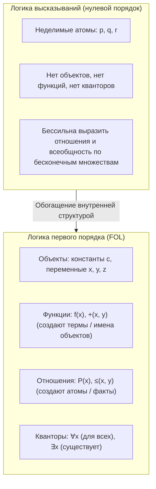
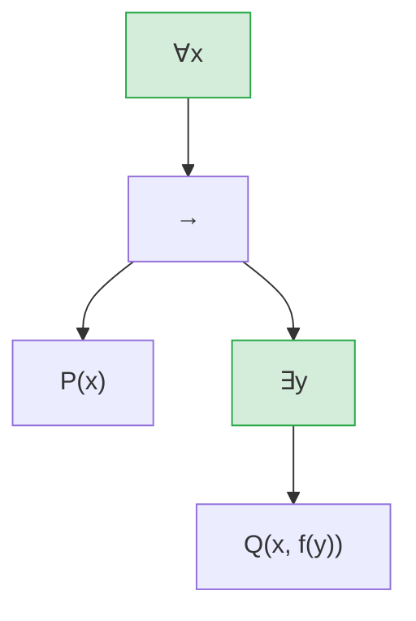
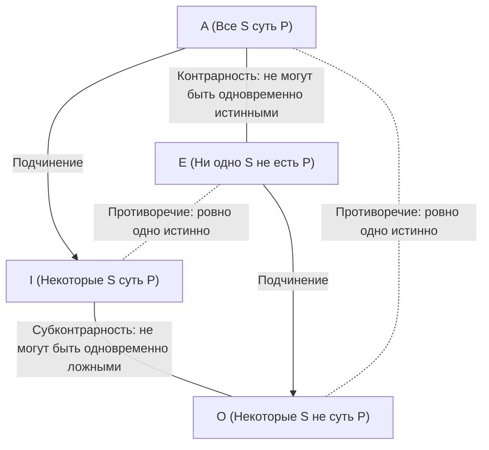

# Лекция 12: Логика первого порядка: язык, семантика, метатеория, нормальные формы и силлогистика Аристотеля

> **Дисциплина**: Дискретная математика  
> **Лектор**: Константин Чухарев (ФИТиП (ИС), Университет ИТМО, осенний семестр 2026)  
> **Ключевые темы**: Ограниченность логики высказываний и необходимость языка первого порядка (FOL / First-Order Logic), сигнатура $\Sigma = (C, F, R)$ (константы, функциональные и предикатные символы, арности), множество предметных переменных $\text{Var}$, индуктивное определение термов и атомов, синтаксис правильно построенных формул (WFF), дерево разбора формулы, свободные и связанные вхождения переменных, область действия квантора (scope), замкнутые формулы (предложения / sentences), операция подстановки терма $\varphi[x := t]$, захват переменной (variable capture) и корректная свободная подстановка, $\alpha$-конверсия (переименование связанных переменных), семантика: структура (интерпретация) $\mathcal{I} = (D, \cdot^\mathcal{I})$, носитель (домен) $D$, оценка переменных $\nu: \text{Var} \to D$, значение терма $\llbracket t \rrbracket_\nu^\mathcal{I}$, отношение истинности формулы в модели $\mathcal{I}, \nu \models \varphi$, кванторы как обобщенные булевы операции на конечных доменах ($\forall \sim \wedge$, $\exists \sim \vee$), лемма о совпадении оценок (Coincidence Lemma), свидетели и контрпримеры, общезначимость ($\models \varphi$) и выполнимость, законы кванторов (отрицание кванторов, законы распределения по связкам, перенос квантора через связки, квантор в посылке импликации), реализация интерпретатора формул на Rust (`type Env`, `enum F`, функция `ev`), метатеория: правила вывода кванторов в натуральной дедукции ($\forall I, \forall E, \exists I, \exists E$), условия свежести параметров и свободы подстановки, теории и модели ($\mathcal{I} \models \Gamma$), теорема Гёделя о полноте логики первого порядка (1930), метод Хенкина (теория со свидетелями, каноническая терм-модель, фактор-пространство по доказуемому равенству $t \equiv_T t'$, лемма об истинности / Truth Lemma), алгоритмическая полуразрешимость (перебор выводов), теорема Чёрча — Тьюринга о неразрешимости проблемы общезначимости FOL (1936), теорема компактности первого порядка (Мальцев, Гёдель), существование нестандартных моделей арифметики ($c > S^n(0)$), теорема Лёвенгейма — Сколема (восходящая и нисходящая части), парадокс Сколема, логика первого против логики второго порядка (схема индукции против квантора $\forall P$, категоричность теории Пеано второго порядка против некатегоричности первого порядка, потеря компактности во втором порядке), нормальные формы: предварённая нормальная форма (ПНФ / Prenex Normal Form), алгоритм приведения к ПНФ, сколемизация (устранение $\exists$, сколемовские константы и функции, сохранение выполнимости), метод резолюций в логике первого порядка, силлогистика Аристотеля («Органон», IV в. до н.э.), субъект $S$, предикат $P$, средний термин $M$, 4 типа категорических суждений ($A, E, I, O$), круги Эйлера, логический квадрат оппозиций, проблема экзистенциального допущения (пустой субъект, пример с «единорогами»), 4 фигуры и 19 правильных модусов силлогизма (Barbara, Celarent, Darii), трансляция силлогистики в логику первого порядка.

---

> [!TIP] Практика и домашнее задание к лекции
> Материалы домашнего задания с подробными решениями и задачами для самопроверки:
> - 📝 [ДЗ Логика первого порядка (лекция 12).md](./%D0%94%D0%97%20%D0%9B%D0%BE%D0%B3%D0%B8%D0%BA%D0%B0%20%D0%BF%D0%B5%D1%80%D0%B2%D0%BE%D0%B3%D0%BE%20%D0%BF%D0%BE%D1%80%D1%8F%D0%B4%D0%BA%D0%B0%20%28%D0%BB%D0%B5%D0%BA%D1%86%D0%B8%D1%8F%2012%29.md)

---

## 1. Рекомендуемая литература

* **Н. К. Верещагин, А. Шень — «Языки и исчисления»**  
  *Часть 2: «Исчисление предикатов» (§1: Язык логики первого порядка; §2: Семантика, модели, истинность; §3: Исчисление предикатов, теорема о полноте; §4: Теорема компактности и нестандартные модели; §5: Теорема Лёвенгейма — Сколема).*
* **Э. Мендельсон — «Введение в математическую логику»**  
  *Глава 2: «Исчисление предикатов первого порядка» (Синтаксис, структуры, выполнимость, теорема Гёделя о полноте, модели арифметики).*
* **Ф. А. Новиков — «Дискретная математика для программистов»**  
  *Глава 2: «Математическая логика» (§2.2: Логика предикатов, предваренная форма, метод резолюций).*
* **Учебные материалы курса ФИТиП ИТМО (2026)**:
  * Модуль `m03`: разделы *«Термы и формулы»*, *«Семантика: модели и истинность»*, *«Распределение и перенос кванторов»*, *«Сколемизация»*, *«Силлогистика Аристотеля»*, *«Полнота и компактность»*, *«Лёвенгейм — Сколем»*.
  * Слайды лекции 12: *«Логика первого порядка»* (К. Чухарев).

---

## 2. Мотивация: Зачем нужен язык первого порядка?

Логика высказываний (пропозициональная логика), изученная нами на предыдущих лекциях, рассматривает элементарные высказывания как неделимые «чёрные ящики» (пропозициональные переменные $p, q, r$). Она не видит внутренней структуры объектов, их параметров, свойств и отношений.

### Проблема выражения всеобщности в логике высказываний
Рассмотрим классическое математическое утверждение:
> *«Каждое натуральное число либо чётно, либо нечётно».*

В логике высказываний для каждого натурального числа $n \in \mathbb{N}$ пришлось бы вводить отдельный пропозициональный атом:
$$p_0 = \text{«0 чётно»}, \quad q_0 = \text{«0 нечётно»}, \quad p_1 = \text{«1 чётно»}, \quad \dots$$
И записывать формулу как бесконечную конъюнкцию:
$$(p_0 \vee q_0) \wedge (p_1 \vee q_1) \wedge (p_2 \vee q_2) \wedge \cdots$$
Но в синтаксисе логики **формула обязана быть конечной цепочкой символов**! Записать бесконечную формулу невозможно. В логике высказываний одно общее математическое утверждение распадается на бесконечное семейство не связанных между собой символов.

В **логике первого порядка (First-Order Logic, FOL)** это фундаментальное утверждение записывается в одну элегантную строчку конечной длины:
$$\forall x . \big(\operatorname{Even}(x) \vee \operatorname{Odd}(x)\big)$$



---

## 3. Синтаксис логики первого порядка: Сигнатура, термы и формулы

Синтаксис логики первого порядка строго разделяется на три уровня:
1. **Словарь (Сигнатура $\Sigma$)**: имена констант, операций и предикатов.
2. **Термы (Terms)**: синтаксические выражения, обозначающие *объекты* предметного домена.
3. **Формулы (Formulas)**: синтаксические выражения, обозначающие *высказывания (истину или ложь)*.

---

### 3.1. Сигнатура $\Sigma$
> [!NOTE] **Определение 1 (Сигнатура)**  
> **Сигнатурой** $\Sigma$ называется тройка попарно непересекающихся множеств $\Sigma = (C, F, R)$:
> * $C$ — множество символов **констант** (имена фиксированных объектов).
> * $F$ — множество символов **функций (операций)**, каждому символу $f \in F$ приписано целое число $n \ge 1$ — его **арность** (число аргументов). Константа может трактоваться как функция арности 0.
> * $R$ — множество символов **отношений (предикатов)**, каждому $P \in R$ приписана положительная арность $m \ge 1$.
> 
> *Важное соглашение*: Переменные **не входят** в сигнатуру. Предметные переменные образуют отдельное счётное множество $\operatorname{Var} = \{x, y, z, x_0, x_1, x_2, \dots\}$, не пересекающееся с $\Sigma$. Символ равенства «$=$» (предикат арности 2) считается логическим символом и фиксирован во всех сигнатурах с равенством.

#### Примеры сигнатур:
| Предметная область | Константы $C$ | Функции $F$ (с арностями) | Предикаты $R$ (с арностями) |
| :--- | :--- | :--- | :--- |
| **Формальная арифметика** | $0, 1$ | $+(2), \cdot(2), S(1)$ | $\le(2), <(2)$ |
| **Теория строгого порядка** | $\varnothing$ | $\varnothing$ | $<(2)$ |
| **Теория групп** | $e$ | $\cdot(2), \; {}^{-1}(1)$ | $\varnothing$ (только логическое $=$) |
| **Теория графов** | $\varnothing$ | $\varnothing$ | $E(2)$ (отношение смежности) |
| **Строки и слова** | $\varepsilon$ (пустое слово) | $\cdot(2)$ (конкатенация) | $\varnothing$ |

---

### 3.2. Термы (Terms)
> [!IMPORTANT] **Определение 2 (Терм сигнатуры $\Sigma$)**  
> Множество термов $\operatorname{Term}(\Sigma)$ индуктивно строится по трем правилам:
> 1. Любая переменная $x \in \operatorname{Var}$ является термом.
> 2. Любая константа $c \in C$ является термом.
> 3. Если $t_1, t_2, \dots, t_n$ — термы, и $f \in F$ — функциональный символ арности $n$, то выражение $f(t_1, \dots, t_n)$ является термом.
> 
> *Ничто другое термом не является.*

*Пример*: В сигнатуре арифметики $0$ и $1$ — термы (константы), $x, y$ — термы (переменные). Выражения $+(x, 1)$ (или $x + 1$) и $\cdot(+(x, 1), y)$ (или $(x + 1) \cdot y$) являются термами. Однако выражение $x \le 1$ термом **не является** — это утверждение (атом), а не имя объекта.

---

### 3.3. Атомы и правильно построенные формулы (WFF)
> [!IMPORTANT] **Определение 3 (Атомарная формула / Атом)**  
> **Атомом сигнатуры $\Sigma$** называется выражение одного из двух видов:
> 1. $P(t_1, \dots, t_n)$, где $P \in R$ — предикатный символ арности $n$, а $t_1, \dots, t_n$ — термы.
> 2. $t_1 = t_2$, где $t_1, t_2$ — термы.

> [!IMPORTANT] **Определение 4 (Формула первого порядка сигнатуры $\Sigma$)**  
> Множество формул $\operatorname{Form}(\Sigma)$ индуктивно задается правилами:
> 1. Каждый атом является формулой.
> 2. Если $\varphi, \psi$ — формулы, то $(\neg \varphi), (\varphi \wedge \psi), (\varphi \vee \psi), (\varphi \to \psi), (\varphi \leftrightarrow \psi)$ — формулы.
> 3. Если $\varphi$ — формула и $x \in \operatorname{Var}$ — переменная, то $(\forall x . \varphi)$ и $(\exists x . \varphi)$ — формулы.
> 
> *Ничто другое формулой не является.*

#### Три типичные синтаксические ошибки:
1. $P(x)$ при бинарном предикате $P$ (арность 2) — **неверная арность**.
2. $P(f(x))$ при бинарном $P$ и унарном $f$ — **неверная арность предиката**.
3. $\forall x . f(x)$ — **квантор навешен на терм $f(x)$, а не на формулу!** (Кванторы связывают утверждения, а не объекты).

---

## 4. Свободные и связанные переменные, подстановка и $\alpha$-конверсия

### 4.1. Область действия квантора (Scope) и вхождения переменных
В формуле $\forall x . \varphi$ (или $\exists x . \varphi$) формула $\varphi$ называется **областью действия квантора (scope)** по переменной $x$.

> [!NOTE] **Определение 5 (Свободное и связанное вхождение)**  
> Вхождение переменной $x$ в формулу $\Phi$ называется **связанным**, если оно находится внутри области действия некоторого квантора по переменной $x$ ($\forall x$ или $\exists x$).  
> В противном случае данное вхождение переменной $x$ называется **свободным**.  
> Переменная $x$ называется **свободной переменной формулы $\Phi$** ($x \in \operatorname{FV}(\Phi)$), если у неё есть хотя бы одно свободное вхождение.



#### Примеры:
1. В формуле $\exists x . (P(x) \wedge Q(y))$: вхождение $x$ связано квантором $\exists x$, а вхождение $y$ **свободно**.
2. В формуле $P(x) \wedge \forall x . Q(x)$: первое вхождение $x$ свободно, а второе вхождение $x$ связано — одна и та же переменная выступает в двух разных ролях!
3. В формуле $\forall x . (\forall x . P(x) \vee Q(x))$: вхождение $x$ в $P(x)$ связано *внутренним* квантором $\forall x$, а вхождение в $Q(x)$ связано *внешним* квантором.

> [!IMPORTANT] **Определение 6 (Замкнутая формула / Предложение / Sentence)**  
> Формула $\varphi$, не содержащая свободных переменных ($\operatorname{FV}(\varphi) = \varnothing$), называется **замкнутой формулой**, или **предложением**.  
> Только замкнутые формулы выражают законченные математические суждения, обладающие абсолютной истинностью или ложностью в заданной структуре без внешних соглашений об оценке!

---

### 4.2. Операция подстановки терма $\varphi[x := t]$ и коллизия (захват) переменных
Пусть $\varphi$ — формула, $x$ — переменная, $t$ — терм.  
Подстановкой терма $t$ вместо свободной переменной $x$ ($\varphi[x := t]$) называется формула, полученная заменой **каждого свободного вхождения** переменной $x$ на терм $t$. Связанные вхождения $x$ остаются нетронутыми!

> [!CAUTION] **Опасность: Захват переменной (Variable Capture)**  
> Подстановка называется **свободной (корректной)**, если ни одна переменная, входящая в подставляемый терм $t$, не оказывается после подстановки связанной каким-либо квантором формулы $\varphi$.  
> Нарушение этого требования называется **захватом переменной** (коллизией имён). Захват грубо искажает семантический смысл формулы!

#### Пример коллизии:
Пусть $\varphi(x) = \forall y . (x < y)$ («любое число больше $x$»). Здесь $x$ свободна, $y$ связана.  
Подставим терм $t = y + 1$ вместо $x$.  
*Наивная подстановка*: $\forall y . (y + 1 < y)$ («для любого $y$ выполнено $y + 1 < y$»).  
Переменная $y$ из терма $t$ была **захвачена** квантором $\forall y$! Истинное при многих $x$ утверждение превратилось в тождественную ложь!

#### Механизм устранения захвата: $\alpha$-конверсия
Перед выполнением подстановки связанная переменная $y$ **переименовывается в свежее имя $z$**, не встречающееся в формуле и терме:
$$\varphi'(x) = \forall z . (x < z)$$
Теперь корректная свободная подстановка дает:
$$\varphi'[x := y + 1] = \forall z . (y + 1 < z)$$
что в точности сохраняет исходный смысл: «для любого $z$ число $z > y + 1$».

---

## 5. Семантика логики первого порядка: Интерпретации, Оценки и Истинность

В пропозициональной логике семантика задавалась простой таблицей истинности $\nu: \operatorname{Var} \to \{0, 1\}$. В логике первого порядка семантика требует введения **алгебраической структуры (модели)**.

### 5.1. Понятие интерпретации (структуры)
> [!IMPORTANT] **Определение 7 (Интерпретация / Структура сигнатуры $\Sigma$)**  
> **Интерпретацией $\mathcal{I}$ сигнатуры $\Sigma = (C, F, R)$** называется пара $\mathcal{I} = (D, \cdot^\mathcal{I})$, где:
> 1. $D$ — непустое множество, называемое **доменом (носителем, универсумом)** интерпретации.
> 2. Каждой константе $c \in C$ сопоставлен фиксированный элемент $c^\mathcal{I} \in D$.
> 3. Каждому функциональному символу $f \in F$ арности $n$ сопоставлена всюду определенная операция $f^\mathcal{I}: D^n \to D$.
> 4. Каждому предикатному символу $P \in R$ арности $m$ сопоставлено отношение $P^\mathcal{I} \subseteq D^m$ (или характеристическая функция $P^\mathcal{I}: D^m \to \{0, 1\}$).
> 5. Предикат равенства «$=$» всегда интерпретируется как отношение тождества на $D$: $\{(d, d) \mid d \in D\}$.

---

### 5.2. Оценка предметных переменных (Valuation)
Интерпретация $\mathcal{I}$ задаёт смысл символов словаря $\Sigma$, но ничего не знает о свободных переменных $\operatorname{Var}$.  
> [!NOTE] **Определение 8 (Оценка переменных)**  
> **Оценкой (переменных)** называется отображение $\nu: \operatorname{Var} \to D$, приписывающее каждой переменной конкретный элемент носителя $D$.

---

### 5.3. Значение терма и отношение истинности формулы
Значение терма $t$ в структуре $\mathcal{I}$ при оценке $\nu$ обозначается $\llbracket t \rrbracket_\nu^\mathcal{I} \in D$ и вычисляется рекурсивно:
* Для переменной: $\llbracket x \rrbracket_\nu^\mathcal{I} = \nu(x)$.
* Для константы: $\llbracket c \rrbracket_\nu^\mathcal{I} = c^\mathcal{I}$.
* Для функции: $\llbracket f(t_1, \dots, t_n) \rrbracket_\nu^\mathcal{I} = f^\mathcal{I}(\llbracket t_1 \rrbracket_\nu^\mathcal{I}, \dots, \llbracket t_n \rrbracket_\nu^\mathcal{I})$.

> [!IMPORTANT] **Определение 9 (Истинность формулы по Тарскому: $\mathcal{I}, \nu \models \varphi$)**  
> Истинность формулы $\varphi$ в интерпретации $\mathcal{I}$ при оценке $\nu$ задается индукцией:
> 1. $\mathcal{I}, \nu \models P(t_1, \dots, t_n) \iff (\llbracket t_1 \rrbracket_\nu^\mathcal{I}, \dots, \llbracket t_n \rrbracket_\nu^\mathcal{I}) \in P^\mathcal{I}$.
> 2. $\mathcal{I}, \nu \models (t_1 = t_2) \iff \llbracket t_1 \rrbracket_\nu^\mathcal{I} = \llbracket t_2 \rrbracket_\nu^\mathcal{I}$.
> 3. Логические связки действуют стандартно:  
>    * $\mathcal{I}, \nu \models \neg\varphi \iff \mathcal{I}, \nu \not\models \varphi$.  
>    * $\mathcal{I}, \nu \models (\varphi \wedge \psi) \iff \mathcal{I}, \nu \models \varphi \text{ и } \mathcal{I}, \nu \models \psi$.  
>    * $\mathcal{I}, \nu \models (\varphi \vee \psi) \iff \mathcal{I}, \nu \models \varphi \text{ или } \mathcal{I}, \nu \models \psi$.  
>    * $\mathcal{I}, \nu \models (\varphi \to \psi) \iff (\mathcal{I}, \nu \not\models \varphi) \text{ или } (\mathcal{I}, \nu \models \psi)$.
> 4. **Квантор всеобщности**:  
>    $\mathcal{I}, \nu \models \forall x . \varphi \iff \text{для каждого элемента } d \in D \text{ выполнено } \mathcal{I}, \nu[x := d] \models \varphi$.
> 5. **Квантор существования**:  
>    $\mathcal{I}, \nu \models \exists x . \varphi \iff \text{существует хотя бы один элемент } d \in D, \text{ для которого } \mathcal{I}, \nu[x := d] \models \varphi$.

Здесь $\nu[x := d]$ обозначает модифицированную оценку, которая совпадает с $\nu$ на всех переменных, кроме $x$, а на переменной $x$ принимает значение $d$.

> [!TIP] **Лемма о совпадении оценок (Coincidence Lemma)**  
> Если две оценки $\nu_1$ и $\nu_2$ совпадают на множестве свободных переменных формулы $\varphi$ ($\forall x \in \operatorname{FV}(\varphi): \nu_1(x) = \nu_2(x)$), то:
> $$\mathcal{I}, \nu_1 \models \varphi \iff \mathcal{I}, \nu_2 \models \varphi$$
> *Следствие*: Для замкнутой формулы (предложения) оценка переменных вообще не имеет значения! Пишут просто:
> $$\mathcal{I} \models \varphi \quad (\text{«формула } \varphi \text{ истинна в структуре } \mathcal{I} \text{ / } \mathcal{I} \text{ является моделью } \varphi \text{»})$$

---

## 6. Общезначимость, выполнимость и законы кванторов

> [!NOTE] **Определение 10 (Классы формул первого порядка)**  
> * Формула $\varphi$ называется **выполнимой**, если существуют структура $\mathcal{I}$ и оценка $\nu$, при которых $\mathcal{I}, \nu \models \varphi$.
> * Формула $\varphi$ называется **общезначимой** (логически общезначимой тавтологией первого порядка, обозначается $\models \varphi$), если она истинна во **всех** возможных интерпретациях при **всех** возможных оценках.
> * Формула $\varphi$ общезначима $\iff \neg\varphi$ невыполнима.

### 6.1. Фундаментальные эквивалентности для кванторов
1. **Законы де Моргана для кванторов (Отрицание кванторов)**:
   $$\neg \forall x . \varphi(x) \equiv \exists x . \neg \varphi(x)$$
   $$\neg \exists x . \varphi(x) \equiv \forall x . \neg \varphi(x)$$
2. **Распределение кванторов по «своим» связкам**:
   $$\forall x . (\varphi(x) \wedge \psi(x)) \equiv (\forall x . \varphi(x)) \wedge (\forall x . \psi(x))$$
   $$\exists x . (\varphi(x) \vee \psi(x)) \equiv (\exists x . \varphi(x)) \vee (\exists x . \psi(x))$$
   > [!CAUTION] **Зеркальные пары НЕ эквивалентны!**  
   > * $\forall x . (\varphi(x) \vee \psi(x)) \not\equiv (\forall x . \varphi(x)) \vee (\forall x . \psi(x))$ *(Контрпример: пусть $D = \{0, 1\}$, $P = \{0\}, Q = \{1\}$. Формула $\forall x (P(x) \vee Q(x))$ истинна, но ни $P$, ни $Q$ не истинны всюду)*.  
   > * $(\exists x . \varphi(x)) \wedge (\exists x . \psi(x)) \not\equiv \exists x . (\varphi(x) \wedge \psi(x))$ *(Свидетели существования для $\varphi$ и $\psi$ могут быть разными элементами домена!)*.
3. **Перенос квантора через связку (когда $x$ не входит свободно в $\psi$)**:  
   Если $x \notin \operatorname{FV}(\psi)$, то:
   $$\forall x . (\varphi(x) \vee \psi) \equiv (\forall x . \varphi(x)) \vee \psi$$
   $$\exists x . (\varphi(x) \wedge \psi) \equiv (\exists x . \varphi(x)) \wedge \psi$$
4. **Квантор в посылке импликации (смена квантора!)**:  
   Если $x \notin \operatorname{FV}(\psi)$, то:
   $$\forall x . (\varphi(x) \to \psi) \equiv (\exists x . \varphi(x)) \to \psi$$
   $$\exists x . (\varphi(x) \to \psi) \equiv (\forall x . \varphi(x)) \to \psi$$
   > *Интуиция*: Утверждение «если хоть кто-то сдал экзамен, профессор доволен» означает в точности: «для каждого студента $x$, если $x$ сдал, профессор доволен».

---

## 7. Программная модель: Интерпретатор логики первого порядка на Rust

Слайды 36–37 лекции содержат строгую программную реализацию интерпретатора FOL для конечных доменов на языке Rust:

```rust
// Окружение: стек сопоставления имен переменных и элементов домена
type Env<'a> = Vec<(&'a str, &'a str)>;

// Фиксированный домен и граф отношений
const D: [&str; 3] = ["a", "b", "c"];
const E: [(&str, &str); 3] = [("a", "b"), ("b", "c"), ("c", "a")];

// Синтаксическое дерево формулы
enum F<'a> {
    Edge(&'a str, &'a str),
    And(&'a F<'a>, &'a F<'a>),
    Exists(&'a str, &'a F<'a>),
    Forall(&'a str, &'a F<'a>),
}

// Функция вычисления истинности формулы (Тарский eval)
fn ev<'a>(f: &F<'a>, s: &Env<'a>) -> bool {
    let v = |x: &'a str| s.iter().rev().find(|(k, _)| *k == x).map_or(x, |(_, d)| *d);
    let sub = |x: &'a str, d: &'a str| {
        let mut t = s.clone();
        t.push((x, d));
        t
    };
    match f {
        F::Edge(x, y) => E.contains(&(v(x), v(y))),
        F::And(p, q) => ev(p, s) && ev(q, s),
        // Кванторы работают как свёртки домена!
        F::Exists(x, p) => D.iter().any(|&d| ev(p, &sub(x, d))),
        F::Forall(x, p) => D.iter().all(|&d| ev(p, &sub(x, d))),
    }
}
```

---

## 8. Метатеория первого порядка: Исчисление, Полнота Гёделя и Неразрешимость Чёрча

### 8.1. Правила вывода кванторов в натуральной дедукции
К правилам пропозициональной логики (Лекция 11) добавляются 4 правила для кванторов:

| Введение (Introduction) | Устранение (Elimination) |
| :--- | :--- |
| **$(\forall I)$**: $\dfrac{\varphi(a)}{\forall x . \varphi(x)}$ <br> *(где $a$ — **свежий параметр**, не входящий в формулу $\varphi(x)$ и открытые гипотезы)* | **$(\forall E)$**: $\dfrac{\forall x . \varphi(x)}{\varphi(t)}$ <br> *(где терм $t$ подставляется **свободно**, без захвата)* |
| **$(\exists I)$**: $\dfrac{\varphi(t)}{\exists x . \varphi(x)}$ <br> *(где $t$ — произвольный терм, свободная подстановка)* | **$(\exists E)$**: $\dfrac{\exists x . \varphi(x) \quad [\varphi(a)] \vdash C}{C}$ <br> *(где $a$ — **свежий параметр**, не входящий в $C$, посылки и $\exists x \varphi$)* |

---

### 8.2. Теорема Гёделя о полноте (1930) и Конструкция Хенкина (1949)
> [!IMPORTANT] **Теорема 1 (Курт Гёдель, 1930 — Полнота исчисления первого порядка)**  
> Для любой теории $\Gamma$ и любой замкнутой формулы $\varphi$:
> $$\Gamma \models \varphi \iff \Gamma \vdash \varphi$$
> Формула выводима в формальном исчислении тогда и только тогда, когда она семантически истинна во всех моделях теории $\Gamma$.

#### Идея доказательства Леона Хенкина (Конструкция канонической терм-модели):
1. **Теория со свидетелями (Henkin constants)**:  
   Язык расширяется счётным запасом новых констант. Для каждого экзистенциального предложения $\exists x \varphi(x)$ добавляется аксиома $\exists x \varphi(x) \to \varphi(c)$, где $c$ — специальная константа-свидетель (Henkin witness).
2. **Максимальное непротиворечивое расширение**:  
   По лемме Линденбаума теория расширяется до полной непротиворечивой теории $T^*$.
3. **Каноническая терм-модель $\mathcal{M}_T$**:  
   * Доменом $D$ служат не абстрактные объекты, а **классы эквивалентности замкнутых термов** языка по отношению доказуемого равенства: $[t] = \{t' \mid T^* \vdash t = t'\}$.
   * Предикат $P^\mathcal{M}([t_1], \dots, [t_n])$ истинен $\iff T^* \vdash P(t_1, \dots, t_n)$.
4. **Лемма об истинности (Truth Lemma)**:  
   Для любого предложения $\psi$: $\mathcal{M}_T \models \psi \iff T^* \vdash \psi$.  
   Построенная структура $\mathcal{M}_T$ является моделью для теории $\Gamma$. Если $\Gamma \not\vdash \varphi$, то в $\mathcal{M}_T$ формула $\neg\varphi$ истинна, что даёт контрмодель к $\Gamma \models \varphi$. $\blacksquare$

---

### 8.3. Алгоритмическая полуразрешимость и Теорема Чёрча — Тьюринга (1936)
В логике высказываний проверка общезначимости алгоритмически разрешима (таблицей истинности за $2^n$ шагов). В логике первого порядка ситуация качественно иная:

> [!CAUTION] **Теорема 2 (Алонзо Чёрч, Алан Тьюринг, 1936 — Неразрешимость логики первого порядка)**  
> 1. Множество общезначимых формул первого порядка **полуразрешимо (перечислимо)**: существует алгоритм (систематический перебор конечных выводов), который для любой общезначимой формулы $\models \varphi$ за конечное время найдет её доказательство и ответит «ДА».
> 2. Однако логика первого порядка **алгоритмически неразрешима**: не существует алгоритма, который для произвольной необщезначимой формулы гарантированно завершит работу и скажет «НЕТ». Проблема общезначимости в FOL алгоритмически неразрешима (эквивалентна проблеме остановки машины Тьюринга).

---

## 9. Теорема компактности, нестандартные модели и теорема Лёвенгейма — Сколема

### 9.1. Теорема компактности первого порядка
> **Теорема 3 (Компактность)**:  
> Множество формул первого порядка $\Gamma$ имеет модель тогда и только тогда, когда каждое его конечное подмножество $\Gamma_0 \subset \Gamma$ имеет модель.  
> *(Доказывается тривиально через полноту: если модели нет, $\Gamma \vdash \bot$, а так как вывод конечен, конечное подмножество $\Gamma_0 \vdash \bot \implies$ у $\Gamma_0$ нет модели)*.

---

### 9.2. Существование нестандартных моделей арифметики
Пусть $\operatorname{Th}(\mathbb{N})$ — теория всех предложений первого порядка, истинных на стандартных натуральных числах $(\mathbb{N}, 0, S, +, \cdot, \le)$.  
Добавим в язык один новый символ константы $c$ и счётное множество аксиом:
$$\Phi = \{c > 0, \; c > S(0), \; c > S(S(0)), \; c > S^3(0), \; \dots, \; c > S^n(0), \; \dots\}$$
* Рассмотрим любое конечное подмножество $\Gamma_0 \subset \operatorname{Th}(\mathbb{N}) \cup \Phi$. Оно содержит лишь конечное число неравенств $c > S^k(0)$. Пусть $M$ — максимальное из этих чисел. Положив значение константы $c = M + 1 \in \mathbb{N}$, мы обращаем все формулы $\Gamma_0$ в истину в стандартной структуре $\mathbb{N}$. Значит, всякое конечное подмножество выполнимо!
* По **теореме компактности** вся бесконечная теория $\operatorname{Th}(\mathbb{N}) \cup \Phi$ обязана иметь модель $\mathcal{N}^*$!
* В модели $\mathcal{N}^*$ элемент $c$ **строго больше любого стандартного натурального числа**!  
  Элемент $c$ является «актуально бесконечно большим числом».

> [!IMPORTANT] **Фундаментальный вывод**  
> Аксиоматика первого порядка принципиально **не способна однозначно зафиксировать бесконечную структуру** (например, натуральный ряд)! Любая теория первого порядка, имеющая бесконечную модель, неизбежно имеет **нестандартные модели**.

---

### 9.3. Теорема Лёвенгейма — Сколема и парадокс Сколема
> **Теорема 4 (Лёвенгейм — Сколем, 1915–1920)**:  
> Если теория первого порядка в счётном языке имеет бесконечную модель, то:
> 1. **Нисходящая часть**: У неё существует **счётная модель** (мощности $\aleph_0$, строящаяся из замкнутых термов Хенкина).
> 2. **Восходящая часть**: Для любой бесконечной мощности $\kappa \ge \aleph_0$ у неё существует модель мощности $\kappa$ (строящаяся добавлением $\kappa$ констант через компактность).

#### Парадокс Сколема:
В аксиоматической теории множеств ZFC доказывается теорема Кантора о существовании несчётных множеств (множество вещественных чисел $\mathbb{R} = 2^\omega$ несчётно).  
Однако ZFC сформулирована на языке логики первого порядка! По нисходящей теореме Лёвенгейма — Сколема, если ZFC непротиворечива, то у неё **существует счётная модель** $\mathcal{M}$!  
*Разрешение парадокса*: Счётность не абсолютна, а относительна! Множество вещественных чисел модели $\mathbb{R}^\mathcal{M}$ с внешней («божественной») точки зрения счётно (существует внешняя биекция $\mathbb{N} \to \mathbb{R}^\mathcal{M}$). Но эта биекция **не является элементом самой модели $\mathcal{M}$**! Изнутри модели множество $\mathbb{R}^\mathcal{M}$ остаётся несчётным, так как функция биекции внутри модели отсутствует.

---

### 9.4. Логика первого порядка vs Логика второго порядка (SOL)
Почему нельзя запретить нестандартные модели? Потому что в FOL принцип математической индукции записывается как **схема аксиом** — по одной аксиоме для каждого *выразимого* формулой предиката $P(x)$:
$$\forall x . (P(0) \wedge \forall x (P(x) \to P(S(x))) \to \forall x P(x))$$
Схема индукции не видит невыразимых свойств (например, свойство «быть стандартным числом»).

В **логике второго порядка (SOL)** разрешены кванторы по предикатам ($\forall P$):
$$\forall P . \big( (P(0) \wedge \forall x (P(x) \to P(S(x)))) \to \forall x P(x) \big)$$
Арифметика Пеано второго порядка **категорична** (все её модели изоморфны стандартным натуральным числам $\mathbb{N}$).  
**Но за это приходится платить колоссальную цену**: логика второго порядка **теряет теорему компактности и теорему Гёделя о полноте!** Для неё невозможно построить полное алгоритмическое исчисление.

---

## 10. Нормальные формы: ПНФ и Сколемизация

Для автоматического доказательства теорем формулы приводят к стандартным унифицированным формам.

### 10.1. Предварённая нормальная форма (ПНФ / Prenex Normal Form)
> [!NOTE] **Определение 11 (ПНФ)**  
> Формула находится в **предварённой нормальной форме (ПНФ)**, если она имеет вид:
> $$Q_1 x_1 . Q_2 x_2 . \cdots . Q_k x_k . \psi$$
> где каждый $Q_i \in \{\forall, \exists\}$, блок $Q_1 x_1 \dots Q_k x_k$ называется **префиксом**, а формула $\psi$ называется **матрицей** и не содержит кванторов.

#### Алгоритм приведения к ПНФ (4 шага):
1. **Устранение импликаций**: заменить все $\alpha \to \beta$ на $\neg\alpha \vee \beta$, а $\alpha \leftrightarrow \beta$ на $(\neg\alpha \vee \beta) \wedge (\neg\beta \vee \alpha)$.
2. **Протаскивание отрицаний**: протащить отрицания $\neg$ внутрь формулы до атомов, используя законы де Моргана и правила $\neg\forall x \varphi \equiv \exists x \neg\varphi$, $\neg\exists x \varphi \equiv \forall x \neg\varphi$.
3. **Переименование связанных переменных ($\alpha$-конверсия)**: переименовать все связанные переменные так, чтобы каждый квантор связывал свою уникальную переменную, не встречающуюся в других частях формулы.
4. **Вынос кванторов наружу**: вынести все кванторы в начало формулы, используя законы переноса кванторов.

---

### 10.2. Сколемизация (Skolemization)
ПНФ оставляет в префиксе кванторы $\exists$. Для алгоритмов резолюции необходимо избавиться от кванторов существования, заменив их функциональными символами.

> [!IMPORTANT] **Определение 12 (Сколемизация)**  
> Сколемизация формулы в ПНФ — это устранение каждого квантора $\exists y$ путем замены переменной $y$ в матрице формулы на:
> * **Сколемовскую функцию** $f(x_1, \dots, x_m)$, где $x_1, \dots, x_m$ — все переменные, связанные кванторами всеобщности $\forall$, стоящими *левее* данного квантора $\exists y$ в префиксе.
> * **Сколемовскую константу** $c$, если левее данного $\exists y$ нет ни одного квантора $\forall$.

#### Примеры:
1. $\forall x \exists y . L(x, y) \xrightarrow{\text{сколемизация}} \forall x . L(x, f(x))$ *(свидетель $y$ зависит от $x$)*.
2. $\exists y \forall x . L(x, y) \xrightarrow{\text{сколемизация}} \forall x . L(x, c)$ *(один универсальный свидетель-константа)*.
3. $\forall x \exists y \forall z \exists w . U(x, y, z, w) \xrightarrow{\text{сколемизация}} \forall x \forall z . U(x, f(x), z, g(x, z))$.

> [!WARNING] **Свойство эквивыполнимости**  
> Сколемовская форма $F_{\text{skolem}}$ **НЕ логически эквивалентна** исходной формуле $F$ (у них разные сигнатуры!). Однако она **эквивыполнима (equisatisfiable)**:
> $$F \text{ выполнима} \iff F_{\text{skolem}} \text{ выполнима}$$
> Для проверки невыполнимости (методом резолюций) этого абсолютно достаточно!

---

## 11. Силлогистика Аристотеля в свете логики первого порядка

Исторически первой формальной теорией дедуктивного вывода была **силлогистика**, созданная Аристотелем в IV веке до н.э. («Первая Аналитика», корпус «Органон»).

### 11.1. Четыре типа суждений и круги Эйлера
В силлогистике рассматриваются 4 типа категорических суждений:

| Обозначение | Латинское имя | Формулировка | Запись в логике первого порядка | Круги Эйлера |
| :---: | :---: | :--- | :--- | :--- |
| **A** | *Affirmo* (общеутвердительное) | Все $S$ суть $P$ | $\forall x . (S(x) \to P(x))$ | Круг $S$ целиком лежит внутри $P$ |
| **E** | *Nego* (общеотрицательное) | Ни одно $S$ не есть $P$ | $\forall x . (S(x) \to \neg P(x))$ | Круги $S$ и $P$ не пересекаются |
| **I** | *Affirmo* (частноутвердительное) | Некоторые $S$ суть $P$ | $\exists x . (S(x) \wedge P(x))$ | Круги $S$ и $P$ пересекаются (есть точка) |
| **O** | *Nego* (частноотрицательное) | Некоторые $S$ не суть $P$ | $\exists x . (S(x) \wedge \neg P(x))$ | Внутри $S$ вне $P$ есть точка |



---

### 11.2. Проблема пустого субъекта (Экзистенциальное допущение и «Единороги»)
В традиционной аристотелевской силлогистике считалось само собой разумеющимся, что **из суждения $A$ следует суждение $I$** (подчинение: если «все $S$ суть $P$», то и «некоторые $S$ суть $P$»).

Однако проверим это в современной логике первого порядка при **пустом субъекте $S = \varnothing$** (например, $S(x) = \text{«$x$ — единорог»}$):
* Формула $A$: $\forall x . (S(x) \to P(x))$ — **истинна** (так как посылка $S(x)$ ложна для всех объектов Вселенной, а из лжи следует всё что угодно; это называется *вакуумной истиной*).
* Формула $I$: $\exists x . (S(x) \wedge P(x))$ — **ложна** (так как во Вселенной нет ни одного единорога, свидетель существования отсутствует).

> [!IMPORTANT] **Экзистенциальное допущение (Existential Import)**  
> Традиционная силлогистика неявно постулировала **экзистенциальное допущение**: класс субъекта $S$ не пуст ($\exists x S(x)$).  
> В современной математической логике вопрос о форме утверждения отделен от вопроса о физическом существовании объектов. Без экзистенциального допущения из $A$ не следует $I$.

---

### 11.3. Модусы силлогизма: Barbara, Celarent, Darii
Силлогизм состоит из трех терминов: **субъект $S$**, **предикат $P$** и **средний термин $M$** (связующее звено, входящее в обе посылки).  
По положению $M$ различают 4 фигуры. Из 256 возможных модусов правильными являются 19 (с экзистенциальным допущением — 24).

#### Модус Barbara (Фигура I: $M-P, \; S-M \vdash S-P$):
* Большая посылка: Все $M$ суть $P$ ($\forall x (M(x) \to P(x))$)
* Меньшая посылка: Все $S$ суть $M$ ($\forall x (S(x) \to M(x))$)
* Заключение: Все $S$ суть $P$ ($\forall x (S(x) \to P(x))$)  
*Доказательство в FOL*: Тривиальное двукратное применение $\forall E$ и правила силлогизма $\to E$.

---

## 12. Резюме лекции

1. **Логика первого порядка (FOL)** преодолевает ограниченность пропозициональной логики, вводя термы (имена объектов), предикаты (отношения) и кванторы ($\forall, \exists$).
2. **Семантика Тарского**: истинность формулы определяется структурой $\mathcal{I} = (D, \cdot^\mathcal{I})$ и оценкой свободных переменных $\nu$.
3. **Законы кванторов** позволяют преобразовывать формулы в предварённую нормальную форму (ПНФ) и выполнять сколемизацию для автоматического доказательства теорем.
4. **Теорема Гёделя о полноте (1930)** устанавливает изоморфизм между синтаксической выводимостью и семантической истинностью ($\Gamma \vdash \varphi \iff \Gamma \models \varphi$) через конструкцию канонической терм-модели Хенкина.
5. **Теорема Чёрча — Тьюринга (1936)**: проблема общезначимости в логике первого порядка полуразрешима, но алгоритмически неразрешима.
6. **Теорема компактности и теорема Лёвенгейма — Сколема** вскрывают неспособность языка первого порядка зафиксировать бесконечную модель (возникновение нестандартных моделей арифметики и парадокса Сколема).
7. **Логика второго порядка** восстанавливает категоричность аксиоматики Пеано, но необратимо теряет полноту и компактность.
8. **Силлогистика Аристотеля** является историческим ядром логики первого порядка при условии непустоты субъекта.

---

## Практика и домашнее задание к лекции
- 📝 [ДЗ Логика первого порядка (лекция 12).md](./%D0%94%D0%97%20%D0%9B%D0%BE%D0%B3%D0%B8%D0%BA%D0%B0%20%D0%BF%D0%B5%D1%80%D0%B2%D0%BE%D0%B3%D0%BE%20%D0%BF%D0%BE%D1%80%D1%8F%D0%B4%D0%BA%D0%B0%20%28%D0%BB%D0%B5%D0%BA%D1%86%D0%B8%D1%8F%2012%29.md)
