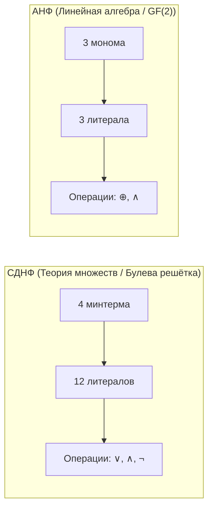
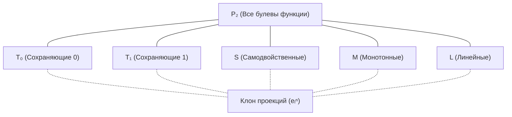
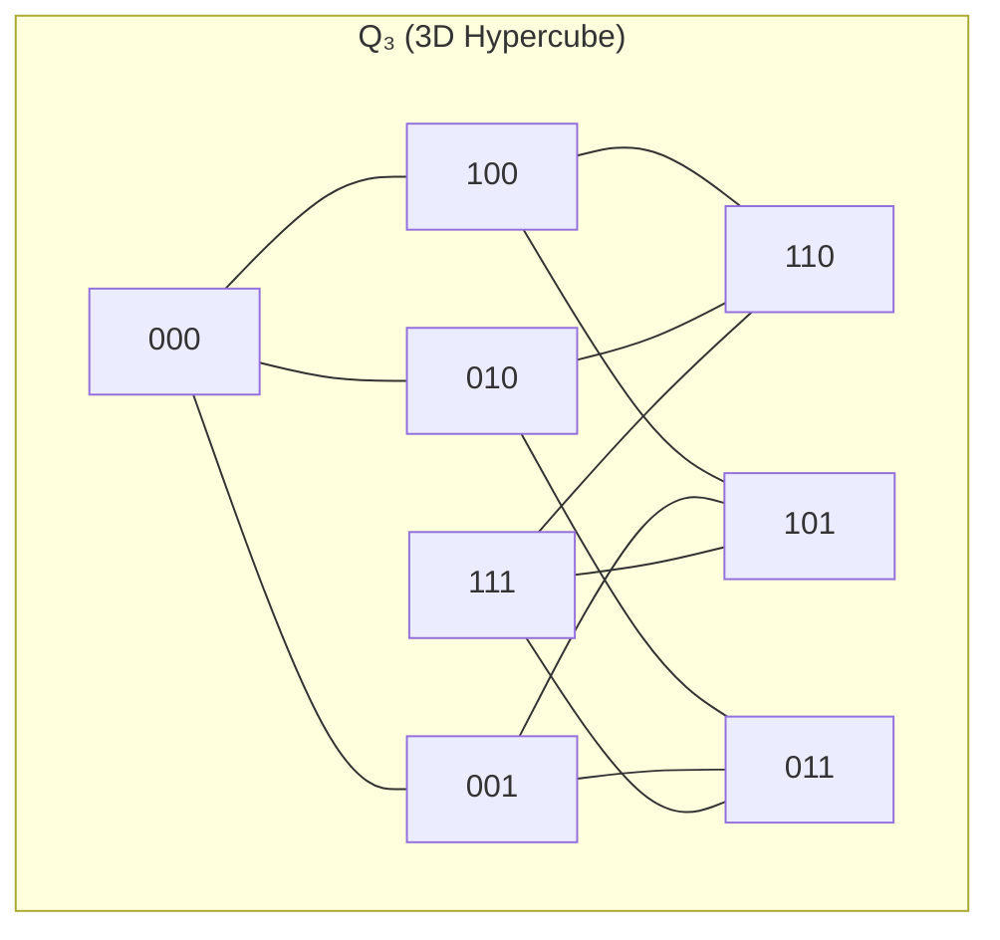

# Лекция 13: Алгебра булевых функций, полином Жегалкина, критерий Поста и геометрия булева куба

> **Дисциплина**: Дискретная математика  
> **Лектор**: Константин Чухарев, ФИТиП (ИС), Университет ИТМО (Осенний семестр 2026, 24–25 ноября)  
> **Ключевые темы**: Базисы в пространстве булевых функций $\mathbb{F}_2^{2^n}$, минтермы и совершенная ДНФ (СДНФ), макстермы и совершенная КНФ (СКНФ), мономный базис и алгебраическая нормальная форма (АНФ, полином Жегалкина), доказательство линейной независимости мономов, матрица перехода между базисами и её инволютивность над $\mathrm{GF}(2)$, прямое и обратное преобразование Мёбиуса, алгоритм треугольника Паскаля, быстрое преобразование Мёбиуса за $O(n 2^n)$ на Rust, проверка эквивалентности формул, булево кольцо, теорема Стоуна о представлении конечных булевых алгебр, степень АНФ и криптоанализ S-блоков (AES SubBytes), линейные коды Рида — Маллера $\mathrm{RM}(r, n)$, полный сумматор, суперпозиция, проекции, клоны и замкнутые классы, пять предполных классов Поста ($T_0, T_1, S, M, L$), таблица Поста, критерий функциональной полноты Поста (теорема о пяти свидетелях и конструктивное доказательство), базисы Шеффера и Пирса, классификация 20 минимальных полных систем от 2 переменных, геометрия гиперкуба $Q_n$, расстояние Хэмминга, мономы как субкубы, чётность как максимальное независимое множество, код Грея как гамильтонов цикл на $Q_n$, карты Карно как плоская развёртка гиперкуба.

---

> [!TIP] Практика и домашнее задание к лекции
> Материалы домашнего задания с подробными решениями и задачами для самопроверки (включая все контрольные вопросы со слайдов 38, 65, 77):
> - 📝 [ДЗ Алгебра булевых функций (лекция 13).md](./%D0%94%D0%97%20%D0%90%D0%BB%D0%B3%D0%B5%D0%B1%D1%80%D0%B0%20%D0%B1%D1%83%D0%BB%D0%B5%D0%B2%D1%8B%D1%85%20%D1%84%D1%83%D0%BD%D0%BA%D1%86%D0%B8%D0%B9%20(%D0%BB%D0%B5%D0%BA%D1%86%D0%B8%D1%8F%2013).md)

---

## 1. Рекомендуемая литература и источники

1. **Конспекты кафедры КТ и ИС ИТМО**:
   * *Модуль 10*: «Булевы функции», «Булева алгебра как алгебраическая структура», «Литералы, минтермы, макстермы», «ДНФ и КНФ», «Полином Жегалкина», «Метод треугольника Паскаля», «Суперпозиция, замыкание и клоны», «Классы Поста и критерий Поста», «Теорема Стоуна о представлении», «Минимизация и Карты Карно».
   * *Модуль 11*: «Код Грея и гиперкуб $Q_n$».
2. **С. В. Яблонский — «Введение в дискретную математику»**:
   * *Глава 1*: «Функции алгебры логики и классы Поста» (§1: Булевы функции и формулы; §2: Замкнутые классы и полнота; §3: Теорема Поста).
3. **Г. П. Гаврилов, А. А. Сапоженко — «Задачи и упражнения по дискретной математике»**:
   * *Раздел I*: «Функции алгебры логики» (построение полиномов Жегалкина, исследование на полноту по Посту).
4. **Н. К. Верещагин, А. Шень — «Языки и исчисления»**:
   * *Глава 1*: «Исчисление высказываний и булевы функции» (булевы кольца, теорема Стоуна).
5. **Джордж Буль (1854)**:
   * *«An Investigation of the Laws of Thought on Which Are Founded the Mathematical Theories of Logic and Probabilities»* — классический труд, заложивший представление логических законов через алгебраические полиномы.

---

## 2. Мотивация: функция чётности и дуализм представлений

В алгебре логики одна и та же булева функция $f: \{0, 1\}^n \to \{0, 1\}$ может быть записана принципиально разными способами. Ярчайший пример — **функция чётности трёх переменных**:
$$f(x, y, z) = x \oplus y \oplus z$$
Данная функция принимает значение $1$ ровно на наборах с нечётным количеством единиц: $(0,0,1)$, $(0,1,0)$, $(1,0,0)$, $(1,1,1)$.

### Сравнение представлений:
1. **Совершенная дизъюнктивная нормальная форма (СДНФ)**:
   Перечисляет все единичные наборы через конъюнкции литералов:
   $$f(x, y, z) = (\overline{x} \wedge \overline{y} \wedge z) \vee (\overline{x} \wedge y \wedge \overline{z}) \vee (x \wedge \overline{y} \wedge \overline{z}) \vee (x \wedge y \wedge z)$$
   * Длина записи: **4 минтерма, 12 литералов**.
   * Никакие два минтерма не склеиваются, поскольку между любыми двумя единичными наборами расстояние Хэмминга составляет не менее $2$.
2. **Алгебраическая нормальная форма (АНФ, полином Жегалкина)**:
   Записывает функцию суммой произведений переменных в поле $\mathbb{F}_2 = \mathrm{GF}(2)$ (сложение по модулю $2$ $\oplus$, умножение $\wedge$):
   $$f(x, y, z) = x \oplus y \oplus z$$
   * Длина записи: **всего 3 литерала (3 монома степени 1)**!



Почему одна и та же функция допускает столь разную сложность описания? Ответ лежит в теории **базисов функциональных пространств** и **смене системы координат**.

---

## 3. Базисы булевых функций

Множество всех булевых функций от $n$ переменных $P_2(n)$ содержит ровно $2^{2^n}$ различных функций. Относительно операции сложения по модулю $2$ ($\oplus$) и умножения на скаляры из поля $\mathbb{F}_2 = \{0, 1\}$ это множество образует **векторное пространство размерности $2^n$**:
$$\dim_{\mathbb{F}_2} P_2(n) = 2^n$$

### Определение 1 (Базис функций)
Набор функций $e_1, e_2, \dots, e_m \in P_2(n)$ называется **базисом**, если каждая булева функция $f$ единственным образом представляется в виде линейной комбинации:
$$f = \bigoplus_{i=1}^m c_i e_i, \quad c_i \in \{0, 1\}$$

Коэффициенты $c_i \in \{0, 1\}$ являются **координатами** функции $f$ в данном базисе. Число функций в базисе обязано в точности равняться размерности пространства: $m = 2^n$.

---

### 3.1 Минтермный базис (Индикаторы наборов)

#### Определение 2 (Минтерм)
**Минтермом** $m_a(x_1, \dots, x_n)$ набора $a = (a_1, \dots, a_n) \in \{0, 1\}^n$ называется конъюнкция литералов:
$$m_a(x) = \bigwedge_{i=1}^n x_i^{a_i}, \quad \text{где } x_i^{a_i} = \begin{cases} x_i, & a_i = 1 \\ \overline{x_i}, & a_i = 0 \end{cases}$$
Минтерм $m_a$ является характеристической функцией (индикатором) ровно одной точки $a$:
$$m_a(x) = \begin{cases} 1, & x = a \\ 0, & x \ne a \end{cases}$$

#### Пример минтермов от двух переменных ($n=2$):
* $m_{00} = \overline{x}\,\overline{y}$
* $m_{01} = \overline{x}y$
* $m_{10} = x\overline{y}$
* $m_{11} = xy$

Так как на любом наборе $x$ ровно один минтерм равен $1$, а остальные равны $0$, дизъюнкция $\vee$ для непересекающихся минтермов эквивалентна сложению по модулю $2$ ($\oplus$):
$$x \vee y = m_{01} \vee m_{10} \vee m_{11} = m_{01} \oplus m_{10} \oplus m_{11}$$

#### Теорема 1 (Минтермы образуют базис)
Множество всех $2^n$ минтермов $\{m_a \mid a \in \{0, 1\}^n\}$ образует базис в $P_2(n)$.

**Доказательство**:
1. *Существование разложения*: Для произвольной функции $f$ рассмотрим сумму:
   $$f(x) = \bigoplus_{a \in \{0, 1\}^n} f(a) m_a(x)$$
   Подставим произвольный фиксированный вектор $b \in \{0, 1\}^n$. Тогда при $a \ne b$ имеем $m_a(b) = 0$, а при $a = b$ имеем $m_b(b) = 1$. Следовательно:
   $$\bigoplus_{a \in \{0, 1\}^n} f(a) m_a(b) = f(b) \cdot 1 = f(b)$$
2. *Единственность (Линейная независимость)*: Пусть линейная комбинация тождественно равна нулю:
   $$\bigoplus_{a \in \{0, 1\}^n} c_a m_a(x) = 0$$
   Подставляя поочередно каждый вектор $b \in \{0, 1\}^n$, получаем $c_b \cdot 1 = 0 \implies c_b = 0$ для всех $b$. $\blacksquare$

---

### 3.2 Макстермы и совершенная КНФ

#### Определение 3 (Макстерм)
**Макстермом** $M_a(x_1, \dots, x_n)$ набора $a \in \{0, 1\}^n$ называется элементарная дизъюнкция:
$$M_a(x) = \bigvee_{i=1}^n x_i^{1 - a_i} = \bigvee_{i=1}^n (x_i \oplus a_i)$$
Макстерм $M_a$ равен нулю **только на наборе $a$**:
$$M_a(x) = 0 \iff x = a$$

#### Теорема 2 (Совершенная КНФ)
Каждая булева функция $f \not\equiv 1$ единственным образом представляется в виде произведения (конъюнкции) макстермов по множеству своих нулей $A_0 = \{a \in \{0, 1\}^n \mid f(a) = 0\}$:
$$f(x) = \bigwedge_{a \in A_0} M_a(x)$$

> [!NOTE] Дуализм ДНФ и КНФ
> * Минтермы читают **единицы** функции ($A_1 = \{a \mid f(a) = 1\}$) и объединяются через $\vee$ (или $\oplus$).
> * Макстермы читают **нули** функции ($A_0 = \{a \mid f(a) = 0\}$) и объединяются через $\wedge$.

---

### 3.3 Мономный базис и полином Жегалкина (АНФ)

В отличие от минтермов, содержащих отрицания переменных $\overline{x_i}$, моном строится исключительно из прямых переменных без отрицаний.

#### Определение 4 (Моном)
Для любого подмножества индексов $S \subseteq \{1, 2, \dots, n\}$ **мономом** $X_S$ называется конъюнкция переменных из $S$:
$$X_S(x) = \prod_{i \in S} x_i = \bigwedge_{i \in S} x_i$$
При этом для пустого множества $S = \varnothing$ произведение по пустому множеству индексов по определению равно константе $1$:
$$X_\varnothing(x) \equiv 1$$

#### Примеры мономов от двух переменных ($n=2$):
* $X_\varnothing = 1$
* $X_{\{1\}} = x$
* $X_{\{2\}} = y$
* $X_{\{1, 2\}} = xy$

#### Теорема 3 (Мономы образуют базис)
Семейство всех $2^n$ мономов $\{X_S \mid S \subseteq \{1, \dots, n\}\}$ образует базис векторного пространства $P_2(n)$.

**Доказательство (по индукции через линейную независимость)**:
Пусть линейная комбинация мономов тождественно равна нулевой функции:
$$\bigoplus_{S \subseteq \{1, \dots, n\}} a_S X_S(x) \equiv 0$$
Докажем, что все $a_S = 0$, индукцией по мощности $|S|$:
1. **База индукции ($|S| = 0$, $S = \varnothing$)**:
   Подставим нулевой вектор $x = (0, 0, \dots, 0)$. Все мономы, содержащие хотя бы одну переменную ($|S| \ge 1$), обращаются в ноль. Остаётся единственный моном $X_\varnothing(0) = 1$. Следовательно:
   $$a_\varnothing \cdot 1 = 0 \implies a_\varnothing = 0$$
2. **Шаг индукции**:
   Предположим, что $a_T = 0$ для всех $T$ таких, что $|T| < k$.
   Возьмём произвольное подмножество $S$ мощности $|S| = k$. Рассмотрим его характеристический вектор $e_S \in \{0, 1\}^n$, у которого $i$-я координата равна $1 \iff i \in S$.
   Вычислим значение произвольного монома $X_T$ на векторе $e_S$:
   $$X_T(e_S) = 1 \iff T \subseteq S$$
   Тогда в сумму входят только слагаемые с $T \subseteq S$:
   $$0 = \bigoplus_{T \subseteq S} a_T X_T(e_S) = a_S X_S(e_S) \oplus \bigoplus_{T \subsetneq S} a_T X_T(e_S)$$
   Но для всех собственных подмножеств $T \subsetneq S$ их мощность $|T| < |S| = k$, и по предположению индукции $a_T = 0$. Следовательно, вся правая сумма обращается в ноль, и остаётся:
   $$a_S \cdot 1 = 0 \implies a_S = 0$$
Так как количество мономов равно $2^n = \dim P_2(n)$ и они линейно независимы, семейство $\{X_S\}$ образует базис пространства $P_2(n)$. $\blacksquare$

#### Определение 5 (Полином Жегалкина / Алгебраическая нормальная форма)
Каноническое разложение булевой функции по мономному базису над полем $\mathbb{F}_2$:
$$f(x_1, \dots, x_n) = \bigoplus_{S \subseteq \{1, \dots, n\}} a_S \prod_{i \in S} x_i, \quad a_S \in \{0, 1\}$$
называется **полиномом Жегалкина** или **Алгебраической нормальной формой (АНФ)**. Коэффициенты $a_S$ определены единственным образом.

---

## 4. Смена базиса и формула обращения Мёбиуса

### 4.1 Матрица перехода
Для двух переменных ($n=2$) упорядочим наборы и подмножества лексикографически: $\varnothing (00), \{1\} (10), \{2\} (01), \{1,2\} (11)$.
Связь между значениями мономов и минтермами задается матрицей перехода $M$:

| Набор | $X_\varnothing = 1$ | $X_1 = x$ | $X_2 = y$ | $X_{1,2} = xy$ |
| :---: | :---: | :---: | :---: | :---: |
| $m_{00}$ | $1$ | $0$ | $0$ | $0$ |
| $m_{10}$ | $1$ | $1$ | $0$ | $0$ |
| $m_{01}$ | $1$ | $0$ | $1$ | $0$ |
| $m_{11}$ | $1$ | $1$ | $1$ | $1$ |

Матрица перехода $M$ нижнетреугольна с единицами на главной диагонали $\implies \det M = 1 \ne 0$, следовательно, она обратима над $\mathbb{F}_2$.

### 4.2 Теорема об инволютивности матрицы перехода над $\mathbb{F}_2$
Удивительное свойство поля характеристики $2$: **матрица перехода совпадает со своей обратной**:
$$M^{-1} = M \pmod 2$$

Это означает, что алгоритм перевода таблицы истинности в коэффициенты АНФ и алгоритм вычисления таблицы истинности по коэффициентам АНФ **абсолютно идентичны**!

---

### 4.3 Формула обращения Мёбиуса

#### Теорема 4 (Прямое и обратное преобразования Мёбиуса)
Пусть булева функция задана своими коэффициентами АНФ $a_S$ и значениями на наборах $f(A)$, где $A \subseteq \{1, \dots, n\}$ отождествляется со своим характеристическим вектором. Тогда:
1. **Прямое преобразование (вычисление значения по АНФ)**:
   $$f(A) = \bigoplus_{S \subseteq A} a_S$$
2. **Обратное преобразование (вычисление коэффициентов АНФ по значениям)**:
   $$a_S = \bigoplus_{T \subseteq S} f(T)$$

#### Доказательство:
Подставим прямое преобразование для $f(T)$ в формулу для $a_S$:
$$\bigoplus_{T \subseteq S} f(T) = \bigoplus_{T \subseteq S} \left( \bigoplus_{U \subseteq T} a_U \right)$$
Поменяем порядок суммирования:
$$\bigoplus_{T \subseteq S} \bigoplus_{U \subseteq T} a_U = \bigoplus_{U \subseteq S} a_U \left( \bigoplus_{U \subseteq T \subseteq S} 1 \right)$$
Количество промежуточных подмножеств $T$ таких, что $U \subseteq T \subseteq S$, в точности равно числу подмножеств разности $S \setminus U$, то есть $2^{|S| - |U|}$:
$$\bigoplus_{U \subseteq T \subseteq S} 1 = \left( 2^{|S| - |U|} \right) \bmod 2$$
* Если $U \subsetneq S$, то $|S| - |U| \ge 1 \implies 2^{|S| - |U|}$ чётно, и сумма по модулю 2 равна $0$.
* Если $U = S$, то $|S| - |U| = 0 \implies 2^0 = 1$, и сумма равна $1$.
Следовательно, все слагаемые с $U \ne S$ взаимно уничтожаются, и остаётся ровно $a_S$:
$$\bigoplus_{T \subseteq S} f(T) = a_S \cdot 1 = a_S \quad \blacksquare$$

---

### 4.4 Практические методы построения АНФ

#### Способ 1: Алгебраический (раскрытие скобок)
Используются тождества:
$$\overline{x} = x \oplus 1, \quad x \vee y = x \oplus y \oplus xy, \quad x \oplus x = 0, \quad x \wedge x = x$$
*Пример*: Перевести $(x \vee y) \wedge z$ в АНФ:
$$(x \vee y) \wedge z = (x \oplus y \oplus xy) \wedge z = xz \oplus yz \oplus xyz$$

#### Способ 2: Метод треугольника Паскаля
Значения функции выписываются в строку по возрастанию двоичных кодов наборов ($00, 01, 10, 11$). Каждая следующая строка формируется попарным XOR соседних элементов предыдущей строки. Коэффициентами АНФ являются **первые элементы каждой строки**:

*Пример для импликации $x \to y$* (наборы $00, 01, 10, 11$; значения $1, 1, 0, 1$):
```
Строка 0 (значения):    [1]    1    0    1   -> a_00 = a_∅  = 1
Строка 1 (1-й XOR):        [0]    1    1       -> a_01 = a_y  = 0
Строка 2 (2-й XOR):           [1]    0         -> a_10 = a_x  = 1
Строка 3 (3-й XOR):              [1]           -> a_11 = a_xy = 1
```
Получаем: $x \to y = 1 \oplus x \oplus xy$.

---

### 4.5 Быстрое преобразование Мёбиуса (Fast Möbius Transform)

Построение треугольника Паскаля требует $O(2^{2n})$ операций, что непрактично при $n \ge 10$. Алгоритм быстрого преобразования Мёбиуса (аналог быстрого преобразования Уолша — Адамара) выполняет вычисление **in-place за $n$ проходов**, требуя суммарно $O(n 2^n)$ операций и $O(2^n)$ памяти:

```rust
/// Вычисление АНФ in-place через быстрое преобразование Мёбиуса
/// Сложность: O(n * 2^n), Память: O(1) дополнительно
fn fast_mobius_transform(f: &mut [u8]) {
    let n = f.len().trailing_zeros(); // log2(len)
    for i in 0..n {
        let bit = 1usize << i;
        for m in 0..f.len() {
            if (m & bit) != 0 {
                f[m] ^= f[m ^ bit];
            }
        }
    }
}
```

#### Принцип работы:
На шаге $i$ переменная $x_i$ прибавляет к набору с единицей в позиции $i$ значение набора с нулем в этой же позиции. Благодаря инволютивности $M = M^{-1}$, эта же функция выполняет и обратное преобразование (из АНФ в таблицу истинности).

---

## 5. Булевы кольца и теорема Стоуна о представлении

### Определение 6 (Булево кольцо)
**Булевым кольцом** называется коммутативное ассоциативное кольцо $\langle R, +, \cdot, 0, 1 \rangle$ с единицей, в котором каждый элемент идемпотентетен по умножению:
$$\forall x \in R: \quad x^2 = x \cdot x = x$$

#### Следствия из аксиомы идемпотентности:
1. **Характеристика кольца равна 2**:
   $$(x + x) = (x + x)^2 = x^2 + 2x^2 + x^2 = 4x \implies 2x = 0 \implies x = -x$$
2. **Коммутативность умножения следует автоматически**:
   $$(x + y) = (x + y)^2 = x^2 + xy + yx + y^2 = x + xy + yx + y \implies xy + yx = 0 \implies xy = -yx = yx$$
3. **Наличие делителей нуля**:
   $$x(1 - x) = x - x^2 = x - x = 0$$
   Следовательно, булево кольцо с более чем двумя элементами никогда не является полем!

Булевы кольца взаимно однозначно соответствуют **булевым алгебрам**:
$$x \oplus y = (x \wedge \overline{y}) \vee (\overline{x} \wedge y), \quad x \vee y = x \oplus y \oplus xy$$

### Теорема 5 (Стоун о представлении конечных булевых алгебр, 1936)
Всякая конечная булева алгебра $B$ изоморфна булеану $\mathcal{P}(\mathrm{At}(B))$ множества своих **атомов** (минимальных ненулевых элементов).
* Для булевой алгебры функций $P_2(n)$ атомами служат в точности **минтермы** $m_a$.
* Любой элемент алгебры единственным образом восстанавливается как точная верхняя грань (дизъюнкция) лежащих под ним атомов.

---

## 6. Применения АНФ в Computer Science

| Область | Роль АНФ / Полинома Жегалкина |
| :--- | :--- |
| **Криптоанализ** | **Алгебраическая степень S-блоков**: Для устойчивости блочных шифров (AES) выходные биты S-бокса обязаны иметь максимальную нелинейность. В AES SubBytes каждый выходной бит является булевой функцией от 8 переменных максимальной степени $7$, что блокирует атаки методом линеаризации. |
| **Теория кодирования** | **Коды Рида — Маллера $\mathrm{RM}(r, n)$**: Множество булевых функций от $n$ переменных со степенью АНФ $\deg(f) \le r$ образует линейный код длины $2^n$, размерности $k = \sum_{i=0}^r \binom{n}{i}$ и минимальным расстоянием Хэмминга $d = 2^{n-r}$. |
| **SAT-солверы** | Системы булевых уравнений с большим числом XOR (CryptoSAT) решаются за полиномиальное время методом исключения Гаусса над $\mathbb{F}_2$. |
| **Схемотехника** | **Полный 1-битный сумматор**: сумма $s = x \oplus y \oplus z$ (линейная функция чётности степени 1), перенос $c = xy \oplus xz \oplus yz$ (функция большинства степени 2). |

---

## 7. Функциональная полнота и замкнутые классы Поста

### 7.1 Операции суперпозиции и клоны
Пусть $F \subseteq P_2 = \bigcup_{n=1}^\infty P_2(n)$.
1. **Проекции**: $e_i^n(x_1, \dots, x_n) = x_i$ (выбор $i$-го аргумента).
2. **Суперпозиция (подстановка)**: $h(x_1, \dots, x_m) = f(g_1(x), \dots, g_n(x))$.
3. **Замыкание $[F]$**: Наименьшее множество функций, содержащее $F$, все проекции $e_i^n$ и замкнутое относительно суперпозиции.
4. **Клон**: Множество функций, содержащее все проекции и замкнутое относительно суперпозиции. Замыкание $[F]$ — наименьший клон, порожденный $F$.
5. **Функциональная полнота**: Система $F$ называется функционально полной, если её замыкание совпадает со всем множеством булевых функций: $[F] = P_2$.

---

### 7.2 Пять предполных классов Поста

Американский математик Эмиль Пост (1941) доказал, что существует ровно **5 максимальных собственных замкнутых классов** (коатомов решётки клонов):



#### 1. Класс $T_0$ (Сохраняющие константу 0)
$$f \in T_0 \iff f(0, 0, \dots, 0) = 0$$
*В терминах АНФ*: Свободный член равен нулю ($a_\varnothing = 0$).  
*Замкнутость*: Если $g_i(0, \dots, 0) = 0$, то $f(g_1(0), \dots, g_n(0)) = f(0, \dots, 0) = 0$.

#### 2. Класс $T_1$ (Сохраняющие константу 1)
$$f \in T_1 \iff f(1, 1, \dots, 1) = 1$$
*В терминах АНФ*: Сумма всех коэффициентов полинома Жегалкина нечётна ($\bigoplus_{S} a_S = 1$).  
*Замкнутость*: Аналогично $T_0$, подстановка единиц сохраняется.

#### 3. Класс $S$ (Самодвойственные функции)
$$f \in S \iff \overline{f(\overline{x_1}, \dots, \overline{x_n})} = f(x_1, \dots, x_n)$$
Инверсия всех входов обязана инвертировать выход.  
*Свойство таблицы истинности*: Значения на противоположных наборах противоположны ($f(\alpha) \ne f(\overline{\alpha})$). Мощность $|S \cap P_2(n)| = 2^{2^{n-1}}$.

#### 4. Класс $M$ (Монотонные функции)
$$f \in M \iff \forall \alpha, \beta \in \{0, 1\}^n: \quad \alpha \le \beta \implies f(\alpha) \le f(\beta)$$
(где $\alpha \le \beta$ означает покоординатное сравнение $\alpha_i \le \beta_i$).  
*Свойство*: В ДНФ монотонной функции отсутствуют отрицания переменных.

#### 5. Класс $L$ (Линейные функции)
$$f \in L \iff f(x_1, \dots, x_n) = a_0 \oplus a_1 x_1 \oplus \dots \oplus a_n x_n$$
*В терминах АНФ*: Степень полинома $\deg(f) \le 1$ (нет нелинейных произведений $x_i x_j$).

---

### 7.3 Критерий Поста о функциональной полноте

#### Теорема 6 (Критерий Поста)
Система булевых функций $F \subseteq P_2$ функционально полна тогда и только тогда, когда она **не содержится целиком ни в одном из пяти предполных классов Поста**:
$$[F] = P_2 \iff \begin{cases} F \not\subseteq T_0 \\ F \not\subseteq T_1 \\ F \not\subseteq S \\ F \not\subseteq M \\ F \not\subseteq L \end{cases}$$

#### Доказательство:
1. **Необходимость**:
   Каждый из классов $T_0, T_1, S, M, L$ замкнут относительно суперпозиции и является собственным подмножеством $P_2$ (например, $\overline{x} \notin T_0$, $\overline{x} \notin T_1$, $x \wedge y \notin S$, $\overline{x} \notin M$, $xy \notin L$). Если $F \subseteq C$, то и $[F] \subseteq [C] = C \subsetneq P_2$, то есть система неполна.

2. **Достаточность (Конструктивная сборка)**:
   Пусть в $F$ существуют 5 функций-свидетелей: $f_0 \notin T_0$, $f_1 \notin T_1$, $f_S \notin S$, $f_M \notin M$, $f_L \notin L$.
   * **Шаг 1 (Константы $0$ и $1$)**:
     Рассмотрим функции одной переменной $g_0(x) = f_0(x, \dots, x)$ и $g_1(x) = f_1(x, \dots, x)$.
     Так как $f_0(0) = 1$, то $g_0(x)$ равна либо $1$, либо $\overline{x}$. Так как $f_1(1) = 0$, то $g_1(x)$ равна либо $0$, либо $\overline{x}$.
     - Если получено отрицание $\overline{x}$, то используя несамодвойственную функцию $f_S \notin S$, подставляем в неё $x$ и $\overline{x}$ на противоположные наборы, получая константу. Вместе с $\overline{x}$ получаем обе константы $0$ и $1$.
     - Если получены константы $0$ и $1$, переходим к следующему шагу.
   * **Шаг 2 (Отрицание $\overline{x}$)**:
     Если отрицание ещё не получено, берём немонотонную функцию $f_M \notin M$. По определению существуют наборы $\alpha \le \beta$, на которых $f_M(\alpha) = 1$, а $f_M(\beta) = 0$. Подставляя константы на совпадающие координаты наборов $\alpha$ и $\beta$, а на различающиеся — переменную $x$, получаем функцию $h(x)$ такую, что $h(0) = 1$ и $h(1) = 0$, то есть в точности $\overline{x}$.
   * **Шаг 3 (Конъюнкция $x \wedge y$)**:
     Берём нелинейную функцию $f_L \notin L$. В её АНФ есть моном степени $\ge 2$. Выберем моном $x_i x_j \dots$ минимальной длины. Зафиксируем константами все переменные вне этого монома, получив функцию вида $x_i x_j \oplus \alpha x_i \oplus \beta x_j \oplus \gamma$.
     Подставляя $x_i \oplus \beta$ и $x_j \oplus \alpha$, нейтрализуем линейные члены и получаем чистую конъюнкцию $x_i x_j$.
   * **Шаг 4 (Завершение)**:
     Имея $\{\wedge, \overline{x}\}$, по закону де Моргана строим $x \vee y = \overline{\overline{x} \wedge \overline{y}}$. Система $\{\wedge, \vee, \overline{x}\}$ позволяет выразить любую функцию через СДНФ. $\blacksquare$

---

### 7.4 Таблица Поста и стандартные базисы

| Функция | $T_0$ | $T_1$ | $S$ | $M$ | $L$ | Статус |
| :---: | :---: | :---: | :---: | :---: | :---: | :---: |
| $x \wedge y$ | $\checkmark$ | $\checkmark$ | $\times$ | $\checkmark$ | $\times$ | Неполна |
| $x \vee y$ | $\checkmark$ | $\checkmark$ | $\times$ | $\checkmark$ | $\times$ | Неполна |
| $\overline{x}$ | $\times$ | $\times$ | $\checkmark$ | $\times$ | $\checkmark$ | Неполна |
| $x \oplus y$ | $\checkmark$ | $\times$ | $\times$ | $\times$ | $\checkmark$ | Неполна |
| $x \to y$ | $\times$ | $\checkmark$ | $\times$ | $\times$ | $\times$ | Неполна |
| $1$ | $\times$ | $\checkmark$ | $\times$ | $\checkmark$ | $\checkmark$ | Неполна |
| $x \uparrow y$ (Штрих Шеффера) | $\times$ | $\times$ | $\times$ | $\times$ | $\times$ | **Функционально полна (базис из 1 элемента)** |
| $x \downarrow y$ (Стрелка Пирса) | $\times$ | $\times$ | $\times$ | $\times$ | $\times$ | **Функционально полна (базис из 1 элемента)** |
| $\{ \wedge, \oplus \}$ | $\checkmark$ | — | — | — | — | **Неполна** (все лежат в $T_0$, нет константы 1) |
| $\{ \wedge, \oplus, 1 \}$ | $\times$ | $\times$ | $\times$ | $\times$ | $\times$ | **Функционально полна** (базис Жегалкина) |
| $\{ \vee, \neg \}$ | $\times$ | $\times$ | $\times$ | $\times$ | $\times$ | **Функционально полна** (де Морган) |

---

## 8. Геометрия булева куба $Q_n$ и минимизация

### 8.1 Гиперкуб $Q_n$
Булев куб $Q_n$ — регулярный граф степени $n$, вершины которого соответствуют векторам $\{0, 1\}^n$, а рёбра соединяют пары вершин, различающихся ровно в одном бите.
* Количество вершин: $|V| = 2^n$.
* Количество рёбер: $|E| = n 2^{n-1}$.
* **Расстояние Хэмминга**:
  $$d(u, v) = \operatorname{wt}(u \oplus v) = \sum_{i=1}^n (u_i \oplus v_i)$$
  Соседние вершины в графе $Q_n$ находятся на расстоянии $d(u, v) = 1$.



### 8.2 Мономы как субкубы
Каждый моном степени $d$ принимает значение $1$ на подкубе размерности $n - d$:
* Моном $1$ (степень 0) $\implies$ весь куб $Q_n$ ($2^n$ вершин).
* Моном $x_1$ (степень 1) $\implies$ грань размерности $n-1$ ($2^{n-1}$ вершин).
* Моном $x_1 x_2$ (степень 2) $\implies$ двумерная грань / ребро размерности $n-2$.
* Полный моном $x_1 x_2 \dots x_n$ (степень $n$) $\implies$ одна вершина $(1, 1, \dots, 1)$.

АНФ раскладывает индикатор единиц функции в сумму подкубов по модулю $2$. Сложение по модулю $2$ гасит четные пересечения.

### 8.3 Чётность как максимальное независимое множество
Вершины с нечётным весом (единицы функции чётности $x_1 \oplus \dots \oplus x_n$) образуют **независимое множество** размера $2^{n-1}$: между ними нет ни одного ребра!
* Так как соседние вершины в $Q_n$ имеют разную чётность веса, граф $Q_n$ двудолен.
* Из-за отсутствия соседних единиц склейка в СДНФ невозможна: размер СДНФ чётности всегда равен $2^{n-1}$ термам.

---

### 8.4 Код Грея и гамильтонов цикл
**Код Грея** порядка $n$ — это циклическая перестановка всех $2^n$ вершин куба $Q_n$, в которой каждые два соседних слова отличаются ровно в одном бите.
* **Рекурсивное определение**:
  $$G_1 = (0, 1), \quad G_{n+1} = 0G_n \circ 1\operatorname{reverse}(G_n)$$
* Для $n=3$:
  $$000 \to 001 \to 011 \to 010 \to 110 \to 111 \to 101 \to 100 \to (000)$$
* **Топологический смысл**: Код Грея задаёт **гамильтонов цикл** на графе гиперкуба $Q_n$.

### 8.5 Карты Карно как проекция гиперкуба
Карта Карно — это развёртка гиперкуба $Q_n$ ($n = 3, 4$) на двумерную сетку. Чтобы соседние клетки сетки соответствовали соседним вершинам гиперкуба (расстояние Хэмминга $1$), строки и столбцы карты нумеруются **исключительно в порядке кода Грея**:
$$(00, 01, 11, 10)$$
Любой прямоугольник из $2^k$ клеток на карте Карно представляет собой $k$-мерный подкуб гиперкуба, что позволяет находить минимальные ДНФ геометрически.

---

## 9. Итоговая сводка понятий

| Концепт | Алгебраический смысл | Геометрический смысл в $Q_n$ |
| :--- | :--- | :--- |
| **Минтерм** | Индикатор одной строки таблицы | Одна вершина гиперкуба |
| **Моном степени $d$** | Конъюнкция $d$ переменных в АНФ | Подкуб размерности $n - d$ |
| **Полином Жегалкина** | Разложение по мономному базису над $\mathbb{F}_2$ | Покрытие множества единиц суммой подкубов по модулю 2 |
| **Критерий Поста** | Выход из 5 предполных классов | Способность породить любое подмножество вершин $Q_n$ |
| **Код Грея** | Последовательность $x_{k+1} = x_k \oplus e_i$ | Гамильтонов цикл в графе $Q_n$ |
| **Карта Карно** | Таблица истинности в базисе Грея | Плоская развёртка графа $Q_n$ с сохранением смежности |

---

## Практика и домашнее задание к лекции
- 📝 [Перейти к разбору домашнего задания (ДЗ Алгебра булевых функций (лекция 13).md)](./%D0%94%D0%97%20%D0%90%D0%BB%D0%B3%D0%B5%D0%B1%D1%80%D0%B0%20%D0%B1%D1%83%D0%BB%D0%B5%D0%B2%D1%8B%D1%85%20%D1%84%D1%83%D0%BD%D0%BA%D1%86%D0%B8%D0%B9%20(%D0%BB%D0%B5%D0%BA%D1%86%D0%B8%D1%8F%2013).md)
