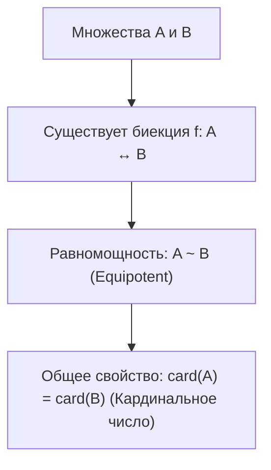
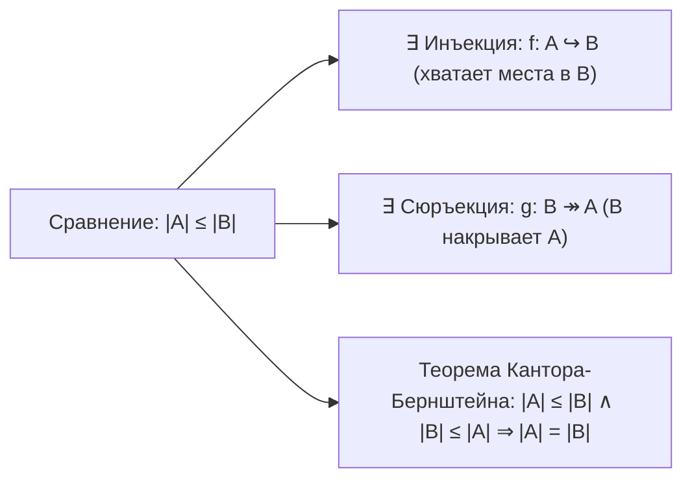
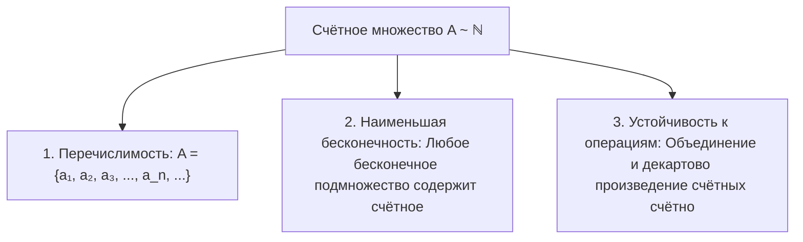

# Лекция 8: Мощность множеств, эквипотентность, счётность и континуум

> **Дисциплина**: Дискретная математика  
> **Лектор**: Константин Чухарев (ФИТиП (ИС), Университет ИТМО, осенний семестр 2026)  
> **Ключевые темы**: Равномощность (эквипотентность) множеств, мощность натурального ряда $\aleph_0$ (алеф-ноль), кардинальные числа, сравнение мощностей через инъекции и сюръекции, теорема Кантора–Бернштейна, дедекиндово определение бесконечности, счетные и несчетные множества, критерии счетности, счетность объединений и декартовых произведений $\mathbb{Q} \sim \mathbb{N}$, несчетность континуума $\mathbb{R} \sim 2^{\mathbb{N}}$ (диагональный метод Кантора), биекция между интервалом $(0, 1)$ и прямой $\mathbb{R}$, схема геометрического переплетения.

---

## 1. Рекомендуемая литература

* **Н. К. Верещагин, А. Шень — «Начала теории множеств»**  
  *Глава 2: «Мощность множеств» (§1: Равномощность; §2: Счетные множества; §3: Несчетные множества; §4: Теорема Кантора–Бернштейна).*
* **Ф. А. Новиков — «Дискретная математика для программистов»**  
  *Глава 1: «Множества и отношения» (§1.5: Мощность множеств и кардинальные числа).*
* **А. Н. Колмогоров, С. В. Фомин — «Элементы теории функций и функционального анализа»**  
  *Глава 1: «Элементы теории множеств» (Мощность, счетные множества, континуум).*

---

## 2. Понятие мощности и равномощности множеств

Для конечных множеств понятие размера очевидно: это количество элементов, выражаемое натуральным числом. Однако для бесконечных множеств интуиция («часть меньше целого») перестает работать (парадокс Галилея: квадратов натуральных чисел $1, 4, 9, 16, \dots$ столько же, сколько всех натуральных чисел $1, 2, 3, 4, \dots$).

Георг Кантор ввел строгое математическое определение равенства мощностей через существование взаимно-однозначного соответствия.



> [!NOTE] **Определение 1 (Равномощность / Эквипотентность)**  
> Два множества $A$ и $B$ называются **равномощными** (или **эквипотентными**, обозначается $A \sim B$), если между ними существует биекция (взаимно однозначное отображение):  
> $$A \sim B \iff \exists f: A \xrightarrow[\text{на}]{\text{1-1}} B$$

### 2.1. Свойства отношения равномощности
Отношение равномощности $\sim$ на любом семействе множеств является отношением эквивалентности:
1. **Рефлексивность**: $A \sim A$ (тождественная биекция $\operatorname{id}_A(x) = x$).
2. **Симметричность**: $A \sim B \implies B \sim A$ (обратная биекция $f^{-1}$).
3. **Транзитивность**: $A \sim B \land B \sim C \implies A \sim C$ (композиция биекций $g \circ f$).

> [!NOTE] **Определение 2 (Кардинальное число / Мощность)**  
> **Кардинальным числом** (или **мощностью**, $\operatorname{card}(A)$ или $|A|$) называется фактор-класс отношения равномощности — абстрактная характеристика «количества элементов» множества.

---

## 3. Сравнение мощностей множеств

> [!NOTE] **Определение 3 (Сравнение мощностей)**  
> Говорят, что мощность множества $A$ не превосходит мощности множества $B$ (обозначается $|A| \le |B|$ или $A \preceq B$), если выполнено одно из эквивалентных условий:  
> 1. Существует **инъекция** $f: A \hookrightarrow B$;  
> 2. Множество $A$ пусто, либо существует **сюръекция** $g: B \twoheadrightarrow A$.  
> Если $|A| \le |B|$ и $A \not\sim B$, то говорят, что мощность $A$ строго меньше мощности $B$: $|A| < |B|$.



### 3.1. Транзитивность порядка мощностей
Если $|A| \le |B|$ и $|B| \le |C|$, то существуют инъекции $f: A \to B$ и $g: B \to C$.  
Композиция $g \circ f: A \to C$ является инъекцией, откуда $|A| \le |C|$.

> [!IMPORTANT] **Теорема 1 (Кантора–Бернштейна–Шрёдера)**  
> Если $|A| \le |B|$ и $|B| \le |A|$, то множества $A$ и $B$ равномощны:  
> $$\Big(\exists f: A \hookrightarrow B \quad \land \quad \exists g: B \hookrightarrow A\Big) \implies A \sim B$$

---

## 4. Определение бесконечности по Дедекинду

Рихард Дедекинд (1888) предложил строго внутреннее определение бесконечного множества, не апеллирующее к понятию натурального ряда.

> [!NOTE] **Определение 4 (Бесконечность по Дедекинду)**  
> Множество $A$ называется **бесконечным (по Дедекинду)**, если оно равномощно своему **собственному подмножеству**:  
> $$\exists B \subsetneq A : \quad A \sim B$$  
> В противном случае множество называется **конечным**.

#### Классический пример:
Множество натуральных чисел $\mathbb{N} = \{1, 2, 3, \dots\}$ бесконечно, так как равномощно своему собственному подмножеству четных чисел $2\mathbb{N} = \{2, 4, 6, \dots\}$ посредством биекции $f(n) = 2n$.

---

## 5. Счётные множества

> [!NOTE] **Определение 5 (Счётное множество)**  
> Множество $A$ называется **счётным**, если оно равномощно множеству натуральных чисел $\mathbb{N}$:  
> $$A \sim \mathbb{N}$$  
> Мощность счетного множества обозначается символом $\aleph_0$ («алеф-ноль»): $|\mathbb{N}| = \aleph_0$.  
> Множество называется *не более чем счётным*, если оно конечно или счётно ($|A| \le \aleph_0$).



---

### 5.1. Критерии и характеризация счётности

> [!IMPORTANT] **Теорема 2 (Критерий счётности)**  
> Для непустого множества $A$ следующие условия равносильны:  
> 1. Множество $A$ счётно ($A \sim \mathbb{N}$);  
> 2. Элементы множества $A$ можно занумеровать без повторений в бесконечную последовательность:  
>    $$A = \{a_1, a_2, a_3, \dots, a_n, \dots\}, \quad a_i \ne a_j \text{ при } i \ne j$$  
> 3. Существует сюръекция $\mathbb{N} \twoheadrightarrow A$ и инъекция $A \hookrightarrow \mathbb{N}$.

### 5.2. Свойства счётных множеств
1. **Подмножество счётного множества**: Любое подмножество счётного множества конечно или счётно.
2. **Счётность объединения**: Объединение счетного числа счетных множеств счётно:  
   $$\text{Если } \forall n \in \mathbb{N} \quad |A_n| = \aleph_0 \implies \left| \bigcup_{n=1}^\infty A_n \right| = \aleph_0$$
3. **Счётность прямого произведения**: Декартово произведение двух счётных множеств счётно:  
   $$|\mathbb{N} \times \mathbb{N}| = \aleph_0$$  
   *Доказательство*: Биекция задается канторовой нумерующей функцией: $\pi(x, y) = \frac{(x+y-2)(x+y-1)}{2} + y$.
4. **Счётность множества рациональных чисел $\mathbb{Q}$**:  
   Любое рациональное число представляется несократимой дробью $p/q$, то есть $\mathbb{Q} \hookrightarrow \mathbb{Z} \times \mathbb{N}$. Так как $\mathbb{Z} \times \mathbb{N}$ счётно, то и $|\mathbb{Q}| = \aleph_0$.

---

## 6. Несчётные множества и континуум

> [!NOTE] **Определение 6 (Континуум)**  
> Множество называется **несчётным**, если оно бесконечно и не является счётным ($|A| > \aleph_0$).  
> Мощность множества всех действительных чисел $\mathbb{R}$ называется **мощностью континуума** и обозначается $\mathfrak{c}$ (или $2^{\aleph_0}$):  
> $$|\mathbb{R}| = \mathfrak{c}$$

---

### 6.1. Диагональный метод Кантора (Несчётность вещественных чисел)

> [!IMPORTANT] **Теорема 3 (Кантор, 1874)**  
> Отрезок $[0, 1]$ (а значит, и вся числовая прямая $\mathbb{R}$) несчётен:  
> $$\mathfrak{c} > \aleph_0$$

#### Доказательство от противного (Диагональный процесс):
1. Предположим, что отрезок $[0, 1]$ счётен. Тогда все его числа можно перенумеровать:  
   $$[0, 1] = \{x_1, x_2, x_3, \dots, x_n, \dots\}$$
2. Запишем каждое число $x_n$ в виде бесконечной десятичной дроби (избегая хвостов из девяток):  
   $$x_1 = 0.d_{11} d_{12} d_{13} \dots d_{1n} \dots$$  
   $$x_2 = 0.d_{21} d_{22} d_{23} \dots d_{2n} \dots$$  
   $$x_3 = 0.d_{31} d_{32} d_{33} \dots d_{3n} \dots$$  
   $$\dots$$  
   $$x_n = 0.d_{n1} d_{n2} d_{n3} \dots d_{nn} \dots$$
3. Сконструируем новое действительное число $\xi = 0.c_1 c_2 c_3 \dots c_n \dots \in [0, 1]$, выбирая его цифры по диагональному правилу:  
   $$c_n = \begin{cases} 1, & \text{если } d_{nn} \ne 1, \\ 2, & \text{если } d_{nn} = 1. \end{cases}$$
4. Сравним число $\xi$ с элементами списка:  
   - $\xi \ne x_1$, так как отличается 1-й цифрой ($c_1 \ne d_{11}$);  
   - $\xi \ne x_2$, так как отличается 2-й цифрой ($c_2 \ne d_{22}$);  
   - Для любого $n$: $\xi \ne x_n$, так как отличается $n$-й цифрой ($c_n \ne d_{nn}$).
5. Мы получили число $\xi \in [0, 1]$, которого нет в предполагаемом полном списке всех чисел отрезка.  
   Противоречие доказывает, что отрезок $[0, 1]$ несчётен. $\blacksquare$

---

## 7. Эквипотентность интервала и прямой: геометрические биекции и переплетение

### 7.1. Аналитическая биекция интервала $(0, 1)$ на всю прямую $\mathbb{R}$
Отображение $f: (0, 1) \to \mathbb{R}$, задаваемое тригонометрической функцией:  
$$f(x) = \operatorname{tg}\left(\pi x - \frac{\pi}{2}\right)$$  
или дробно-линейной функцией:  
$$f(x) = \frac{2x - 1}{x(1 - x)}$$  
является строгой монотонной биекцией.  
Следовательно:  
$$|(0, 1)| = |\mathbb{R}| = \mathfrak{c}$$

```mermaid
graph LR
    Int["Интервал (0, 1)"] -->|f(x) = tg(πx - π/2)| Real["Вся вещественная прямая R"]
    Int -->|Схема переплетения| Semi["Полуинтервал [0, 1) и отрезок [0, 1]"]
```

---

### 7.2. Схема «переплетения» (Устранение концов: биекция $[0, 1) \to (0, 1)$)

Казалось бы, полуинтервал $[0, 1)$ содержит граничную точку $0$, которой нет в интервале $(0, 1)$. Как построить взаимно-однозначное соответствие между $[0, 1)$ и $(0, 1)$ без использования предельных переходов?

Используется классическая **схема переплетения Гильберта («Отель Гранд»)**:
1. Выделим внутри множества $[0, 1)$ счётную последовательность точек:  
   $$S = \left\{0, \; \frac{1}{2}, \; \frac{1}{3}, \; \frac{1}{4}, \; \dots, \; \frac{1}{n}, \; \dots\right\} \subset [0, 1)$$
2. Зададим отображение $h: [0, 1) \to (0, 1)$ правилом:  
   $$h(x) = \begin{cases} \frac{1}{2}, & \text{если } x = 0, \\ \frac{1}{n+1}, & \text{если } x = \frac{1}{n} \;\; (n \ge 2), \\ x, & \text{если } x \notin S. \end{cases}$$
3. Анализ отображения:  
   - Точка $0$ переходит в $1/2$;  
   - Точка $1/2$ переходит в $1/3$;  
   - Точка $1/n$ переходит в $1/(n+1)$;  
   - Все остальные точки отрезка остаются неподвижными ($h(x) = x$).
4. Образ множества $S$: $\left\{\frac{1}{2}, \frac{1}{3}, \frac{1}{4}, \dots\right\} \subset (0, 1)$.  
   Точка $0$ успешно «растворилась» внутри счётной последовательности, а отображение $h$ является **строгой биекцией**.

> [!TIP] **Вывод**  
> $$(0, 1) \sim [0, 1) \sim (0, 1] \sim [0, 1] \sim \mathbb{R}$$  
> Все конечные отрезки, интервалы и вся числовая прямая имеют в точности одну и ту же мощность — мощность континуума $\mathfrak{c}$.
