# Лекция 8: Мощность множеств, эквипотентность, счётность и континуум

> **Дисциплина**: Дискретная математика  
> **Лектор**: Константин Чухарев (ФИТиП (ИС), Университет ИТМО, осенний семестр 2026)  
> **Ключевые темы**: Равномощность (эквипотентность) множеств, кардинальные числа, парадокс Галилея, определение бесконечности по Дедекинду, Отель Гильберта и трансфинитные сдвиги, счётные множества ($\aleph_0$) и их характеризации, счётность $\mathbb{Z}$ и $\mathbb{Q}$ (счёт по высоте и диагональный обход), несчётность континуума $\mathbb{R} \sim 2^{\mathbb{N}}$ (диагональный метод Кантора), геометрические биекции, равномощность отрезка и квадрата $[0, 1] \sim [0, 1]^2$ (переплетение цифр), совершенное множество Кантора, алгебраические ($\mathbb{A}$) и трансцендентные ($\mathbb{T}$) числа, следствия для Computer Science (счётность программ $\Sigma^*$ vs несчётность языков $\mathcal{P}(\Sigma^*)$, диагональный язык $L_d$, алгоритмическая неразрешимость), теорема Кантора о мощности булеана ($|A| < |\mathcal{P}(A)|$), теорема Кантора–Бернштейна–Шрёдера (доказательство через цепи траекторий), кардинальная арифметика, шкалы Алефов ($\aleph_\alpha$) и Бетов ($\beth_\alpha$), Континуум-гипотеза (CH) и её независимость в ZFC.

---

## 1. Введение: Что значит «посчитать» множество?

Для конечных совокупностей объектов процедура подсчёта интуитивна: мы последовательно указываем на предметы, сопоставляя каждому очередное натуральное число: $1, 2, 3, \dots, n$. Число $n$ объявляется размером множества.

Однако при переходе к бесконечным совокупностям привычная интуиция (включая древнейшую аксиому Евклида *«Целое больше своей части»*) терпит полный крах.

### Парадокс Галилея (1638 г.)
Рассмотрим множество натуральных чисел $\mathbb{N} = \{1, 2, 3, 4, 5, \dots\}$ и множество точных квадратов $S = \{1, 4, 9, 16, 25, \dots\}$.
- С одной стороны, квадраты составляют лишь исчезающе малую часть натурального ряда ($S \subsetneq \mathbb{N}$), ведь между $1$ и $4$ пропущены два числа ($2, 3$), между $4$ и $9$ — четыре ($5, 6, 7, 8$), и расстояния неограниченно растут.
- С другой стороны, каждому числу $n \in \mathbb{N}$ взаимно-однозначно отвечает его квадрат $n^2 \in S$:

$$\begin{array}{cccccc}
1 & 2 & 3 & 4 & \dots & n \\
\updownarrow & \updownarrow & \updownarrow & \updownarrow & \dots & \updownarrow \\
1 & 4 & 9 & 16 & \dots & n^2
\end{array}$$

Галилео Галилей пришёл к выводу, что атрибуты «больше», «меньше» и «равно» вообще неприменимы к бесконечным величинам.

Георг Кантор в 1870-х годах показал, что математически строгая теория бесконечных совокупностей не только возможна, но и открывает целую иерархию качественно различных бесконечностей.

---

## 2. Понятие мощности и равномощности (эквипотентности)

Фундаментом теории множеств Кантора служит отказ от подсчёта элементов через натуральные числа в пользу **биекций (взаимно-однозначных соответствий)**.

### Определение 2.1 (Равномощность / Эквипотентность)
> Множества $A$ и $B$ называются **равномощными** (или **эквипотентными**), обозначается $A \sim B$ (или $|A| = |B|$), если существует хотя бы одна биекция $f: A \leftrightarrow B$ (отображение, одновременно инъективное и сюръективное).

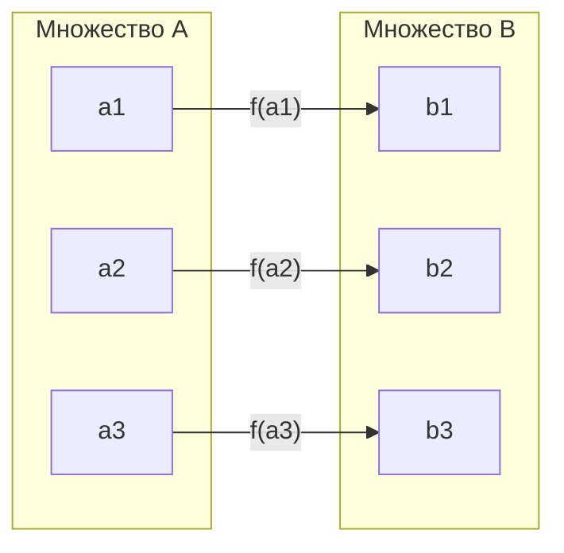

### Теорема 2.1 (Свойства отношения равномощности)
Отношение $\sim$ на любом классе множеств является **отношением эквивалентности**:
1. **Рефлексивность**: $A \sim A$ (тождественное отображение $\mathrm{id}_A: x \mapsto x$ биективно).
2. **Симметричность**: $A \sim B \implies B \sim A$ (если $f$ — биекция, то обратная функция $f^{-1}: B \to A$ также биекция).
3. **Транзитивность**: $A \sim B \land B \sim C \implies A \sim C$ (композиция биекций $g \circ f: A \to C$ биективна).

### Кардинальное число
Каждому классу эквивалентности по отношению $\sim$ сопоставляется характеристика, называемая **мощностью множества** или **кардинальным числом** $\mathrm{card}(A) = |A|$.
- Для конечного множества мощности совпадают с количеством элементов: $|A| = n \in \mathbb{N}_0$.
- Мощность натурального ряда обозначается $\aleph_0$ (*алеф-ноль*): $|\mathbb{N}| = \aleph_0$.
- Мощность континуума (числовой прямой $\mathbb{R}$) обозначается $\mathfrak{c}$ или $2^{\aleph_0}$.

### Сравнение мощностей: Инъекции и Сюръекции
> **Определение 2.2**: Будем говорить, что мощность множества $A$ не превосходит мощности $B$ ($|A| \le |B|$), если существует **инъекция** $f: A \hookrightarrow B$.  
> Эквивалентно (при $A \ne \varnothing$ и в предположении аксиомы выбора): существует **сюръекция** $g: B \twoheadrightarrow A$.

Строгое неравенство мощностей:
$$|A| < |B| \iff (|A| \le |B|) \land (|A| \ne |B|)$$
то есть инъекция из $A$ в $B$ существует, а биекции между ними нет.

### Определение бесконечности по Дедекинду
В 1888 году Рихард Дедекинд сформулировал критерий бесконечности, не опирающийся на натуральный ряд:
> **Определение 2.3 (Бесконечность по Дедекинду)**: Множество $A$ называется **бесконечным**, если оно равномощно некоторому своему **собственному** подмножеству:
> $$\exists B \subsetneq A : B \sim A$$
> В противном случае множество $A$ называется **конечным**.

**Почему у конечных множеств часть всегда строго меньше целого?**  
По принципу Дирихле (Pigeonhole Principle): никакая инъекция из конечного множества мощности $n$ в его подмножество мощности $k < n$ невозможна. У бесконечных же множеств появляется «свобода сдвига».

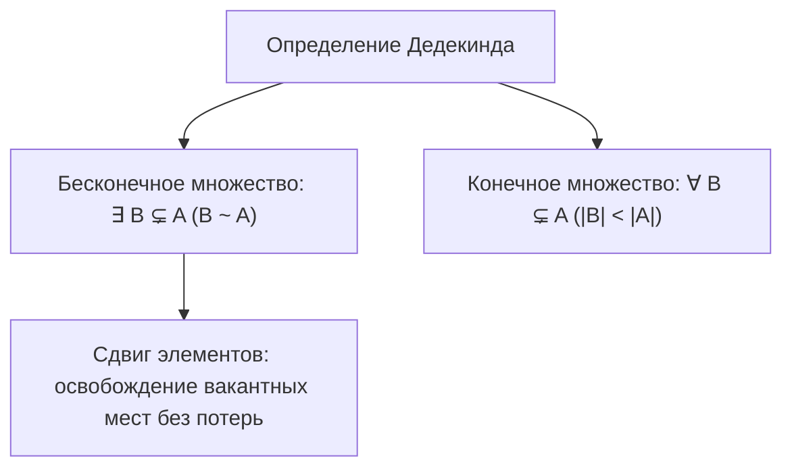

---

## 3. «Гранд-отель» Гильберта и трансфинитные сдвиги

В 1924 году Давид Гильберт предложил мысленный эксперимент, иллюстрирующий парадоксальную геометрию счётных бесконечностей.

Представим отель с бесконечным счётным числом комнат: номера $1, 2, 3, 4, \dots$ Все комнаты до единой заняты постояльцами.

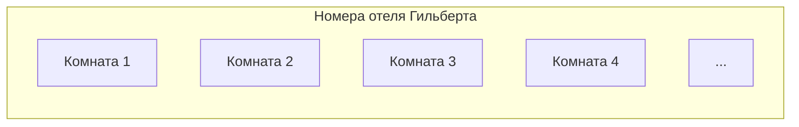

### Ситуация 1: Прибытие одного нового гостя ($+1$)
- **Проблема**: Свободных комнат нет.
- **Решение**: Просим гостя из комнаты $n$ перейти в комнату $n+1$:
  $$f(n) = n + 1$$
- Комната 1 освобождается для вновь прибывшего.
- **Математический вывод**: $\aleph_0 + 1 = \aleph_0$.

### Ситуация 2: Прибытие конечной группы из $k$ гостей ($+k$)
- Переселяем постояльца из комнаты $n$ в комнату $n + k$.
- Первые $k$ комнат ($1, 2, \dots, k$) освобождаются.
- **Математический вывод**: $\aleph_0 + k = \aleph_0$.

### Ситуация 3: Прибытие автобуса со счётным числом гостей ($\aleph_0 + \aleph_0$)
- Приехал бесконечный автобус, в котором сидят пассажиры $g_1, g_2, g_3, \dots$
- **Решение**: Переселяем каждого старого постояльца из комнаты $n$ в комнату с удвоенным номером:
  $$n \mapsto 2n$$
  Все жильцы перемещаются в чётные комнаты: $1 \to 2$, $2 \to 4$, $3 \to 6$, $4 \to 8, \dots$
- Все нечётные комнаты ($1, 3, 5, 7, \dots$) освобождаются.
- Пассажира $g_k$ заселяем в нечётную комнату $2k - 1$:
  $$g_k \mapsto 2k - 1$$
- **Математический вывод**: $\aleph_0 + \aleph_0 = \aleph_0$.

### Ситуация 4: Бесконечно много автобусов, в каждом бесконечно много гостей ($\aleph_0 \times \aleph_0$)
Прибывает счётный караван автобусов $B_1, B_2, B_3, \dots$, и в каждом автобусе $B_i$ сидит счётное число пассажиров: $g_{i,1}, g_{i,2}, g_{i,3}, \dots$

#### Способ 1: Метод простых чисел
- Используем основную теорему арифметики (факторизация на простые числа уникальна).
- Старого жильца из комнаты $n$ переселяем в комнату $2^n$ (степени первого простого числа $p_1 = 2$).
- Пассажира $j$ из автобуса $i$ заселяем в комнату:
  $$p_{i+1}^j$$
  где $p_2 = 3, p_3 = 5, p_4 = 7, p_5 = 11, \dots$
- Поскольку разложение чисел на простые сомножители однозначно, никакие два гостя не окажутся в одной комнате (инъекция).
- Более того, множество свободных комнат (например, $6 = 2 \cdot 3$, $10$, $12$, не являющиеся чистыми степенями простых) останется бесконечным!

#### Способ 2: Канторова нумерация пар (диагональная змейка)
Таблицу пар $(i, j)$ (где $i$ — номер автобуса, $j$ — номер места) обходим по антидиагоналям:
$$\pi(i, j) = \frac{(i + j - 1)(i + j - 2)}{2} + i$$

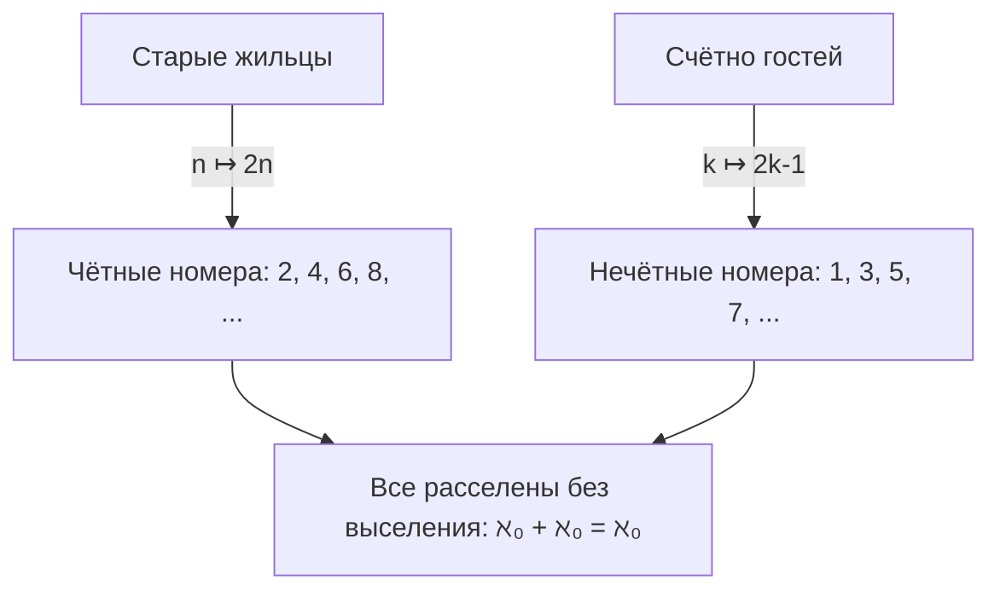

---

## 4. Счётные множества и их критерии

### Определение 4.1 (Счётное множество)
> Множество $A$ называется **счётным**, если оно равномощно множеству всех натуральных чисел $\mathbb{N}$:
> $$A \sim \mathbb{N} \iff |A| = \aleph_0$$
> Множество называется **не более чем счётным**, если оно либо конечно, либо счётно.

### Три эквивалентные характеризации счётности
Для любого непустого множества $A$ следующие условия равносильны:
1. $A$ счётно ($A \sim \mathbb{N}$).
2. Элементы $A$ можно представить в виде бесконечной последовательности **без повторений**:
   $$A = \{a_1, a_2, a_3, a_4, \dots\}$$
3. Существует инъекция $f: A \hookrightarrow \mathbb{N}$ и существует сюръекция $g: \mathbb{N} \twoheadrightarrow A$.

### Теорема 4.1 (Свойства счётных множеств)
1. **Подмножество**: Всякое бесконечное подмножество счётного множества счётно (счётность — наименьшая из бесконечных мощностей: $\forall \text{ бесконечного } B: |B| \ge \aleph_0$).
2. **Счётное объединение**: Объединение счётного семейства не более чем счётных множеств счётно:
   $$\left|\bigcup_{n=1}^\infty A_n\right| \le \aleph_0 \cdot \aleph_0 = \aleph_0$$
3. **Декартово произведение**: Если $A$ и $B$ счётны, то $A \times B$ счётно:
   $$|\mathbb{N} \times \mathbb{N}| = \aleph_0$$
   По индукции, декартово произведение любого *конечного* числа счётных множеств $A_1 \times A_2 \times \dots \times A_k$ счётно.

---

## 5. Доказательства счётности базовых числовых множеств

### 1. Множество целых чисел $\mathbb{Z}$ счётно
Зададим биекцию $f: \mathbb{Z} \to \mathbb{N}$:
$$f(n) = \begin{cases} 
2n, & n > 0 \\ 
2|n| + 1, & n \le 0 
\end{cases}$$
Или в виде ряда: $0, 1, -1, 2, -2, 3, -3, \dots \implies \mathbb{Z} \sim \mathbb{N}$.

### 2. Множество положительных рациональных чисел $\mathbb{Q}^+$ счётно
Рассмотрим таблицу пар $(p, q)$, представляющих дробь $p/q$:

$$\begin{array}{c|ccccc}
p \backslash q & 1 & 2 & 3 & 4 & \dots \\
\hline
1 & 1/1 & 1/2 & 1/3 & 1/4 & \dots \\
2 & 2/1 & 2/2 & 2/3 & 2/4 & \dots \\
3 & 3/1 & 3/2 & 3/3 & 3/4 & \dots \\
4 & 4/1 & 4/2 & 4/3 & 4/4 & \dots \\
\vdots & \vdots & \vdots & \vdots & \vdots & \ddots
\end{array}$$

#### Метод А: Диагональный обход (Змейка Кантора)
Обходим таблицу по диагоналям $p + q = s$ ($s = 2, 3, 4, \dots$):
$1/1 \to 1/2 \to 2/1 \to 3/1 \to 2/2 \to 1/3 \to 1/4 \to \dots$
Если очередная дробь сократима (например, $2/2 = 1/1$, $2/4 = 1/2$), мы её пропускаем. Получаем строгую нумерацию всех несократимых положительных рациональных чисел без повторений.

#### Метод Б: Счёт по высоте дроби
Введём понятие **высоты** несократимой дроби $p/q$ ($p \in \mathbb{Z}, q \in \mathbb{N}, \gcd(p, q) = 1$):
$$h\left(\frac{p}{q}\right) = |p| + q$$
- При фиксированной высоте $h = k$ существует лишь конечное число пар $(p, q)$, таких что $|p| + q = k$.
- Например:
  - $h = 2: 1/1, -1/1$ (2 дроби)
  - $h = 3: 1/2, -1/2, 2/1, -2/1$ (4 дроби)
  - $h = 4: 1/3, -1/3, 3/1, -3/1$ ($2/2$ сократима)
- Множество $\mathbb{Q}$ распадается в счётное объединение конечных непересекающихся слоёв:
  $$\mathbb{Q} = \bigcup_{h=2}^\infty D_h, \quad |D_h| < \infty$$
  Счётное объединение конечных множеств счётно $\implies |\mathbb{Q}| = \aleph_0$.

---

## 6. Мощность континуума и диагональный метод Кантора

Являются ли все бесконечные множества счётными? Нет.

### Теорема 6.1 (Несчётность $\mathbb{R}$, Кантор, 1874/1891 гг.)
> Множество действительных чисел на отрезке $[0, 1]$ (и вся числовая прямая $\mathbb{R}$) **несчётно**:
> $$|\mathbb{R}| > \aleph_0$$

### Диагональный аргумент Кантора (доказательство от противного)
1. Предположим, что отрезок $[0, 1)$ счётен. Тогда все его элементы можно выписать в виде бесконечного занумерованного списка:
   $$x_1, x_2, x_3, x_4, \dots, x_n, \dots$$
2. Запишем каждое число $x_i$ в виде бесконечной десятичной дроби (чтобы избежать неоднозначности представления вроде $0.1000\dots = 0.0999\dots$, запретим записи с бесконечным хвостом из девяток):
   $$\begin{aligned}
   x_1 &= 0 . \mathbf{d_{11}} d_{12} d_{13} d_{14} \dots \\
   x_2 &= 0 . d_{21} \mathbf{d_{22}} d_{23} d_{24} \dots \\
   x_3 &= 0 . d_{31} d_{32} \mathbf{d_{33}} d_{34} \dots \\
   x_4 &= 0 . d_{41} d_{42} d_{43} \mathbf{d_{44}} \dots \\
   &\;\;\vdots
   \end{aligned}$$
3. Сконструируем новое действительное число $x^* = 0.c_1 c_2 c_3 c_4 \dots \in [0, 1)$ по следующему диагональному правилу:
   $$c_n = \begin{cases} 
   4, & \text{если } d_{nn} \ne 4 \\ 
   5, & \text{если } d_{nn} = 4 
   \end{cases}$$
4. Исследуем принадлежность числа $x^*$ исходному списку:
   - $x^* \ne x_1$, так как их первая цифра после запятой отличается ($c_1 \ne d_{11}$).
   - $x^* \ne x_2$, так как их вторая цифра отличается ($c_2 \ne d_{22}$).
   - $\forall n \in \mathbb{N}: x^* \ne x_n$, так как их $n$-я цифра отличается ($c_n \ne d_{nn}$).
   - В записи $x^*$ нет девяток (только цифры 4 и 5), поэтому разночтения десятичной записи исключены.
5. Получено противоречие: число $x^* \in [0, 1)$ существует, но в списке отсутствует. Следовательно, список не может содержать все числа $\implies [0, 1)$ несчётен. $\blacksquare$

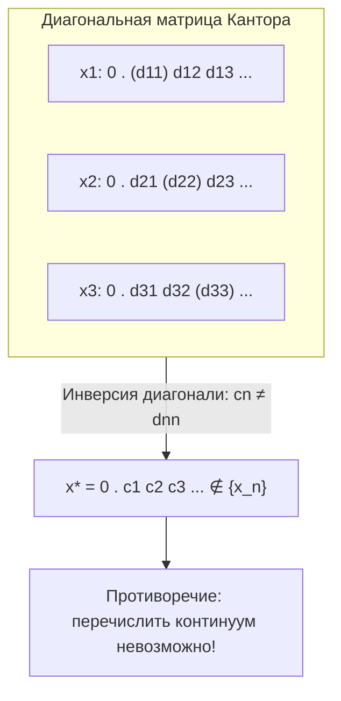

---

## 7. Геометрические биекции и эквивалентность отрезка и квадрата

### Равномощность интервалов и всей прямой
Любые два невырожденных интервала равномощны между собой и равномощны всей прямой $\mathbb{R}$:
1. **Интервал $(a, b) \sim (0, 1)$**: линейная биекция $f(x) = \frac{x - a}{b - a}$.
2. **Интервал $(-1, 1) \sim \mathbb{R}$**: биекция через алгебраическую дробь:
   $$f(x) = \frac{x}{1 - |x|}, \quad f^{-1}(y) = \frac{y}{1 + |y|}$$
   или тригонометрически: $f(x) = \tan\left(\frac{\pi x}{2}\right)$.
3. **Отрезок $[0, 1] \sim (0, 1)$**:
   - Внутри $(0, 1)$ выберем счётную последовательность точек: $S = \{x_1, x_2, x_3, \dots\} = \{1/2, 1/3, 1/4, \dots\}$.
   - В $[0, 1]$ добавим две граничные точки: $\{0, 1\} \cup S = \{0, 1, 1/2, 1/3, \dots\} = \{y_1, y_2, y_3, \dots\}$.
   - Зададим биекцию сдвигом на счётном подмножестве:
     $$f(x) = \begin{cases} 
     x_{n+2}, & \text{если } x = y_n \in \{0, 1, 1/2, 1/3, \dots\} \\ 
     x, & \text{если } x \notin \{0, 1\} \cup S 
     \end{cases}$$
   - Точки 0 и 1 «вдвигаются» внутрь счётной цепочки, как гости в отеле Гильберта.

### Равномощность отрезка и квадрата: $[0, 1] \sim [0, 1]^2$
В 1877 году Георг Кантор потряс математический мир доказательством того, что отрезок содержит ровно столько же точек, сколько квадрат, куб или любое $n$-мерное евклидово пространство:
> *«Je le vois, mais je ne le crois pas»* («Я это вижу, но я этому не верю» — из письма Кантора Дедекинду).

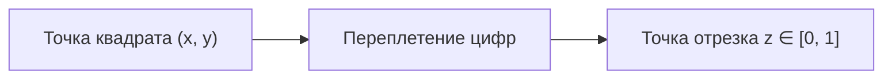

#### Идея переплетения цифр (Interleaving digits)
Пусть точка единичного квадрата имеет координаты $(x, y) \in [0, 1]^2$:
$$x = 0.x_1 x_2 x_3 x_4 \dots, \quad y = 0.y_1 y_2 y_3 y_4 \dots$$
Сопоставим ей число $z \in [0, 1]$, переплетая их десятичные знаки:
$$z = 0.x_1 y_1 x_2 y_2 x_3 y_3 x_4 y_4 \dots$$

#### Тонкость с периодическими девятками и корректная конструкция
Прямое посимвольное чередование сталкивается с проблемой неоднозначности десятичных дробей:
- Например, точка $(0.1000\dots, 0) \mapsto 0.100000\dots$
- Но $0.1000\dots = 0.0999\dots$, а пара $(0.0999\dots, 0) \mapsto 0.00909090\dots \ne 0.1000\dots$
- **Строгое решение (разбиение на блоки)**: Запретим хвосты из девяток. Каждое число разбиваем на цифровые блоки, заканчивающиеся первой ненулевой цифрой (например, $0.003\,07\,5\dots$). Затем переплетаем не отдельные цифры, а целые блоки! Это превращает отображение в строгую биекцию.
- Альтернативный топологический подход: **Кривая Пеано** (непрерывное сюръективное отображение отрезка на квадрат).

---

## 8. Канторово совершенное множество и троичные дроби

Канторово множество $\mathcal{C} \subset [0, 1]$ строится бесконечным процессом удаления открытых средних третей:
1. Шаг 0: $C_0 = [0, 1]$.
2. Шаг 1: Выбрасываем интервал $(1/3, 2/3)$, остаются $C_1 = [0, 1/3] \cup [2/3, 1]$.
3. Шаг 2: Из каждого из двух отрезков удаляем среднюю треть: остаются 4 отрезка длины $1/9$.
4. Шаг $n$: Остаются $2^n$ отрезков длины $3^{-n}$.
$$\mathcal{C} = \bigcap_{n=0}^\infty C_n$$

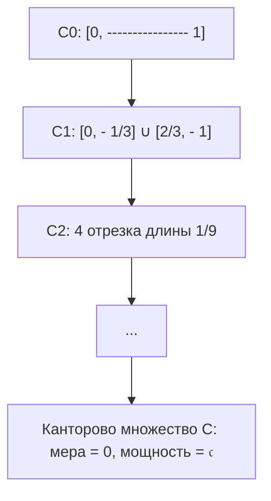

### Парадоксальные свойства множества Кантора
1. **Длина (мера Лебега) равна нулю**:
   Суммарная длина всех выброшенных интервалов:
   $$\sum_{k=0}^\infty 2^k \cdot \frac{1}{3^{k+1}} = \frac{1}{3} \sum_{k=0}^\infty \left(\frac{2}{3}\right)^k = \frac{1}{3} \cdot \frac{1}{1 - 2/3} = 1$$
   Мера оставшейся части: $\mu(\mathcal{C}) = 1 - 1 = 0$.
2. **Мощность равна континууму ($|\mathcal{C}| = \mathfrak{c}$)**:
   Запишем любое число $x \in [0, 1]$ в троичной системе счисления:
   $$x = \sum_{i=1}^\infty \frac{a_i}{3^i}, \quad a_i \in \{0, 1, 2\}$$
   Удаление средней трети на шаге $n$ означает запрет цифры $a_n = 1$.
   Следовательно, точка $x$ принадлежит $\mathcal{C}$ тогда и только тогда, когда её троичная запись содержит **только цифры 0 и 2**:
   $$\mathcal{C} = \left\{ \sum_{i=1}^\infty \frac{a_i}{3^i} \;\middle|\; a_i \in \{0, 2\} \right\}$$
   Заменяя каждую цифру 2 на 1 ($a_i / 2$), получаем взаимно-однозначное соответствие между $\mathcal{C}$ и всеми бесконечными последовательностями нулей и единиц $\{0, 1\}^\mathbb{N}$, то есть отрезком $[0, 1]$ в двоичной системе счисления.
   $$|\mathcal{C}| = 2^{\aleph_0} = \mathfrak{c}$$

> **Фундаментальный вывод**: Множество может иметь нулевую геометрическую длину (меру), но при этом содержать континуум точек!

---

## 9. Алгебраические и трансцендентные числа

Действительные числа разделяются на два фундаментальных класса:

### Определение 9.1 (Алгебраические числа)
> Число $\alpha \in \mathbb{C}$ называется **алгебраическим**, если оно является корнем ненулевого многочлена с целыми коэффициентами:
> $$P(x) = a_n x^n + a_{n-1} x^{n-1} + \dots + a_1 x + a_0 = 0, \quad a_i \in \mathbb{Z}, \; a_n \ne 0$$
> Множество всех действительных алгебраических чисел обозначается $\mathbb{A}$.

Примеры алгебраических чисел:
- Любое рациональное $p/q$ ($q x - p = 0$).
- $\sqrt{2}$ ($x^2 - 2 = 0$).
- $\sqrt[3]{5} - 1$ ($x^3 + 3x^2 + 3x - 4 = 0$).

### Теорема 9.1 (Счётность алгебраических чисел)
> Множество всех алгебраических чисел **счётно**:
> $$|\mathbb{A}| = \aleph_0$$

#### Доказательство через высоту многочлена
Для многочлена $P(x) = a_n x^n + \dots + a_0$ определим его **высоту** как натуральное число:
$$H(P) = n + |a_n| + |a_{n-1}| + \dots + |a_0|$$
- Поскольку $n \ge 1$ и $|a_n| \ge 1$, то $H(P) \ge 2$.
- Для любого фиксированного целого $H \ge 2$ существует лишь **конечное число** многочленов высоты $H$ (так как степень $n \le H$, а каждый коэффициент $|a_i| \le H$).
- Каждый многочлен степени $n$ имеет не более $n$ действительных корней.
- Следовательно, множество $K_H$ корней всех многочленов высоты $H$ **конечно**.
- Множество всех алгебраических чисел есть счётное объединение конечных множеств:
  $$\mathbb{A} = \bigcup_{H=2}^\infty K_H \implies |\mathbb{A}| \le \aleph_0$$
  А так как $\mathbb{N} \subset \mathbb{A}$, то $|\mathbb{A}| = \aleph_0$. $\blacksquare$

### Трансцендентные числа: Несчётность $\mathbb{T}$
> **Определение 9.2**: Число называется **трансцендентным**, если оно не является алгебраическим: $\mathbb{T} = \mathbb{R} \setminus \mathbb{A}$.

Известные трансцендентные числа: $\pi \approx 3.14159$, $e \approx 2.71828$ (доказано Эрмитом в 1873 г. и Линдеманом в 1882 г.). Доказать трансцендентность конкретного числа аналитически — чрезвычайно сложная задача.

Однако теория Кантора даёт мгновенный неконструктивный ответ о распространённости таких чисел:
$$|\mathbb{R}| = \mathfrak{c}, \quad |\mathbb{A}| = \aleph_0$$
$$|\mathbb{T}| = |\mathbb{R} \setminus \mathbb{A}| = \mathfrak{c} - \aleph_0 = \mathfrak{c}$$

> **Следствие Кантора**: Трансцендентных чисел несравненно больше, чем алгебраических. Почти всякое действительное число является трансцендентным! Если наугад бросить точку на отрезок, вероятность попасть в алгебраическое число равна 0.

---

## 10. Следствия для Computer Science: Мощность программ и алгоритмическая неразрешимость

Одно из самых глубоких приложений теории мощностей Кантора в теоретической информатике — доказательство существования алгоритмически неразрешимых задач (Алан Тьюринг, 1936 г.).

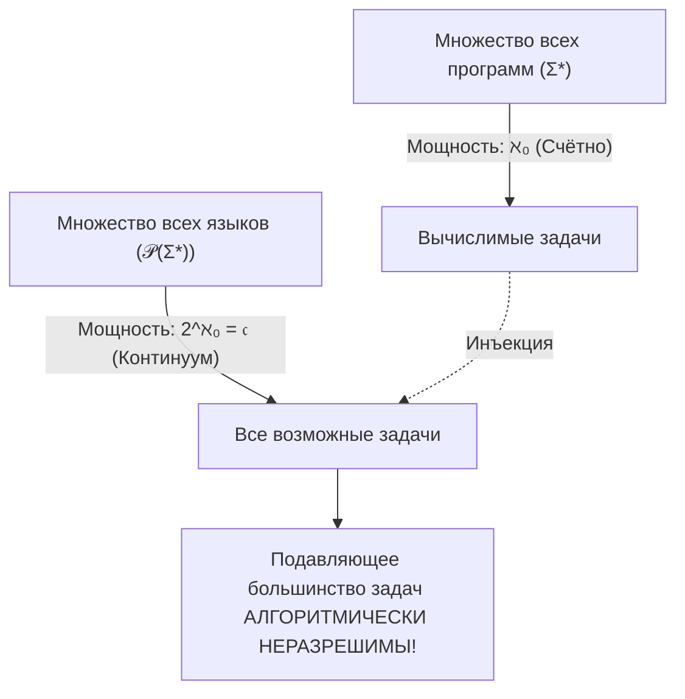

### 1. Множество программ счётно
Любая компьютерная программа (на Python, C++, Java или машина Тьюринга) представляет собой конечный текст — конечное слово в некотором конечном алфавите символов $\Sigma$ (ASCII, UTF-8, биты $\{0, 1\}$).
- Множество всех возможных текстов программ есть $\Sigma^* = \bigcup_{k=0}^\infty \Sigma^k$.
- Для каждого $k$ число программ длины $k$ конечно ($|\Sigma|^k$).
- Счётное объединение конечных множеств счётно:
  $$|\text{Programs}| = |\Sigma^*| = \aleph_0$$

### 2. Множество задач (языков) несчётно
Задача распознавания (decision problem) формализуется как **язык** $L \subseteq \Sigma^*$ (множество слов, для которых ответ «Да»).
- Множество всех возможных языков есть булеан (множество подмножеств) счётного множества слов:
  $$\text{Languages} = \mathcal{P}(\Sigma^*)$$
- По теореме Кантора мощность булеана равна мощности континуума:
  $$|\mathcal{P}(\Sigma^*)| = 2^{\aleph_0} = \mathfrak{c}$$

### 3. Алгоритмическая неразрешимость
Поскольку биекция между счётным множеством алгоритмов и несчётным множеством задач невозможна:
$$|\text{Programs}| = \aleph_0 < \mathfrak{c} = |\text{Tasks}|$$
Существует несчётно много задач, для которых **в принципе невозможно написать программу решения**.

### Диагональный язык Тьюринга $L_d$ и проблема остановки
Занумеруем все программы $M_1, M_2, M_3, \dots$ и все возможные входные слова $w_1, w_2, w_3, \dots$
Построим таблицу, где ячейка $(i, j) = 1$, если программа $M_i$ допускает слово $w_j$, и $0$ иначе.

Определим **диагональный язык**:
$$L_d = \{ w_i \in \Sigma^* \mid w_i \notin L(M_i) \}$$
(слово $w_i$ принадлежит $L_d$ тогда и только тогда, когда $i$-я программа его отвергает или зависает).

Если бы язык $L_d$ был разрешим некоторой машиной Тьюринга $M_k$, то:
$$w_k \in L_d \iff w_k \notin L(M_k) = L_d$$
Полученное противоречие ($w_k \in L_d \iff w_k \notin L_d$) доказывает неразрешимость языка $L_d$ и алгоритмическую неразрешимость проблемы остановки (Halting Problem). Метод рассуждения здесь тождественен диагонали Кантора!

---

## 11. Теорема Кантора о мощности булеана ($|A| < |\mathcal{P}(A)|$)

Существует ли максимальная бесконечность? Ответ даёт фундаментальная теорема Кантора.

### Теорема 11.1 (Кантор)
> Для любого множества $A$ мощность его булеана (множества всех подмножеств $\mathcal{P}(A) = 2^A$) строго больше мощности самого множества:
> $$|A| < |\mathcal{P}(A)|$$

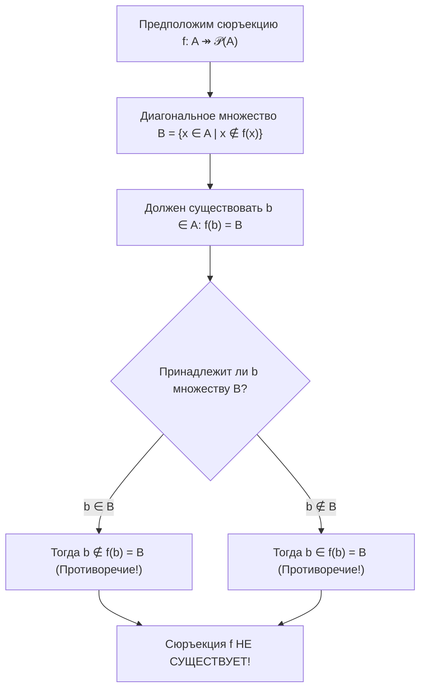

### Доказательство
1. **Инъекция существует**: Отображение $g: A \to \mathcal{P}(A)$, задаваемое как $g(x) = \{x\}$, очевидно инъективно $\implies |A| \le |\mathcal{P}(A)|$.
2. **Сюръекция невозможна (от противного)**:
   - Пусть существует сюръекция $f: A \twoheadrightarrow \mathcal{P}(A)$. Это означает, что для любого подмножества $Y \subseteq A$ найдётся элемент $a \in A$, такой что $f(a) = Y$.
   - Рассмотрим специальное «диагональное» подмножество:
     $$B = \{x \in A \mid x \notin f(x)\}$$
     (множество всех элементов, которые не содержатся в своём образе).
   - Так как $B \subseteq A$, то $B \in \mathcal{P}(A)$. В силу сюръективности $f$, для $B$ обязан существовать прообраз $b \in A$, такой что:
     $$f(b) = B$$
   - Зададимся вопросом: принадлежит ли элемент $b$ множеству $B$?
     - Если $b \in B$, то по условию принадлежности к $B$ должно выполняться $b \notin f(b)$. Но $f(b) = B$, значит, $b \notin B$. Противоречие.
     - Если $b \notin B$, то условие $x \notin f(x)$ для $x = b$ выполняется, а значит, $b \in B$. Противоречие.
3. В обоих случаях получено неустранимое противоречие. Значит, сюръекции $f$ не существует $\implies |A| < |\mathcal{P}(A)|$. $\blacksquare$

### Бесконечная лестница мощностей
Теорема Кантора гарантирует, что не существует «наибольшей» мощности. Применяя операцию булеана, мы получаем бесконечную иерархию всё более мощных множеств:
$$|\mathbb{N}| < |\mathcal{P}(\mathbb{N})| < |\mathcal{P}(\mathcal{P}(\mathbb{N}))| < |\mathcal{P}(\mathcal{P}(\mathcal{P}(\mathbb{N})))| < \dots$$
$$\aleph_0 < 2^{\aleph_0} = \mathfrak{c} < 2^\mathfrak{c} < 2^{2^\mathfrak{c}} < \dots$$
- $2^{\aleph_0} = \mathfrak{c}$ — мощность континуума ($\mathbb{R}$, непрерывные кривые на плоскости).
- $2^\mathfrak{c} = 2^{2^{\aleph_0}}$ — гиперконтинуум (мощность множества всех функций $\mathbb{R} \to \mathbb{R}$ или всех подмножеств прямой $\mathcal{P}(\mathbb{R})$).

---

## 12. Теорема Кантора–Бернштейна–Шрёдера (КБШ)

При сравнении мощностей интуитивно ожидается свойство антисимметричности: если $|A| \le |B|$ и $|B| \le |A|$, то $|A| = |B|$. Однако для бесконечных множеств это нетривиальная теорема.

### Теорема 12.1 (Кантор–Бернштейн–Шрёдер)
> Если существуют инъекции $f: A \hookrightarrow B$ и $g: B \hookrightarrow A$, то существует биекция $h: A \leftrightarrow B$:
> $$(|A| \le |B|) \land (|B| \le |A|) \implies |A| = |B|$$

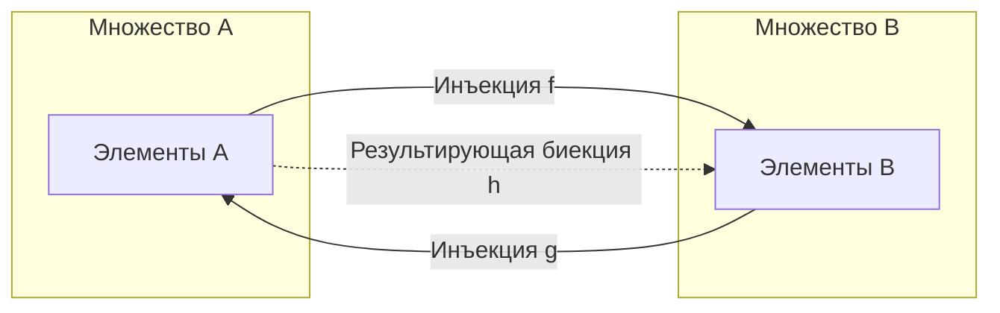

### Доказательство через распад на цепи (орбиты)
Пусть даны инъекции $f: A \to B$ и $g: B \to A$.
Для каждого элемента $x \in A \cup B$ проследим его происхождение (родословную предков), попеременно применяя прообразы $g^{-1}$ и $f^{-1}$:

$$\dots \xrightarrow{f} g^{-1}(a) \xrightarrow{g} f^{-1}(g^{-1}(a)) \dots$$

Каждый элемент принадлежит цепочке одного из 4 взаимоисключающих типов:
1. **$A$-останавливающаяся цепь**: цепочка обрывается на элементе множества $A \setminus g(B)$ (у него нет предка в $B$).
2. **$B$-останавливающаяся цепь**: цепочка обрывается на элементе множества $B \setminus f(A)$ (у него нет предка в $A$).
3. **Бесконечная цепь**: элементы уходят назад в бесконечность без начала.
4. **Периодическая цепь (цикл)**: цепочка замыкается сама на себя.

Разобьём множество $A$ на две части:
- $A_A$ — элементы, принадлежащие $A$-цепям, бесконечным цепям и циклам.
- $A_B$ — элементы, принадлежащие $B$-цепям.

Зададим искомую биекцию $h: A \to B$:
$$h(x) = \begin{cases} 
f(x), & \text{если } x \in A_A \\ 
g^{-1}(x), & \text{если } x \in A_B 
\end{cases}$$
Отображение $h$ строго корректно, инъективно и сюръективно $\implies h$ — биекция. $\blacksquare$

### Пример триумфа КБШ: Полуинтервал и квадрат
Доказать равномощность $[0, 1)$ и $(0, 1)^2$ прямым построением формулы биекции громоздко. По КБШ достаточно предъявить две тривиальные инъекции:
1. $f: (0, 1) \hookrightarrow [0, 1)$ задаётся тождественно: $f(x) = x$.
2. $g: [0, 1) \hookrightarrow (0, 1)$ задаётся сжатием: $g(x) = \frac{x + 1}{3}$.
По КБШ немедленно получаем $[0, 1) \sim (0, 1)$.

---

## 13. Кардинальная арифметика и трансфинитные числа

Операции над мощностями определяются через операции над множествами.

### Определение 13.1 (Арифметика кардиналов)
Пусть $|A| = \kappa$, $|B| = \lambda$.
1. **Сложение**: $\kappa + \lambda = |(A \times \{0\}) \cup (B \times \{1\})|$ (мощность дизъюнктного объединения).
2. **Умножение**: $\kappa \cdot \lambda = |A \times B|$ (мощность декартова произведения).
3. **Возведение в степень**: $\kappa^\lambda = |B \to A| = |A^B|$ (мощность множества всех функций из $B$ в $A$).

### Таблица законов кардинальной арифметики

| Выражение | Значение | Смысл / Интерпретация |
| :--- | :--- | :--- |
| $\aleph_0 + n$ | $\aleph_0$ | Отель Гильберта ($+n$ гостей) |
| $\aleph_0 + \aleph_0$ | $\aleph_0$ | Объединение двух счётных множеств |
| $\aleph_0 \cdot \aleph_0$ | $\aleph_0$ | Пары натуральных чисел $\mathbb{N} \times \mathbb{N} \sim \mathbb{Q}$ |
| $2^{\aleph_0}$ | $\mathfrak{c}$ | Мощность множества подмножеств $\mathcal{P}(\mathbb{N})$ и континуума $\mathbb{R}$ |
| $\mathfrak{c} + \aleph_0$ | $\mathfrak{c}$ | Добавление счётного множества к континууму |
| $\mathfrak{c} + \mathfrak{c}$ | $\mathfrak{c}$ | Объединение двух непересекающихся отрезков |
| $\mathfrak{c} \cdot \mathfrak{c}$ | $\mathfrak{c}$ | Точки квадрата $[0, 1]^2 \sim [0, 1]$ |
| $\mathfrak{c}^{\aleph_0}$ | $\mathfrak{c}$ | Последовательности вещественных чисел: $(2^{\aleph_0})^{\aleph_0} = 2^{\aleph_0 \cdot \aleph_0} = 2^{\aleph_0} = \mathfrak{c}$ |
| $2^\mathfrak{c}$ | $2^\mathfrak{c}$ | Мощность всех функций $\mathbb{R} \to \{0, 1\}$ и булеана $\mathcal{P}(\mathbb{R})$ |
| $\mathfrak{c}^\mathfrak{c}$ | $2^\mathfrak{c}$ | Мощность всех функций $\mathbb{R} \to \mathbb{R}$: $(2^{\aleph_0})^\mathfrak{c} = 2^{\aleph_0 \cdot \mathfrak{c}} = 2^\mathfrak{c}$ |

> **Замечание (поглощение меньших кардиналов)**: Для любых бесконечных кардиналов $\kappa, \lambda$ в ZFC выполняется:
> $$\kappa + \lambda = \kappa \cdot \lambda = \max(\kappa, \lambda)$$

---

## 14. Шкалы Алефов ($\aleph$) и Бетов ($\beth$), Континуум-гипотеза (CH)

Бесконечности в современной теории множеств классифицируются по двум шкалам:

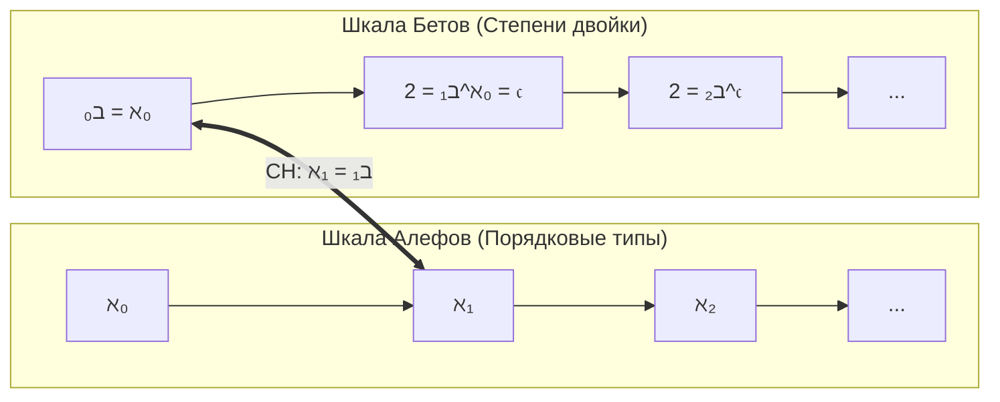

### Шкала Алефов: $\aleph_\alpha$
Алефы нумеруют мощности **вполне упорядоченных множеств** по возрастанию:
- $\aleph_0$ — наименьшая бесконечная мощность ($|\mathbb{N}|$).
- $\aleph_1$ — непосредственно следующая за ней мощность (наименьшая несчётная мощность).
- $\aleph_2$ — непосредственно следующая за $\aleph_1$, и так далее.

### Шкала Бетов: $\beth_\alpha$
Беты строятся последовательным взятием мощности булеана:
- $\beth_0 = \aleph_0$
- $\beth_1 = 2^{\beth_0} = 2^{\aleph_0} = \mathfrak{c}$ (континуум)
- $\beth_2 = 2^{\beth_1} = 2^\mathfrak{c}$ (гиперконтинуум)
- $\beth_{\alpha+1} = 2^{\beth_\alpha}$

### Континуум-гипотеза (CH — Continuum Hypothesis)
В 1878 году Георг Кантор выдвинул гипотезу:
> **Континуум-гипотеза (CH)**: Не существует множества, мощность которого строго промежуточна между счётным и континуумом:
> $$\aleph_1 = 2^{\aleph_0} = \mathfrak{c} \quad (\aleph_1 = \beth_1)$$
> **Обобщённая континуум-гипотеза (GCH)**: Для любого ординала $\alpha$:
> $$\aleph_{\alpha+1} = 2^{\aleph_\alpha} \quad (\aleph_\alpha = \beth_\alpha)$$

#### Статус континуум-гипотезы в современной науке
Континуум-гипотеза оказалась первой проблемой в знаменитом списке 23 проблем Гильберта (1900 г.). Её судьба стала триумфом математической логики XX века:
1. **Курт Гёдель (1938 г.)**: Доказал, что CH **нельзя опровергнуть** в рамках стандартной аксиоматики Цермело–Френкеля с аксиомой выбора (ZFC). То есть теория $\mathrm{ZFC} + \mathrm{CH}$ непротиворечива (если непротиворечива сама ZFC). Гёдель построил модель конструктивных множеств $L$.
2. **Пол Коэн (1963 г.)**: Изобрёл фундаментальный метод **форсинга (forcing)** и доказал, что CH **нельзя доказать** в ZFC. Теория $\mathrm{ZFC} + \neg\mathrm{CH}$ также непротиворечива.
3. **Итог**: Континуум-гипотеза **независима от ZFC** ($ZFC \nvdash CH$ и $ZFC \nvdash \neg CH$). Вопрос о том, равна ли мощность континуума $\aleph_1$, $\aleph_2$ или $\aleph_{42}$, не разрешим в рамках принятых базовых аксиом математики.

---

## 15. Сводная классификация мощностей

| Множество | Обозначение мощности | Значение | Метод доказательства |
| :--- | :---: | :---: | :--- |
| Конечное множество $\{1, \dots, n\}$ | $n$ | $n < \aleph_0$ | Принцип Дирихле |
| Натуральные числа $\mathbb{N}$ | $\aleph_0$ | $\aleph_0$ | Эталон счётности |
| Чётные числа $2\mathbb{N}$ | $\aleph_0$ | $\aleph_0$ | Биекция $n \mapsto 2n$ (Галилей) |
| Целые числа $\mathbb{Z}$ | $\aleph_0$ | $\aleph_0$ | Чередование знаков $0, 1, -1, 2, \dots$ |
| Рациональные числа $\mathbb{Q}$ | $\aleph_0$ | $\aleph_0$ | Змейка Кантора / счёт по высоте |
| Алгебраические числа $\mathbb{A}$ | $\aleph_0$ | $\aleph_0$ | Счёт по высоте многочленов |
| Множество всех программ $\Sigma^*$ | $\aleph_0$ | $\aleph_0$ | Счётное объединение конечных $\Sigma^k$ |
| Действительные числа $\mathbb{R}$ | $\mathfrak{c} = 2^{\aleph_0}$ | $\beth_1$ | Диагональный процесс Кантора |
| Интервал $(0, 1)$, отрезок $[0, 1]$ | $\mathfrak{c}$ | $\beth_1$ | Сдвиг в отеле Гильберта |
| Квадрат $[0, 1]^2$, куб $[0, 1]^3$, $\mathbb{R}^n$ | $\mathfrak{c}$ | $\beth_1$ | Переплетение блоков цифр / Пеано |
| Канторово совершенное множество $\mathcal{C}$ | $\mathfrak{c}$ | $\beth_1$ | Троичные дроби $\{0, 2\}^\mathbb{N}$ |
| Трансцендентные числа $\mathbb{T}$ | $\mathfrak{c}$ | $\beth_1$ | $\mathfrak{c} - \aleph_0 = \mathfrak{c}$ |
| Все языки / задачи $\mathcal{P}(\Sigma^*)$ | $\mathfrak{c}$ | $\beth_1$ | Булеан счётного множества |
| Все подмножества прямой $\mathcal{P}(\mathbb{R})$ | $2^\mathfrak{c}$ | $\beth_2$ | Теорема Кантора $|A| < |\mathcal{P}(A)|$ |
| Все функции $\mathbb{R} \to \mathbb{R}$ | $2^\mathfrak{c}$ | $\beth_2$ | $\mathfrak{c}^\mathfrak{c} = (2^{\aleph_0})^\mathfrak{c} = 2^\mathfrak{c}$ |

---

## 16. Контрольные вопросы и задачи для самопроверки

1. **Вопрос**: Докажите, что множество всех правильных скобочных последовательностей счётно.  
   *Указание*: Множество скобочных выражений есть подмножество всех конечных слов в алфавите $\{ (, ) \}$, которое счётно.
2. **Вопрос**: Какова мощность множества всех окружностей на плоскости $\mathbb{R}^2$ с рациональным радиусом и рациональным центром?  
   *Указание*: Каждая такая окружность однозначно задаётся тройкой $(x_0, y_0, r) \in \mathbb{Q} \times \mathbb{Q} \times \mathbb{Q}^+$. Мощность равна $\aleph_0^3 = \aleph_0$.
3. **Вопрос**: Какова мощность множества всех непересекающихся восьмёрок на плоскости?  
   *Указание*: Внутри каждого из двух колец каждой восьмёрки можно выбрать по рациональной точке с координатами из $\mathbb{Q}^2$. Поскольку восьмёрки не пересекаются, точки уникальны. Множество не более чем счётно.
4. **Вопрос**: Почему множество всех непрерывных функций $C(\mathbb{R})$ имеет мощность континуума $\mathfrak{c}$, тогда как множество всех произвольных функций $\mathbb{R}^\mathbb{R}$ имеет мощность $2^\mathfrak{c}$?  
   *Указание*: Непрерывная функция однозначно определяется своими значениями на счётном всюду плотном множестве рациональных чисел $\mathbb{Q}$. Следовательно, $|C(\mathbb{R})| \le |\mathbb{R}^\mathbb{Q}| = \mathfrak{c}^{\aleph_0} = (2^{\aleph_0})^{\aleph_0} = 2^{\aleph_0} = \mathfrak{c}$.
5. **Вопрос**: В чём принципиальное различие между шкалой алефов и шкалой бетов, и при каких условиях они совпадают?  
   *Указание*: Алефы нумеруют мощности упорядоченных множеств, беты — степени булеанов; совпадают тогда и только тогда, когда верна обобщённая континуум-гипотеза (GCH).
