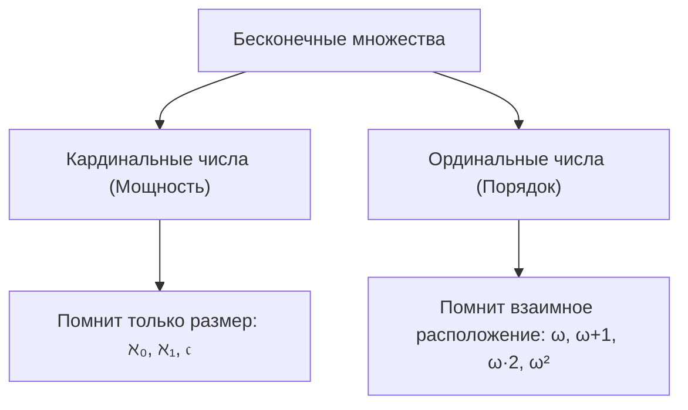
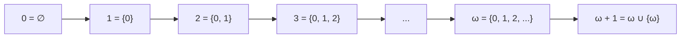
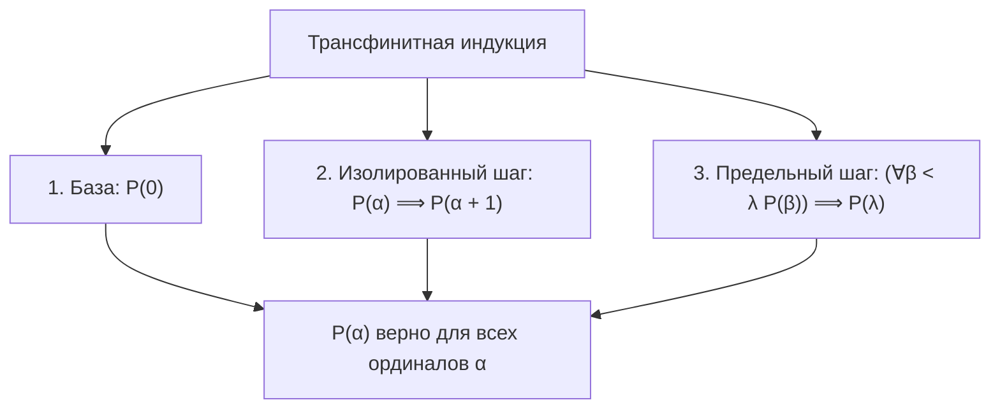
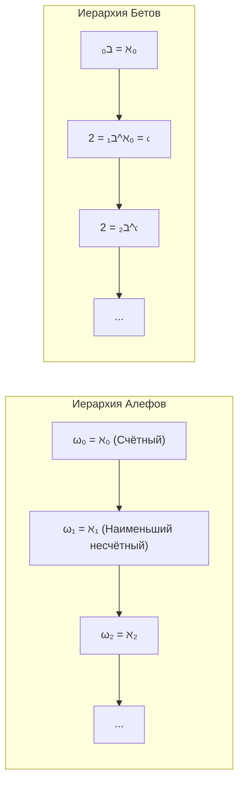
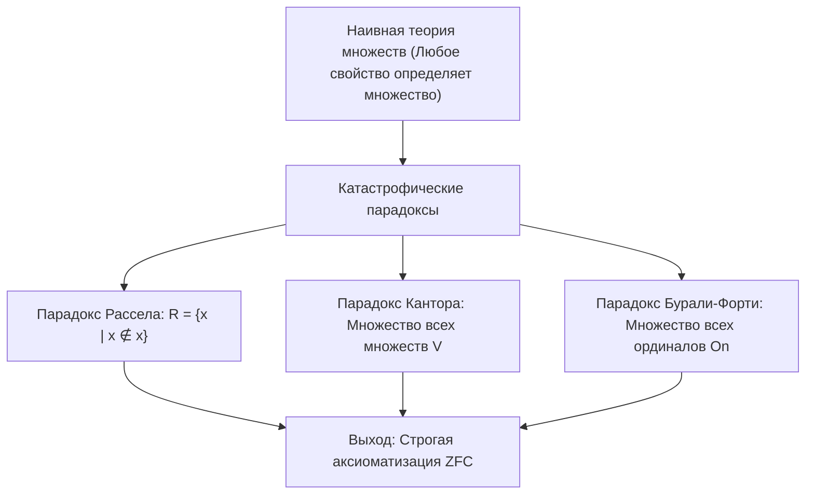
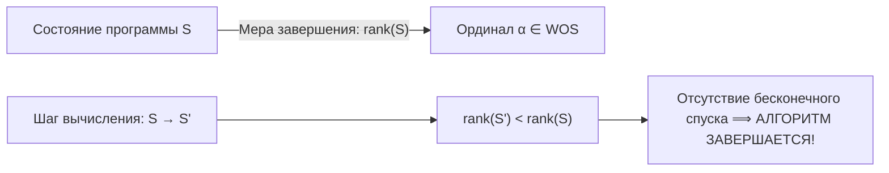

# Лекция 9: Вполне упорядоченные множества, ординалы фон Неймана, трансфинитная индукция, парадоксы теории множеств и аксиоматика ZFC

> **Дисциплина**: Дискретная математика  
> **Лектор**: Константин Чухарев (ФИТиП (ИС), Университет ИТМО, осенний семестр 2026)  
> **Ключевые темы**: Понятие порядка: «сколько» (кардиналы) vs «какой по счёту» (ординалы), вполне упорядоченные множества (WOS) и отсутствие бесконечного спуска, порядковые типы и изоморфизмы порядков, определение ординалов по фон Нейману через транзитивные множества, операции над ординалами (следующий ординал $\alpha^+$, предельные ординалы, некоммутативность сложения и умножения: $1 + \omega = \omega \ne \omega + 1$), трансфинитная индукция и трансфинитная рекурсия, связь ординалов и кардиналов (начальные ординалы), шкала Алефов ($\aleph_\alpha$) и шкала Бетов ($\beth_\alpha$), Континуум-гипотеза (CH/GCH) и независимость в ZFC, парадоксы наивной теории множеств (Рассел, Кантор, Бурали-Форти), аксиоматика Цермело–Френкеля с аксиомой выбора (ZFC), кумулятивный универсум фон Неймана $V_\alpha$, недостижимые кардиналы, приложения в Computer Science (доказательство завершаемости алгоритмов, Hydra Game, теорема Гудстейна).

---

## 1. Рекомендуемая литература

* **Н. К. Верещагин, А. Шень — «Начала теории множеств»**  
  *Глава 3: «Вполне упорядоченные множества и ординалы» (§1: Вполне упорядоченные множества; §2: Порядковые числа; §3: Трансфинитная индукция; §4: Парадоксы теории множеств).*
* **Ф. А. Новиков — «Дискретная математика для программистов»**  
  *Глава 1: «Множества и отношения» (§1.6: Упорядоченные множества, ординалы и кардиналы; §1.7: Аксиоматические теории множеств).*
* **К. Кунен — «Set Theory: An Introduction to Independence Proofs»**  
  *Chapter 1: «The Axioms of Set Theory», Chapter 3: «Ordinals and Cardinals».*
* **П. Дж. Коэн — «Теория множеств и континуум-гипотеза»**  
  *Классическое изложение метода форсинга и независимости CH от ZFC.*

---

## 2. «Сколько» vs «Какой по счёту»: Кардиналы против Ординалов

В конечной математике два фундаментальных аспекта числа полностью совпадают:
- **Количественный (кардинальный)**: сколько элементов в совокупности ($1, 2, 3, \dots, n$).
- **Порядковый (ординальный)**: на каком месте стоит элемент в последовательности (первый, второй, третий, $\dots$, $n$-й).

В бесконечном мире эти понятия принципиально расходятся:
- **Кардинальное число** («размер») помнит только мощность множества (наличие биекции $A \sim B$). Порядок элементов кардинал полностью игнорирует.
- **Ординальное число** («порядковый номер») помнит структуру порядка. Одно и то же счётное множество мощности $\aleph_0$ можно упорядочить бесконечным числом структурно неизоморфных способов!



---

## 3. Вполне упорядоченные множества (Well-Ordered Sets)

Напомним, что множество $X$ с бинарным отношением $\le$ называется **линейно упорядоченным**, если отношение рефлексивно, антисимметрично, транзитивно, и любые два элемента сравнимы: $\forall a, b \in X \; (a \le b \lor b \le a)$.

### Определение 3.1 (Вполне упорядоченное множество)
> Линейно упорядоченное множество $(X, \le)$ называется **вполне упорядоченным** (англ. *well-ordered set*, WOS), если любое его **непустое подмножество** $S \subseteq X$ ($S \ne \varnothing$) имеет **наименьший элемент**:
> $$\forall S \subseteq X \; (S \ne \varnothing \implies \exists m \in S \; \forall x \in S: m \le x)$$

### Критерий фундированности: Отсутствие бесконечного спуска
> **Теорема 3.1**: Линейно упорядоченное множество $(X, \le)$ вполне упорядочено тогда и только тогда, когда в нём **не существует бесконечной строго убывающей последовательности**:
> $$\nexists \{a_n\}_{n=1}^\infty \subset X : a_1 > a_2 > a_3 > a_4 > \dots$$

```mermaid
graph LR
    subgraph Bad["Не фундированный порядок (Бесконечный спуск)"]
        a1["a1"] -->|" > "| a2["a2"] -->|" > "| a3["a3"] -->|" > "| adots["..."]
    end
    subgraph Good["Вполне упорядоченный (WOS)"]
        b0["Минимум m"] <=- b1["b1"] <=- b2["b2"]
    end
```

### Примеры и контрпримеры:
1. **Натуральные числа** $(\mathbb{N}, \le)$: вполне упорядочены (аксиома индукции / принцип наименьшего элемента). Любое непустое подмножество натуральных чисел имеет минимум.
2. **Целые числа** $(\mathbb{Z}, \le)$ со стандартным порядком: **не вполне упорядочены**, так как последовательность $-1 > -2 > -3 > -4 > \dots$ бесконечно убывает. В самом множестве $\mathbb{Z}$ нет наименьшего элемента.
3. **Отрезок** $[0, 1] \subset \mathbb{R}$: не вполне упорядочен. Подмножество $(0, 1] \subset [0, 1]$ не имеет наименьшего элемента (инфимум $0 \notin (0, 1]$), а последовательность $1/2 > 1/3 > 1/4 > \dots$ бесконечно убывает.

### Как «починить» порядок на $\mathbb{Z}$?
Стандартный порядок на $\mathbb{Z}$ не является полным. Однако множество $\mathbb{Z}$ можно переупорядочить так, чтобы оно стало вполне упорядоченным:
- **Способ А (перемежение)**:
  $$0 \prec 1 \prec -1 \prec 2 \prec -2 \prec 3 \prec -3 \prec \dots$$
  Этот порядок изоморфен стандартному порядку на $\mathbb{N}$.
- **Способ Б (сначала положительные, затем отрицательные)**:
  $$0 \prec 1 \prec 2 \prec 3 \prec \dots \prec -1 \prec -2 \prec -3 \prec \dots$$
  Здесь любой убывающий спуск обрывается: если мы идём влево по отрицательным числам, мы упрёмся в $-1$, перейдём в положительные и упрёмся в $0$. Это вполне упорядоченное множество нового порядкового типа ($\omega + \omega$).

---

## 4. Порядковый тип и изоморфизм порядков

### Определение 4.1 (Изоморфизм упорядоченных множеств)
> Два упорядоченных множества $(A, \le_A)$ и $(B, \le_B)$ называются **изоморфными** (или имеют одинаковый **порядковый тип**), если существует биекция $f: A \leftrightarrow B$, сохраняющая порядок:
> $$\forall x, y \in A: \quad x \le_A y \iff f(x) \le_B f(y)$$

### Начальные отрезки (сегменты)
Для элемента $a \in X$ **начальным отрезком** (сегментом) называется множество всех элементов, строго меньших $a$:
$$X_{< a} = \{x \in X \mid x < a\}$$

> **Фундаментальная теорема о сравнении WOS**:  
> Для любых двух вполне упорядоченных множеств $A$ и $B$ выполнено ровно одно из трёх условий:
> 1. $A \cong B$ ($A$ изоморфно $B$).
> 2. $A$ изоморфно некоторому начальному отрезку $B_{< b}$ ($A$ «короче» $B$).
> 3. $B$ изоморфно некоторому начальному отрезку $A_{< a}$ ($B$ «короче» $A$).
>
> Более того, никакое вполне упорядоченное множество не может быть изоморфно своему собственному начальному отрезку!

---

## 5. Ординалы фон Неймана

В 1923 году Джон фон Нейман предложил гениальную теоретико-множественную конструкцию: реализовать каждое порядковое число как конкретное каноническое множество, элементами которого являются все предшествующие ему ординалы.

### Определение 5.1 (Транзитивное множество)
> Множество $T$ называется **транзитивным**, если каждый его элемент является одновременно его подмножеством:
> $$\forall x \in T \; (x \subseteq T) \iff \forall y, x \; (y \in x \land x \in T \implies y \in T)$$

### Определение 5.2 (Ординал по фон Нейману)
> Множество $\alpha$ называется **ординалом** (ординальным числом), если:
> 1. $\alpha$ транзитивно.
> 2. Отношение принадлежности $\in$ является строгим полным порядком на $\alpha$.

В этой модели отношение «меньше» для ординалов — это в точности отношение принадлежности $\in$:
$$\beta < \alpha \iff \beta \in \alpha$$
А нестрогое неравенство совпадает с включением:
$$\beta \le \alpha \iff \beta \subseteq \alpha$$



### Построение натуральных чисел фон Неймана:
$$\begin{aligned}
0 &= \varnothing \\
1 &= 0 \cup \{0\} = \{\varnothing\} = \{0\} \\
2 &= 1 \cup \{1\} = \{0, 1\} = \{\varnothing, \{\varnothing\}\} \\
3 &= 2 \cup \{2\} = \{0, 1, 2\} \\
n+1 &= n \cup \{n\} = \{0, 1, 2, \dots, n\}
\end{aligned}$$
Каждый конечный ординал $n$ содержит ровно $n$ элементов — все меньшие натуральные числа!

### Следующий ординал (Операция следования)
Для любого ординала $\alpha$ **непосредственно следующим** ординалом является:
$$\alpha^+ = S(\alpha) = \alpha \cup \{\alpha\}$$
Между $\alpha$ и $\alpha^+$ нет никаких промежуточных ординалов.

---

## 6. Предельные ординалы и первый бесконечный ординал $\omega$

### Первый бесконечный ординал $\omega$
Множество всех конечных натуральных чисел фон Неймана само удовлетворяет определению ординала:
$$\omega = \{0, 1, 2, 3, \dots\} = \mathbb{N}_0$$
$\omega$ — наименьший бесконечный ординал. Он не имеет непосредственного предшественника!

### Классификация ординалов:
Каждый ординал $\alpha$ принадлежит ровно к одному из трёх классов:
1. $\alpha = 0 = \varnothing$ (ноль).
2. $\alpha = \beta + 1 = \beta \cup \{\beta\}$ (**изолированный** или непредельный ординал, имеет непосредственного предшественника $\beta$).
3. $\alpha$ — **предельный ординал**: $\alpha \ne 0$, не имеет непосредственного предшественника и является точной верхней гранью (объединением) всех меньших ординалов:
   $$\alpha = \bigcup_{\beta < \alpha} \beta = \sup_{\beta < \alpha} \beta$$

*Примеры предельных ординалов*:
$$\omega, \quad \omega \cdot 2 = \omega + \omega, \quad \omega^2, \quad \omega^\omega, \quad \varepsilon_0 = \sup\{\omega, \omega^\omega, \omega^{\omega^\omega}, \dots\}$$

---

## 7. Трансфинитная индукция и трансфинитная рекурсия

Обычная математическая индукция работает только для конечных шагов $n \in \mathbb{N}$. Трансфинитная индукция обобщает доказательства на произвольные вполне упорядоченные совокупности.

### Теорема 7.1 (Принцип трансфинитной индукции)
> Пусть $P(\alpha)$ — некоторое свойство ординалов.  
> Если для любого ординала $\alpha$ из предположения, что $P(\beta)$ истинно для всех $\beta < \alpha$, следует истинность $P(\alpha)$:
> $$\forall \alpha \; \bigl((\forall \beta < \alpha: P(\beta)) \implies P(\alpha)\bigr)$$
> то свойство $P(\alpha)$ истинно для **всех** ординалов $\alpha$.

На практике доказательство по трансфинитной индукции разбивают на 3 шага:
1. **База индукции**: Доказать $P(0)$.
2. **Шаг для изолированного ординала**: Предполагая $P(\alpha)$, доказать $P(\alpha + 1)$.
3. **Шаг для предельного ординала**: Пусть $\lambda$ — предельный ординал. Предполагая, что $P(\beta)$ верно для всех $\beta < \lambda$, доказать $P(\lambda)$.



---

## 8. Арифметика ординалов и её парадоксы

Операции сложения, умножения и возведения в степень для ординалов определяются через трансфинитную рекурсию или склейку упорядоченных множеств.

### 1. Сложение ординалов ($\alpha + \beta$)
Множество $A$ порядка $\alpha$, за которым следует множество $B$ порядка $\beta$:
- База: $\alpha + 0 = \alpha$
- Изолированный переход: $\alpha + (\beta + 1) = (\alpha + \beta) + 1$
- Предельный переход: $\alpha + \lambda = \sup_{\beta < \lambda} (\alpha + \beta)$

#### Парадокс некоммутативности сложения:
$$1 + \omega = \sup_{n < \omega} (1 + n) = \omega$$
но:
$$\omega + 1 = \omega \cup \{\omega\} > \omega$$
Следовательно:
$$1 + \omega \ne \omega + 1 \quad (1 + \omega = \omega < \omega + 1)$$
*Геометрический смысл*: Добавление одного элемента в начало натурального ряда не меняет его порядкового типа:
$$\bullet, 0, 1, 2, 3, \dots \cong 0, 1, 2, 3, \dots$$
Но добавление элемента в конец создаёт новый максимальный элемент, строго больший всех остальных:
$$0, 1, 2, 3, \dots, \bullet \quad (\text{порядковый тип } \omega + 1)$$

### 2. Умножение ординалов ($\alpha \cdot \beta$)
Декартово произведение $B \times A$ с обратным лексикографическим порядком (замена каждого элемента множества $B$ копией множества $A$):
- $\alpha \cdot 0 = 0$
- $\alpha \cdot (\beta + 1) = (\alpha \cdot \beta) + \alpha$
- $\alpha \cdot \lambda = \sup_{\beta < \lambda} (\alpha \cdot \beta)$

#### Некоммутативность умножения:
$$2 \cdot \omega = \sup_{n < \omega} (2 \cdot n) = \omega$$
(бесконечная цепочка пар: $(\bullet, \bullet), (\bullet, \bullet), \dots \cong \omega$)  
но:
$$\omega \cdot 2 = \omega + \omega > \omega$$
(две последовательные бесконечные цепочки: $0, 1, 2, \dots, 0', 1', 2', \dots$)

### 3. Возведение в степень ординалов ($\alpha^\beta$)
- $\alpha^0 = 1$
- $\alpha^{\beta+1} = \alpha^\beta \cdot \alpha$
- $\alpha^\lambda = \sup_{\beta < \lambda} \alpha^\beta$

> [!WARNING]
> Ординальное возведение в степень **не равно** кардинальному!
> В арифметике ординалов:
> $$2^\omega = \sup_{n < \omega} 2^n = \omega$$
> Ординал $2^\omega = \omega$ **счётен**! В то время как кардинальная степень $2^{\aleph_0} = \mathfrak{c}$ — это несчётный континуум.

---

## 9. Кардиналы как начальные ординалы и шкала Алефов

Все ординалы $\omega, \omega+1, \omega \cdot 2, \omega^2, \omega^\omega, \varepsilon_0$ имеют одну и ту же **счётную мощность** $\aleph_0$:
$$|\omega| = |\omega + 1| = |\omega \cdot 2| = |\omega^2| = |\omega^\omega| = |\varepsilon_0| = \aleph_0$$

### Определение 9.1 (Начальный ординал / Кардинал)
> Ординал $\kappa$ называется **начальным ординалом** (или **кардиналом**), если он не может быть взаимно-однозначно отображён ни на какой строго меньший ординал:
> $$\forall \alpha < \kappa: \quad |\alpha| < |\kappa|$$

### Шкала Алефов ($\aleph_\alpha$ / $\omega_\alpha$)
Каждому кардиналу $\aleph_\alpha$ соответствует начальный ординал $\omega_\alpha$:
- $\omega_0 = \omega \iff \aleph_0$ — наименьший бесконечный кардинал.
- $\omega_1 \iff \aleph_1$ — **наименьший несчётный ординал**: множество **всех** счётных ординалов:
  $$\omega_1 = \{\alpha \in \mathrm{On} \mid |\alpha| \le \aleph_0\}$$
- $\omega_2 \iff \aleph_2$ — наименьший ординал мощности, строго превосходящей $\aleph_1$.



---

## 10. Парадоксы наивной теории множеств

В конце XIX века Георг Кантор определял множество просто как «объединение в единое целое любых мыслимых объектов». Это привело к фатальным логическим противоречиям.

### 1. Парадокс Рассела (1901 г.)
Рассмотрим свойство множества «не содержать себя в качестве элемента» ($x \notin x$). Большинство обычных множеств удовлетворяют ему (например, множество яблок само не яблоко).  
Определим по принципу свободы абстракции множество всех таких множеств:
$$R = \{x \mid x \notin x\}$$
Зададимся вопросом: принадлежит ли $R$ самому себе?
- Если $R \in R$, то по определению $R$ должно выполняться $R \notin R$. Противоречие.
- Если $R \notin R$, то условие $x \notin x$ для $x = R$ выполнено $\implies R \in R$. Противоречие.
$$R \in R \iff R \notin R$$
*Популярная аналогия*: Парадокс брадобрея (деревенский парикмахер бреет всех тех и только тех жителей деревни, которые не бреются сами. Бреет ли он сам себя?).

### 2. Парадокс Кантора (1899 г.)
Если существует «множество всех множеств» $V$, то его булеан $\mathcal{P}(V)$ также состоит из множеств, а значит, является подмножеством $V$:
$$\mathcal{P}(V) \subseteq V \implies |\mathcal{P}(V)| \le |V|$$
Однако по фундаментальной теореме Кантора мощность булеана строго больше мощности исходного множества:
$$|\mathcal{P}(V)| > |V|$$
Получили невозможное неравенство $|V| < |\mathcal{P}(V)| \le |V|$.

### 3. Парадокс Бурали-Форти (1897 г.)
Рассмотрим совокупность всех ординалов $\mathrm{On}$.
- Можно показать, что $\mathrm{On}$ вполне упорядочено отношением $\in$ и транзитивно.
- По определению фон Неймана, $\mathrm{On}$ само обязано быть ординалом: $\Omega = \mathrm{On}$.
- Но тогда $\Omega \in \mathrm{On} = \Omega$, то есть $\Omega < \Omega$.
- Более того, для ординала $\Omega$ существует следующий ординал $\Omega + 1 > \Omega$. Но $\Omega + 1 \in \mathrm{On} = \Omega \implies \Omega + 1 \le \Omega$. Противоречие.



---

## 11. Аксиоматика Цермело–Френкеля (ZFC)

Чтобы спасти математику от противоречий, Эрнст Цермело (1908) и Абрахам Френкель (1922) сформулировали систему аксиом ZFC, исключающую «слишком большие» совокупности (собственные классы).

### Аксиома выделения (Axiom Schema of Specification)
Главный барьер против парадокса Рассела: **запрещено** создавать множество выражением $\{x \mid P(x)\}$. Разрешено лишь выделять элементы из **уже существующего множества $A$**:
$$\forall A \; \exists B \; \forall x \; (x \in B \iff x \in A \land P(x))$$
Если применить схему Рассела $R_A = \{x \in A \mid x \notin x\}$, мы получаем лишь строгое доказательство того, что $R_A \notin A$, откуда следует, что **универсального множества всех множеств не существует**!

### Полный список аксиом ZFC:
1. **Экстенсиональность (объёмность)**: Множества равны, если состоят из одних и тех же элементов:
   $$\forall x \; (x \in A \iff x \in B) \implies A = B$$
2. **Пустое множество**: Существует множество $\varnothing$, не содержащее элементов: $\exists \varnothing \; \forall x \; (x \notin \varnothing)$.
3. **Пара**: Для любых двух множеств $a, b$ существует неупорядоченная пара $\{a, b\}$.
4. **Объединение ($\bigcup$)**: Для любого семейства множеств $A$ существует объединение всех элементов его элементов.
5. **Схема выделения**: Для любого свойства $P$ и множества $A$ существует подмножество $\{x \in A \mid P(x)\}$.
6. **Булеан (множество подмножеств $\mathcal{P}$)**: Для любого множества $A$ существует множество всех его подмножеств.
7. **Бесконечность**: Существует бесконечное индуктивное множество (гарантирует существование $\omega$ и $\mathbb{N}$).
8. **Схема подстановки (замены)**: Образ множества при функциональном отображении является множеством.
9. **Регулярность (фундирование)**: Каждое непустое множество $A$ содержит $\in$-минимальный элемент ($x \cap A = \varnothing$). Запрещает цепочки $x \in x$ и бесконечные спуски $x_1 \ni x_2 \ni x_3 \ni \dots$
10. **Аксиома выбора (AC)**: Для любого семейства непустых непересекающихся множеств существует функция выбора.

### Кумулятивная иерархия фон Неймана ($V_\alpha$)
В ZFC весь универсум множеств строится «снизу вверх» по шагам, нумеруемым ординалами:
$$\begin{aligned}
V_0 &= \varnothing \\
V_{\alpha+1} &= \mathcal{P}(V_\alpha) \\
V_\lambda &= \bigcup_{\beta < \lambda} V_\beta \quad (\text{для предельного } \lambda) \\
V &= \bigcup_{\alpha \in \mathrm{On}} V_\alpha
\end{aligned}$$
Каждое множество появляется на некотором ординальном этаже $\alpha$ (ранг множества $\operatorname{rank}(x) = \alpha$).

---

## 12. Недостижимые и большие кардиналы

Существуют ли в универсуме множеств этажи, недостижимые операциями ZFC?
> **Определение 12.1 (Слабо недостижимый кардинал)**: Несчётный кардинал $\kappa > \aleph_0$ называется слабо недостижимым, если он предельный ($\forall \lambda < \kappa: \lambda^+ < \kappa$) и регулярный ($\operatorname{cf}(\kappa) = \kappa$, его нельзя получить как объединение меньшего числа меньших множеств).  
> **Сильно недостижимый кардинал**: Кардинал $\kappa > \aleph_0$ регулярен и является сильным предельным: $\forall \lambda < \kappa: 2^\lambda < \kappa$.

### Теорема о модели
Если $\kappa$ — сильно недостижимый кардинал, то этаж кумулятивной иерархии $V_\kappa$ сам по себе является **полноценной моделью ZFC**!
> **Следствие (по второй теореме Гёделя о неполноте)**:  
> Теория ZFC **не может доказать** существование недостижимого кардинала (иначе ZFC доказала бы непротиворечивость модели ZFC, а значит, доказала бы собственную непротиворечивость, что невозможно). Гипотезы о существовании больших кардиналов образуют естественную шкалу расширений современной аксиоматики.

---

## 13. Приложения в Computer Science: Доказательство завершаемости алгоритмов

В теории вычислений и формальной верификации программ доказательство того, что цикл или рекурсивная функция всегда завершают работу (halting / termination), опирается на ординалы и вполне упорядоченные множества.



### Метод ординальной меры Тьюринга–Флойда
1. Каждому состоянию программы $S$ сопоставляется элемент вполне упорядоченного множества (ординал) $\mu(S) \in \alpha$.
2. Доказывается, что на каждом шаге цикла или рекурсии мера строго уменьшается:
   $$S \to S' \implies \mu(S') < \mu(S)$$
3. **Вывод**: Поскольку во вполне упорядоченном множестве бесконечный убывающий спуск невозможен, алгоритм гарантированно завершит работу за конечное число шагов!

### Игра «Гидра» (Hydra Game) и теорема Гудстейна
- **Гидра** — это конечное корневое дерево. Герой Геркулес на каждом шаге отрубает одну голову (лист). В ответ гидра отращивает любое конечное число новых голов по строгому правилу.
- Кажется, что гидру победить невозможно из-за колоссального разрастания.
- **Математическое доказательство (Кирби и Парис, 1982 г.)**: Каждому дереву гидры сопоставляется ординал $\alpha < \varepsilon_0$. Любой срез головы строго уменьшает ординал. Так как бесконечного спуска ординалов нет, **Геркулес всегда побеждает за конечное число шагов**, какой бы стратегии отращивания ни придерживалась Гидра!
- Более того, завершаемость этой игры принципиально **не может быть доказана** средствами формальной арифметики Пеано (PA), но триумфально доказывается средствами теории ординалов (индукцией до $\varepsilon_0$).

---

## 14. Сводная сравнительная таблица: Кардиналы vs Ординалы

| Характеристика | Ординалы (Ordinal Numbers) | Кардиналы (Cardinal Numbers) |
| :--- | :--- | :--- |
| **Что выражает?** | Порядковый номер, взаимное расположение | Количественный размер, мощность множества |
| **Отношение** | Изоморфизм порядков ($A \cong B$) | Биекция множеств ($A \sim B$) |
| **Базовый бесконечный представитель** | $\omega = \{0, 1, 2, \dots\}$ | $\aleph_0 = |\mathbb{N}|$ |
| **Коммутативность сложения** | **Нет**: $1 + \omega = \omega \ne \omega + 1$ | **Да**: $1 + \aleph_0 = \aleph_0 + 1 = \aleph_0$ |
| **Коммутативность умножения** | **Нет**: $2 \cdot \omega = \omega \ne \omega \cdot 2$ | **Да**: $2 \cdot \aleph_0 = \aleph_0 \cdot 2 = \aleph_0$ |
| **Возведение в степень** | $2^\omega = \omega$ (счётно!) | $2^{\aleph_0} = \mathfrak{c}$ (несчётно!) |
| **Иерархия следующих** | $\alpha + 1$ (непосредственный последователь) | $\aleph_{\alpha+1}$ (следующая мощность) |
| **Свойство сложения бесконечных** | Растёт: $\omega < \omega + 1 < \omega + 2 < \dots$ | Поглощается: $\aleph_0 + \aleph_0 = \aleph_0$ |

---

## 15. Контрольные вопросы для самопроверки

1. **Вопрос**: Почему множество целых чисел со стандартным порядком $(\mathbb{Z}, \le)$ не является вполне упорядоченным, а множество неотрицательных чётных чисел $(\{0, 2, 4, \dots\}, \le)$ является?  
   *Ответ*: В $\mathbb{Z}$ есть бесконечная строго убывающая цепь $-1 > -2 > -3 > \dots$, и у подмножества всех отрицательных чисел нет минимума. В чётных неотрицательных числах спуск обрывается в нуле, любое подмножество имеет наименьший элемент.
2. **Вопрос**: В чём заключается геометрическое различие порядковых типов $\omega + 1$ и $1 + \omega$?  
   *Ответ*: Порядок $1 + \omega$ имеет изолированную точку в начале, за которой идёт стандартная последовательность, что изоморфно $\omega$. Порядок $\omega + 1$ имеет бесконечную последовательность, за которой следует выделенная точка конца (максимум), чего в $\omega$ нет.
3. **Вопрос**: Каким образом аксиома выделения в ZFC блокирует парадокс Рассела?  
   *Ответ*: Она запрещает брать все объекты вселенной со свойством $x \notin x$. Позволяется лишь строить множество $\{x \in A \mid x \notin x\}$ из уже существующего множества $A$, что доказывает лишь $R_A \notin A$ (универсального множества $A$ не существует), не создавая противоречия.
4. **Вопрос**: Почему ординал $2^\omega$ счётен, тогда как кардинал $2^{\aleph_0}$ несчётен?  
   *Ответ*: В арифметике ординалов $2^\omega = \sup_{n < \omega} 2^n$ есть счётное объединение конечных ординалов, равное $\omega$. В кардинальной арифметике $2^{\aleph_0}$ — это мощность множества подмножеств $\mathcal{P}(\mathbb{N})$, равная континууму $\mathfrak{c}$.
5. **Вопрос**: Как свойство вполне упорядоченности используется для доказательства завершаемости программ?  
   *Ответ*: Состоянию программы сопоставляется элемент WOS (ординал), строго убывающий на каждом шаге. Из-за отсутствия бесконечного спуска цикл обязан завершиться за конечное число шагов.
