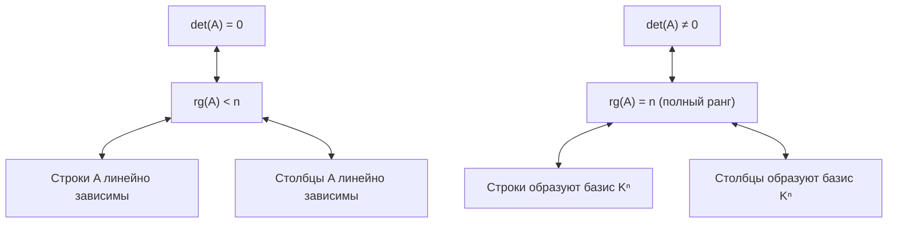
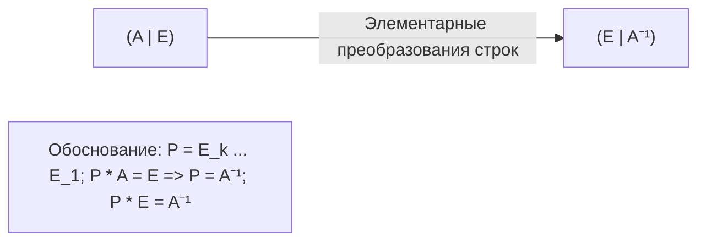

# Лекция 10: Инвариантность ранга матрицы, критерий вырожденности, формы записи СЛАУ, формулы Крамера, существование и единственность обратной матрицы

> **Дисциплина**: Линейная алгебра  
> **Лектор**: ФИТиП (ИС), Университет ИТМО (Осенний семестр 2026)  
> **Ключевые темы**: Инвариантность строчного и столбцового ранга при элементарных преобразованиях строк и столбцов, элементарные матрицы $E_{ij}, E_i(\lambda), E_{ij}(\lambda)$, представление цепочки преобразований как произведения $P = E_k \cdots E_1 A$, теорема о сохранении ранга при умножении на невырожденную матрицу ($\operatorname{rg}(PA) = \operatorname{rg}(A)$), критерий вырожденности квадратной матрицы ($\det A = 0 \iff$ строки матрицы линейно зависимы $\iff$ столбцы линейно зависимы $\iff \operatorname{rg}(A) < n$), строгое доказательство критерия вырожденности в обе стороны через приведение к треугольному и диагональному виду, системы линейных алгебраических уравнений (СЛАУ), три формы представления СЛАУ (развернутая по координатам, матричная $A X = B$, столбцовая / векторная $\sum_{j=1}^n x_j A^{(j)} = B$), геометрический смысл совместности СЛАУ и теорема Кронекера — Капелли, квадратные СЛАУ порядка $n$, определитель матрицы системы, теорема Крамера и вывод формул Крамера ($x_j = \Delta_j / \Delta$) через полилинейность и знакопеременность определителя, понятие обратной матрицы ($A A^{-1} = A^{-1} A = E$), необходимое условие обратимости ($\det A \ne 0$), теорема о существовании и единственности обратной матрицы (строгое доказательство единственности через ассоциативность умножения матриц), разложение матричного уравнения $A X = E$ на $n$ систем $A X^{(j)} = e^{(j)}$, связь элементов обратной матрицы с формулами Крамера и алгебраическими дополнениями, явная формула через присоединенную (союзную) матрицу ($A^{-1} = \frac{1}{\det A} \operatorname{adj}(A) = \frac{1}{\det A} C^T$), вычисление $A^{-1}$ методом Гаусса — Жордана над блочной матрицей $(A \mid E) \sim (E \mid A^{-1})$ и его алгебраическое обоснование.

---

## 1. Рекомендуемая литература

* **А. И. Кострикин — «Введение в алгебру. Часть II: Линейная алгебра»**  
  *Глава 1: «Векторные пространства» (§4: Ранг матриц); Глава 2: «Матрицы» (§2: Системы линейных уравнений; §3: Обратная матрица и формулы Крамера).*
* **Э. Б. Винберг — «Курс алгебры»**  
  *Глава 1: «Системы линейных уравнений и матрицы» (§1: Правило Крамера; §2: Метод Гаусса; §3: Умножение матриц и обратная матрица).*
* **И. В. Проскуряков — «Сборник задач по линейной алгебре»**  
  *Раздел II: «Системы линейных уравнений» (§1: Исследование систем по правилу Крамера; §2: Метод Гаусса); Раздел III: «Матрицы» (§1: Обратная матрица и матричные уравнения).*
* **Г. Стрэнг — «Линейная алгебра и её применения»**  
  *Глава 1: «Матрицы и метод исключения Гаусса» (обратные матрицы, разложение $A = LU$); Глава 4: «Определители» (формула Крамера, объем параллелепипеда).*

---

## 2. Инвариантность ранга матрицы при элементарных преобразованиях

На предыдущей лекции было введено понятие строчного и столбцового ранга матрицы $A \in M_{m \times n}(K)$ как размерностей линейных оболочек её строк и столбцов соответственно:
$$\operatorname{rg}_{\text{row}}(A) = \dim(\operatorname{span}(A_1, \dots, A_m)), \qquad \operatorname{rg}_{\text{col}}(A) = \dim(\operatorname{span}(A^{(1)}, \dots, A^{(n)}))$$
и доказана фундаментальная теорема о совпадении строчного и столбцового рангов: $\operatorname{rg}_{\text{row}}(A) = \operatorname{rg}_{\text{col}}(A) = \operatorname{rg}(A)$.

Сегодня мы переходим к глубокому исследованию динамических свойств ранга, его связи с определителем и приложениям к решению систем уравнений.

### Элементарные преобразования и элементарные матрицы
Напомним, что элементарными преобразованиями строк матрицы называются операции трех типов:
1. **Перестановка двух строк**: $A_i \leftrightarrow A_j$.
2. **Умножение строки на ненулевой скаляр**: $A_i \to \lambda A_i$ ($\lambda \ne 0$).
3. **Прибавление к одной строке другой строки, умноженной на скаляр**: $A_i \to A_i + \lambda A_j$ ($j \ne i$).

Каждому элементарному преобразованию строк размерности $m$ соответствует умножение матрицы $A$ **слева** на квадратную элементарную матрицу $E \in M_{m \times m}(K)$, полученную применением того же преобразования к единичной матрице $E_m$:
* Матрица перестановки $E_{ij}$ ($\det E_{ij} = -1$).
* Матрица масштабирования $E_i(\lambda)$ ($\det E_i(\lambda) = \lambda \ne 0$).
* Матрица сдвига (трансвекция) $E_{ij}(\lambda)$ ($\det E_{ij}(\lambda) = 1$).

Аналогично, элементарные преобразования столбцов матрицы $A$ эквивалентны умножению матрицы $A$ **справа** на соответствующие элементарные матрицы порядка $n$.

> [!IMPORTANT] **Ключевое свойство элементарных матриц**  
> Все элементарные матрицы **невырождены (обратимы)**: их определители отличны от нуля. Более того, матрица, обратная к элементарной, сама является элементарной матрицей того же типа:
> $$E_{ij}^{-1} = E_{ij}, \qquad (E_i(\lambda))^{-1} = E_i(\lambda^{-1}), \qquad (E_{ij}(\lambda))^{-1} = E_{ij}(-\lambda)$$

### Теорема об инвариантности ранга
> **Теорема 1 (Инвариантность ранга при элементарных преобразованиях)**:  
> Элементарные преобразования строк и столбцов не изменяют ранг матрицы.  
> То есть если матрица $B$ получена из матрицы $A$ конечной цепочкой элементарных преобразований строк и столбцов, то:
> $$\operatorname{rg}(B) = \operatorname{rg}(A)$$

#### Доказательство:
1. **Шаг 1: Преобразования строк**.  
   Строки матрицы $B$ получаются элементарными операциями над строками матрицы $A$.  
   * При перестановке строк множество строк как подмножество $K^n$ не меняется, значит, их линейная оболочка $\operatorname{span}(A_1, \dots, A_m)$ остаётся прежней.  
   * При замене $A_i$ на $\lambda A_i$ ($\lambda \ne 0$) любой вектор, линейно выражающийся через $A_i$, выражается и через $\lambda A_i$ (так как $A_i = \lambda^{-1}(\lambda A_i)$). Линейная оболочка сохраняется.  
   * При замене $A_i$ на $A_i + \lambda A_j$ очевидно, что $A_i + \lambda A_j \in \operatorname{span}(A_1, \dots, A_m)$, поэтому новая линейная оболочка содержится в старой. Наоборот, исходная строка $A_i = (A_i + \lambda A_j) - \lambda A_j$ принадлежит новой линейной оболочке.  
   Следовательно:
   $$\operatorname{Row}(B) = \operatorname{Row}(A) \implies \dim(\operatorname{Row}(B)) = \dim(\operatorname{Row}(A)) \implies \operatorname{rg}_{\text{row}}(B) = \operatorname{rg}_{\text{row}}(A)$$
2. **Шаг 2: Преобразования столбцов**.  
   Аналогично, элементарные преобразования столбцов не меняют линейную оболочку столбцов $\operatorname{Col}(A)$, следовательно, сохраняют столбцовый ранг $\operatorname{rg}_{\text{col}}(A)$.
3. **Шаг 3: Совпадение рангов**.  
   Так как по фундаментальной теореме строчный и столбцовый ранги любой матрицы совпадают ($\operatorname{rg}_{\text{row}} = \operatorname{rg}_{\text{col}} = \operatorname{rg}$), любое строчное преобразование сохраняет и столбцовый ранг, а любое столбцовое преобразование сохраняет строчный ранг. $\blacksquare$

### Алгебраическое обобщение: умножение на невырожденную матрицу
Любая цепочка из $k$ элементарных преобразований строк записывается как матрица:
$$P = E_k \cdot E_{k-1} \cdots E_1$$
Так как каждая $E_i$ невырождена, матрица $P$ также невырождена ($\det P = \prod \det E_i \ne 0$).

> [!NOTE] **Теорема 2 (Сохранение ранга при умножении на невырожденную матрицу)**  
> Пусть $A \in M_{m \times n}(K)$.  
> 1. Если матрица $P \in M_{m \times m}(K)$ невырождена ($\det P \ne 0$), то $\operatorname{rg}(P A) = \operatorname{rg}(A)$.  
> 2. Если матрица $Q \in M_{n \times n}(K)$ невырождена ($\det Q \ne 0$), то $\operatorname{rg}(A Q) = \operatorname{rg}(A)$.  
> 
> *Доказательство*: Строки матрицы $P A$ являются линейными комбинациями строк матрицы $A$, поэтому $\operatorname{Row}(P A) \subseteq \operatorname{Row}(A)$, откуда $\operatorname{rg}(P A) \le \operatorname{rg}(A)$.  
> Поскольку $P$ невырождена, существует обратная матрица $P^{-1}$. Применяя то же неравенство к матрице $P A$ и матрице $P^{-1}$, получаем:
> $$\operatorname{rg}(A) = \operatorname{rg}(P^{-1} (P A)) \le \operatorname{rg}(P A)$$
> Из двух противоположных неравенств следует точное равенство: $\operatorname{rg}(P A) = \operatorname{rg}(A)$.

---

## 3. Критерий вырожденности квадратной матрицы

Для квадратных матриц $A \in M_{n \times n}(K)$ понятие ранга и понятие определителя сливаются в единую гармоничную теорию.

> [!IMPORTANT] **Теорема 3 (Критерий вырожденности матрицы)**  
> Для любой квадратной матрицы $A \in M_{n \times n}(K)$ следующие утверждения эквивалентны:
> 1. $\det(A) = 0$ *(матрица вырождена)*.
> 2. Строки матрицы $A$ линейно зависимы.
> 3. Столбцы матрицы $A$ линейно зависимы.
> 4. Ранг матрицы строго меньше её порядка: $\operatorname{rg}(A) < n$.

### Строгое доказательство критерия вырожденности:

#### Доказательство в сторону $(\Leftarrow)$:
Пусть строки $A_1, \dots, A_n$ матрицы $A$ линейно зависимы.  
Тогда существует нетривиальная линейная комбинация, равная нулевому вектору:
$$\sum_{i=1}^n c_i A_i = 0, \quad \text{где хотя бы один } c_k \ne 0$$
Без ограничения общности положим $c_k \ne 0$. Тогда строка $A_k$ выражается через остальные строки:
$$A_k = -\sum_{i \ne k} \frac{c_i}{c_k} A_i$$
Применим к матрице $A$ цепочку элементарных преобразований третьего типа: вычтем из $k$-й строки вектор $\frac{c_i}{c_k} A_i$ для всех $i \ne k$.  
Как известно из свойств определителя, элементарные преобразования третьего типа **не изменяют величину определителя**.  
В результате этих преобразований на месте $k$-й строки окажется **строка, целиком состоящая из нулей**:
$$A'_k = A_k - \sum_{i \ne k} \left(-\frac{c_i}{c_k} A_i\right) = 0$$
Матрица, содержащая нулевую строку, имеет определитель, равный 0 (по линейности определителя).  
Следовательно:
$$\det(A) = \det(A') = 0$$

#### Доказательство в сторону $(\Rightarrow)$:
Пусть $\det(A) = 0$. Докажем, что строки матрицы $A$ линейно зависимы.  
1. Применим к матрице $A$ метод Гаусса (элементарные преобразования строк), чтобы привести её к ступенчатому (верхнетреугольному) виду $U$:
   $$U = E_k \cdots E_1 A$$
   где $U$ — верхнетреугольная матрица вида:
   $$U = \begin{pmatrix} u_{11} & u_{12} & \cdots & u_{1n} \\ 0 & u_{22} & \cdots & u_{2n} \\ \vdots & \vdots & \ddots & \vdots \\ 0 & 0 & \cdots & u_{nn} \end{pmatrix}$$
2. По мультипликативному свойству определителя:
   $$\det(U) = \det(E_k) \cdots \det(E_1) \cdot \det(A)$$
   Поскольку определители всех элементарных матриц $E_i$ отличны от нуля, а $\det(A) = 0$, получаем:
   $$\det(U) = 0$$
3. Определитель треугольной матрицы равен произведению элементов её главной диагонали:
   $$\det(U) = \prod_{i=1}^n u_{ii} = 0$$
   Следовательно, на главной диагонали матрицы $U$ имеется **хотя бы один ноль**: $\exists j : u_{jj} = 0$.
4. В силу ступенчатой структуры матрицы $U$, если на диагонали появляется ноль, то последняя строка матрицы $U$ обязана быть **целиком нулевой**: $U_n = (0, 0, \dots, 0)$.  
   *(Или число ненулевых строк ступенчатой матрицы строго меньше $n$).*
5. Значит, число ненулевых строк матрицы $U$ строго меньше $n$, то есть:
   $$\operatorname{rg}(U) < n$$
6. Но элементарные преобразования строк не меняют ранг: $\operatorname{rg}(A) = \operatorname{rg}(U) < n$.
7. По определению ранга через размерность строчного пространства:
   $$\dim(\operatorname{span}(A_1, \dots, A_n)) = \operatorname{rg}(A) < n$$
   Если $n$ векторов $A_1, \dots, A_n$ в пространстве $K^n$ порождают подпространство размерности $< n$, они **обязаны быть линейно зависимыми**! $\blacksquare$

---

## 4. Системы линейных алгебраических уравнений (СЛАУ)

Рассмотрим систему из $m$ линейных уравнений с $n$ неизвестными $x_1, x_2, \dots, x_n$ над полем $K$.

### 4.1. Три эквивалентные формы записи СЛАУ

#### 1. Развернутая координатная форма
$$\begin{cases}
a_{11} x_1 + a_{12} x_2 + \cdots + a_{1n} x_n = b_1 \\
a_{21} x_1 + a_{22} x_2 + \cdots + a_{2n} x_n = b_2 \\
\quad \vdots \\
a_{m1} x_1 + a_{m2} x_2 + \cdots + a_{mn} x_n = b_m
\end{cases}$$

#### 2. Матричная форма
$$A X = B$$
где:
* $A = (a_{ij}) \in M_{m \times n}(K)$ — основная матрица системы.
* $X = (x_1, x_2, \dots, x_n)^T \in K^n$ — вектор-столбец неизвестных.
* $B = (b_1, b_2, \dots, b_m)^T \in K^m$ — вектор-столбец свободных членов (правая часть).

#### 3. Столбцовая (векторная) форма
$$x_1 \begin{pmatrix} a_{11} \\ a_{21} \\ \vdots \\ a_{m1} \end{pmatrix} + x_2 \begin{pmatrix} a_{12} \\ a_{22} \\ \vdots \\ a_{m2} \end{pmatrix} + \cdots + x_n \begin{pmatrix} a_{1n} \\ a_{2n} \\ \vdots \\ a_{mn} \end{pmatrix} = \begin{pmatrix} b_1 \\ b_2 \\ \vdots \\ b_m \end{pmatrix}$$
или в компактном виде:
$$x_1 A^{(1)} + x_2 A^{(2)} + \cdots + x_n A^{(n)} = B \quad \Longleftrightarrow \quad \sum_{j=1}^n x_j A^{(j)} = B$$

### Геометрический смысл СЛАУ
> [!NOTE] **Фундаментальное геометрическое понимание**  
> Найти решение СЛАУ — значит **разложить вектор правой части $B$ по столбцам $A^{(1)}, \dots, A^{(n)}$ матрицы системы $A$**!  
> Значения неизвестных $(x_1, \dots, x_n)$ — это в точности коэффициенты линейной комбинации столбцов, дающей вектор $B$.

Отсюда мгновенно и без вычислений вытекает великая **теорема Кронекера — Капелли**:
* Система $A X = B$ разрешима (совместна) $\iff$ вектор $B$ лежит в линейной оболочке столбцов матрицы $A$:
  $$B \in \operatorname{span}(A^{(1)}, \dots, A^{(n)}) \iff \operatorname{Col}(A) = \operatorname{Col}(A \mid B) \iff \operatorname{rg}(A) = \operatorname{rg}(A \mid B)$$

---

## 5. Квадратные СЛАУ и формулы Крамера

Рассмотрим случай, когда число уравнений совпадает с числом неизвестных: $m = n$.  
Матрица системы $A \in M_{n \times n}(K)$ является квадратной. Её определитель обозначим $\Delta = \det(A)$.

Обозначим через $A_j(B)$ матрицу, полученную из матрицы $A$ заменой её $j$-го столбца столбцом свободных членов $B$:
$$A_j(B) = (A^{(1)}, \dots, A^{(j-1)}, B, A^{(j+1)}, \dots, A^{(n)})$$
Определитель этой матрицы обозначим через $\Delta_j = \det(A_j(B))$.

> [!IMPORTANT] **Теорема 4 (Теорема Крамера, 1750)**  
> Если определитель матрицы квадратной системы отличен от нуля ($\Delta = \det A \ne 0$), то система $A X = B$ имеет **единственное решение**, и оно задается формулами:
> $$x_j = \frac{\Delta_j}{\Delta} = \frac{\det(A^{(1)}, \dots, B, \dots, A^{(n)})}{\det A}, \qquad j = 1, 2, \dots, n$$

### Строгое доказательство теоремы Крамера:
Используем столбцовую форму записи СЛАУ:
$$B = \sum_{k=1}^n x_k A^{(k)}$$

Подставим это выражение для вектора $B$ на место $j$-го столбца в матрицу $A_j(B)$:
$$\Delta_j = \det(A^{(1)}, \dots, A^{(j-1)}, \; \sum_{k=1}^n x_k A^{(k)}, \; A^{(j+1)}, \dots, A^{(n)})$$

По свойству **полилинейности определителя** по столбцам (линейности по $j$-му столбцу), определитель суммы равен сумме определителей с вынесением скаляров $x_k$:
$$\Delta_j = \sum_{k=1}^n x_k \det(A^{(1)}, \dots, A^{(j-1)}, \; A^{(k)}, \; A^{(j+1)}, \dots, A^{(n)})$$

Проанализируем каждый определитель в этой сумме:
1. **Случай $k \ne j$**:  
   В матрице столбец $A^{(k)}$ стоит на своей естественной $k$-й позиции, а также подставлен на $j$-ю позицию.  
   Значит, матрица содержит **два одинаковых столбца** (столбец $A^{(k)}$ повторяется дважды).  
   По свойству кососимметричности определителя определитель матрицы с двумя совпадающими столбцами **тождественно равен нулю**:
   $$\det(A^{(1)}, \dots, A^{(k)}, \dots, A^{(k)}, \dots, A^{(n)}) = 0 \quad (\text{при } k \ne j)$$
2. **Случай $k = j$**:  
   На $j$-й позиции стоит вектор $A^{(j)}$, то есть мы получаем исходную матрицу $A$:
   $$\det(A^{(1)}, \dots, A^{(j-1)}, \; A^{(j)}, \; A^{(j+1)}, \dots, A^{(n)}) = \det(A) = \Delta$$

Таким образом, из всех $n$ слагаемых суммы выживает **ровно одно слагаемое** (при $k = j$):
$$\Delta_j = x_j \cdot \Delta$$

Поскольку по условию теоремы $\Delta \ne 0$, мы можем законно разделить обе части равенства на $\Delta$:
$$x_j = \frac{\Delta_j}{\Delta}$$

#### Единственность и существование:
* **Единственность**: Если решение $X = (x_1, \dots, x_n)^T$ существует, его компоненты обязаны удовлетворять соотношению $\Delta_j = x_j \Delta$, откуда они однозначно определяются: $x_j = \Delta_j / \Delta$.
* **Существование**: Непосредственной подстановкой вектора $x_j = \frac{\Delta_j}{\Delta}$ в $i$-е уравнение системы и разложением определителей $\Delta_j$ по $j$-му столбцу получаем верное тождество в силу формулы разложения определителя по строке. $\blacksquare$

---

## 6. Множество квадратных матриц и понятие обратной матрицы

Рассмотрим алгебру квадратных матриц $M_n(K)$ порядка $n$ с операцией матричного умножения.  
Единичной матрицей $E = I_n$ называется матрица с единицами на главной диагонали и нулями вне её ($a_{ii} = 1, a_{ij} = 0$ при $i \ne j$). Единичная матрица является нейтральным элементом по умножению: $A E = E A = A$.

> [!NOTE] **Определение 1 (Обратная матрица)**  
> Квадратная матрица $A^{-1} \in M_n(K)$ называется **обратной** к матрице $A \in M_n(K)$, если выполнено двустороннее равенство:
> $$A \cdot A^{-1} = A^{-1} \cdot A = E$$
> Матрица, для которой существует обратная, называется **обратимой** (или невырожденной / регулярной).

### Необходимое условие обратимости
По теореме об определителе произведения матриц:
$$\det(A \cdot A^{-1}) = \det(A) \cdot \det(A^{-1}) = \det(E) = 1$$
Отсюда следует, что:
$$\det(A) \ne 0 \quad \text{и} \quad \det(A^{-1}) = \frac{1}{\det(A)}$$
Таким образом, **отличие определителя от нуля ($\det A \ne 0$) является строгим необходимым условием существования обратной матрицы**.

---

## 7. Теорема о существовании и единственности обратной матрицы

### 7.1. Доказательство единственности обратной матрицы
> **Теорема 5 (Единственность обратной матрицы)**:  
> Если для матрицы $A$ существует обратная матрица, то она **определяется единственным образом**.

#### Строгое доказательство:
Пусть для матрицы $A$ существуют две (априори различные) обратные матрицы $B$ и $C$.  
По определению обратной матрицы это означает:
$$A B = B A = E \quad \text{и} \quad A C = C A = E$$

Рассмотрим произведение трех матриц $B \cdot A \cdot C$.  
Вычислим его двумя способами, опираясь на **ассоциативность матричного умножения**:
1. С одной стороны:
   $$(B A) C = E \cdot C = C$$
2. С другой стороны:
   $$B (A C) = B \cdot E = B$$
Поскольку операция умножения матриц ассоциативна, результаты обязаны совпадать:
$$B = C$$
Следовательно, две различные обратные матрицы существовать не могут. Обратная матрица **всегда единственна**. $\blacksquare$

---

### 7.2. Конструктивное доказательство существования $A^{-1}$ через формулы Крамера

Пусть $\det A \ne 0$. Докажем существование обратной матрицы $X = A^{-1}$.  
Матричное равенство:
$$A \cdot X = E$$
можно записать по столбцам. Пусть $X = (X^{(1)}, X^{(2)}, \dots, X^{(n)})$, где $X^{(j)}$ — $j$-й столбец матрицы $X$.  
Столбцами единичной матрицы $E$ являются стандартные базисные векторы $e^{(1)}, e^{(2)}, \dots, e^{(n)}$, где:
$$e^{(j)} = (0, \dots, 0, \underbrace{1}_{j\text{-я позиция}}, 0, \dots, 0)^T$$

Матричное уравнение $A X = E$ эквивалентно **$n$ независимым системам линейных уравнений**:
$$A \cdot X^{(j)} = e^{(j)}, \qquad j = 1, 2, \dots, n$$

Каждая из этих систем имеет одну и ту же квадратную матрицу $A$.  
Поскольку $\det A \ne 0$, по **теореме Крамера** каждая из этих $n$ систем имеет **единственное решение** $X^{(j)}$!  
Найдем координаты этого решения по формулам Крамера.  
Элемент матрицы $x_{ij}$ (стоящий в $i$-й строке и $j$-м столбце матрицы $X$) равен:
$$x_{ij} = \frac{\Delta_{i}^{(j)}}{\det A}$$
где $\Delta_i^{(j)}$ — определитель матрицы, полученной заменой $i$-го столбца матрицы $A$ вектором $e^{(j)}$:
$$\Delta_i^{(j)} = \det(A^{(1)}, \dots, \underbrace{e^{(j)}}_{i\text{-й столбец}}, \dots, A^{(n)})$$

Разложим этот определитель по $i$-му столбцу. Так как в столбце $e^{(j)}$ единственный ненулевой элемент (единица) стоит в $j$-й строке:
$$\Delta_i^{(j)} = 1 \cdot (-1)^{j + i} M_{ji} = C_{ji}$$
где $M_{ji}$ — дополнительный минор элемента $a_{ji}$ матрицы $A$, а $C_{ji}$ — **алгебраическое дополнение к элементу $a_{ji}$ матрицы $A$**!

> [!CAUTION] **Внимание: транспонирование индексов!**  
> Обратите пристальное внимание: в формуле для элемента $x_{ij}$ стоит алгебраическое дополнение $C_{ji}$ элемента, у которого **индексы переставлены местами**!

---

### 7.3. Формула для обратной матрицы через присоединенную (союзную) матрицу

> [!IMPORTANT] **Определение 2 (Союзная / Присоединенная матрица)**  
> **Присоединенной (или союзной, взаимной, adjugate)** матрицей к матрице $A$ называется **транспонированная матрица алгебраических дополнений**:
> $$\operatorname{adj}(A) = C^T = \begin{pmatrix}
> C_{11} & C_{21} & \cdots & C_{n1} \\
> C_{12} & C_{22} & \cdots & C_{n2} \\
> \vdots & \vdots & \ddots & \vdots \\
> C_{1n} & C_{2n} & \cdots & C_{nn}
> \end{pmatrix}$$
> где $C_{ij} = (-1)^{i+j} M_{ij}$.

Мы строго доказали формулу:
$$A^{-1} = \frac{1}{\det A} \operatorname{adj}(A) = \frac{1}{\det A} C^T$$

#### Проверка тождества $A \cdot \operatorname{adj}(A) = (\det A) \cdot E$:
Элемент на позиции $(i, k)$ произведения $A \cdot C^T$ равен скалярному произведению $i$-й строки матрицы $A$ и $k$-го столбца матрицы $C^T$ (то есть $k$-й строки матрицы $C$):
$$(A \cdot C^T)_{ik} = \sum_{j=1}^n a_{ij} C_{kj}$$
По теореме о разложении определителя:
* Если $i = k$, то $\sum_{j=1}^n a_{ij} C_{ij} = \det A$ *(разложение определителя по $i$-й строке)*.
* Если $i \ne k$, то $\sum_{j=1}^n a_{ij} C_{kj} = 0$ *(теорема об аннулировании / фальшивом разложении: сумма произведений элементов строки на алгебраические дополнения чужой строки равна 0)*.

Следовательно:
$$A \cdot \operatorname{adj}(A) = \begin{pmatrix} \det A & 0 & \cdots & 0 \\ 0 & \det A & \cdots & 0 \\ \vdots & \vdots & \ddots & \vdots \\ 0 & 0 & \cdots & \det A \end{pmatrix} = (\det A) \cdot E$$
Деля на скаляр $\det A \ne 0$, получаем строго:
$$A \cdot \left(\frac{1}{\det A} \operatorname{adj}(A)\right) = E$$
Аналогично проверяется левое умножение: $\left(\frac{1}{\det A} \operatorname{adj}(A)\right) \cdot A = E$. $\blacksquare$

---

## 8. Вычисление обратной матрицы методом Гаусса — Жордана

Хотя формула Крамера через алгебраические дополнения фундаментальна с теоретической точки зрения, её вычислительная сложность катастрофична ($O(n!)$ или $O(n^4)$ при наивном вычислении).  
На практике для вычисления обратной матрицы применяется **метод Гаусса — Жордана** сложности $O(n^3)$.

### Алгоритм:
1. Составляем блочную расширенную матрицу размера $n \times 2n$, приписав справа к матрице $A$ единичную матрицу $E$:
   $$(A \mid E)$$
2. С помощью элементарных преобразований **только над строками** приводим левую половину матрицы к улучшенному ступенчатому (приведенному) виду — то есть к единичной матрице $E$.
3. В тот момент, когда левая половина превратится в $E$, правая половина автоматически превратится в $A^{-1}$:
   $$(A \mid E) \xrightarrow{\text{элементарные преобразования строк}} (E \mid A^{-1})$$

### Строгое математическое обоснование метода:
Любая последовательность элементарных преобразований строк эквивалентна умножению блочной матрицы слева на матрицу $P = E_k \cdots E_1$:
$$P \cdot (A \mid E) = (P A \mid P E) = (P A \mid P)$$
Если в результате преобразований левая часть стала единичной матрицей:
$$P A = E$$
то по теореме о единственности обратной матрицы $P$ обязана быть обратной матрицей к $A$:
$$P = A^{-1}$$
Но тогда правая часть блочной матрицы равна:
$$P E = P = A^{-1}$$
Метод Гаусса — Жордана абсолютно строг и корректен!

---

## 9. Резюме лекции

1. **Элементарные преобразования строк и столбцов инвариантны относительно ранга матрицы**: $\operatorname{rg}(PAQ) = \operatorname{rg}(A)$ для любых невырожденных матриц $P$ и $Q$.
2. **Критерий вырожденности квадратной матрицы**: $\det A = 0 \iff \operatorname{rg}(A) < n \iff$ строки матрицы линейно зависимы $\iff$ столбцы матрицы линейно зависимы.
3. **СЛАУ допускает три формы записи**: координатную, матричную ($AX = B$) и столбцовую ($\sum x_j A^{(j)} = B$). Решить систему — значит разложить свободный вектор по базису/столбцам матрицы.
4. **Теорема Крамера**: при $\det A \ne 0$ система $AX = B$ имеет ровно одно решение $x_j = \frac{\Delta_j}{\Delta}$, доказанное через полилинейность определителя.
5. **Обратная матрица $A^{-1}$ существует тогда и только тогда, когда $\det A \ne 0$, и определяется единственным образом** ($B = B(AC) = (BA)C = C$).
6. Нахождение $A^{-1}$ сводится к $n$ системам $AX^{(j)} = e^{(j)}$, что дает аналитическую формулу $A^{-1} = \frac{1}{\det A} C^T$.
7. Численно обратная матрица эффективно вычисляется методом Гаусса — Жордана над расширенной матрицей $(A \mid E) \sim (E \mid A^{-1})$.
