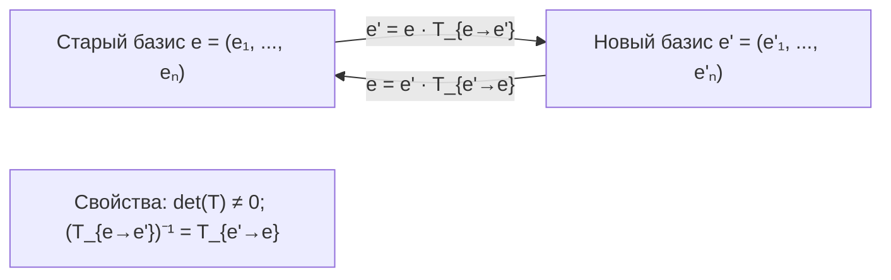
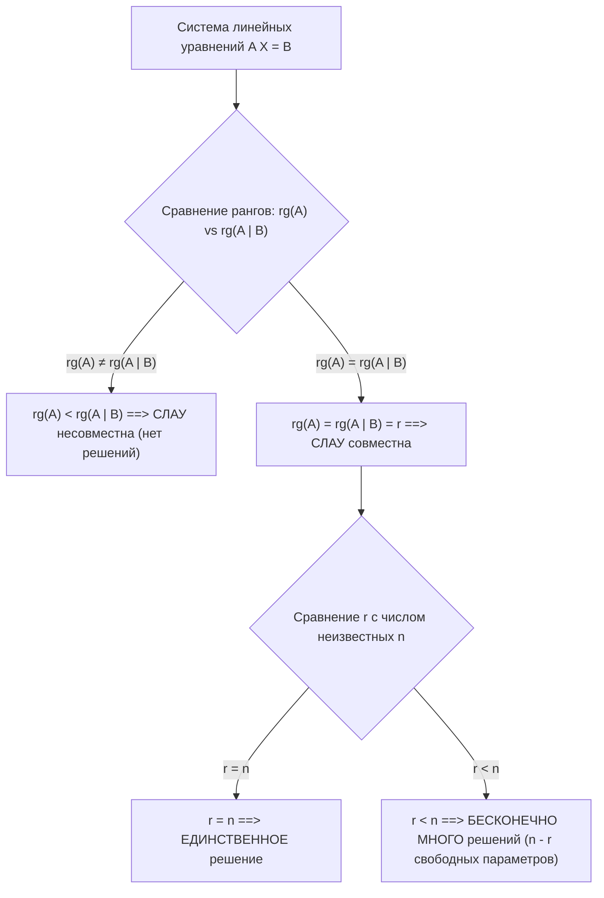

# Лекция 11: Матрица перехода между базисами, закон преобразования координат, совместность СЛАУ, теорема Кронекера — Капелли и критерий единственности решения

> **Дисциплина**: Линейная алгебра  
> **Лектор**: ФИТиП (ИС), Университет ИТМО (Осенний семестр 2026)  
> **Ключевые темы**: Базис линейного пространства $V$, разложение нового базиса по старому ($e'_j = \sum_{i=1}^n c_{ij} e_i$), матрица перехода $T_{e \to e'}$ и её столбцовая структура, невырожденность матрицы перехода ($\det T_{e \to e'} \ne 0$), обратная матрица перехода и теорема $(T_{e \to e'})^{-1} = T_{e' \to e}$, транзитивность преобразования базисов ($T_{e \to e''} = T_{e \to e'} \cdot T_{e' \to e''}$), закон преобразования координат вектора ($X_e = T_{e \to e'} X_{e'}$ и $X_{e'} = T_{e' \to e} X_e$), контравариантность координат векторов против ковариантности базисных векторов, расширенная матрица СЛАУ $(A \mid B)$, понятие совместности и несовместности СЛАУ, геометрический критерий совместности (принадлежность столбца свободных членов $B$ образу матрицы / линейной оболочке столбцов $\operatorname{Col}(A)$), фундаментальная теорема Кронекера — Капелли ($\operatorname{rg}(A) = \operatorname{rg}(A \mid B)$), критерий единственности решения квадратной и прямоугольной СЛАУ ($\operatorname{rg}(A) = \operatorname{rg}(A \mid B) = n$), критерий бесконечного множества решений ($\operatorname{rg}(A) < n$), базисные и свободные неизвестные, размерность аффинного пространства решений $n - \operatorname{rg}(A)$, фундаментальная система решений (ФСР) однородной системы, структура общего решения неоднородной СЛАУ ($X_{\text{неодн}} = X_{\text{частн}} + X_{\text{одн}}$).

---

## 1. Рекомендуемая литература

* **А. И. Кострикин — «Введение в алгебру. Часть II: Линейная алгебра»**  
  *Глава 1: «Векторные пространства» (§3: Базис и размерность, замена базиса; §4: Подпространства и линейные многообразия); Глава 2: «Матрицы» (§2: Системы линейных уравнений, критерий совместности Кронекера — Капелли, общее решение).*
* **Э. Б. Винберг — «Курс алгебры»**  
  *Глава 4: «Линейные пространства» (§1: Базис и координаты; §2: Матрица перехода, закон преобразования координат; §4: Системы линейных уравнений, фундаментальная система решений).*
* **И. В. Проскуряков — «Сборник задач по линейной алгебре»**  
  *Раздел II: «Системы линейных уравнений» (§2: Исследование систем линейных уравнений на совместность; §3: Фундаментальная система решений); Раздел IV: «Линейные пространства» (§2: Координаты вектора и замена базиса).*
* **Г. Стрэнг — «Линейная алгебра и её применения»**  
  *Глава 2: «Векторные пространства» (Четыре фундаментальных подпространства матрицы, ядро $\ker A$, образ $\operatorname{Im} A$, общее решение СЛАУ).*

---

## 2. Базис линейного пространства и разложение нового базиса по старому

Пусть $V$ — конечномерное линейное (векторное) пространство над полем $K$ ($\mathbb{R}$ или $\mathbb{C}$), и $\dim V = n$.  
Напомним, что упорядоченный набор векторов $e = (e_1, e_2, \dots, e_n)$ называется **базисом пространства $V$**, если:
1. Векторы $e_1, \dots, e_n$ линейно независимы.
2. Векторы $e_1, \dots, e_n$ порождают всё пространство: $\operatorname{span}(e_1, \dots, e_n) = V$.

Любой вектор $x \in V$ однозначно представляется в виде линейной комбинации базисных векторов:
$$x = x_1 e_1 + x_2 e_2 + \cdots + x_n e_n = \sum_{i=1}^n x_i e_i$$
Числа $x_1, \dots, x_n \in K$ называются **координатами вектора $x$ в базисе $e$**. Будем записывать их в виде вектор-столбца:
$$X_e = \begin{pmatrix} x_1 \\ x_2 \\ \vdots \\ x_n \end{pmatrix} \in K^n$$

Пусть теперь в этом же пространстве $V$ задан другой («новый») базис $e' = (e'_1, e'_2, \dots, e'_n)$.  
Каждый новый базисный вектор $e'_j$ (где $j = 1, \dots, n$) сам является элементом пространства $V$, а значит, может быть единственным образом разложен по «старому» базису $e$:
$$\begin{aligned}
e'_1 &= c_{11} e_1 + c_{21} e_2 + \cdots + c_{n1} e_n \\
e'_2 &= c_{12} e_1 + c_{22} e_2 + \cdots + c_{n2} e_n \\
&\;\;\vdots \\
e'_n &= c_{1n} e_1 + c_{2n} e_2 + \cdots + c_{nn} e_n
\end{aligned}$$
или в краткой индексной форме:
$$e'_j = \sum_{i=1}^n c_{ij} e_i, \qquad j = 1, 2, \dots, n$$

> [!CAUTION] **Расположение индексов**  
> Коэффициенты $c_{1j}, c_{2j}, \dots, c_{nj}$ разложения вектора $e'_j$ по старому базису образуют **$j$-й столбец** матрицы коэффициентов, а не строку! Первый индекс указывает номер старого базисного вектора, а второй — номер нового базисного вектора.

---

## 3. Матрица перехода и её фундаментальные свойства

> [!IMPORTANT] **Определение 1 (Матрица перехода)**  
> **Матрицей перехода от старого базиса $e$ к новому базису $e'$** называется квадратная матрица $T_{e \to e'} \in M_n(K)$, столбцами которой являются координаты новых базисных векторов $e'_1, \dots, e'_n$ в старом базисе $e$:
> $$T_{e \to e'} = \begin{pmatrix}
> c_{11} & c_{12} & \cdots & c_{1n} \\
> c_{21} & c_{22} & \cdots & c_{2n} \\
> \vdots & \vdots & \ddots & \vdots \\
> c_{n1} & c_{n2} & \cdots & c_{nn}
> \end{pmatrix} = \Big( [e'_1]_e \;\; [e'_2]_e \;\; \cdots \;\; [e'_n]_e \Big)$$

Если рассматривать базисы как формальные строки из векторов:
$$e = (e_1, e_2, \dots, e_n), \qquad e' = (e'_1, e'_2, \dots, e'_n)$$
то связь между базисами записывается в компактной матричной форме:
$$e' = e \cdot T_{e \to e'}$$
где умножение строки векторов на числовую матрицу понимается по правилу «строка на столбец»:
$$e'_j = (e_1, \dots, e_n) \begin{pmatrix} c_{1j} \\ \vdots \\ c_{nj} \end{pmatrix} = \sum_{i=1}^n c_{ij} e_i$$

### 3.1. Невырожденность матрицы перехода
> **Теорема 1 (Невырожденность матрицы перехода)**:  
> Матрица перехода $T_{e \to e'}$ между любыми двумя базисами пространства $V$ всегда **невырождена**:
> $$\det(T_{e \to e'}) \ne 0$$

#### Доказательство:
1. Столбцами матрицы $T_{e \to e'}$ являются координатные векторы $[e'_1]_e, [e'_2]_e, \dots, [e'_n]_e \in K^n$.
2. Векторы $e'_1, \dots, e'_n$ образуют базис в $V$, следовательно, они линейно независимы в $V$.
3. Отображение изоморфизма между $V$ и $K^n$, сопоставляющее вектору его координаты в базисе $e$ ($v \mapsto [v]_e$), сохраняет линейную независимость.  
   Значит, координатные столбцы $[e'_1]_e, \dots, [e'_n]_e$ линейно независимы в $K^n$.
4. По критерию вырожденности матрицы (Лекция 10), квадратная матрица порядка $n$, столбцы которой линейно независимы, имеет отличный от нуля определитель и полный ранг:
   $$\operatorname{rg}(T_{e \to e'}) = n \iff \det(T_{e \to e'}) \ne 0$$
Что и требовалось доказать. $\blacksquare$

---

### 3.2. Обратная матрица перехода
> **Теорема 2 (Связь прямого и обратного переходов)**:  
> Матрица перехода от нового базиса $e'$ к старому базису $e$ является **обратной матрицей** к матрице перехода от $e$ к $e'$:
> $$T_{e' \to e} = (T_{e \to e'})^{-1}$$

#### Доказательство:
По определению матриц перехода:
$$e' = e \cdot T_{e \to e'}, \qquad e = e' \cdot T_{e' \to e}$$
Подставим второе равенство в первое:
$$e' = (e' \cdot T_{e' \to e}) \cdot T_{e \to e'}$$
В силу ассоциативности умножения строки векторов на числовые матрицы:
$$e' = e' \cdot (T_{e' \to e} \cdot T_{e \to e'})$$
С другой стороны, $e' = e' \cdot E$, где $E$ — единичная матрица порядка $n$.  
Поскольку $e'$ — базис (векторы $e'_j$ линейно независимы), коэффициенты разложения векторов $e'$ по самому базису $e'$ определяются единственным образом. Отсюда:
$$T_{e' \to e} \cdot T_{e \to e'} = E$$
Аналогично, подставляя первое выражение во второе, получаем:
$$T_{e \to e'} \cdot T_{e' \to e} = E$$
По теореме о единственности обратной матрицы (Лекция 10):
$$T_{e' \to e} = (T_{e \to e'})^{-1}$$
Что и требовалось доказать. $\blacksquare$

---

### 3.3. Транзитивность смены базисов (композиция переходов)
Пусть в пространстве $V$ заданы три базиса: $e$, $e'$ и $e''$.  
Тогда:
$$e' = e \cdot T_{e \to e'}, \qquad e'' = e' \cdot T_{e' \to e''}$$
Подставляя $e'$ в выражение для $e''$:
$$e'' = (e \cdot T_{e \to e'}) \cdot T_{e' \to e''} = e \cdot (T_{e \to e'} \cdot T_{e' \to e''})$$
По определению матрицы перехода от $e$ к $e''$:
$$e'' = e \cdot T_{e \to e''}$$
Следовательно:
$$T_{e \to e''} = T_{e \to e'} \cdot T_{e' \to e''}$$

---

## 4. Закон преобразования координат вектора

Пусть фиксирован вектор $x \in V$.  
Он может быть разложен как по старому базису $e$, так и по новому базису $e'$:
$$x = \sum_{i=1}^n x_i e_i = e \cdot X_e$$
$$x = \sum_{j=1}^n x'_j e'_j = e' \cdot X_{e'}$$
где $X_e = (x_1, \dots, x_n)^T$ и $X_{e'} = (x'_1, \dots, x'_n)^T$ — столбцы координат вектора $x$ в базисах $e$ и $e'$ соответственно.

> [!IMPORTANT] **Теорема 3 (Закон преобразования координат вектора)**  
> Координаты вектора в старом и новом базисах связаны соотношениями:
> $$X_e = T_{e \to e'} \cdot X_{e'}$$
> $$X_{e'} = (T_{e \to e'})^{-1} \cdot X_e = T_{e' \to e} \cdot X_e$$

#### Доказательство:
Используем матричную связь базисов $e' = e \cdot T_{e \to e'}$:
$$x = e' \cdot X_{e'} = (e \cdot T_{e \to e'}) \cdot X_{e'} = e \cdot (T_{e \to e'} \cdot X_{e'})$$
С другой стороны:
$$x = e \cdot X_e$$
В силу единственности координат вектора $x$ в базисе $e$, столбцы коэффициентов обязаны совпадать:
$$X_e = T_{e \to e'} \cdot X_{e'}$$
Умножая обе части матричного равенства слева на обратную матрицу $(T_{e \to e'})^{-1} = T_{e' \to e}$, получаем:
$$X_{e'} = (T_{e \to e'})^{-1} \cdot X_e = T_{e' \to e} \cdot X_e$$
Что и требовалось доказать. $\blacksquare$

> [!NOTE] **Контравариантность координат vs Ковариантность базиса**  
> Обратите внимание на фундаментальную асимметрию, играющую ключевую роль в тензорном анализе и физике:
> * Базис преобразуется **прямой матрицей**: $e' = e \cdot T$ *(ковариантно)*.
> * Координаты вектора преобразуются **обратной матрицей**: $X_{e'} = T^{-1} \cdot X_e$ *(контравариантно)*!  
> Если базисные векторы удлинить в 2 раза ($e' = 2e$), то координаты любого вектора уменьшатся в 2 раза ($x' = \frac{1}{2} x$), чтобы сам геометрический объект $x = \sum x_i e_i$ остался неизменным.

---

## 5. Расширенная матрица СЛАУ и геометрический критерий совместности

Рассмотрим систему $m$ линейных алгебраических уравнений с $n$ неизвестными над полем $K$:
$$\begin{cases}
a_{11} x_1 + a_{12} x_2 + \cdots + a_{1n} x_n = b_1 \\
a_{21} x_1 + a_{22} x_2 + \cdots + a_{2n} x_n = b_2 \\
\quad \vdots \\
a_{m1} x_1 + a_{m2} x_2 + \cdots + a_{mn} x_n = b_m
\end{cases}$$

В матричной форме:
$$A X = B$$
где $A = (a_{ij}) \in M_{m \times n}(K)$ — основная матрица системы, $X \in K^n$ — столбец неизвестных, $B \in K^m$ — столбец свободных членов.

> [!NOTE] **Определение 2 (Расширенная матрица системы)**  
> **Расширенной матрицей СЛАУ** называется матрица размера $m \times (n+1)$, полученная приписыванием столбца $B$ справа к матрице $A$:
> $$(A \mid B) = \begin{pmatrix}
> a_{11} & a_{12} & \cdots & a_{1n} & \big| & b_1 \\
> a_{21} & a_{22} & \cdots & a_{2n} & \big| & b_2 \\
> \vdots & \vdots & \ddots & \vdots & \big| & \vdots \\
> a_{m1} & a_{m2} & \cdots & a_{mn} & \big| & b_m
> \end{pmatrix}$$

### Понятие совместности
* СЛАУ называется **совместной**, если она имеет хотя бы одно решение.
* СЛАУ называется **несовместной** (противоречивой), если множество её решений пусто.

### Геометрический критерий совместности
Запишем систему в столбцовой форме (Лекция 10):
$$x_1 A^{(1)} + x_2 A^{(2)} + \cdots + x_n A^{(n)} = B$$
где $A^{(j)} \in K^m$ — $j$-й столбец матрицы $A$.

> [!IMPORTANT] **Теорема 4 (Геометрический критерий совместности)**  
> Система линейных уравнений $A X = B$ совместна тогда и только тогда, когда **столбец свободных членов $B$ может быть разложен в линейную комбинацию столбцов матрицы $A$**, то есть принадлежит столбцовому пространству (образу матрицы):
> $$B \in \operatorname{span}(A^{(1)}, A^{(2)}, \dots, A^{(n)}) = \operatorname{Col}(A) = \operatorname{Im}(A)$$

---

## 6. Теорема Кронекера — Капелли

> [!IMPORTANT] **Теорема 5 (Теорема Кронекера — Капелли, 1886)**  
> Система линейных алгебраических уравнений $A X = B$ совместна тогда и только тогда, когда **ранг основной матрицы равен рангу расширенной матрицы**:
> $$\operatorname{rg}(A) = \operatorname{rg}(A \mid B)$$

### Строгое доказательство теоремы Кронекера — Капелли:
1. **Необходимость ($\implies$)**:  
   Пусть СЛАУ совместна. Тогда существует вектор решений $X = (x_1, \dots, x_n)^T$, такой что:
   $$B = \sum_{j=1}^n x_j A^{(j)}$$
   Это означает, что столбец $B$ является линейной комбинацией столбцов $A^{(1)}, \dots, A^{(n)}$.  
   Следовательно, добавление столбца $B$ к системе столбцов $A^{(1)}, \dots, A^{(n)}$ не меняет их линейную оболочку:
   $$\operatorname{span}(A^{(1)}, \dots, A^{(n)}, B) = \operatorname{span}(A^{(1)}, \dots, A^{(n)})$$
   Поскольку ранг матрицы равен размерности линейной оболочки её столбцов (столбцовый ранг):
   $$\operatorname{rg}(A \mid B) = \dim(\operatorname{span}(A^{(1)}, \dots, A^{(n)}, B)) = \dim(\operatorname{span}(A^{(1)}, \dots, A^{(n)})) = \operatorname{rg}(A)$$
2. **Достаточность ($\impliedby$)**:  
   Пусть $\operatorname{rg}(A) = \operatorname{rg}(A \mid B) = r$.  
   Выберем в матрице $A$ базисный набор из $r$ линейно независимых столбцов, скажем $A^{(j_1)}, \dots, A^{(j_r)}$.  
   Так как $\dim(\operatorname{span}(A^{(1)}, \dots, A^{(n)})) = r$, эти $r$ столбцов образуют базис пространства столбцов матрицы $A$.  
   Поскольку ранг расширенной матрицы $(A \mid B)$ также равен $r$, любой столбец расширенной матрицы (включая последний столбец $B$) линейно выражается через этот базис:
   $$B = \sum_{k=1}^r c_k A^{(j_k)}$$
   Положив неизвестные $x_{j_k} = c_k$, а все остальные неизвестные $x_j = 0$, мы получаем вектор $X = (x_1, \dots, x_n)^T$, удовлетворяющий уравнению $\sum_{j=1}^n x_j A^{(j)} = B$.  
   Значит, система совместна. $\blacksquare$

---

## 7. Критерий единственности решения СЛАУ и структура пространства решений

Пусть система $A X = B$ совместна, то есть $\operatorname{rg}(A) = \operatorname{rg}(A \mid B) = r$.  
Пусть $n$ — общее число неизвестных (столбцов матрицы $A$).

> [!IMPORTANT] **Теорема 6 (Критерий единственности решения)**  
> 1. Совместная СЛАУ имеет **единственное решение** тогда и только тогда, когда ранг матрицы равен числу неизвестных:
>    $$r = n$$
> 2. Если $r < n$, то система имеет **бесконечно много решений**, зависящих от $k = n - r$ свободных параметров.

### 7.1. Базисные и свободные неизвестные
Приведем расширенную матрицу $(A \mid B)$ элементарными преобразованиями строк к ступенчатому виду методом Гаусса:
* Ведущие элементы (пивоты) ступенчатой матрицы определяют $r$ **базисных неизвестных** (например, $x_1, \dots, x_r$).
* Оставшиеся $k = n - r$ неизвестных называются **свободными переменными** (например, $x_{r+1}, \dots, x_n$).
* Свободным переменным можно придавать совершенно произвольные числовые значения из поля $K$:
  $$x_{r+1} = c_1, \quad x_{r+2} = c_2, \quad \dots, \quad x_n = c_{n-r} \qquad (c_i \in K)$$
* После фиксации свободных переменных базисные переменные выражаются через них однозначно с помощью обратного хода метода Гаусса.

---

### 7.2. Однородные СЛАУ и Фундаментальная система решений (ФСР)
Рассмотрим соответствующую **однородную систему линейных уравнений**:
$$A X = 0$$
Множество всех решений однородной системы образует линейное подпространство в $K^n$, называемое **ядром матрицы $A$** (или пространством решений):
$$\operatorname{Sol}_0 = \ker A = \{X \in K^n \mid A X = 0\} \subseteq K^n$$

> [!NOTE] **Теорема о размерности ядра (Rank-Nullity Theorem)**  
> Размерность пространства решений однородной СЛАУ равна дефекту матрицы — разности между числом неизвестных и рангом матрицы:
> $$\dim(\ker A) = n - \operatorname{rg}(A) = n - r$$

> [!IMPORTANT] **Определение 3 (Фундаментальная система решений — ФСР)**  
> Базис подпространства решений однородной системы $\ker A$ называется **фундаментальной системой решений (ФСР)**.  
> ФСР состоит из $n - r$ линейно независимых вектор-столбцов:
> $$\Phi = (F_1, F_2, \dots, F_{n-r}), \qquad F_i \in K^n$$
> Общее решение однородной СЛАУ представляется в виде произвольной линейной комбинации векторов ФСР:
> $$X_{\text{одн}} = c_1 F_1 + c_2 F_2 + \cdots + c_{n-r} F_{n-r}, \qquad c_i \in K$$

---

### 7.3. Структура общего решения неоднородной СЛАУ
> **Теорема 7 (Структура общего решения неоднородной системы)**:  
> Пусть $X_{\text{частн}}$ — какое-либо фиксированное (частное) решение неоднородной системы $A X = B$.  
> Тогда общее решение неоднородной системы представляет собой сумму этого частного решения и общего решения соответствующей однородной системы $A X = 0$:
> $$X_{\text{неодн}} = X_{\text{частн}} + X_{\text{одн}} = X_{\text{частн}} + \sum_{k=1}^{n-r} c_k F_k$$

#### Доказательство:
1. Если $X = X_{\text{частн}} + X_{\text{одн}}$, то:
   $$A X = A(X_{\text{частн}} + X_{\text{одн}}) = A X_{\text{частн}} + A X_{\text{одн}} = B + 0 = B$$
   Значит, любой вектор такого вида является решением $A X = B$.
2. Пусть $X^*$ — произвольное решение системы $A X = B$. Рассмотрим разность:
   $$Y = X^* - X_{\text{частн}}$$
   Подействуем матрицей $A$:
   $$A Y = A(X^* - X_{\text{частн}}) = A X^* - A X_{\text{частн}} = B - B = 0$$
   Следовательно, разность $Y$ является решением однородной системы $A Y = 0$, то есть $Y \in \ker A$.  
   Значит, $Y$ раскладывается по базису ФСР: $Y = \sum_{k=1}^{n-r} c_k F_k$, откуда:
   $$X^* = X_{\text{частн}} + \sum_{k=1}^{n-r} c_k F_k$$
Что и требовалось доказать. $\blacksquare$

> [!TIP] **Геометрическая интерпретация решений**  
> Множество решений неоднородной совместной СЛАУ представляет собой **аффинное подпространство (линейное многообразие)** в $K^n$, полученное параллельным сдвигом линейного подпространства $\ker A$ на вектор частного решения $X_{\text{частн}}$:
> $$\operatorname{Sol}(A, B) = X_{\text{частн}} + \ker A$$

---

## 8. Резюме лекции

1. **Матрица перехода $T_{e \to e'}$**: её столбцы состоят из координат новых базисных векторов в старом базисе. Связь базисов: $e' = e \cdot T_{e \to e'}$.
2. **Свойства матрицы перехода**:
   * Всегда невырождена: $\det(T_{e \to e'}) \ne 0$.
   * Обратный переход задается обратной матрицей: $T_{e' \to e} = (T_{e \to e'})^{-1}$.
   * Транзитивность: $T_{e \to e''} = T_{e \to e'} \cdot T_{e' \to e''}$.
3. **Закон преобразования координат вектора**:
   $$X_e = T_{e \to e'} X_{e'} \iff X_{e'} = (T_{e \to e'})^{-1} X_e$$
   Координаты преобразуются контравариантно (с помощью обратной матрицы перехода).
4. **Геометрический смысл совместности СЛАУ**: столбец $B$ принадлежит линейной оболочке столбцов матрицы $A$ ($B \in \operatorname{Col}(A)$).
5. **Теорема Кронекера — Капелли**: СЛАУ $AX = B$ совместна $\iff \operatorname{rg}(A) = \operatorname{rg}(A \mid B) = r$.
6. **Критерий единственности**:
   * $r = n$ $\implies$ решение существует и единственно.
   * $r < n$ $\implies$ бесконечно много решений, зависящих от $n - r$ свободных параметров.
7. **Структура общего решения**: $X_{\text{неодн}} = X_{\text{частн}} + X_{\text{одн}}$, где $X_{\text{одн}} = \sum_{k=1}^{n-r} c_k F_k$ — линейная комбинация векторов фундаментальной системы решений (ФСР).
