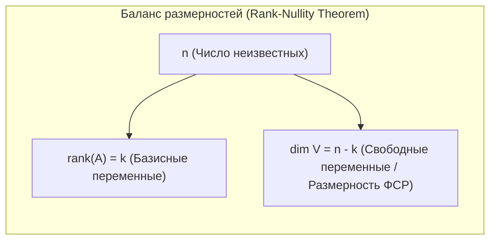
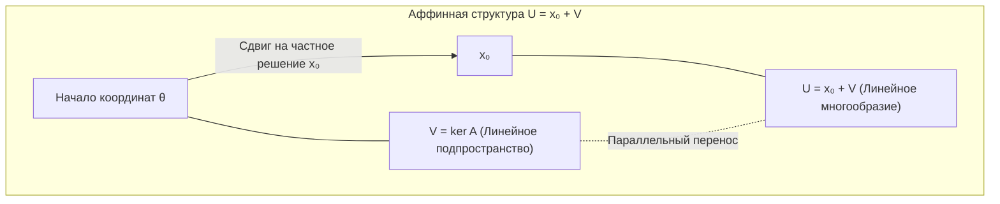

# Лекция 12: Пространство решений однородной СЛАУ, фундаментальная система решений (ФСР) и структура решений неоднородной СЛАУ

> **Дисциплина**: Линейная алгебра  
> **Лектор**: ФИТиП (ИС), Университет ИТМО (Осенний семестр 2026)  
> **Ключевые темы**: Однородная система линейных алгебраических уравнений (ОСЛАУ) $Ax = \theta$, пространство решений ОСЛАУ как линейное подпространство $\ker A \subseteq \mathbb{R}^n$, фундаментальная система решений (ФСР), теорема о размерности пространства решений $\dim V = n - \operatorname{rank} A$ (дефект матрицы), метод Гаусса — Жордана и алгоритм построения нормальной ФСР, структура общего решения неоднородной СЛАУ (НСЛАУ) $Ax = b$, теорема об аффинном подпространстве $U = x_0 + V$, векторная параметрическая форма записи решений.

---

> [!TIP] Практика и домашнее задание к лекции
> Материалы домашнего задания с подробными решениями и задачами для самопроверки:
> - 📝 [Линейная алгебра ДЗ к лекции 12.md](./%D0%9B%D0%B8%D0%BD%D0%B5%D0%B9%D0%BD%D0%B0%D1%8F%20%D0%B0%D0%BB%D0%B3%D0%B5%D0%B1%D1%80%D0%B0%20%D0%94%D0%97%20%D0%BA%20%D0%BB%D0%B5%D0%BA%D1%86%D0%B8%D0%B8%2012.md)

---

## 1. Рекомендуемая литература

1. **Э. Б. Винберг — «Курс алгебры»**:
   * *Глава 4: «Линейные пространства»* (§3: Системы линейных уравнений; пространство решений однородной системы, фундаментальная система решений; аффинные подпространства и линейные многообразия).
2. **А. И. Кострикин — «Введение в алгебру. Часть II: Линейная алгебра»**:
   * *Глава 1: «Векторные пространства»* (§5: Системы линейных уравнений, размерность подпространства решений, теорема о дефекте матрицы).
3. **И. В. Проскуряков — «Сборник задач по линейной алгебре»**:
   * *Раздел: «Системы линейных уравнений»* (§7: Однородные системы, нахождение фундаментальных систем решений, общее решение неоднородных систем в векторном виде).

---

## 2. Пространство решений однородной СЛАУ (ОСЛАУ)

Рассмотрим систему $m$ линейных уравнений с $n$ неизвестными над полем $\mathbb{R}$:
$$\begin{cases}
a_{11} x_1 + a_{12} x_2 + \dots + a_{1n} x_n = 0 \\
a_{21} x_1 + a_{22} x_2 + \dots + a_{2n} x_n = 0 \\
\quad \dots \\
a_{m1} x_1 + a_{m2} x_2 + \dots + a_{mn} x_n = 0
\end{cases}$$

В компактной матричной форме система записывается как:
$$A x = \theta$$
где:
* $A = (a_{ij}) \in M_{m \times n}(\mathbb{R})$ — основная матрица системы;
* $x = (x_1, x_2, \dots, x_n)^T \in \mathbb{R}^n$ — вектор неизвестных;
* $\theta = (0, 0, \dots, 0)^T \in \mathbb{R}^m$ — нулевой вектор-столбец свободных членов.

> [!NOTE] Тривиальное решение
> Вектор $x = \theta \in \mathbb{R}^n$ всегда удовлетворяет уравнению $A \theta = \theta$. Поэтому однородная система **всегда совместна** (всегда обладает хотя бы одним решением — тривиальным).

---

### Теорема 1 (О пространстве решений ОСЛАУ)
Множество $V \subseteq \mathbb{R}^n$ всех решений однородной системы $Ax = \theta$ является **линейным подпространством** арифметического пространства $\mathbb{R}^n$ (называемым ядром матрицы $A$, или $\ker A$).

#### Строгое доказательство:
Для того чтобы непустое подмножество $V$ было подпространством, необходимо и достаточно проверить замкнутость относительно двух операций: сложения векторов и умножения на скаляр.
1. **Непустота**: $\theta \in V$, так как $A \theta = \theta$.
2. **Замкнутость относительно сложения**:
   Пусть $x_1, x_2 \in V$, то есть $A x_1 = \theta$ и $A x_2 = \theta$.
   В силу дистрибутивности матричного умножения:
   $$A (x_1 + x_2) = A x_1 + A x_2 = \theta + \theta = \theta$$
   Следовательно, $(x_1 + x_2) \in V$.
3. **Замкнутость относительно умножения на скаляр**:
   Пусть $x \in V$ ($Ax = \theta$) и $\lambda \in \mathbb{R}$.
   В силу свойства выноса скаляра:
   $$A (\lambda x) = \lambda (A x) = \lambda \cdot \theta = \theta$$
   Следовательно, $\lambda x \in V$.

Таким образом, $V$ является векторным подпространством пространства $\mathbb{R}^n$. $\blacksquare$

---

## 3. Фундаментальная система решений (ФСР)

Так как $V$ является линейным подпространством конечномерного пространства $\mathbb{R}^n$, оно обладает конечной размерностью и базисом.

### Определение 1 (Фундаментальная система решений)
**Фундаментальной системой решений (ФСР)** однородной системы линейных уравнений $Ax = \theta$ называется любой **базис** пространства её решений $V$.

Иными словами, набор векторов $\{e_1, e_2, \dots, e_r\} \subset V$ образует ФСР тогда и только тогда, когда выполнены два условия:
1. **Линейная независимость**:
   $$\alpha_1 e_1 + \alpha_2 e_2 + \dots + \alpha_r e_r = \theta \iff \alpha_1 = \alpha_2 = \dots = \alpha_r = 0$$
2. **Полнота (порождаемость)**:
   Любое решение $x \in V$ системы $Ax = \theta$ может быть единственным образом представлено в виде линейной комбинации векторов ФСР:
   $$x = c_1 e_1 + c_2 e_2 + \dots + c_r e_r = \sum_{i=1}^r c_i e_i, \quad c_i \in \mathbb{R}$$
Коэффициенты $c_1, \dots, c_r$ играют роль свободных параметров в общем решении ОСЛАУ.

---

## 4. Теорема о размерности пространства решений (дефект матрицы)

Какова размерность пространства решений $V = \ker A$? Ответ дает фундаментальная теорема алгебры:

### Теорема 2 (О размерности пространства решений)
Пусть матрица $A \in M_{m \times n}(\mathbb{R})$ имеет $n$ столбцов (число неизвестных системы), а её ранг равен $\operatorname{rank}(A) = k$.  
Тогда размерность пространства решений $V$ равна числу неизвестных минус ранг матрицы $A$:
$$\dim V = n - \operatorname{rank}(A) = n - k$$
Число $n - k$ называется **дефектом матрицы** $A$ (или размерностью ядра $\operatorname{nullity}(A)$).

#### Конструктивное доказательство методом Гаусса — Жордана:
1. **Приведение к улучшенному ступенчатому виду**:
   С помощью элементарных преобразований строк матрица $A$ приводится к улучшенному ступенчатому виду (reduced row echelon form, rref). Элементарные преобразования строк соответствуют эквивалентным преобразованиям уравнений системы и не меняют множество решений $V$.
2. **Разделение переменных**:
   Поскольку ранг матрицы равен $k$, в ступенчатом виде содержится ровно $k$ ненулевых строк. Главные элементы (ведущие единицы) этих строк находятся в $k$ столбцах с индексами $j_1 < j_2 < \dots < j_k$.
   * Переменные $x_{j_1}, \dots, x_{j_k}$ назовем **базисными (главными)**.
   * Оставшиеся $n - k$ переменных назовем **свободными**. Перенумеруем для простоты обозначений переменные так, чтобы свободными были $x_{k+1}, x_{k+2}, \dots, x_n$.
3. **Разрешение относительно главных переменных**:
   Система принимает вид:
   $$\begin{cases}
   x_1 = -\beta_{1, k+1} x_{k+1} - \dots - \beta_{1, n} x_n \\
   x_2 = -\beta_{2, k+1} x_{k+1} - \dots - \beta_{2, n} x_n \\
   \dots \\
   x_k = -\beta_{k, k+1} x_{k+1} - \dots - \beta_{k, n} x_n
   \end{cases}$$
4. **Построение нормальной ФСР**:
   Зададим свободным переменным значения единичных базисных векторов стандартного базиса $\mathbb{R}^{n-k}$:
   * Вектор $e_1$: свободные переменные $(1, 0, \dots, 0)^T \implies e_1 = (-\beta_{1, k+1}, \dots, -\beta_{k, k+1}, 1, 0, \dots, 0)^T$;
   * Вектор $e_2$: свободные переменные $(0, 1, \dots, 0)^T \implies e_2 = (-\beta_{1, k+2}, \dots, -\beta_{k, k+2}, 0, 1, \dots, 0)^T$;
   * ...
   * Вектор $e_{n-k}$: свободные переменные $(0, 0, \dots, 1)^T \implies e_{n-k} = (-\beta_{1, n}, \dots, -\beta_{k, n}, 0, 0, \dots, 1)^T$.
5. **Проверка условий базиса**:
   * *Линейная независимость*: Если $\sum_{i=1}^{n-k} c_i e_i = \theta$, то, глядя на последние $n - k$ координат, получаем:
     $$c_1 \begin{pmatrix} 1 \\ 0 \\ \dots \\ 0 \end{pmatrix} + c_2 \begin{pmatrix} 0 \\ 1 \\ \dots \\ 0 \end{pmatrix} + \dots + c_{n-k} \begin{pmatrix} 0 \\ 0 \\ \dots \\ 1 \end{pmatrix} = \begin{pmatrix} 0 \\ 0 \\ \dots \\ 0 \end{pmatrix} \implies c_1 = c_2 = \dots = c_{n-k} = 0$$
     Векторы $e_1, \dots, e_{n-k}$ линейно независимы.
   * *Полнота*: Пусть $x = (\xi_1, \dots, \xi_k, c_1, \dots, c_{n-k})^T$ — произвольное решение системы $Ax = \theta$. Рассмотрим вектор $y = \sum_{i=1}^{n-k} c_i e_i$. Так как $y \in V$, то и разность $(x - y) \in V$. При этом свободные переменные вектора $x - y$ равны $c_i - c_i = 0$. Но при нулевых свободных переменных из разрешенной системы однозначно следует, что все базисные переменные равны нулю $\implies x - y = \theta \implies x = y$.
Следовательно, $\{e_1, \dots, e_{n-k}\}$ образует базис $V$, а его размерность $\dim V = n - k$. $\blacksquare$

---

## 5. Структура общего решения неоднородной СЛАУ (НСЛАУ)

Рассмотрим теперь неоднородную систему:
$$A x = b, \quad b \ne \theta$$
Предположим, что система **совместна** (по теореме Кронекера — Капелли это равносильно $\operatorname{rank}(A) = \operatorname{rank}(A|b)$).

Обозначим через $U \subseteq \mathbb{R}^n$ множество всех решений НСЛАУ:
$$U = \{x \in \mathbb{R}^n \mid A x = b\}$$
А через $V \subseteq \mathbb{R}^n$ — подпространство решений соответствующей однородной системы:
$$V = \{v \in \mathbb{R}^n \mid A v = \theta\}$$

> [!WARNING] $U$ не является подпространством!
> Так как $A \theta = \theta \ne b$, нулевой вектор не принадлежит $U$ ($\theta \notin U$). Следовательно, множество решений неоднородной системы $U$ не образует линейного подпространства!

Какова же геометрическая природа множества $U$?

### Теорема 3 (О структуре решений неоднородной системы)
Пусть $x_0$ — произвольное фиксированное частное решение неоднородной системы $Ax = b$ ($Ax_0 = b$).  
Тогда множество всех решений $U$ системы $Ax = b$ представляет собой **аффинное подпространство** (линейное многообразие), полученное сдвигом подпространства $V$ на вектор $x_0$:
$$U = x_0 + V = \{x_0 + v \mid v \in V\}$$
Иными словами:
$$\text{Общее решение НСЛАУ} = \text{Частное решение НСЛАУ} + \text{Общее решение ОСЛАУ}$$

#### Строгое доказательство (методом двух включений):
1. **Докажем, что $(x_0 + V) \subseteq U$**:
   Пусть $x \in (x_0 + V)$, то есть $x = x_0 + v$, где $v \in V$ ($Av = \theta$).
   Проверим, является ли $x$ решением системы $Ax = b$:
   $$A x = A (x_0 + v) = A x_0 + A v = b + \theta = b$$
   Следовательно, $x \in U$.
2. **Докажем, что $U \subseteq (x_0 + V)$**:
   Пусть $x \in U$ — произвольное решение системы $Ax = b$ (то есть $Ax = b$).
   Рассмотрим вектор разности:
   $$v = x - x_0$$
   Подействуем матрицей $A$ на вектор $v$:
   $$A v = A (x - x_0) = A x - A x_0 = b - b = \theta$$
   Значит, $v \in V$.
   Отсюда получаем:
   $$x = x_0 + v, \quad \text{где } v \in V \implies x \in (x_0 + V)$$

Оба включения доказаны $\implies U = x_0 + V$. $\blacksquare$

---

## 6. Векторная параметрическая форма решения

Объединяя теоремы 2 и 3, получаем общую формулу для записи решений произвольной линейной системы.

### Теорема 4 (Векторная форма общего решения)
Пусть ранг матрицы совместной системы $Ax = b$ равен $k$, число неизвестных равно $n$, $x_0$ — частное решение системы $Ax = b$, а $\{e_1, e_2, \dots, e_{n-k}\}$ — ФСР соответствующей однородной системы $Ax = \theta$.  
Тогда общее решение системы $Ax = b$ представляется в векторной параметрической форме:
$$x = x_0 + c_1 e_1 + c_2 e_2 + \dots + c_{n-k} e_{n-k}$$
где $c_1, c_2, \dots, c_{n-k} \in \mathbb{R}$ — произвольные действительные параметры (свободные коэффициенты).

---

## 7. Практический пример: полное нахождение ФСР и общего решения

Решим систему уравнений:
$$\begin{cases}
x_1 + 2x_2 - x_3 + 3x_4 = 4 \\
2x_1 + 4x_2 - x_3 + 5x_4 = 7 \\
-x_1 - 2x_2 + 2x_3 - 4x_4 = -5
\end{cases}$$

### Шаг 1: Расширенная матрица и метод Гаусса — Жордана
Запишем расширенную матрицу $(A|b)$:
$$\begin{pmatrix}
1 & 2 & -1 & 3 & | & 4 \\
2 & 4 & -1 & 5 & | & 7 \\
-1 & -2 & 2 & -4 & | & -5
\end{pmatrix}$$

Выполняем элементарные преобразования строк:
* $R_2 \leftarrow R_2 - 2R_1$:
  $$(2-2, \; 4-4, \; -1 - 2(-1), \; 5 - 2(3) \; | \; 7 - 2(4)) = (0, 0, 1, -1 \; | \; -1)$$
* $R_3 \leftarrow R_3 + R_1$:
  $$(-1+1, \; -2+2, \; 2-1, \; -4+3 \; | \; -5+4) = (0, 0, 1, -1 \; | \; -1)$$

Получаем:
$$\begin{pmatrix}
1 & 2 & -1 & 3 & | & 4 \\
0 & 0 & 1 & -1 & | & -1 \\
0 & 0 & 1 & -1 & | & -1
\end{pmatrix}$$

* $R_3 \leftarrow R_3 - R_2$ (строка зануляется):
* $R_1 \leftarrow R_1 + R_2$ (зануляем столбец над ведущей единицей $R_2$):
  $$(1+0, \; 2+0, \; -1+1, \; 3+(-1) \; | \; 4+(-1)) = (1, 2, 0, 2 \; | \; 3)$$

Улучшенный ступенчатый вид (rref):
$$\begin{pmatrix}
1 & 2 & 0 & 2 & | & 3 \\
0 & 0 & 1 & -1 & | & -1 \\
0 & 0 & 0 & 0 & | & 0
\end{pmatrix}$$

### Шаг 2: Анализ рангов и переменные
* $\operatorname{rank}(A) = \operatorname{rank}(A|b) = 2 \implies$ система совместна.
* Число неизвестных $n = 4$, ранг $k = 2$.
* Размерность пространства решений ОСЛАУ: $\dim V = n - k = 4 - 2 = 2$.
* Ведущие единицы находятся в столбцах $1$ и $3$.
  - **Базисные переменные**: $x_1, x_3$.
  - **Свободные переменные**: $x_2, x_4$.

### Шаг 3: Выражение базисных переменных
$$\begin{cases}
x_1 = 3 - 2x_2 - 2x_4 \\
x_3 = -1 + x_4
\end{cases}$$

### Шаг 4: Нахождение частного решения $x_0$
Полагаем свободные переменные равными нулю: $x_2 = 0, x_4 = 0$.
Тогда $x_1 = 3, x_3 = -1$.
$$x_0 = \begin{pmatrix} 3 \\ 0 \\ -1 \\ 0 \end{pmatrix}$$

### Шаг 5: Нахождение ФСР соответствующей ОСЛАУ
Для ОСЛАУ свободные члены равны $0$:
$$\begin{cases}
x_1 = -2x_2 - 2x_4 \\
x_3 = x_4
\end{cases}$$
* При $x_2 = 1, x_4 = 0$: $x_1 = -2, x_3 = 0 \implies e_1 = \begin{pmatrix} -2 \\ 1 \\ 0 \\ 0 \end{pmatrix}$.
* При $x_2 = 0, x_4 = 1$: $x_1 = -2, x_3 = 1 \implies e_2 = \begin{pmatrix} -2 \\ 0 \\ 1 \\ 1 \end{pmatrix}$.

### Шаг 6: Общее решение в векторном виде
$$x = \begin{pmatrix} 3 \\ 0 \\ -1 \\ 0 \end{pmatrix} + c_1 \begin{pmatrix} -2 \\ 1 \\ 0 \\ 0 \end{pmatrix} + c_2 \begin{pmatrix} -2 \\ 0 \\ 1 \\ 1 \end{pmatrix}, \quad c_1, c_2 \in \mathbb{R}$$

---

## Практика и домашнее задание к лекции
- 📝 [Перейти к разбору домашнего задания (Линейная алгебра ДЗ к лекции 12.md)](./%D0%9B%D0%B8%D0%BD%D0%B5%D0%B9%D0%BD%D0%B0%D1%8F%20%D0%B0%D0%BB%D0%B3%D0%B5%D0%B1%D1%80%D0%B0%20%D0%94%D0%97%20%D0%BA%20%D0%BB%D0%B5%D0%BA%D1%86%D0%B8%D0%B8%2012.md)
