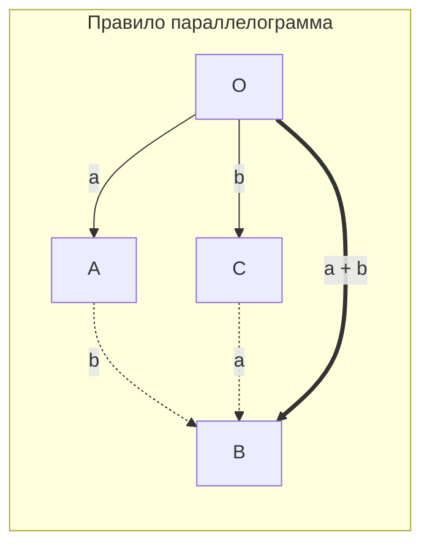

# Лекция 13: Векторная алгебра в геометрическом пространстве, свободные векторы, коллинеарность, компланарность и базис

> **Дисциплина**: Линейная алгебра  
> **Лектор**: ФИТиП (ИС), Университет ИТМО (Осенний семестр 2026)  
> **Ключевые темы**: Геометрическое трехмерное пространство $V_3$, направленный отрезок как упорядоченная пара точек, отношение эквивалентности (равенство по длине, параллельности и сонаправленности), свободный вектор как класс эквивалентности, нулевой вектор, линейные операции над геометрическими векторами (правило треугольника, правило параллелограмма, умножение на скаляр), теорема об образовании линейного пространства (проверка 8 аксиом), коллинеарность векторов и критерий линейной зависимости двух векторов, компланарность векторов и критерий линейной зависимости трех векторов, теорема о размерности $\dim V_3 = 3$ (линейная зависимость любых четырех векторов), базис в $V_3$, теорема о единственности разложения по базису, декартова система координат.

---

> [!TIP] Практика и домашнее задание к лекции
> Материалы домашнего задания с подробными решениями и задачами для самопроверки:
> - 📝 [Линейная алгебра ДЗ к лекции 13.md](./%D0%9B%D0%B8%D0%BD%D0%B5%D0%B9%D0%BD%D0%B0%D1%8F%20%D0%B0%D0%BB%D0%B3%D0%B5%D0%B1%D1%80%D0%B0%20%D0%94%D0%97%20%D0%BA%20%D0%BB%D0%B5%D0%BA%D1%86%D0%B8%D0%B8%2013.md)

---

## 1. Рекомендуемая литература

1. **А. И. Кострикин — «Введение в алгебру. Часть II: Линейная алгебра»**:
   * *Глава 2: «Аффинные и евклидовы пространства»* (§1: Векторы в геометрии, линейные операции; базис и координаты).
2. **Э. Б. Винберг — «Курс алгебры»**:
   * *Глава 4: «Линейные пространства»* (§1: Определение и примеры, геометрические векторы $V_1, V_2, V_3$).
3. **Д. В. Клетеник — «Сборник задач по аналитической геометрии»**:
   * *Раздел: «Векторная алгебра»* (линейные операции над векторами, условия коллинеарности и компланарности, разложение вектора по базису).

---

## 2. Геометрическое пространство $V_3$ и свободные векторы

До сих пор мы рассматривали абстрактные линейные пространства и координатные пространства $\mathbb{R}^n$. Векторная алгебра возникла из задач механики и геометрии, где вектор представляет собой направленный отрезок, характеризующийся величиной и направлением.

### 2.1 Направленные отрезки
Пусть задано трехмерное евклидово пространство точек $\mathcal{E}^3$.
* **Определение**: **Направленным отрезком** (или связанным вектором) называется упорядоченная пара точек $(A, B)$, где точка $A$ называется *началом*, а точка $B$ — *концом*. Обозначение: $\vec{AB}$.
* **Длина (модуль)**: Расстояние между точками $A$ и $B$ называется длиной направленного отрезка: $|\vec{AB}|$.

### 2.2 Отношение эквивалентности (равенство направленных отрезков)
Два направленных отрезка $\vec{AB}$ и $\vec{CD}$ называются **эквивалентными** ($\vec{AB} \sim \vec{CD}$), если:
1. Их длины равны: $|\vec{AB}| = |\vec{CD}|$;
2. Прямые $AB$ и $CD$ параллельны или совпадают ($AB \parallel CD$);
3. Они сонаправлены (лучи $[AB)$ и $[CD)$ направлены в одну сторону).

Легко проверить, что введенное отношение $\sim$ обладает свойствами:
* *Рефлексивность*: $\vec{AB} \sim \vec{AB}$;
* *Симметричность*: $\vec{AB} \sim \vec{CD} \implies \vec{CD} \sim \vec{AB}$;
* *Транзитивность*: $\vec{AB} \sim \vec{CD} \wedge \vec{CD} \sim \vec{EF} \implies \vec{AB} \sim \vec{EF}$.

Следовательно, отношение $\sim$ является **отношением эквивалентности** на множестве всех направленных отрезков пространства.

### 2.3 Свободный вектор
**Определение**: **Свободным вектором** называется **класс эквивалентности** направленных отрезков по отношению $\sim$. Обозначение: $\vec{a}, \vec{b}, \vec{v}$.
* Любой направленный отрезок из данного класса называется *представителем* свободного вектора.
* Это означает, что свободный вектор можно отложить от **любой точки** пространства $A \in \mathcal{E}^3$, притом единственным образом (параллельным переносом).

> [!NOTE] Нулевой вектор
> Если начало и конец отрезка совпадают ($A = B$), то направленный отрезок $\vec{AA}$ задает **нулевой вектор** $\vec{0}$.
> * Длина нулевого вектора равна нулю: $|\vec{0}| = 0$.
> * Направление нулевого вектора считается неопределенным (или коллинеарным любому направлению).

Множество всех свободных векторов трехмерного пространства обозначается через $V_3$ (на плоскости — $V_2$, на прямой — $V_1$).

---

## 3. Линейные операции над векторами

### 3.1 Сложение векторов
Пусть даны два свободных вектора $\vec{a}, \vec{b} \in V_3$.
* **Правило треугольника**: Выберем произвольную точку $O$. Отложим от неё вектор $\vec{OA} = \vec{a}$. Затем от точки $A$ отложим вектор $\vec{AB} = \vec{b}$. Тогда вектор $\vec{OB}$ называется суммой векторов $\vec{a}$ и $\vec{b}$:
  $$\vec{a} + \vec{b} = \vec{OA} + \vec{AB} = \vec{OB}$$
* **Правило параллелограмма**: Отложим оба вектора от общего начала $O$: $\vec{OA} = \vec{a}$, $\vec{OC} = \vec{b}$. Построим параллелограмм $OABC$. Тогда вектор диагонали $\vec{OB}$ равен сумме $\vec{a} + \vec{b}$.

### 3.2 Умножение вектора на скаляр
Произведением вектора $\vec{a} \in V_3$ на действительное число $\lambda \in \mathbb{R}$ называется вектор $\lambda \vec{a}$, удовлетворяющий условиям:
1. Длина: $|\lambda \vec{a}| = |\lambda| \cdot |\vec{a}|$;
2. Направление:
   * если $\lambda > 0$, то $\lambda \vec{a} \uparrow\uparrow \vec{a}$ (сонаправлен);
   * если $\lambda < 0$, то $\lambda \vec{a} \uparrow\downarrow \vec{a}$ (противоположно направлен);
   * если $\lambda = 0$ или $\vec{a} = \vec{0}$, то $\lambda \vec{a} = \vec{0}$.

---

### Теорема 1 (О линейном пространстве $V_3$)
Множество свободных векторов $V_3$ с операциями сложения векторов и умножения на скаляр образует **линейное (векторное) пространство** над полем вещественных чисел $\mathbb{R}$.

#### Доказательство 8 аксиом векторного пространства:
1. **$\vec{a} + \vec{b} = \vec{b} + \vec{a}$ (коммутативность)**:
   Следует непосредственно из правила параллелограмма: диагональ параллелограмма $OABC$ одна и та же, откладываем ли мы сначала $\vec{a}$ или $\vec{b}$.
2. **$(\vec{a} + \vec{b}) + \vec{c} = \vec{a} + (\vec{b} + \vec{c})$ (ассоциативность)**:
   Отложим последовательно от точки $O$: $\vec{OA} = \vec{a}$, $\vec{AB} = \vec{b}$, $\vec{BC} = \vec{c}$.  
   Тогда $(\vec{a} + \vec{b}) + \vec{c} = \vec{OB} + \vec{BC} = \vec{OC}$, и $\vec{a} + (\vec{b} + \vec{c}) = \vec{OA} + \vec{AC} = \vec{OC}$. Равенство доказано.
3. **$\vec{a} + \vec{0} = \vec{a}$ (существование нейтрального элемента)**:
   $\vec{OA} + \vec{AA} = \vec{OA}$.
4. **$\vec{a} + (-\vec{a}) = \vec{0}$ (существование противоположного элемента)**:
   Если $\vec{a} = \vec{AB}$, то $-\vec{a} = \vec{BA}$. Тогда $\vec{AB} + \vec{BA} = \vec{AA} = \vec{0}$.
5. **$1 \cdot \vec{a} = \vec{a}$**: По определению умножения на 1 длина и направление сохраняются.
6. **$(\alpha \beta) \vec{a} = \alpha (\beta \vec{a})$**: Модули совпадают ($|\alpha \beta| |\vec{a}| = |\alpha| |\beta| |\vec{a}|$), знаки определяют направление одинаково.
7. **$(\alpha + \beta) \vec{a} = \alpha \vec{a} + \beta \vec{a}$**: Очевидно из геометрического сложения коллинеарных векторов на одной прямой.
8. **$\alpha (\vec{a} + \vec{b}) = \alpha \vec{a} + \alpha \vec{b}$**:
   Следует из подобия треугольников $OAB$ и $OA'B'$, полученных гомотетией с коэффициентом $\alpha$ относительно центра $O$. $\blacksquare$

---

## 4. Коллинеарность и линейная зависимость двух векторов

### Определение 2 (Коллинеарность)
Два вектора $\vec{a}, \vec{b} \in V_3$ называются **коллинеарными** ($\vec{a} \parallel \vec{b}$), если их представители, отложенные от одной точки, лежат на одной прямой. Нулевой вектор коллинеарен любому вектору.

### Теорема 2 (Критерий линейной зависимости двух векторов)
Два вектора $\vec{a}, \vec{b} \in V_3$ линейно зависимы тогда и только тогда, когда они **коллинеарны**:
$$\vec{a}, \vec{b} \text{ л.з.} \iff \vec{a} \parallel \vec{b}$$

#### Доказательство:
1. **Необходимость ($\implies$)**:
   Пусть $\vec{a}, \vec{b}$ линейно зависимы. По определению существуют скаляры $\alpha, \beta \in \mathbb{R}$, не равные нулю одновременно ($\alpha^2 + \beta^2 \ne 0$), такие что:
   $$\alpha \vec{a} + \beta \vec{b} = \vec{0}$$
   Без ограничения общности пусть $\alpha \ne 0$. Тогда:
   $$\vec{a} = -\frac{\beta}{\alpha} \vec{b}$$
   Следовательно, вектор $\vec{a}$ получен умножением вектора $\vec{b}$ на число, а значит, лежит на той же прямой $\implies \vec{a} \parallel \vec{b}$.
2. **Достаточность ($\impliedby$)**:
   Пусть $\vec{a} \parallel \vec{b}$.
   * Если один из векторов нулевой, например $\vec{a} = \vec{0}$, то нетривиальная комбинация $1 \cdot \vec{0} + 0 \cdot \vec{b} = \vec{0}$ доказывает линейную зависимость.
   * Если оба ненулевые, то отношение их длин $\lambda = |\vec{a}| / |\vec{b}| > 0$. Если они сонаправлены, то $\vec{a} = \lambda \vec{b} \implies 1 \cdot \vec{a} - \lambda \vec{b} = \vec{0}$. Если противоположно направлены, то $\vec{a} = -\lambda \vec{b} \implies 1 \cdot \vec{a} + \lambda \vec{b} = \vec{0}$. В обоих случаях существует нетривиальная нулевая комбинация $\implies \vec{a}, \vec{b}$ линейно зависимы. $\blacksquare$

---

## 5. Компланарность и линейная зависимость трёх векторов

### Определение 3 (Компланарность)
Три вектора $\vec{a}, \vec{b}, \vec{c} \in V_3$ называются **компланарными**, если их представители, отложенные от одной точки, лежат в одной плоскости (или параллельны одной плоскости).

### Теорема 3 (Критерий линейной зависимости трёх векторов)
Три вектора $\vec{a}, \vec{b}, \vec{c} \in V_3$ линейно зависимы тогда и только тогда, когда они **компланарны**:
$$\vec{a}, \vec{b}, \vec{c} \text{ л.з.} \iff \vec{a}, \vec{b}, \vec{c} \text{ компланарны}$$

#### Доказательство:
1. **Необходимость ($\implies$)**:
   Пусть $\alpha \vec{a} + \beta \vec{b} + \gamma \vec{c} = \vec{0}$, где хотя бы один коэффициент ненулевой. Пусть $\gamma \ne 0$. Тогда:
   $$\vec{c} = -\frac{\alpha}{\gamma} \vec{a} - \frac{\beta}{\gamma} \vec{b}$$
   Вектор $\vec{c}$ раскладывается по векторам $\vec{a}$ и $\vec{b}$. Отложим $\vec{a}$ и $\vec{b}$ от точки $O$. Они задают плоскость $\pi$. Вектор $\vec{c}$, являясь суммой векторов из плоскости $\pi$, также лежит в $\pi$. Значит, векторы компланарны.
2. **Достаточность ($\impliedby$)**:
   Пусть $\vec{a}, \vec{b}, \vec{c}$ компланарны. Отложим их от одной точки $O$: $\vec{OA} = \vec{a}, \vec{OB} = \vec{b}, \vec{OC} = \vec{c}$. Все три точки $A, B, C$ лежат в одной плоскости $\pi$.
   * Если $\vec{a}$ и $\vec{b}$ коллинеарны, они уже линейно зависимы по теореме 2 $\implies$ вся тройка линейно зависима.
   * Если $\vec{a}$ и $\vec{b}$ не коллинеарны, они образуют базис на плоскости $\pi$. Проведем через точку $C$ прямые, параллельные $OA$ и $OB$. По правилу параллелограмма вектор $\vec{OC}$ однозначно раскладывается в сумму:
     $$\vec{c} = \lambda \vec{a} + \mu \vec{b} \implies \lambda \vec{a} + \mu \vec{b} - 1 \cdot \vec{c} = \vec{0}$$
   Коэффициент при $\vec{c}$ равен $-1 \ne 0 \implies$ векторы линейно зависимы. $\blacksquare$

---

## 6. Теорема о размерности $V_3$ и базис

### Теорема 4 (О линейной зависимости любых четырёх векторов)
Любые четыре вектора $\vec{a}, \vec{b}, \vec{c}, \vec{d} \in V_3$ **линейно зависимы**.

#### Доказательство:
Отложим все четыре вектора от общего начала $O$.
* Если любые три из них компланарны, они линейно зависимы по теореме 3, а значит, и вся четверка линейно зависима.
* Пусть первые три вектора $\vec{a}, \vec{b}, \vec{c}$ не компланарны. Проведем через конец вектора $\vec{d}$ прямую, параллельную прямой $OC$, до пересечения с плоскостью векторов $\vec{a}, \vec{b}$ в точке $D'$.
  Тогда вектор $\vec{d}$ раскладывается в сумму:
  $$\vec{d} = \vec{OD'} + \vec{D'D}$$
  Вектор $\vec{D'D}$ параллелен $\vec{c} \implies \vec{D'D} = \gamma \vec{c}$.  
  Вектор $\vec{OD'}$ лежит в плоскости векторов $\vec{a}, \vec{b} \implies \vec{OD'} = \alpha \vec{a} + \beta \vec{b}$.
  Подставляя:
  $$\vec{d} = \alpha \vec{a} + \beta \vec{b} + \gamma \vec{c} \implies \alpha \vec{a} + \beta \vec{b} + \gamma \vec{c} - 1 \cdot \vec{d} = \vec{0}$$
Так как коэффициент при $\vec{d}$ равен $-1 \ne 0$, четыре вектора всегда линейно зависимы. $\blacksquare$

---

### Следствие (Размерность и базис в пространстве $V_3$)
1. **Размерность геометрического пространства равна трем**:
   $$\dim V_3 = 3$$
2. **Базис пространства $V_3$**: Любая упорядоченная тройка **некомпланарных** векторов $e = (\vec{e}_1, \vec{e}_2, \vec{e}_3)$ образует базис пространства $V_3$.
3. **Единственность координат**: Любой вектор $\vec{a} \in V_3$ единственным образом разлагается по базису:
   $$\vec{a} = x \vec{e}_1 + y \vec{e}_2 + z \vec{e}_3$$
   Тройка чисел $(x, y, z)$ называется **координатами вектора $\vec{a}$** в данном базисе.

---

## 7. Декартов прямоугольный базис и координаты

Если базисные векторы взаимно перпендикулярны (ортогональны) и имеют единичную длину (нормированы), такой базис называется **ортонормированным** (декартовым):
$$\vec{i}, \vec{j}, \vec{k}, \quad |\vec{i}| = |\vec{j}| = |\vec{k}| = 1, \quad \vec{i} \perp \vec{j}, \; \vec{j} \perp \vec{k}, \; \vec{k} \perp \vec{i}$$

В таком базисе линейные операции выполняются покоординатно:
* $\vec{a} + \vec{b} = (x_1 + x_2) \vec{i} + (y_1 + y_2) \vec{j} + (z_1 + z_2) \vec{k}$;
* $\lambda \vec{a} = (\lambda x) \vec{i} + (\lambda y) \vec{j} + (\lambda z) \vec{k}$;
* Длина вектора: $|\vec{a}| = \sqrt{x^2 + y^2 + z^2}$;
* Скалярное произведение: $(\vec{a}, \vec{b}) = x_1 x_2 + y_1 y_2 + z_1 z_2 = |\vec{a}| |\vec{b}| \cos \angle(\vec{a}, \vec{b})$.

---

## Практика и домашнее задание к лекции
- 📝 [Перейти к разбору домашнего задания (Линейная алгебра ДЗ к лекции 13.md)](./%D0%9B%D0%B8%D0%BD%D0%B5%D0%B9%D0%BD%D0%B0%D1%8F%20%D0%B0%D0%BB%D0%B3%D0%B5%D0%B1%D1%80%D0%B0%20%D0%94%D0%97%20%D0%BA%20%D0%BB%D0%B5%D0%BA%D1%86%D0%B8%D0%B8%2013.md)
