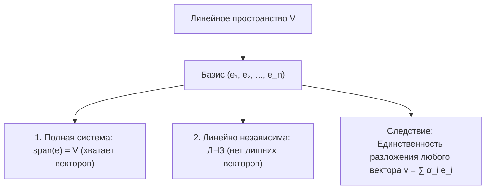

# Лекция 6: Базис, размерность и изоморфизм линейных пространств

> **Дисциплина**: Линейная алгебра  
> **Лектор**: ФИТиП (ИС), Университет ИТМО (Осенний семестр 2026)  
> **Ключевые темы**: Базис векторного пространства, инвариантность мощности базиса, размерность $\dim V$, канонические базисы в $K^n$, $K_{\le n}[x]$, $M_{m,n}(K)$, теорема о дополнении до базиса, единственность разложения вектора, линейность координат, изоморфизм линейных пространств, критерий изоморфизма через размерность, операции над подпространствами (пересечение, сумма), прямая сумма $L_1 \oplus L_2$, формула Грассмана.

---

## 1. Базис линейного пространства

В предыдущей лекции было доказано, что если система $X$ из $k$ векторов линейно независима, а система $Y$ из $m$ векторов полна ($\operatorname{span}(Y) = V$), то по лемме Штейница $k \le m$.  
Это позволяет строго ввести понятие базиса как «золотой середины» — минимальной полной и одновременно максимальной независимой системы.

> [!NOTE] **Определение 1 (Базис линейного пространства)**  
> Упорядоченная система векторов $e = (e_1, e_2, \dots, e_n)$ пространства $V$ над полем $K$ называется **базисом** пространства $V$, если она удовлетворяет двум условиям:  
> 1. **Полнота**: система $e$ порождает все пространство: $\operatorname{span}(e_1, \dots, e_n) = V$;  
> 2. **Линейная независимость**: система $e$ линейно независима (ЛНЗ).

---

### 1.1. Инвариантность мощности базиса

> [!IMPORTANT] **Теорема 1 (Об инвариантности числа векторов в базисе)**  
> В конечномерном линейном пространстве $V$ **любые два базиса состоят из одинакового числа векторов**.

#### Строгое доказательство:
Пусть $e = (e_1, \dots, e_n)$ и $f = (f_1, \dots, f_m)$ — два произвольных базиса пространства $V$.  
1. Система $e$ линейно независима (как базис), а система $f$ полна (как базис).  
   По лемме Штейница о замещении: $n \le m$.  
2. Система $f$ линейно независима (как базис), а система $e$ полна (как базис).  
   По лемме Штейница о замещении: $m \le n$.  
Из одновременного выполнения $n \le m$ и $m \le n$ следует, что:
$$n = m \quad \blacksquare$$

---

### 1.2. Размерность линейного пространства

> [!NOTE] **Определение 2 (Размерность / Dimension)**  
> **Размерностью** линейного пространства $V$ над полем $K$ называется количество векторов в любом его базисе.  
> Обозначается: $\dim_K V$ (или $\dim V$).  
> Если пространство состоит только из нулевого вектора $V = \{\mathbf{0}\}$, то по соглашению $\dim \{\mathbf{0}\} = 0$.

#### Стандартные (канонические) базисы:
1. **Арифметическое пространство $K^n$**:  
   Стандартный базис составляют единичные орты:
   $$e_1 = \begin{pmatrix} 1 \\ 0 \\ \vdots \\ 0 \end{pmatrix}, \quad e_2 = \begin{pmatrix} 0 \\ 1 \\ \vdots \\ 0 \end{pmatrix}, \quad \dots, \quad e_n = \begin{pmatrix} 0 \\ 0 \\ \vdots \\ 1 \end{pmatrix} \implies \dim K^n = n$$
2. **Пространство многочленов степени не выше $n$ ($K_{\le n}[x]$)**:  
   Базис: $\{1, x, x^2, \dots, x^n\}$.  
   Размерность: $\dim K_{\le n}[x] = n + 1$.
3. **Пространство матриц $M_{m, n}(K)$**:  
   Базис образуют матричные единицы $E_{ij}$ (единица на позиции $(i, j)$, остальные нули).  
   Размерность: $\dim M_{m, n}(K) = m \cdot n$.

---

## 2. Теоремы о базисе конечномерного пространства

### 2.1. Теорема о дополнении до базиса

> [!IMPORTANT] **Теорема 2 (О расширении независимой системы до базиса)**  
> Пусть $\dim V = n$, и пусть $\{x_1, x_2, \dots, x_k\} \subset V$ — произвольная линейно независимая система векторов ($k < n$).  
> Тогда эту систему всегда можно дополнить векторами $x_{k+1}, \dots, x_n$ до базиса всего пространства $V$.

#### Конструктивное доказательство:
Так как $k < n = \dim V$, линейная оболочка $L_k = \operatorname{span}(x_1, \dots, x_k) \ne V$ (иначе $L_k$ была бы полным пространством размерности $k < n$).  
Следовательно, существует вектор $x_{k+1} \in V \setminus L_k$.  
По лемме о добавлении вектора (Лекция 5), так как $x_{k+1}$ не выражается через $\{x_1, \dots, x_k\}$, расширенная система $\{x_1, \dots, x_k, x_{k+1}\}$ является **линейно независимой**.  
Если $k + 1 < n$, повторяем шаг и выбираем $x_{k+2} \in V \setminus \operatorname{span}(x_1, \dots, x_{k+1})$.  
Через $n - k$ шагов получим независимую систему из $n$ векторов $\{x_1, \dots, x_n\}$.  
В пространстве размерности $n$ любая независимая система из $n$ векторов является полной (по лемме Штейница), следовательно, она образует базис $V$. $\blacksquare$

---

### 2.2. Единственность разложения вектора по базису

> [!IMPORTANT] **Теорема 3 (О единственности координат в базисе)**  
> Пусть $e = (e_1, \dots, e_n)$ — базис пространства $V$. Тогда любой вектор $v \in V$ **единственным образом** представим в виде линейной комбинации векторов базиса:  
> $$v = \sum_{i=1}^n \alpha_i e_i = \alpha_1 e_1 + \alpha_2 e_2 + \dots + \alpha_n e_n$$

#### Строгое доказательство:
1. *Существование*: следует из полноты базиса ($\operatorname{span}(e) = V$).
2. *Единственность*: предположим противное. Пусть вектор $v$ имеет два различных разложения:
   $$v = \alpha_1 e_1 + \dots + \alpha_n e_n = \beta_1 e_1 + \dots + \beta_n e_n$$
   Вычтем одно равенство из другого:
   $$(\alpha_1 - \beta_1) e_1 + (\alpha_2 - \beta_2) e_2 + \dots + (\alpha_n - \beta_n) e_n = \mathbf{0}$$
   Так как система $(e_1, \dots, e_n)$ образует базис, она линейно независима.  
   Следовательно, равенство линейной комбинации нулю возможно только при тривиальном наборе коэффициентов:
   $$\alpha_1 - \beta_1 = 0, \quad \alpha_2 - \beta_2 = 0, \quad \dots, \quad \alpha_n - \beta_n = 0$$
   Откуда $\alpha_i = \beta_i$ для всех $i = 1, \dots, n$.  
Координаты вектора в фиксированном базисе строго единственны. $\blacksquare$

---

### 2.3. Линейность координат

> [!NOTE] **Определение 3 (Координатный столбец)**  
> Набор коэффициентов $[\alpha_1, \dots, \alpha_n]^T \in K^n$ называется **координатами вектора $v$ в базисе $e$** и обозначается $[v]_e$.

> [!IMPORTANT] **Теорема 4 (Линейность координатного отображения)**  
> Отображение сопоставления координат $[\cdot]_e: V \to K^n$ является линейным:  
> 1. $[u + v]_e = [u]_e + [v]_e$ (координаты суммы равны сумме координат);  
> 2. $[\alpha \cdot v]_e = \alpha \cdot [v]_e$ (скаляр выносится за координаты).

*Доказательство*:  
Пусть $u = \sum \alpha_i e_i$ и $v = \sum \beta_i e_i$.  
Тогда $u + v = \sum \alpha_i e_i + \sum \beta_i e_i = \sum (\alpha_i + \beta_i) e_i$.  
В силу единственности разложения по базису $e$, $i$-й координатой вектора $u + v$ является $\alpha_i + \beta_i$.  
Аналогично для $\lambda u = \lambda \sum \alpha_i e_i = \sum (\lambda \alpha_i) e_i$. $\blacksquare$

---

## 3. Изоморфизм линейных пространств

Изоморфизм формализует концепцию: «пространства имеют одинаковую алгебраическую природу, различаясь лишь именами элементов».

### 3.1. Определение изоморфизма

> [!NOTE] **Определение 4 (Изоморфизм)**  
> Отображение $\varphi: V \to W$ между двумя линейными пространствами над одним и тем же полем $K$ называется **изоморфизмом**, если:  
> 1. $\varphi$ **биективно** (взаимно однозначно);  
> 2. $\varphi$ **линейно** (сохраняет линейные операции):  
>    $$\forall x, y \in V \implies \varphi(x + y) = \varphi(x) + \varphi(y)$$  
>    $$\forall \alpha \in K, \; \forall x \in V \implies \varphi(\alpha x) = \alpha \varphi(x)$$  
> Пространства $V$ и $W$ называются **изоморфными** (обозначается $V \cong W$).

---

### 3.2. Свойства отношения изоморфизма

> [!IMPORTANT] **Теорема 5 (Изоморфизм как отношение эквивалентности)**  
> Отношение изоморфизма пространств $\cong$ является отношением эквивалентности:  
> 1. **Рефлексивно**: $V \cong V$ (тождественный изоморфизм $\operatorname{id}_V$);  
> 2. **Симметрично**: $V \cong W \implies W \cong V$ (обратное отображение $\varphi^{-1}: W \to V$ также является изоморфизмом);  
> 3. **Транзитивно**: $V \cong W \land W \cong U \implies V \cong U$ (композиция изоморфизмов $\psi \circ \varphi$ является изоморфизмом).

*Доказательство симметричности*:  
Так как $\varphi: V \to W$ биективно, обратное отображение $\varphi^{-1}: W \to V$ существует и биективно. Проверим его линейность.  
Пусть $w_1, w_2 \in W$. Обозначим $v_1 = \varphi^{-1}(w_1)$ и $v_2 = \varphi^{-1}(w_2)$, то есть $w_1 = \varphi(v_1), w_2 = \varphi(v_2)$.  
Тогда $w_1 + w_2 = \varphi(v_1) + \varphi(v_2) = \varphi(v_1 + v_2)$.  
Применяя $\varphi^{-1}$ к обеим частям: $\varphi^{-1}(w_1 + w_2) = v_1 + v_2 = \varphi^{-1}(w_1) + \varphi^{-1}(w_2)$.  
Аналогично $\varphi^{-1}(\alpha w) = \alpha \varphi^{-1}(w)$. Значит, $\varphi^{-1}$ линейно. $\blacksquare$

---

### 3.3. Главный критерий изоморфизма конечномерных пространств

> [!IMPORTANT] **Теорема 6 (Критерий изоморфизма через размерность)**  
> Два конечномерных линейных пространства $V$ и $W$ над полем $K$ изоморфны тогда и только тогда, когда их **размерности совпадают**:  
> $$V \cong W \iff \dim V = \dim W$$

#### Строгое доказательство:
1. **Необходимость ($\implies$)**:  
   Пусть $\varphi: V \to W$ — изоморфизм, и $e = (e_1, \dots, e_n)$ — базис $V$.  
   Покажем, что система $\varphi(e) = (\varphi(e_1), \dots, \varphi(e_n))$ образует базис $W$.  
   - *ЛНЗ*: пусть $\sum \alpha_i \varphi(e_i) = \mathbf{0}_W \implies \varphi(\sum \alpha_i e_i) = \mathbf{0}_W$. Так как $\varphi$ инъективно, прообраз нуля есть нуль: $\sum \alpha_i e_i = \mathbf{0}_V$. Так как $e$ — базис, все $\alpha_i = 0$.  
   - *Полнота*: для любого $w \in W$ в силу сюръективности существует $v \in V$ с $\varphi(v) = w$. Разложим $v = \sum \lambda_i e_i$. Тогда $w = \varphi(\sum \lambda_i e_i) = \sum \lambda_i \varphi(e_i)$.  
   Значит, образ базиса $V$ есть базис $W$. Следовательно, $\dim W = n = \dim V$.
2. **Достаточность ($\impliedby$)**:  
   Пусть $\dim V = \dim W = n$.  
   Выберем базис $e = (e_1, \dots, e_n)$ в $V$ и базис $f = (f_1, \dots, f_n)$ в $W$.  
   Каждому вектору $v = \sum_{i=1}^n \alpha_i e_i \in V$ сопоставим вектор $\varphi(v) = \sum_{i=1}^n \alpha_i f_i \in W$.  
   Отображение $\varphi$ очевидно биективно (координаты совпадают) и линейно.  
   Следовательно, $V \cong W$. $\blacksquare$

> [!TIP] **Следствие (Универсальность пространства $K^n$)**  
> Любое $n$-мерное линейное пространство над полем $K$ изоморфно арифметическому пространству $K^n$:  
> $$V \cong K^n \quad (\text{где } n = \dim V)$$

---

## 4. Алгебра подпространств: пересечение и сумма

Пусть $L_1$ и $L_2$ — линейные подпространства пространства $V$.

### 4.1. Пересечение подпространств
> [!NOTE] **Определение 5 (Пересечение подпространств)**  
> Пересечением $L_1 \cap L_2$ называется теоретико-множественное пересечение:  
> $$L_1 \cap L_2 = \{x \in V \mid x \in L_1 \land x \in L_2\}$$

Пересечение $L_1 \cap L_2$ всегда является линейным подпространством в $V$ (проверено по критерию замкнутости).

---

### 4.2. Сумма подпространств
Объединение подпространств $L_1 \cup L_2$ в общем случае **не является** подпространством (сумма векторов может выйти за пределы объединения). Чтобы получить наименьшее подпространство, содержащее оба множества, вводят сумму.

> [!NOTE] **Определение 6 (Сумма подпространств)**  
> **Суммой** подпространств $L_1$ и $L_2$ называется множество всех попарных сумм их элементов:  
> $$L_1 + L_2 = \{x_1 + x_2 \mid x_1 \in L_1, \; x_2 \in L_2\} = \operatorname{span}(L_1 \cup L_2)$$

---

### 4.3. Прямая сумма подпространств

> [!NOTE] **Определение 7 (Прямая сумма)**  
> Сумма подпространств $L_1 + L_2$ называется **прямой суммой** (обозначается $L_1 \oplus L_2$), если каждый вектор $x \in L_1 + L_2$ **единственным образом** представляется в виде:  
> $$x = x_1 + x_2, \qquad x_1 \in L_1, \; x_2 \in L_2$$

> [!IMPORTANT] **Теорема 7 (Критерий прямой суммы)**  
> Сумма подпространств является прямой тогда и только тогда, когда их пересечение тривиально (содержит только нулевой вектор):  
> $$L_1 + L_2 = L_1 \oplus L_2 \iff L_1 \cap L_2 = \{\mathbf{0}\}$$

---

### 4.4. Формула Грассмана для размерностей

> [!IMPORTANT] **Теорема 8 (Формула Грассмана)**  
> Для любых двух конечномерных подпространств $L_1, L_2 \le V$ справедливо соотношение:  
> $$\dim(L_1 + L_2) = \dim L_1 + \dim L_2 - \dim(L_1 \cap L_2)$$  
> В частности, для прямой суммы:  
> $$\dim(L_1 \oplus L_2) = \dim L_1 + \dim L_2$$

#### Идея доказательства:
Выберем базис в пересечении $e = (e_1, \dots, e_k)$, где $k = \dim(L_1 \cap L_2)$.  
По теореме о дополнении до базиса:
- Дополним $e$ векторами $(u_1, \dots, u_p)$ до базиса $L_1$ ($\dim L_1 = k + p$);
- Дополним $e$ векторами $(w_1, \dots, w_q)$ до базиса $L_2$ ($\dim L_2 = k + q$).  
Тогда объединенная система $(e_1, \dots, e_k, u_1, \dots, u_p, w_1, \dots, w_q)$ образует базис $L_1 + L_2$.  
Ее размерность: $k + p + q = (k + p) + (k + q) - k = \dim L_1 + \dim L_2 - \dim(L_1 \cap L_2)$. $\blacksquare$
