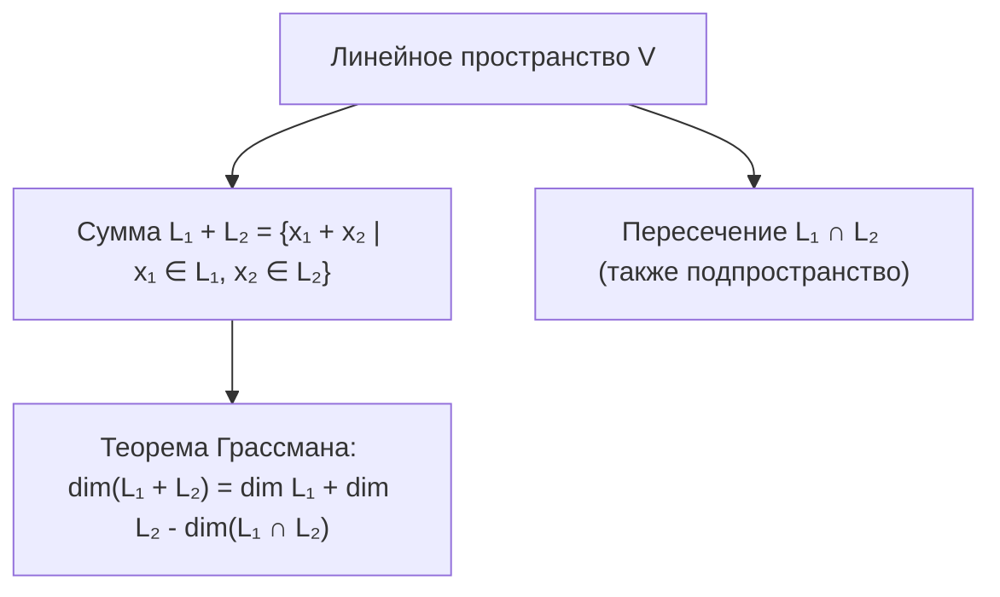
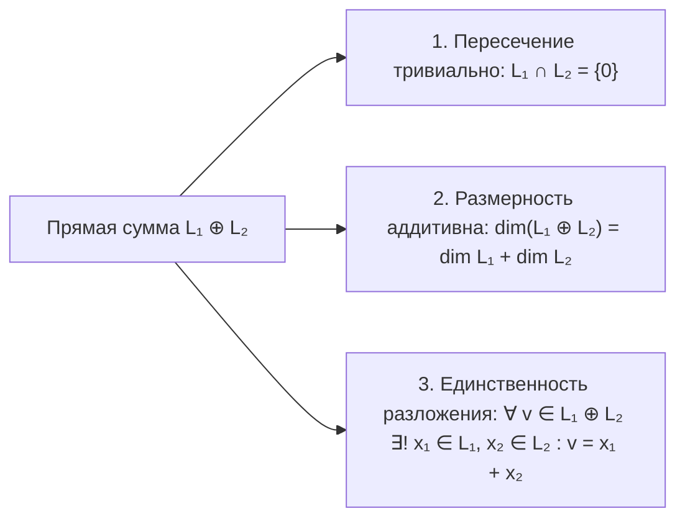

# Лекция 7: Сумма и прямая сумма подпространств, формула Грассмана, аксиоматика и свойства определителя

> **Дисциплина**: Линейная алгебра  
> **Лектор**: ФИТиП (ИС), Университет ИТМО (Осенний семестр 2026)  
> **Ключевые темы**: Сумма и пересечение подпространств, теорема Грассмана о размерности суммы, прямая сумма подпространств $L_1 \oplus L_2$, критерий прямой суммы через единственность разложения, аксиоматическое определение определителя (полилинейность, кососимметричность, нормированность), элементарные следствия из аксиом, явный вывод формулы определителя для матриц размера $2 \times 2$, теорема о существовании и единственности определителя через перестановки матрицы $n \times n$.

---

## 1. Рекомендуемая литература

* **А. И. Кострикин — «Введение в алгебру. Часть II: Линейная алгебра»**  
  *Глава 1: «Векторные пространства» (§4: Сумма и прямая сумма подпространств, теорема Грассмана); Глава 3: «Определители» (§1: Аксиоматическое построение, полилинейные кососимметрические формы).*
* **Э. Б. Винберг — «Курс алгебры»**  
  *Глава 4: «Линейные пространства» (§2: Операции над подпространствами); Глава 5: «Определители» (Аксиомы определителя, знакопеременные полилинейные функции).*
* **И. В. Проскуряков — «Сборник задач по линейной алгебре»**  
  *Задачи на сумму и пересечение подпространств, свойства определителей произвольного порядка.*

---

## 2. Сумма подпространств и формула Грассмана

Пусть $V$ — линейное пространство над полем $K$, и пусть $L_1, L_2 \subseteq V$ — два векторных подпространства.

> [!NOTE] **Определение 1 (Сумма подпространств)**  
> **Суммой подпространств** $L_1$ и $L_2$ называется множество всех векторов пространства $V$, представимых в виде суммы вектора из $L_1$ и вектора из $L_2$:  
> $$L_1 + L_2 = \{v \in V \mid v = x_1 + x_2, \quad x_1 \in L_1, \; x_2 \in L_2\}$$

Сумма подпространств $L_1 + L_2$ является наименьшим подпространством в $V$, содержащим одновременно $L_1$ и $L_2$, то есть $L_1 + L_2 = \operatorname{span}(L_1 \cup L_2)$.

---

### 2.1. Теорема Грассмана

> [!IMPORTANT] **Теорема 1 (Формула Грассмана)**  
> Для любых двух конечномерных подпространств $L_1$ и $L_2$ конечномерного пространства $V$:  
> $$\dim(L_1 + L_2) = \dim L_1 + \dim L_2 - \dim(L_1 \cap L_2)$$

#### Строгое доказательство:
1. Пересечение $L_1 \cap L_2$ является подпространством в $V$. Пусть его размерность равна $k$:  
   $$\dim(L_1 \cap L_2) = k$$  
   Выберем базис в $L_1 \cap L_2$:  
   $$E = (e_1, e_2, \dots, e_k)$$
2. По теореме о дополнении до базиса, систему $E$ (как ЛНЗ систему) можно дополнить до базиса подпространства $L_1$:  
   Пусть $\dim L_1 = k + p$, и базис $L_1$ имеет вид:  
   $$\mathcal{B}_1 = (e_1, \dots, e_k, \; x_1, \dots, x_p)$$
3. Аналогично, дополним систему $E$ до базиса подпространства $L_2$:  
   Пусть $\dim L_2 = k + q$, и базис $L_2$ имеет вид:  
   $$\mathcal{B}_2 = (e_1, \dots, e_k, \; y_1, \dots, y_q)$$
4. Докажем, что объединение этих систем:  
   $$\mathcal{B} = (e_1, \dots, e_k, \; x_1, \dots, x_p, \; y_1, \dots, y_q)$$  
   является базисом суммы подпространств $L_1 + L_2$.

##### Шаг А: Полнота системы $\mathcal{B}$
Любой вектор $v \in L_1 + L_2$ по определению представим как $v = u_1 + u_2$, где $u_1 \in L_1, u_2 \in L_2$.  
Так как $u_1 \in \operatorname{span}(e_1, \dots, e_k, x_1, \dots, x_p)$ и $u_2 \in \operatorname{span}(e_1, \dots, e_k, y_1, \dots, y_q)$, их сумма $v = u_1 + u_2$ линейно выражается через объединенную систему $\mathcal{B}$. Следовательно, $\operatorname{span}(\mathcal{B}) = L_1 + L_2$.

##### Шаг Б: Линейная независимость системы $\mathcal{B}$
Составим линейную комбинацию, равную нулевому вектору:  
$$\sum_{i=1}^k \alpha_i e_i + \sum_{j=1}^p \beta_j x_j + \sum_{m=1}^q \gamma_m y_m = \mathbf{0}$$  
Перенесем слагаемые с $y_m$ в правую часть:  
$$\underbrace{\sum_{i=1}^k \alpha_i e_i + \sum_{j=1}^p \beta_j x_j}_{\in L_1} = \underbrace{-\sum_{m=1}^q \gamma_m y_m}_{\in L_2}$$  
Обозначим этот вектор через $w$. Вектор $w$ принадлежит $L_1$ (левая часть) и принадлежит $L_2$ (правая часть), а значит:  
$$w \in L_1 \cap L_2$$  
Но система $(e_1, \dots, e_k)$ — базис $L_1 \cap L_2$, следовательно, вектор $w$ разлагается только по векторам $e_i$:  
$$-\sum_{m=1}^q \gamma_m y_m = \sum_{i=1}^k \mu_i e_i \implies \sum_{i=1}^k \mu_i e_i + \sum_{m=1}^q \gamma_m y_m = \mathbf{0}$$  
Но векторы $(e_1, \dots, e_k, y_1, \dots, y_q)$ образуют базис $L_2$ и линейно независимы! Отсюда:  
$$\gamma_1 = \gamma_2 = \dots = \gamma_q = 0 \quad (\text{и } \mu_i = 0)$$  
Подставляя нулевые коэффициенты $\gamma_m = 0$ в исходное равенство:  
$$\sum_{i=1}^k \alpha_i e_i + \sum_{j=1}^p \beta_j x_j = \mathbf{0}$$  
Так как $(e_1, \dots, e_k, x_1, \dots, x_p)$ — базис $L_1$, все коэффициенты также равны нулю:  
$$\alpha_1 = \dots = \alpha_k = 0, \quad \beta_1 = \dots = \beta_p = 0$$  
Все коэффициенты обязаны быть нулевыми, следовательно, система $\mathcal{B}$ линейно независима (ЛНЗ).

##### Шаг В: Подсчет размерности
Так как $\mathcal{B}$ — базис пространства $L_1 + L_2$, количество векторов в нем равно размерности:  
$$\dim(L_1 + L_2) = k + p + q$$  
С другой стороны:  
$$\dim L_1 + \dim L_2 - \dim(L_1 \cap L_2) = (k + p) + (k + q) - k = k + p + q$$  
Теорема Грассмана полностью доказана. $\blacksquare$

---

## 3. Прямая сумма подпространств

> [!NOTE] **Определение 2 (Прямая сумма)**  
> Сумма подпространств $L_1$ и $L_2$ называется **прямой суммой** (обозначается $L_1 \oplus L_2$), если их пересечение тривиально:  
> $$L_1 \cap L_2 = \{\mathbf{0}\}$$

> [!IMPORTANT] **Теорема 2 (Критерий прямой суммы)**  
> Для суммы подпространств $L = L_1 + L_2$ следующие утверждения эквивалентны:  
> 1. Сумма является прямой: $L = L_1 \oplus L_2$ (то есть $L_1 \cap L_2 = \{\mathbf{0}\}$);  
> 2. Каждый вектор $v \in L$ **единственным образом** представляется в виде $v = x_1 + x_2$, где $x_1 \in L_1, x_2 \in L_2$;  
> 3. Нулевой вектор $\mathbf{0}$ представляется в виде $x_1 + x_2$ ($x_1 \in L_1, x_2 \in L_2$) единственным образом: только при $x_1 = \mathbf{0}, x_2 = \mathbf{0}$;  
> 4. $\dim(L_1 + L_2) = \dim L_1 + \dim L_2$.

#### Доказательство эквивалентности (1) $\iff$ (2):
* $(1 \implies 2)$: Пусть $L_1 \cap L_2 = \{\mathbf{0}\}$. Предположим, некоторый вектор $v$ имеет два разложения:  
  $$v = x_1 + x_2 = x_1' + x_2', \quad x_1, x_1' \in L_1, \; x_2, x_2' \in L_2$$  
  Перегруппируем слагаемые:  
  $$\underbrace{x_1 - x_1'}_{\in L_1} = \underbrace{x_2' - x_2}_{\in L_2}$$  
  Вектор $w = x_1 - x_1' = x_2' - x_2$ принадлежит одновременно $L_1$ и $L_2$, следовательно:  
  $$w \in L_1 \cap L_2 = \{\mathbf{0}\} \implies w = \mathbf{0}$$  
  Отсюда $x_1 - x_1' = \mathbf{0} \implies x_1 = x_1'$ и $x_2' - x_2 = \mathbf{0} \implies x_2 = x_2'$. Разложение единственно!
* $(2 \implies 1)$: Пусть разложение единственно. Пусть $z \in L_1 \cap L_2$.  
  Тогда нулевой вектор можно записать двумя способами:  
  $$\mathbf{0} = \mathbf{0} + \mathbf{0} \quad \text{и} \quad \mathbf{0} = z + (-z)$$  
  где $z \in L_1$, а $-z \in L_2$.  
  В силу единственности разложения нуля: $z = \mathbf{0}$. Значит, $L_1 \cap L_2 = \{\mathbf{0}\}$. $\blacksquare$

---

## 4. Аксиоматика определителя (детерминанта)

Пусть $M_n(K)$ — пространство квадратных матриц размера $n \times n$ над полем $K$.  
Будем рассматривать матрицу $A \in M_n(K)$ как упорядоченный набор её строк:  
$$A = \begin{pmatrix} A_1 \\ A_2 \\ \vdots \\ A_n \end{pmatrix}, \quad \text{где } A_i = (a_{i1}, a_{i2}, \dots, a_{in}) \in K^n$$

> [!NOTE] **Определение 3 (Аксиомы определителя по Вейлю / Кострикину)**  
> **Определителем (детерминантом)** называется функция $\det : M_n(K) \to K$, удовлетворяющая трем аксиомам:  
> 1. **Полилинейность по строкам**: Функция линейна по каждой строке при фиксированных остальных строках:  
>    $$\det \begin{pmatrix} A_1 \\ \vdots \\ \alpha X + \beta Y \\ \vdots \\ A_n \end{pmatrix} = \alpha \det \begin{pmatrix} A_1 \\ \vdots \\ X \\ \vdots \\ A_n \end{pmatrix} + \beta \det \begin{pmatrix} A_1 \\ \vdots \\ Y \\ \vdots \\ A_n \end{pmatrix}, \quad \forall \alpha, \beta \in K$$  
> 2. **Кососимметричность (знакопеременность)**: При перестановке любых двух строк матрицы определитель меняет знак на противоположный:  
>    $$\det(A_1, \dots, A_i, \dots, A_j, \dots, A_n) = -\det(A_1, \dots, A_j, \dots, A_i, \dots, A_n), \quad i \ne j$$  
> 3. **Нормированность на единичной матрице**: Определитель единичной матрицы $I_n$ равен единице:  
>    $$\det(I_n) = \det(e_1, e_2, \dots, e_n) = 1$$  
>    где $(e_1, \dots, e_n)$ — канонический базис в $K^n$.

---

### 4.1. Фундаментальные следствия из аксиом

1. **Свойство двух одинаковых строк**:  
   Если матрица $A$ содержит две совпадающие строки ($A_i = A_j$ при $i \ne j$), то $\det(A) = 0$.  
   *Доказательство*: Поменяем местами строки $i$ и $j$. С одной стороны, матрица не изменилась: $\det(A)$. С другой стороны, по аксиоме кососимметричности знак сменился на противоположный: $-\det(A)$.  
   $$\det(A) = -\det(A) \implies 2\det(A) = 0 \implies \det(A) = 0 \quad (\operatorname{char} K \ne 2)$$
2. **Свойство нулевой строки**:  
   Если в матрице есть строка из нулей, то $\det(A) = 0$.  
   *Доказательство*: Нулевую строку можно представить как $0 \cdot X$. По полилинейности: $\det(A_1, \dots, 0 \cdot X, \dots, A_n) = 0 \cdot \det(A_1, \dots, X, \dots, A_n) = 0$.
3. **Свойство пропорциональных строк**:  
   Если одна строка матрицы пропорциональна другой ($A_i = \lambda A_j$), то $\det(A) = 0$.  
   *Доказательство*: По полилинейности выносим скаляр $\lambda$: $\det(A) = \lambda \det(\dots, A_j, \dots, A_j, \dots) = \lambda \cdot 0 = 0$.
4. **Прибавление линейной комбинации строк**:  
   Определитель матрицы не меняется, если к одной строке прибавить другую строку, умноженную на любое число $\lambda \in K$:  
   $$\det(A_1, \dots, A_i + \lambda A_j, \dots, A_j, \dots) = \det(A_1, \dots, A_i, \dots) + \lambda \underbrace{\det(A_1, \dots, A_j, \dots, A_j, \dots)}_{= 0} = \det(A)$$

---

## 5. Конструктивный вывод формулы определителя

### 5.1. Случай матрицы размера $2 \times 2$
Пусть $A = \begin{pmatrix} a_{11} & a_{12} \\ a_{21} & a_{22} \end{pmatrix}$.  
Разложим строки $A_1$ и $A_2$ по стандартному базису $e_1 = (1, 0), e_2 = (0, 1)$:  
$$A_1 = a_{11}e_1 + a_{12}e_2, \qquad A_2 = a_{21}e_1 + a_{22}e_2$$  
Используя аксиомы определителя:  
$$\det(A) = \det(a_{11}e_1 + a_{12}e_2, \; A_2) = a_{11}\det(e_1, A_2) + a_{12}\det(e_2, A_2)$$  
Теперь разложим вторую строку $A_2$:  
$$\det(A) = a_{11}\big(a_{21}\det(e_1, e_1) + a_{22}\det(e_1, e_2)\big) + a_{12}\big(a_{21}\det(e_2, e_1) + a_{22}\det(e_2, e_2)\big)$$  
Применим свойства базисных определителей:  
- $\det(e_1, e_1) = 0$ и $\det(e_2, e_2) = 0$ (равные строки);  
- $\det(e_1, e_2) = \det(I_2) = 1$ (аксиома нормированности);  
- $\det(e_2, e_1) = -\det(e_1, e_2) = -1$ (аксиома кососимметричности).  

Подставляя эти значения:  
$$\det(A) = a_{11}(0 + a_{22} \cdot 1) + a_{12}(a_{21} \cdot (-1) + 0) = a_{11}a_{22} - a_{12}a_{21}$$  
Мы строго вывели формулу школьного определителя $2 \times 2$ прямо из аксиом!

---

### 5.2. Общая формула определителя $n \times n$ (Теорема о существовании и единственности)

> [!IMPORTANT] **Теорема 3 (Существование и единственность определителя)**  
> Существует ровно одна функция $\det : M_n(K) \to K$, удовлетворяющая аксиомам полилинейности, кососимметричности и нормированности.  
> Она задается формулой полного разложения Лейбница:  
> $$\det(A) = \sum_{\sigma \in S_n} (-1)^{\operatorname{sgn}(\sigma)} a_{1, \sigma(1)} a_{2, \sigma(2)} \cdots a_{n, \sigma(n)}$$  
> где суммирование ведется по всем $n!$ перестановкам $\sigma$ симметрической группы $S_n$, а $\operatorname{sgn}(\sigma)$ — четность (число инверсий) перестановки $\sigma$.

#### Строгое доказательство:
1. Представим каждую строку $A_i$ как разложение по каноническому базису $e_1, \dots, e_n$:  
   $$A_i = \sum_{j=1}^n a_{ij} e_j$$
2. В силу полилинейности определителя по каждой из $n$ строк:  
   $$\det(A) = \det\left(\sum_{j_1=1}^n a_{1, j_1} e_{j_1}, \; \sum_{j_2=1}^n a_{2, j_2} e_{j_2}, \; \dots, \; \sum_{j_n=1}^n a_{n, j_n} e_{j_n}\right) = \sum_{j_1=1}^n \sum_{j_2=1}^n \cdots \sum_{j_n=1}^n a_{1, j_1} a_{2, j_2} \cdots a_{n, j_n} \det(e_{j_1}, e_{j_2}, \dots, e_{j_n})$$  
   Сумма изначально содержит ровно $n^n$ слагаемых.
3. По свойству равных строк, если среди индексов $(j_1, j_2, \dots, j_n)$ встречаются хотя бы два одинаковых, то матрица из строк $(e_{j_1}, \dots, e_{j_n})$ содержит две одинаковые строки, и её определитель равен нулю:  
   $$\det(e_{j_1}, \dots, e_{j_n}) = 0$$
4. Значит, ненулевой вклад дают **только те наборы индексов**, где все $j_1, \dots, j_n$ попарно различны.  
   Такие наборы взаимно однозначно соответствуют **перестановкам** чисел $\{1, 2, \dots, n\}$, то есть $\sigma \in S_n$, где $\sigma(i) = j_i$.  
   Количество ненулевых слагаемых сокращается с $n^n$ до $n!$.
5. Определитель $\det(e_{\sigma(1)}, e_{\sigma(2)}, \dots, e_{\sigma(n)})$ получается из определителя единичной матрицы $\det(e_1, \dots, e_n) = 1$ последовательностью транспозиций строк, приводящей перестановку $\sigma$ к тождественному виду.  
   По свойству кососимметричности каждая транспозиция меняет знак на $-1$. Число таких перестановок по четности совпадает с числом инверсий $\operatorname{sgn}(\sigma)$:  
   $$\det(e_{\sigma(1)}, \dots, e_{\sigma(n)}) = (-1)^{\operatorname{sgn}(\sigma)} \det(e_1, \dots, e_n) = (-1)^{\operatorname{sgn}(\sigma)}$$
6. Подставляя этот результат в сумму:  
   $$\det(A) = \sum_{\sigma \in S_n} (-1)^{\operatorname{sgn}(\sigma)} a_{1, \sigma(1)} a_{2, \sigma(2)} \cdots a_{n, \sigma(n)}$$  
   Поскольку формула получена исключительно на основе аксиом без какого-либо произвола, функция определителя **единственна**. Существование проверяется прямой подстановкой формулы в три исходные аксиомы. $\blacksquare$
