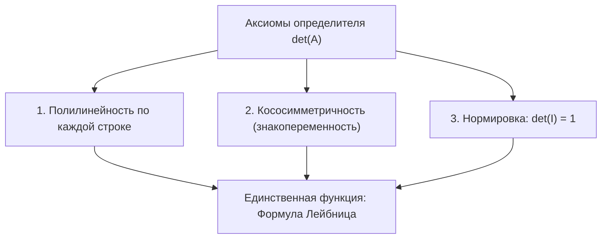
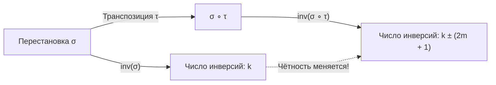
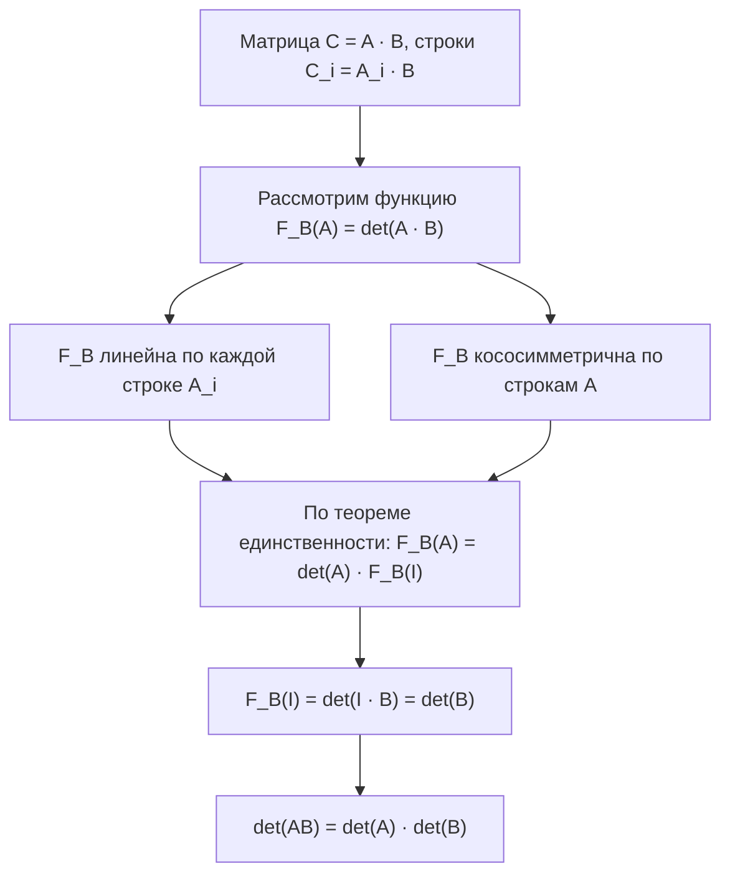
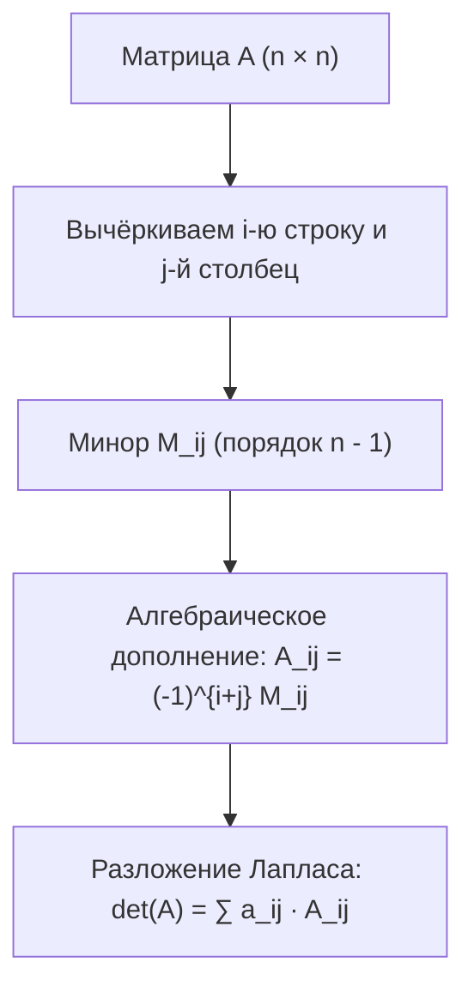

# Лекция 8: Определители: полилинейные кососимметричные формы, перестановки, формула Лейбница, свойства и теорема Лапласа

> **Дисциплина**: Линейная алгебра и геометрия  
> **Лектор**: ФИТиП (ИС), Университет ИТМО (Осенний семестр 2026)  
> **Ключевые темы**: Аксиоматическое определение определителя как полилинейной нормированной кососимметричной формы строк, группа перестановок $S_n$, инверсии, транспозиции и теорема о сохранении чётности, знак перестановки $\operatorname{sgn}(\sigma)$, полная формула Лейбница для определителя $n \times n$, теорема о транспонировании ($\det(A^T) = \det(A)$), свойства определителя (линейность по строкам, смена знака при перестановке, обнуление при совпадении строк), метод Гаусса вычисления определителей, теорема об определителе произведения матриц ($\det(AB) = \det(A)\det(B)$), миноры и алгебраические дополнения, теорема Лапласа о разложении по строке/столбцу и фальшивое разложение, присоединённая матрица и формула обратной матрицы ($A^{-1} = \frac{1}{\det A} C^T$), формулы Крамера, геометрический смысл (ориентированный объём параллелепипеда).

---

## 1. Рекомендуемая литература

* **А. И. Кострикин — «Введение в алгебру. Часть II: Линейная алгебра»**  
  *Глава 1: «Определители» (§1: Полилинейные формы и определитель; §2: Свойства определителей; §3: Теорема Лапласа; §4: Вычисление определителей).*
* **Д. В. Беклемишев — «Курс аналитической геометрии и линейной алгебры»**  
  *Глава III: «Определители» (§1: Определители второго и третьего порядков; §2: Перестановки и подстановки; §3: Определитель $n$-го порядка и его свойства).*
* **И. В. Проскуряков — «Сборник задач по линейной алгебре»**  
  *Раздел I: «Определители» (Задачи на формулу Лейбница, метод Гаусса, теорему Лапласа и рекуррентные соотношения).*

---

## 2. Аксиоматический подход: Определитель как полилинейная кососимметричная форма

Пусть $M_n(\mathbb{R})$ — множество всех квадратных матриц размера $n \times n$. Каждую матрицу $A \in M_n(\mathbb{R})$ можно рассматривать как упорядоченный набор из $n$ вектор-строк (или вектор-столбцов):
$$A = \begin{pmatrix} A_1 \\ A_2 \\ \vdots \\ A_n \end{pmatrix}, \quad A_i \in \mathbb{R}^n$$

Мы ищем скалярную функцию $F: M_n(\mathbb{R}) \to \mathbb{R}$, которая сопоставляет матрице число $F(A_1, A_2, \dots, A_n)$ и обладает естественными геометрическими свойствами объёма.

### Аксиомы определителя:
Функция $\det: M_n(\mathbb{R}) \to \mathbb{R}$ удовлетворяет трём базовым аксиомам:

1. **Полилинейность**: Функция линейна по каждой строке при фиксированных остальных строках.  
   Для любой строки $i$ и любых скаляров $\alpha, \beta \in \mathbb{R}$:
   $$\det\begin{pmatrix} \vdots \\ \alpha A_i + \beta A_i' \\ \vdots \end{pmatrix} = \alpha \det\begin{pmatrix} \vdots \\ A_i \\ \vdots \end{pmatrix} + \beta \det\begin{pmatrix} \vdots \\ A_i' \\ \vdots \end{pmatrix}$$
2. **Кососимметричность (знакопеременность)**: При перестановке местами любых двух строк знак функции меняется на противоположный:
   $$\det\begin{pmatrix} \vdots \\ A_j \\ \vdots \\ A_i \\ \vdots \end{pmatrix} = -\det\begin{pmatrix} \vdots \\ A_i \\ \vdots \\ A_j \\ \vdots \end{pmatrix}$$
   *Следствие кососимметричности*: Если у матрицы две строки одинаковы ($A_i = A_j$), то $\det(A) = -\det(A) \implies 2\det(A) = 0 \implies \det(A) = 0$.
3. **Нормировка**: Определитель единичной матрицы $I$ равен единице:
   $$\det(I) = \det(e_1, e_2, \dots, e_n) = 1$$
   где $e_1 = (1, 0, \dots, 0), e_2 = (0, 1, \dots, 0), \dots, e_n = (0, \dots, 0, 1)$ — стандартный базис пространства $\mathbb{R}^n$.

> **Теорема о единственности**: Существует ровно одна функция $F: M_n(\mathbb{R}) \to \mathbb{R}$, удовлетворяющая аксиомам 1–3.

---

## 3. Перестановки, инверсии и теорема о чётности

Чтобы получить явную аналитическую формулу для определителя, разложим каждую строку матрицы по стандартному базису:
$$A_i = \sum_{j=1}^n a_{ij} e_j$$
Подставляя это в определитель и пользуясь полилинейностью:
$$\det(A) = \det\left(\sum_{j_1=1}^n a_{1, j_1} e_{j_1}, \dots, \sum_{j_n=1}^n a_{n, j_n} e_{j_n}\right) = \sum_{j_1, \dots, j_n = 1}^n a_{1, j_1} \dots a_{n, j_n} \det(e_{j_1}, \dots, e_{j_n})$$
Если среди индексов $j_1, \dots, j_n$ есть хотя бы два одинаковых, строки базисных векторов совпадают, и по свойству кососимметричности $\det(e_{j_1}, \dots, e_{j_n}) = 0$.  
Ненулевые слагаемые остаются только тогда, когда $(j_1, j_2, \dots, j_n)$ образуют **перестановку чисел $\{1, 2, \dots, n\}$**!

### Определение 3.1 (Перестановка)
> **Перестановкой** (или подстановкой) множества $\{1, 2, \dots, n\}$ называется биекция $\sigma: \{1, 2, \dots, n\} \leftrightarrow \{1, 2, \dots, n\}$.  
> Множество всех перестановок порядка $n$ образует симметрическую группу $S_n$ мощности $|S_n| = n!$.
> Записывается перестановка в виде второй строки:
> $$\sigma = \begin{pmatrix} 1 & 2 & \dots & n \\ \sigma(1) & \sigma(2) & \dots & \sigma(n) \end{pmatrix} = (\sigma(1), \sigma(2), \dots, \sigma(n))$$

### Определение 3.2 (Инверсия и знак перестановки)
> Парой инверсии в перестановке $\sigma$ называется пара индексов $(i, j)$ такая, что $i < j$, но $\sigma(i) > \sigma(j)$ (большее число стоит раньше меньшего).  
> Общее количество таких пар обозначается $\operatorname{inv}(\sigma)$.  
> **Знаком** (или чётностью) перестановки называется число:
> $$\operatorname{sgn}(\sigma) = (-1)^{\operatorname{inv}(\sigma)} = \begin{cases} +1, & \text{если } \operatorname{inv}(\sigma) \text{ чётно (чётная перестановка)} \\ -1, & \text{если } \operatorname{inv}(\sigma) \text{ нечётно (нечётная перестановка)} \end{cases}$$

### Определение 3.3 (Транспозиция)
> **Транспозицией** называется перестановка, которая меняет местами ровно два элемента, оставляя остальные на месте:
> $$\tau = (i, j)$$

### Теорема 3.1 (О чётности перестановок и транспозиций)
> 1. Любая транспозиция меняет чётность числа инверсий на противоположную:
>    $$\operatorname{sgn}(\sigma \circ \tau) = -\operatorname{sgn}(\sigma)$$
> 2. Любую перестановку $\sigma \in S_n$ можно представить в виде произведения транспозиций:
>    $$\sigma = \tau_1 \circ \tau_2 \circ \dots \circ \tau_k$$
>    Количество транспозиций $k$ определяется неоднозначно, однако его **чётность неизменна** и совпадает с чётностью перестановки:
>    $$\operatorname{sgn}(\sigma) = (-1)^k$$

*Доказательство*:
1. Сначала рассмотрим транспозицию соседних элементов $(i, i+1)$. При их обмене взаимный порядок элементов $i$ и $i+1$ меняется: если была инверсия, она исчезает ($-1$), если не было — появляется ($+1$). Взаимный порядок остальных пар не меняется. Значит, $\operatorname{inv}$ меняется строго на $\pm 1$, то есть меняет чётность.
2. Транспозиция произвольных элементов $i$ и $j$ ($j > i$) представляется через $2(j - i) - 1$ соседних транспозиций (нечётное число). Нечётное количество смен чётности меняет чётность на противоположную.
3. Тождественная перестановка $\operatorname{id} = (1, 2, \dots, n)$ имеет 0 инверсий ($\operatorname{sgn} = +1$). Если $\sigma = \tau_1 \dots \tau_k$, то последовательно применяя $k$ транспозиций к $\operatorname{id}$, получаем $\operatorname{sgn}(\sigma) = (-1)^k$. $\blacksquare$

### Базисные определители:
Так как любая перестановка базисных строк переводит матрицу $I$ в матрицу с переставленными строками, по свойству кососимметричности:
$$\det(e_{\sigma(1)}, e_{\sigma(2)}, \dots, e_{\sigma(n)}) = \operatorname{sgn}(\sigma) \cdot \det(e_1, \dots, e_n) = \operatorname{sgn}(\sigma)$$

---

## 4. Итоговая формула Лейбница

Подставляя результат для базисных определителей, получаем фундаментальную теорему:

### Теорема 4.1 (Формула Лейбница для определителя)
> Определитель квадратной матрицы $A = (a_{ij}) \in M_n(\mathbb{R})$ выражается явной формулой:
> $$\det(A) = \sum_{\sigma \in S_n} \operatorname{sgn}(\sigma) \prod_{i=1}^n a_{i, \sigma(i)} = \sum_{\sigma \in S_n} (-1)^{\operatorname{inv}(\sigma)} a_{1, \sigma(1)} a_{2, \sigma(2)} \dots a_{n, \sigma(n)}$$

Каждое слагаемое представляет собой произведение $n$ элементов матрицы, взятых **ровно по одному из каждой строки и каждого столбца**. Всего слагаемых $n!$, из них ровно $n!/2$ входят со знаком плюс и $n!/2$ — со знаком минус.

### Частные случаи:
1. **$n = 1$**:
   $$\det(a_{11}) = a_{11}$$
2. **$n = 2$**: $S_2$ состоит из 2 перестановок: $(1, 2)$ ($0$ инверсий, знак $+1$) и $(2, 1)$ ($1$ инверсия, знак $-1$):
   $$\det \begin{pmatrix} a_{11} & a_{12} \\ a_{21} & a_{22} \end{pmatrix} = a_{11} a_{22} - a_{12} a_{21}$$
3. **$n = 3$**: $S_3$ состоит из $3! = 6$ перестановок. Получаем **правило Саррюса (правило треугольников)**:
   $$\det \begin{pmatrix} a_{11} & a_{12} & a_{13} \\ a_{21} & a_{22} & a_{23} \\ a_{31} & a_{32} & a_{33} \end{pmatrix} = \begin{aligned} &a_{11}a_{22}a_{33} + a_{12}a_{23}a_{31} + a_{13}a_{21}a_{32} \\ - &a_{13}a_{22}a_{31} - a_{11}a_{23}a_{32} - a_{12}a_{21}a_{33} \end{aligned}$$

---

## 5. Основные свойства определителя

### Теорема 5.1 (Транспонирование матрицы)
> Определитель транспонированной матрицы равен определителю исходной матрицы:
> $$\det(A^T) = \det(A)$$

*Доказательство*:
Элементы $A^T$ имеют вид $b_{ij} = a_{ji}$. По формуле Лейбница:
$$\det(A^T) = \sum_{\sigma \in S_n} \operatorname{sgn}(\sigma) \prod_{i=1}^n b_{i, \sigma(i)} = \sum_{\sigma \in S_n} \operatorname{sgn}(\sigma) \prod_{i=1}^n a_{\sigma(i), i}$$
В каждом произведении упорядочим сомножители по первой координате, сделав замену индекса $j = \sigma(i) \iff i = \sigma^{-1}(j)$:
$$\prod_{i=1}^n a_{\sigma(i), i} = \prod_{j=1}^n a_{j, \sigma^{-1}(j)}$$
Заметим, что инверсии перестановки $\sigma$ взаимно-однозначно соответствуют инверсиям обратной перестановки $\sigma^{-1}$, поэтому $\operatorname{sgn}(\sigma^{-1}) = \operatorname{sgn}(\sigma)$.  
Когда $\sigma$ пробегает всю группу $S_n$, обратная перестановка $\sigma^{-1}$ также пробегает всю $S_n$. Значит:
$$\det(A^T) = \sum_{\sigma^{-1} \in S_n} \operatorname{sgn}(\sigma^{-1}) \prod_{j=1}^n a_{j, \sigma^{-1}(j)} = \det(A) \quad \blacksquare$$

> **Важнейшее следствие**: Строки и столбцы в определителе совершенно равноправны! Любое свойство, доказанное для строк, автоматически справедливо и для столбцов.

### Сводка свойств определителя:
1. **Умножение строки (столбца) на число $c$**: умножает определитель на $c$.  
   *Следствие*: Для матрицы размера $n \times n$ выполнено: $\det(c A) = c^n \det(A)$.
2. **Перестановка двух строк (столбцов)**: меняет знак определителя.
3. **Нулевая строка (столбец)**: $\det(A) = 0$.
4. **Две одинаковые или пропорциональные строки**: $\det(A) = 0$.
5. **Линейная комбинация строк**: Если строка $A_i$ является линейной комбинацией остальных строк, то $\det(A) = 0$ (матрица вырождена $\iff \det(A) = 0$).
6. **Элементарные преобразования (метод Гаусса)**: Прибавление к любой строке (столбцу) линейной комбинации других строк (столбцов) **не меняет** величину определителя!
   $$\det \begin{pmatrix} \vdots \\ A_i + \lambda A_k \\ \vdots \end{pmatrix} = \det \begin{pmatrix} \vdots \\ A_i \\ \vdots \end{pmatrix} + \lambda \underbrace{\det \begin{pmatrix} \vdots \\ A_k \\ \vdots \end{pmatrix}}_{= 0} = \det(A)$$
7. **Определитель треугольной матрицы**: Если матрица верхнетреугольная ($a_{ij} = 0$ при $i > j$) или нижнетреугольная ($a_{ij} = 0$ при $i < j$), её определитель равен произведению элементов главной диагонали:
   $$\det(A) = a_{11} a_{22} \dots a_{nn}$$
   *(В формуле Лейбница единственное ненулевое слагаемое отвечает тождественной перестановке $\sigma = \operatorname{id}$)*.

---

## 6. Определитель произведения матриц

### Теорема 6.1 (Мультипликативность определителя)
> Для любых двух квадратных матриц $A, B \in M_n(\mathbb{R})$ определитель их произведения равен произведению их определителей:
> $$\det(A \cdot B) = \det(A) \cdot \det(B)$$

### Доказательство через полилинейные формы
Пусть матрица $B$ фиксирована. Рассмотрим функцию $F_B: M_n(\mathbb{R}) \to \mathbb{R}$, заданную формулой:
$$F_B(A) = \det(A \cdot B)$$
Вспомним правило умножения матриц: $i$-я строка матрицы $C = AB$ равна $C_i = A_i \cdot B$.
1. **Проверим полилинейность $F_B$**:  
   Если строка $A_i = \alpha A_i' + \beta A_i''$, то:
   $$C_i = (\alpha A_i' + \beta A_i'') B = \alpha (A_i' B) + \beta (A_i'' B)$$
   В силу линейности определителя $\det$ по $i$-й строке, функция $F_B(A)$ линейна по каждой строке матрицы $A$.
2. **Проверим кососимметричность $F_B$**:  
   Если поменять местами две строки матрицы $A$, то соответствующие строки матрицы $AB$ также поменяются местами, поэтому $\det(AB)$ сменит знак.
3. **Применение теоремы о кососимметричных формах**:  
   Любая полилинейная кососимметричная форма от $n$ строк пространства $\mathbb{R}^n$ пропорциональна определителю:
   $$F_B(A) = c \cdot \det(A), \quad \text{где } c = F_B(I)$$
4. Подставим в качестве $A$ единичную матрицу $I$:
   $$c = F_B(I) = \det(I \cdot B) = \det(B)$$
5. Окончательно:
   $$\det(AB) = F_B(A) = \det(A) \cdot \det(B) \quad \blacksquare$$

### Следствия:
- **Определитель степени матрицы**: $\det(A^k) = (\det A)^k$.
- **Определитель обратной матрицы**: Так как $A \cdot A^{-1} = I$, то:
  $$\det(A) \cdot \det(A^{-1}) = \det(I) = 1 \implies \det(A^{-1}) = \frac{1}{\det A}$$
  Матрица обратима тогда и только тогда, когда $\det(A) \ne 0$.

---

## 7. Миноры, алгебраические дополнения и теорема Лапласа

Разложение определителя по строке или столбцу позволяет свести вычисление определителя порядка $n$ к определителям порядка $n-1$.

### Определение 7.1 (Минор и алгебраическое дополнение)
Пусть $A \in M_n(\mathbb{R})$.
1. **Дополнительным минором** $M_{ij}$ к элементу $a_{ij}$ называется определитель матрицы порядка $(n-1) \times (n-1)$, полученной из матрицы $A$ вычёркиванием $i$-й строки и $j$-го столбца.
2. **Алгебраическим дополнением** $A_{ij}$ элемента $a_{ij}$ называется минор со знаком:
   $$A_{ij} = (-1)^{i+j} M_{ij}$$

### Теорема 7.2 (Теорема Лапласа о разложении определителя)
> 1. **Разложение по $i$-й строке**:  
>    Определитель равен сумме произведений элементов любой строки на их алгебраические дополнения:
>    $$\det(A) = \sum_{j=1}^n a_{ij} A_{ij} = a_{i1} A_{i1} + a_{i2} A_{i2} + \dots + a_{in} A_{in}$$
> 2. **Разложение по $j$-му столбцу**:
>    $$\det(A) = \sum_{i=1}^n a_{ij} A_{ij} = a_{1j} A_{1j} + a_{2j} A_{2j} + \dots + a_{nj} A_{nj}$$

### Теорема 7.3 (Фальшивое разложение / Теорема об аннулировании)
> Сумма произведений элементов некоторой строки (столбца) матрицы на алгебраические дополнения **другой** строки (столбца) тождественно равна нулю:
> $$\sum_{j=1}^n a_{kj} A_{ij} = 0 \quad \text{при } k \ne i$$
> $$\sum_{i=1}^n a_{ik} A_{ij} = 0 \quad \text{при } k \ne j$$

*Доказательство*:  
Сумма $\sum_{j=1}^n a_{kj} A_{ij}$ представляет собой разложение по $i$-й строке матрицы $A'$, у которой $i$-я строка заменена на $k$-ю строку матрицы $A$. Но тогда у матрицы $A'$ две одинаковые строки ($i$-я и $k$-я), а значит, её определитель равен 0! $\blacksquare$

Объединяя теоремы 7.2 и 7.3, получаем компактную матричную формулу через символ Кронекера $\delta_{ik}$:
$$\sum_{j=1}^n a_{kj} A_{ij} = \delta_{ki} \cdot \det(A) = \begin{cases} \det(A), & k = i \\ 0, & k \ne i \end{cases}$$

---

## 8. Применения: Обратная матрица и формулы Крамера

### 1. Формула для обратной матрицы
Пусть $C$ — матрица алгебраических дополнений к элементам матрицы $A$: $C = (A_{ij})$.  
Матрица $C^T$ (транспонированная матрица алгебраических дополнений) называется **присоединённой матрицей** (союзной матрицей, adjugate matrix) $\operatorname{adj}(A) = C^T$.

По формулам Лапласа:
$$A \cdot \operatorname{adj}(A) = A \cdot C^T = \begin{pmatrix} \det A & 0 & \dots & 0 \\ 0 & \det A & \dots & 0 \\ \vdots & \vdots & \ddots & \vdots \\ 0 & 0 & \dots & \det A \end{pmatrix} = \det(A) \cdot I$$
Если $\det(A) \ne 0$, разделим обе части на $\det(A)$:
$$A^{-1} = \frac{1}{\det(A)} \operatorname{adj}(A) = \frac{1}{\det(A)} C^T = \frac{1}{\det(A)} \begin{pmatrix} A_{11} & A_{21} & \dots & A_{n1} \\ A_{12} & A_{22} & \dots & A_{n2} \\ \vdots & \vdots & \ddots & \vdots \\ A_{1n} & A_{2n} & \dots & A_{nn} \end{pmatrix}$$

### 2. Метод Крамера для решения СЛАУ
Рассмотрим систему $n$ линейных уравнений с $n$ неизвестными: $A x = b$.  
Если определитель матрицы коэффициентов $\Delta = \det(A) \ne 0$, система имеет единственное решение, задаваемое формулами Крамера:
$$x_j = \frac{\Delta_j}{\Delta} \quad (j = 1, 2, \dots, n)$$
где $\Delta_j$ — определитель матрицы, полученной из $A$ заменой $j$-го столбца на столбец свободных членов $b$.

### 3. Геометрический смысл: Ориентированный объём
В трёхмерном пространстве $\mathbb{R}^3$ модуль определителя матрицы $3 \times 3$, составленной из векторов $v_1, v_2, v_3$, равен объёму параллелепипеда:
$$V = |\det(v_1, v_2, v_3)|$$
а знак определителя указывает ориентацию тройки векторов (правая или левая).  
В общем случае $n$ измерений $|\det(A)|$ есть $n$-мерный объём параллелепипеда, натянутого на векторы строк матрицы в $\mathbb{R}^n$. При линейном преобразовании $y = Ax$ объём любой фигуры масштабируется в $|\det A|$ раз.

---

## 9. Примеры вычисления определителей типовыми методами

### Пример 9.1 (Метод Гаусса — приведение к треугольному виду)
Вычислить определитель матрицы $4 \times 4$:
$$\Delta = \begin{vmatrix} 1 & 2 & 3 & 4 \\ 2 & 3 & 4 & 1 \\ 3 & 4 & 1 & 2 \\ 4 & 1 & 2 & 3 \end{vmatrix}$$

**Решение**:
1. Сложим все строки (2-ю, 3-ю, 4-ю) в первую строку:
   $$\Delta = \begin{vmatrix} 10 & 10 & 10 & 10 \\ 2 & 3 & 4 & 1 \\ 3 & 4 & 1 & 2 \\ 4 & 1 & 2 & 3 \end{vmatrix} = 10 \begin{vmatrix} 1 & 1 & 1 & 1 \\ 2 & 3 & 4 & 1 \\ 3 & 4 & 1 & 2 \\ 4 & 1 & 2 & 3 \end{vmatrix}$$
2. Вычтем 1-й столбец из 2-го, 3-го и 4-го столбцов:
   $$\Delta = 10 \begin{vmatrix} 1 & 0 & 0 & 0 \\ 2 & 1 & 2 & -1 \\ 3 & 1 & -2 & -1 \\ 4 & -3 & -2 & -1 \end{vmatrix}$$
3. Раскладываем по 1-й строке:
   $$\Delta = 10 \cdot 1 \cdot \begin{vmatrix} 1 & 2 & -1 \\ 1 & -2 & -1 \\ -3 & -2 & -1 \end{vmatrix}$$
4. Вычтем 1-ю строку из 2-й:
   $$\begin{vmatrix} 1 & 2 & -1 \\ 0 & -4 & 0 \\ -3 & -2 & -1 \end{vmatrix} = (-4) \cdot (-1)^{2+2} \begin{vmatrix} 1 & -1 \\ -3 & -1 \end{vmatrix} = (-4) \cdot (1 \cdot (-1) - (-1) \cdot (-3)) = (-4) \cdot (-1 - 3) = (-4)(-4) = 16$$
5. Итоговый определитель: $\Delta = 10 \cdot 16 = 160$.

*Ответ*: $160$.

---

### Пример 9.2 (Определитель Вандермонда)
Определитель Вандермонда порядка $n$:
$$V_n(x_1, \dots, x_n) = \begin{vmatrix} 1 & x_1 & x_1^2 & \dots & x_1^{n-1} \\ 1 & x_2 & x_2^2 & \dots & x_2^{n-1} \\ \vdots & \vdots & \vdots & \ddots & \vdots \\ 1 & x_n & x_n^2 & \dots & x_n^{n-1} \end{vmatrix} = \prod_{1 \le i < j \le n} (x_j - x_i)$$

Для $n = 3$:
$$\begin{vmatrix} 1 & x_1 & x_1^2 \\ 1 & x_2 & x_2^2 \\ 1 & x_3 & x_3^2 \end{vmatrix} = (x_2 - x_1)(x_3 - x_1)(x_3 - x_2)$$

---

## 10. Контрольные вопросы для самопроверки

1. **Вопрос**: Почему перестановка двух строк меняет знак определителя, а прибавление к строке линейной комбинации других строк его не меняет?  
   *Ответ*: Перестановка строк меняет знак в силу аксиомы кососимметричности. Прибавление к строке $A_i$ вектора $\lambda A_k$ по полилинейности даёт $\det(A) + \lambda \det(A')$, где у матрицы $A'$ две одинаковые строки $A_k$, откуда $\det(A') = 0$.
2. **Вопрос**: Докажите, что определитель кососимметрической матрицы нечётного порядка равен нулю ($A^T = -A$).  
   *Ответ*: $\det(A) = \det(A^T) = \det(-A) = (-1)^n \det(A)$. При нечётном $n$ получаем $\det(A) = -\det(A) \implies 2\det(A) = 0 \implies \det(A) = 0$.
3. **Вопрос**: В чём различие между теоремой Лапласа и формулой фальшивого разложения?  
   *Ответ*: Теорема Лапласа суммирует произведения элементов строки на их собственные алгебраические дополнения и даёт $\det(A)$. Фальшивое разложение умножает элементы строки на дополнения другой строки и даёт тождественный $0$.
4. **Вопрос**: Чему равен определитель матрицы $A^{-1}$, если $\det(A) = 5$?  
   *Ответ*: $\det(A^{-1}) = \frac{1}{\det A} = \frac{1}{5} = 0.2$.
5. **Вопрос**: Сколько слагаемых содержит формула Лейбница для матрицы размера $5 \times 5$? Сколько из них со знаком плюс?  
   *Ответ*: Всего $5! = 120$ слагаемых, ровно половина ($60$) со знаком плюс и $60$ со знаком минус.
