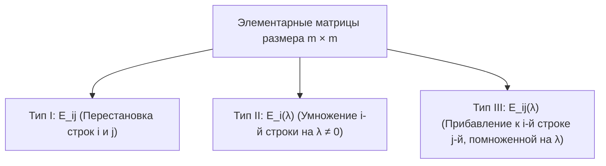
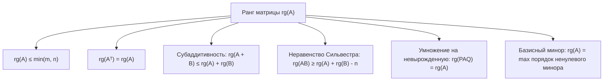

# Лекция 9: Ранг матрицы, элементарные преобразования строк, ступенчатый вид, метод Гаусса — Жордана и равенство строчного и столбцового рангов

> **Дисциплина**: Линейная алгебра  
> **Лектор**: ФИТиП (ИС), Университет ИТМО (Осенний семестр 2026)  
> **Ключевые темы**: Связь определителя с перестановками, определение ранга матрицы через линейную оболочку строк ($\operatorname{rg}(A) = \dim(\operatorname{span}(A_1, \dots, A_m))$), элементарные преобразования строк (перестановка, умножение на скаляр, прибавление строки), их обратимость, матрицы элементарных преобразований ($E_{ij}, E_i(\lambda), E_{ij}(\lambda)$), ведущие элементы (пивоты), ступенчатый вид (REF), улучшенный / приведенный ступенчатый вид (RREF), алгоритм и теорема метода Гаусса — Жордана с доказательством по индукции по числу столбцов матрицы, линейная независимость ненулевых строк ступенчатой матрицы, инвариантность соотношений линейной зависимости столбцов при преобразованиях строк, фундаментальная теорема о совпадении строчного и столбцового рангов ($\operatorname{rg}_{\text{row}}(A) = \operatorname{rg}_{\text{col}}(A)$), фундаментальные свойства ранга (субаддитивность, неравенство Сильвестра, сохранение ранга при умножении на невырожденные матрицы, теорема о базисном миноре), теорема Кронекера — Капелли и размерность пространства решений СЛАУ.

---

## 1. Рекомендуемая литература

* **А. И. Кострикин — «Введение в алгебру. Часть II: Линейная алгебра»**  
  *Глава 1: «Векторные пространства» (§3: Базис и размерность; §4: Подпространства, сумма и прямая сумма); Глава 2: «Матрицы» (§1: Ранг матрицы; §2: Метод Гаусса и элементарные преобразования).*
* **Э. Б. Винберг — «Курс алгебры»**  
  *Глава 1: «Системы линейных уравнений и матрицы» (§2: Метод последовательного исключения неизвестных Гаусса; §3: Ступенчатые матрицы); Глава 4: «Линейные пространства» (§3: Ранг матрицы, равенство строчного и столбцового рангов).*
* **И. В. Проскуряков — «Сборник задач по линейной алгебре»**  
  *Раздел III: «Матрицы и определители» (§2: Ранг матрицы; задачи на исследование ранга с параметрами).*
* **Г. Стрэнг — «Линейная алгебра и её применения»**  
  *Глава 2: «Векторные пространства и четыре фундаментальных подпространства матрицы».*

---

## 2. Мостик от определителей к рангу матрицы

На предыдущей лекции было установлено фундаментальное представление определителя квадратной матрицы $A \in M_{n \times n}(K)$ через формулу Лейбница по всем перестановкам симметрической группы $S_n$:
$$\det(A) = \sum_{\sigma \in S_n} \operatorname{sgn}(\sigma) \prod_{i=1}^n a_{i, \sigma(i)}$$

Определитель обладает критическим геометрическим свойством:
$$\det(A) \ne 0 \iff \text{строки (столбцы) матрицы } A \text{ линейно независимы}$$
Однако для прямоугольных матриц $A \in M_{m \times n}(K)$ (где $m \ne n$) понятие определителя неприменимо напрямую. Возникает фундаментальный вопрос: **как строго измерить степень линейной независимости строк и столбцов произвольной прямоугольной матрицы?** Этим универсальным инвариантом является **ранг матрицы**.

---

## 3. Понятие ранга матрицы: Строчный и столбцовый ранг

Пусть $K$ — основное поле ($\mathbb{R}$ или $\mathbb{C}$), и задана прямоугольная матрица $A \in M_{m \times n}(K)$:
$$A = \begin{pmatrix} a_{11} & a_{12} & \cdots & a_{1n} \\ a_{21} & a_{22} & \cdots & a_{2n} \\ \vdots & \vdots & \ddots & \vdots \\ a_{m1} & a_{m2} & \cdots & a_{mn} \end{pmatrix}$$

Матрицу $A$ можно рассматривать в двух равноправных аспектах:
1. Как упорядоченный набор из $m$ строк-векторов $A_1, A_2, \dots, A_m \in K^n$, где $A_i = (a_{i1}, a_{i2}, \dots, a_{in})$.
2. Как упорядоченный набор из $n$ столбцов-векторов $A^{(1)}, A^{(2)}, \dots, A^{(n)} \in K^m$, где $A^{(j)} = (a_{1j}, a_{2j}, \dots, a_{mj})^T$.

> [!NOTE] **Определение 1 (Линейная оболочка строк и столбцов)**  
> * **Строчным пространством** матрицы $A$ называется линейная оболочка её строк:  
>   $$\operatorname{Row}(A) = \operatorname{span}(A_1, A_2, \dots, A_m) \subseteq K^n$$  
> * **Столбцовым пространством** (образом матрицы $\operatorname{Im} A$) называется линейная оболочка её столбцов:  
>   $$\operatorname{Col}(A) = \operatorname{span}(A^{(1)}, A^{(2)}, \dots, A^{(n)}) \subseteq K^m$$

> [!IMPORTANT] **Определение 2 (Строчный и столбцовый ранг)**  
> 1. **Строчным рангом** матрицы $A$ называется размерность её строчного пространства (максимальное число линейно независимых строк матрицы):  
>    $$\operatorname{rg}_{\text{row}}(A) = \dim(\operatorname{Row}(A)) = \dim(\operatorname{span}(A_1, \dots, A_m)) \le m$$  
> 2. **Столбцовым рангом** матрицы $A$ называется размерность её столбцового пространства (максимальное число линейно независимых столбцов матрицы):  
>    $$\operatorname{rg}_{\text{col}}(A) = \dim(\operatorname{Col}(A)) = \dim(\operatorname{span}(A^{(1)}, \dots, A^{(n)})) \le n$$

Очевидно, что $\operatorname{rg}_{\text{row}}(A) \le m$ и $\operatorname{rg}_{\text{col}}(A) \le n$. Однако пока остаётся неясным, равны ли эти два числа для любой произвольной прямоугольной матрицы $m \times n$. Для ответа на этот вопрос исследуем алгебру преобразований строк.

---

## 4. Элементарные преобразования строк и элементарные матрицы

> [!IMPORTANT] **Определение 3 (Элементарные преобразования строк)**  
> **Элементарными преобразованиями строк** матрицы $A$ называются операции трёх типов:  
> 1. **Тип I ($S_{ij}$)**: Перестановка местами двух строк $i$ и $j$ ($i \ne j$). Запись: $A_i \leftrightarrow A_j$.  
> 2. **Тип II ($M_i(\lambda)$)**: Умножение строки $i$ на ненулевой скаляр $\lambda \in K \setminus \{0\}$. Запись: $A_i \leftarrow \lambda A_i$.  
> 3. **Тип III ($A_{ij}(\lambda)$)**: Прибавление к строке $i$ строки $j$, умноженной на скаляр $\lambda \in K$ ($j \ne i$). Запись: $A_i \leftarrow A_i + \lambda A_j$.

### 4.1. Обратимость элементарных преобразований
Каждое элементарное преобразование является **строго обратимым**, причём обратное преобразование относится к тому же типу:
1. Обратным к перестановке строк $S_{ij}$ является та же перестановка $S_{ij}$: $(S_{ij})^{-1} = S_{ij}$.
2. Обратным к умножению строки на $\lambda \ne 0$ является умножение той же строки на $\lambda^{-1}$: $(M_i(\lambda))^{-1} = M_i(\lambda^{-1})$.
3. Обратным к прибавлению $A_i \leftarrow A_i + \lambda A_j$ является вычитание $A_i \leftarrow A_i - \lambda A_j$: $(A_{ij}(\lambda))^{-1} = A_{ij}(-\lambda)$.

---

### 4.2. Матрицы элементарных преобразований (Элементарные матрицы)

> [!NOTE] **Определение 4 (Элементарная матрица)**  
> **Элементарной матрицей** размера $m \times m$ называется матрица, полученная из единичной матрицы $I_m$ применением одного элементарного преобразования строк.

1. **Матрица $E_{ij}$**: получается перестановкой $i$-й и $j$-й строк в $I_m$:
   $$E_{ij} = \begin{pmatrix} 1 & & & & & \\ & \ddots & & & & \\ & & 0 & \cdots & 1 & \\ & & \vdots & \ddots & \vdots & \\ & & 1 & \cdots & 0 & \\ & & & & & \ddots \end{pmatrix}, \quad \det(E_{ij}) = -1$$
2. **Матрица $E_i(\lambda)$** ($\lambda \ne 0$): на диагонали на $i$-м месте стоит $\lambda$, остальные диагональные элементы равны 1:
   $$E_i(\lambda) = \operatorname{diag}(1, \dots, 1, \lambda, 1, \dots, 1), \quad \det(E_i(\lambda)) = \lambda \ne 0$$
3. **Матрица $E_{ij}(\lambda)$** ($i \ne j$): совпадает с $I_m$, но на позиции $(i, j)$ стоит элемент $\lambda$:
   $$E_{ij}(\lambda) = I_m + \lambda e_i e_j^T, \quad \det(E_{ij}(\lambda)) = 1$$

> [!IMPORTANT] **Теорема 1 (О матричном представлении элементарных преобразований)**  
> Применение элементарного преобразования строк к матрице $A \in M_{m \times n}(K)$ эквивалентно **умножению матрицы $A$ слева** на соответствующую элементарную матрицу $E$:  
> $$A \xrightarrow{\text{преобразование}} E \cdot A$$

*Доказательство*:
Рассмотрим $k$-ю строку произведения $(E \cdot A)_k = E_k \cdot A = \sum_{p=1}^m e_{kp} A_p$.
* Если $E = E_{ij}$, то для строки $i$: $E_i = e_j^T$, поэтому $(E_{ij} A)_i = A_j$. Для строки $j$: $(E_{ij} A)_j = A_i$. Остальные строки не меняются.
* Если $E = E_i(\lambda)$, то $E_i = \lambda e_i^T$, поэтому $(E_i(\lambda) A)_i = \lambda A_i$.
* Если $E = E_{ij}(\lambda)$, то $E_i = e_i^T + \lambda e_j^T$, поэтому $(E_{ij}(\lambda) A)_i = A_i + \lambda A_j$. $\blacksquare$

Следствие: Поскольку $\det(E) \ne 0$, **все элементарные матрицы невырождены (обратимы)**.

---

## 5. Ступенчатый и приведенный ступенчатый вид матрицы

> [!NOTE] **Определение 5 (Ведущий элемент / Пивот)**  
> **Ведущим элементом (пивотом / leading entry)** ненулевой строки матрицы называется её первый (самый левый) ненулевой элемент.

> [!IMPORTANT] **Определение 6 (Ступенчатый вид / Row Echelon Form, REF)**  
> Матрица $A \in M_{m \times n}(K)$ называется **ступенчатой (имеющей ступенчатый вид)**, если выполнены два условия:  
> 1. Все нулевые строки (если они есть) расположены **строго ниже** всех ненулевых строк.  
> 2. Для любых двух соседних ненулевых строк $k$ и $k+1$ номер столбца ведущего элемента строки $k+1$ **строго больше** номера столбца ведущего элемента строки $k$:  
>    $$j_1 < j_2 < \dots < j_r$$  
>    где $j_k$ — номер столбца, в котором расположен пивот $k$-й строки, а $r$ — число ненулевых строк.

Схематический вид ступенчатой матрицы:
$$A_{\text{REF}} = \begin{pmatrix} 0 & \cdots & 0 & \mathbf{p_1} & * & * & \cdots & * & * & \cdots & * \\ 0 & \cdots & 0 & 0 & \cdots & \mathbf{p_2} & \cdots & * & * & \cdots & * \\ \vdots & & & & & & \ddots & \vdots & \vdots & & \vdots \\ 0 & \cdots & 0 & 0 & \cdots & 0 & \cdots & \mathbf{p_r} & * & \cdots & * \\ 0 & \cdots & 0 & 0 & \cdots & 0 & \cdots & 0 & 0 & \cdots & 0 \\ \vdots & & \vdots & \vdots & & \vdots & & \vdots & \vdots & & \vdots \\ 0 & \cdots & 0 & 0 & \cdots & 0 & \cdots & 0 & 0 & \cdots & 0 \end{pmatrix}$$
где $p_1, p_2, \dots, p_r \ne 0$.

> [!IMPORTANT] **Определение 7 (Приведенный ступенчатый вид / Reduced Row Echelon Form, RREF)**  
> Ступенчатая матрица называется **приведенной ступенчатой (RREF)**, если выполнены дополнительные требования нормализации:  
> 1. Каждый ведущий элемент равен единице: $p_1 = p_2 = \dots = p_r = 1$.  
> 2. В каждом столбце, содержащем ведущую единицу $p_k$, **все остальные элементы равны нулю** (как ниже, так и выше пивота):  
>    $$a_{i, j_k} = 0 \quad \text{при } i \ne k$$

---

## 6. Метод Гаусса — Жордана и теорема о приведении

> [!IMPORTANT] **Теорема 2 (О существовании ступенчатого вида матрицы)**  
> Любая матрица $A \in M_{m \times n}(K)$ с помощью конечного числа элементарных преобразований строк может быть приведена к ступенчатому виду (прямой ход метода Гаусса), а затем к единственному приведенному ступенчатому виду (обратный ход метода Жордана).

### Строгое доказательство методом математической индукции по числу столбцов $n$:

* **База индукции ($n = 1$)**:  
  Матрица $A$ состоит из одного столбца размера $m \times 1$: $A = (a_{11}, a_{21}, \dots, a_{m1})^T$.
  * Если все $a_{i1} = 0$, матрица нулевая и уже является ступенчатой.
  * Если существует $a_{k1} \ne 0$: перестановкой строк $S_{1k}$ перемещаем элемент $a_{k1}$ на позицию $(1, 1)$. Затем для всех строк $i = 2, 3, \dots, m$ выполняем преобразование $A_i \leftarrow A_i - \frac{a_{i1}}{a_{11}} A_1$. Все элементы ниже позиции $(1, 1)$ обращаются в ноль. Столбец принимает вид $(a_{11}, 0, \dots, 0)^T$, что является ступенчатым видом. База доказана.

* **Индукционное предположение**:  
  Пусть для любой матрицы с числом столбцов $\le n - 1$ (при произвольном числе строк) теорема верна: её можно привести к ступенчатому виду элементарными преобразованиями строк.

* **Индукционный шаг ($n - 1 \implies n$)**:  
  Рассмотрим матрицу $A \in M_{m \times n}(K)$. Представим её блочно: $A = (A^{(1)} \mid \tilde{A})$, где $A^{(1)}$ — первый столбец, а $\tilde{A}$ — подматрица размера $m \times (n-1)$.
  * **Случай 1**: Первый столбец $A^{(1)}$ целиком нулевой.  
    Тогда преобразования строк не меняют нулевой столбец. По индукционному предположению приводим подматрицу $\tilde{A}$ к ступенчатому виду. Вся матрица $A$ становится ступенчатой с ведущим столбцом $j_1 > 1$.
  * **Случай 2**: В первом столбце есть хотя бы один ненулевой элемент $a_{k1} \ne 0$.  
    1. Перестановкой строк $S_{1k}$ помещаем ненулевой элемент в верхний левый угол $(1, 1)$. Обозначим новый пивот $p_1 = a'_{11} \ne 0$.  
    2. Для всех $i = 2, 3, \dots, m$ прибавляем к $i$-й строке первую, умноженную на $-a'_{i1} / p_1$:  
       $$A_i \leftarrow A_i - \frac{a'_{i1}}{p_1} A_1$$  
       В результате первый столбец принимает вид $(p_1, 0, \dots, 0)^T$, а вся матрица становится блочной:  
       $$A' = \begin{pmatrix} p_1 & * & \cdots & * \\ 0 & & & \\ \vdots & & B & \\ 0 & & & \end{pmatrix}$$  
       где $B$ — подматрица размера $(m-1) \times (n-1)$.  
    3. По предположению индукции подматрица $B$ может быть приведена к ступенчатому виду $B_{\text{REF}}$ с помощью элементарных преобразований её строк. Каждое элементарное преобразование строк подматрицы $B$ соответствует элементарному преобразованию строк матрицы $A'$ с номерами от $2$ до $m$. Такие преобразования затрагивают только нули в первом столбце матрицы $A'$ и не меняют ни одного нуля!  
    4. В результате блок $B$ становится ступенчатым, а вся матрица $A'$ приобретает ступенчатый вид с первым пивотом $p_1$ в столбце $j_1 = 1$. Индукционный переход полностью доказан. $\blacksquare$

---

## 7. Линейная независимость строк и равенство рангов

> [!IMPORTANT] **Лемма 1 (О линейной независимости ненулевых строк ступенчатой матрицы)**  
> Все ненулевые строки любой ступенчатой матрицы $R \in M_{m \times n}(K)$ линейно независимы.  
> Следовательно, строчный ранг ступенчатой матрицы в точности равен числу её ненулевых строк (числу пивотов):  
> $$\operatorname{rg}_{\text{row}}(R) = r$$

*Доказательство*:  
Пусть ненулевые строки ступенчатой матрицы суть $R_1, R_2, \dots, R_r$, а их пивоты расположены в столбцах с номерами $j_1 < j_2 < \dots < j_r$.  
Рассмотрим произвольную линейную комбинацию, равную нулевой строке:
$$\sum_{k=1}^r c_k R_k = \mathbf{0}$$
Посмотрим на координату этой суммы в столбце $j_1$. В строках $R_2, R_3, \dots, R_r$ на этой позиции стоят нули (поскольку их пивоты лежат строго правее: $j_k > j_1$ для всех $k \ge 2$). Поэтому значение суммы в столбце $j_1$ равно $c_1 \cdot r_{1, j_1} = 0$. Так как $r_{1, j_1} \ne 0$, получаем $c_1 = 0$.  
Исключая первую строку и повторяя то же рассуждение последовательно для столбцов $j_2, j_3, \dots, j_r$, получаем $c_2 = 0, c_3 = 0, \dots, c_r = 0$.  
Все коэффициенты тривиальны, значит, строки $R_1, \dots, R_r$ линейно независимы. $\blacksquare$

---

### 7.1. Инвариантность линейной оболочки строк

> [!IMPORTANT] **Теорема 3 (Инвариантность строчного пространства при элементарных преобразованиях)**  
> Элементарные преобразования строк не изменяют линейную оболочку строк матрицы:  
> $$\operatorname{Row}(E \cdot A) = \operatorname{Row}(A)$$  
> В частности, строчный ранг матрицы инвариантен относительно любых элементарных преобразований строк:  
> $$\operatorname{rg}_{\text{row}}(A) = \operatorname{rg}_{\text{row}}(RREF(A)) = r$$

*Доказательство*:  
Каждая строка матрицы $E \cdot A$ является линейной комбинацией строк матрицы $A$:  
$$(E \cdot A)_i \in \operatorname{span}(A_1, \dots, A_m) \implies \operatorname{Row}(E \cdot A) \subseteq \operatorname{Row}(A)$$  
Поскольку элементарная матрица $E$ обратима и $E^{-1}$ также является элементарной матрицей, получаем обратное включение:  
$$A = E^{-1} (E \cdot A) \implies \operatorname{Row}(A) \subseteq \operatorname{Row}(E \cdot A)$$  
Следовательно, подпространства совпадают: $\operatorname{Row}(A) = \operatorname{Row}(E \cdot A)$, а значит, их размерности равны: $\dim \operatorname{Row}(A) = \dim \operatorname{Row}(E \cdot A)$. $\blacksquare$

---

### 7.2. Сохранение линейных зависимостей столбцов и совпадение рангов

Хотя элементарные преобразования строк меняют сами векторы-столбцы матрицы, они обладают ключевым свойством: **сохраняют все соотношения линейной зависимости между столбцами**!

> [!NOTE] **Лемма 2 (О сохранении линейных зависимостей столбцов)**  
> Для любых коэффициентов $c_1, c_2, \dots, c_n \in K$:  
> $$\sum_{j=1}^n c_j A^{(j)} = \mathbf{0} \iff \sum_{j=1}^n c_j (E \cdot A)^{(j)} = \mathbf{0}$$

*Доказательство*:  
Линейная комбинация столбцов матрицы $A$ с коэффициентами $c = (c_1, \dots, c_n)^T$ записывается как матричное произведение $A \cdot c$.  
Тогда:  
$$A \cdot c = \mathbf{0} \implies E \cdot (A \cdot c) = \mathbf{0} \implies (E A) \cdot c = \mathbf{0}$$  
Обратно, умножая на $E^{-1}$, получаем $(E A) c = \mathbf{0} \implies A c = \mathbf{0}$. $\blacksquare$

> [!IMPORTANT] **Фундаментальная теорема 4 (О совпадении строчного и столбцового рангов)**  
> Для любой прямоугольной матрицы $A \in M_{m \times n}(K)$ её строчный ранг в точности равен её столбцовому рангу:  
> $$\operatorname{rg}_{\text{row}}(A) = \operatorname{rg}_{\text{col}}(A) = \operatorname{rg}(A)$$

#### Строгое доказательство:
1. Приведём матрицу $A$ элементарными преобразованиями строк к приведенному ступенчатому виду: $R = \operatorname{RREF}(A) = P \cdot A$, где $P = E_k \cdots E_1$ — обратимая матрица.  
2. Пусть $R$ имеет $r$ ненулевых строк. По лемме 1 строчный ранг $\operatorname{rg}_{\text{row}}(A) = \operatorname{rg}_{\text{row}}(R) = r$.
3. Пивоты матрицы $R$ стоят в столбцах $j_1, j_2, \dots, j_r$. Так как $R$ — приведенная ступенчатая матрица, эти $r$ столбцов представляют собой стандартные базисные орты пространства $K^m$:  
   $$R^{(j_1)} = e_1, \; R^{(j_2)} = e_2, \; \dots, \; R^{(j_r)} = e_r$$  
   Эти $r$ столбцов очевидно линейно независимы в $K^m$. Любой другой столбец $R^{(k)}$ имеет ненулевые элементы только в первых $r$ позициях, поэтому является их линейной комбинацией:  
   $$R^{(k)} = \sum_{p=1}^r r_{pk} e_p = \sum_{p=1}^r r_{pk} R^{(j_p)}$$  
   Следовательно, столбцы $R^{(j_1)}, \dots, R^{(j_r)}$ образуют базис столбцового пространства матрицы $R$, откуда $\operatorname{rg}_{\text{col}}(R) = r$.
4. По лемме 2 любые соотношения линейной зависимости между столбцами матрицы $R$ в точности эквивалентны соотношениям между столбцами исходной матрицы $A$. Следовательно, исходные столбцы $A^{(j_1)}, A^{(j_2)}, \dots, A^{(j_r)}$ также линейно независимы и порождают столбцовое пространство $\operatorname{Col}(A)$.  
5. Значит, столбцовый ранг матрицы $A$ также равен $r$:  
   $$\operatorname{rg}_{\text{col}}(A) = r = \operatorname{rg}_{\text{row}}(A)$$  
Теорема полностью доказана. $\blacksquare$

---

## 8. Фундаментальные свойства ранга матрицы

1. **Ограничение размерности**:  
   Для любой матрицы $A \in M_{m \times n}(K)$:  
   $$\operatorname{rg}(A) \le \min(m, n)$$
2. **Инвариантность при транспонировании**:  
   Поскольку строки матрицы $A$ являются столбцами матрицы $A^T$:  
   $$\operatorname{rg}(A^T) = \operatorname{rg}_{\text{col}}(A^T) = \operatorname{rg}_{\text{row}}(A) = \operatorname{rg}(A)$$
3. **Субаддитивность (неравенство треугольника для ранга)**:  
   Для любых $A, B \in M_{m \times n}(K)$:  
   $$\operatorname{rg}(A + B) \le \operatorname{rg}(A) + \operatorname{rg}(B)$$  
   *Доказательство*: Строки матрицы $A + B$ лежат в сумме линейных оболочек строк $A$ и строк $B$:  
   $$\operatorname{Row}(A + B) \subseteq \operatorname{Row}(A) + \operatorname{Row}(B)$$  
   По формуле Грассмана: $\dim(\operatorname{Row}(A) + \operatorname{Row}(B)) \le \dim \operatorname{Row}(A) + \dim \operatorname{Row}(B) = \operatorname{rg}(A) + \operatorname{rg}(B)$.
4. **Ранг произведения**:  
   Для $A \in M_{m \times n}(K)$ и $B \in M_{n \times p}(K)$:  
   $$\operatorname{rg}(A B) \le \min(\operatorname{rg}(A), \operatorname{rg}(B))$$  
   Столбцы $AB$ являются линейными комбинациями столбцов $A$, а строки $AB$ — линейными комбинациями строк $B$.
5. **Неравенство Сильвестра**:  
   Для $A \in M_{m \times n}(K)$ и $B \in M_{n \times p}(K)$:  
   $$\operatorname{rg}(A B) \ge \operatorname{rg}(A) + \operatorname{rg}(B) - n$$  
   *Доказательство*: Рассмотрим оператор $A$ на образе оператора $B$ ($\operatorname{Im} B \subseteq K^n$). По теореме о ранге и дефекте:  
   $$\dim(\operatorname{Im} B) = \dim(\operatorname{Im}(AB)) + \dim(\operatorname{Ker} A \cap \operatorname{Im} B)$$  
   Так как $\dim(\operatorname{Ker} A \cap \operatorname{Im} B) \le \dim(\operatorname{Ker} A) = n - \operatorname{rg}(A)$, подставляя, получаем:  
   $$\operatorname{rg}(B) \le \operatorname{rg}(AB) + n - \operatorname{rg}(A) \implies \operatorname{rg}(AB) \ge \operatorname{rg}(A) + \operatorname{rg}(B) - n. \quad \blacksquare$$
6. **Сохранение ранга при умножении на невырожденные матрицы**:  
   Если матрицы $P \in M_{m \times m}$ и $Q \in M_{n \times n}$ невырождены ($\det P \ne 0, \det Q \ne 0$), то:  
   $$\operatorname{rg}(P \cdot A \cdot Q) = \operatorname{rg}(A)$$
7. **Теорема о базисном миноре**:  
   Ранг матрицы $A$ равен **наибольшему порядку её отличного от нуля минора**. Строки и столбцы, на пересечении которых стоит базисный минор, образуют базис строчного и столбцового пространств матрицы $A$.

---

## 9. Приложения в Computer Science и линейных системах

### 9.1. Теорема Кронекера — Капелли
Система линейных алгебраических уравнений $A x = b$ совместна (имеет хотя бы одно решение) тогда и только тогда, когда ранг основной матрицы системы равен рангу расширенной матрицы:
$$\operatorname{rg}(A) = \operatorname{rg}(A \mid b)$$

* Если $\operatorname{rg}(A) = \operatorname{rg}(A \mid b) = n$ (число неизвестных), система имеет **единственное решение**.
* Если $\operatorname{rg}(A) = \operatorname{rg}(A \mid b) = r < n$, система имеет **бесконечно много решений**, зависящих от $n - r$ свободных параметров (фундаментальная система решений, ФСР).
* Пространство решений однородной системы $A x = \mathbf{0}$ образует ядро матрицы $\operatorname{Ker} A$ размерности:
  $$\dim \operatorname{Ker} A = n - \operatorname{rg}(A)$$

### 9.2. Вычислительная сложность метода Гаусса
Прямой ход метода Гаусса для матрицы $m \times n$ выполняет:
$$\sum_{k=1}^{\min(m, n)} (m - k)(n - k) \approx O(m \cdot n \cdot \min(m, n))$$
Для квадратной матрицы $n \times n$ алгоритм требует $\approx \frac{2}{3} n^3$ арифметических операций с плавающей точкой (FLOPs), что делает его базовым численным методом в LAPACK и BLAS.
