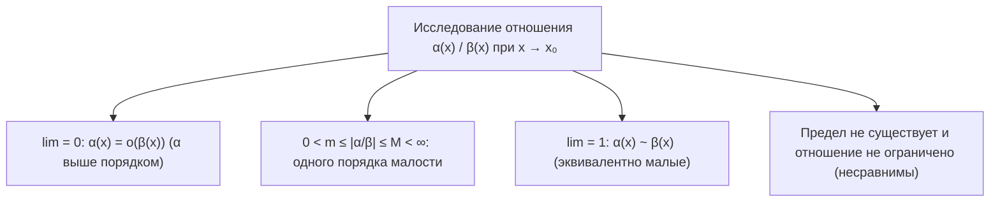
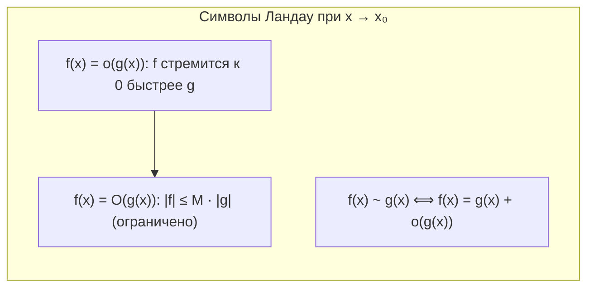
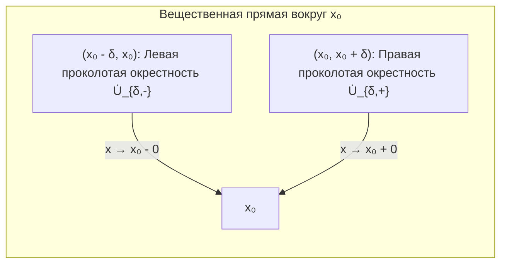
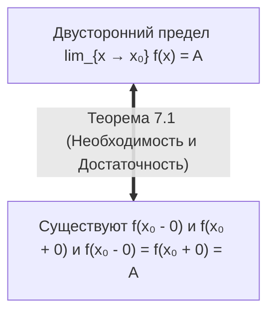
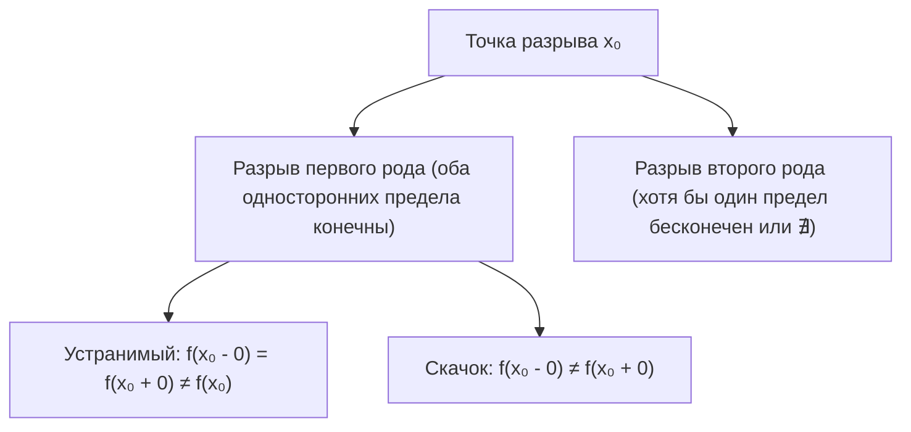

# Лекция 10: Сравнение бесконечно малых, символика Ландау (O и o), таблица эквивалентностей и односторонние пределы

> **Дисциплина**: Математический анализ  
> **Факультет**: ФИТиП (ИС), Университет ИТМО (Осенний семестр 2026)  
> **Ключевые темы**: Бесконечно малые функции, классификация порядков малости, функции одного порядка малости, ограниченность и отделённость от нуля, символы Ландау $O$ («O-большое») и $o$ («o-малое») и их свойства, отношение эквивалентности бесконечно малых ($\alpha \sim \beta$), теорема о замене на эквивалентные в произведениях и частных, разложения элементарных функций в окрестности нуля с остаточным членом в форме Пеано, односторонние окрестности ($\dot{U}_{\delta,+}$ и $\dot{U}_{\delta,-}$), пределы слева $f(x_0 - 0)$ и справа $f(x_0 + 0)$, критерий существования двустороннего предела через односторонние (теорема и строгое доказательство), классификация точек разрыва функций (устранимый, 1-го рода / скачок, 2-го рода).

---

## 1. Рекомендуемая литература

* **Г. М. Фихтенгольц — «Курс дифференциального и интегрального исчисления», Том 1**  
  *Глава II: «Предельный переход для функций непрерывного аргумента» (§2: Бесконечно малые и бесконечно большие величины; §4: Классификация бесконечно малых; §5: Односторонние пределы).*
* **В. А. Зорич — «Математический анализ», Часть 1**  
  *Глава III: «Предел функции» (§2: Сравнение функций, асимптотическая символика Ландау; §3: Односторонние пределы и непрерывность функции).*
* **Л. Д. Кудрявцев — «Курс математического анализа», Том 1**  
  *Глава 2: «Предел и непрерывность функций одного переменного» (§7: Сравнение функций; §8: Односторонние пределы).*

---

## 2. Сравнение бесконечно малых функций и шкала порядков

Пусть $x_0$ — предельная точка множества $E \subseteq \mathbb{R}$, и пусть функции $\alpha(x)$ и $\beta(x)$ являются **бесконечно малыми** при $x \to x_0$, то есть:
$$\lim_{x \to x_0} \alpha(x) = 0 \quad \text{и} \quad \lim_{x \to x_0} \beta(x) = 0$$

Для сравнения скорости их стремления к нулю исследуется отношение $\frac{\alpha(x)}{\beta(x)}$ в проколотой окрестности $\dot{U}(x_0)$ (предполагая $\beta(x) \ne 0$ при $x \ne x_0$).

### 1. Бесконечно малая высшего порядка малости
> **Определение 2.1**: Функция $\alpha(x)$ называется бесконечно малой **более высокого порядка** относительно $\beta(x)$ при $x \to x_0$, если:
> $$\lim_{x \to x_0} \frac{\alpha(x)}{\beta(x)} = 0$$
> В этом случае пишут: $\alpha(x) = o(\beta(x))$ (*«альфа есть о-малое от бета»*).
>
> *Интуиция*: $\alpha(x)$ стремится к нулю существенно быстрее, чем $\beta(x)$.

*Пример*: При $x \to 0$ функция $x^3 = o(x^2)$, так как $\lim_{x \to 0} \frac{x^3}{x^2} = \lim_{x \to 0} x = 0$.

### 2. Бесконечно малые одного порядка малости
> **Определение 2.2**: Функции $\alpha(x)$ и $\beta(x)$ называются бесконечно малыми **одного порядка малости** при $x \to x_0$, если существует проколотая окрестность $\dot{U}(x_0)$ и положительные константы $m, M > 0$ такие, что для всех $x \in \dot{U}(x_0)$ выполнено:
> $$\alpha(x) = c(x) \cdot \beta(x), \quad \text{где} \quad 0 < m \le |c(x)| \le M < \infty$$
> (то есть функция $c(x) = \frac{\alpha(x)}{\beta(x)}$ локально ограничена и строго отделена от нуля).

*Частный случай (предельный)*: Если существует конечный и отличный от нуля предел:
$$\lim_{x \to x_0} \frac{\alpha(x)}{\beta(x)} = C \ne 0 \quad (C \in \mathbb{R})$$
то функции $\alpha(x)$ и $\beta(x)$ заведомо одного порядка малости.

### 3. Эквивалентные бесконечно малые
> **Определение 2.3**: Функции $\alpha(x)$ и $\beta(x)$ называются **эквивалентными бесконечно малыми** при $x \to x_0$, если предел их отношения равен единице:
> $$\lim_{x \to x_0} \frac{\alpha(x)}{\beta(x)} = 1$$
> Обозначение: $\alpha(x) \sim \beta(x)$ при $x \to x_0$.

### 4. Несравнимые бесконечно малые
Если предел отношения $\lim_{x \to x_0} \frac{\alpha(x)}{\beta(x)}$ не существует, и отношение $\frac{\alpha(x)}{\beta(x)}$ не ограничено снизу положительной константой или не ограничено сверху, то бесконечно малые называют **несравнимыми**.

*Пример*: $\alpha(x) = x \sin(1/x)$ и $\beta(x) = x$ при $x \to 0$. Отношение $\frac{\alpha(x)}{\beta(x)} = \sin(1/x)$ колеблется между $-1$ и $1$, предела не имеет, и обращается в 0 в точках $x_k = \frac{1}{\pi k} \to 0$, поэтому отделенности от нуля нет.

### Порядок малости относительно эталона и главная часть
Чаще всего в качестве эталонной бесконечно малой при $x \to x_0$ выбирают линейную функцию $\varphi(x) = x - x_0$ (а при $x \to \infty$ — функцию $\varphi(x) = \frac{1}{x}$).
> **Определение 2.4**: Функция $\alpha(x)$ имеет **порядок малости $k > 0$** относительно $x - x_0$, если существует константа $C \ne 0$ такая, что:
> $$\alpha(x) \sim C \cdot (x - x_0)^k \quad \text{при } x \to x_0$$
> Величина $C \cdot (x - x_0)^k$ называется **главной частью** бесконечно малой функции $\alpha(x)$.

---

## 3. Символика Ландау (O-большое и o-малое)

Эдмунд Ландау ввёл стандартную математическую нотацию для описания асимптотического поведения функций.

### Определение 3.1 (Символ «O-большое»)
> Запись $f(x) = O(g(x))$ при $x \to x_0$ означает, что отношение $\frac{f(x)}{g(x)}$ локально ограничено, то есть существуют константы $M > 0$ и $\delta > 0$ такие, что:
> $$|f(x)| \le M \cdot |g(x)| \quad \forall x \in \dot{U}_\delta(x_0)$$

*В частности*, $f(x) = O(1)$ означает, что функция $f(x)$ локально ограничена в окрестности точки $x_0$.

### Определение 3.2 (Символ «o-малое»)
> Запись $f(x) = o(g(x))$ при $x \to x_0$ означает, что:
> $$f(x) = \varepsilon(x) \cdot g(x), \quad \text{где } \lim_{x \to x_0} \varepsilon(x) = 0$$
> Если $g(x) \ne 0$, это равносильно $\lim_{x \to x_0} \frac{f(x)}{g(x)} = 0$.

*В частности*, $f(x) = o(1)$ означает просто, что функция $f(x)$ бесконечно мала при $x \to x_0$ ($\lim_{x \to x_0} f(x) = 0$).

### Алгебраические свойства («арифметика o-малого»)
При $x \to x_0$ справедливы следующие тождества классов функций:
1. $o(g) + o(g) = o(g)$
2. $C \cdot o(g) = o(g)$ для любой константы $C \ne 0$
3. $o(C \cdot g) = o(g)$
4. $f(x) \cdot o(g(x)) = o(f(x) \cdot g(x))$
5. $o(f(x)) \cdot o(g(x)) = o(f(x) \cdot g(x))$
6. Если $f(x) = O(g(x))$, то $f(x) \cdot o(h(x)) = o(g(x) \cdot h(x))$
7. Для степенных функций при $x \to 0$ и $m \ge n$:
   $$o(x^n) + o(x^m) = o(x^n)$$
   $$x^m = o(x^n) \quad (m > n)$$
8. Транзитивность: если $f = o(g)$ и $g = o(h)$, то $f = o(h)$.

> [!WARNING]
> Знак равенства в соотношениях вроде $f(x) = o(x)$ является **односторонним (асимметричным)**: он означает принадлежность функции классу $f \in o(x)$. Нельзя «сокращать» $o(x)$ как обычное число или переносить в другую часть равенства без изменения смысла.

---

## 4. Отношение эквивалентности и теоремы о замене

### Теорема 4.1 (Связь эквивалентности и o-малого)
> Функции $\alpha(x)$ и $\beta(x)$ эквивалентны при $x \to x_0$ ($\alpha(x) \sim \beta(x)$) тогда и только тогда, когда:
> $$\alpha(x) = \beta(x) + o(\beta(x)) \quad \text{при } x \to x_0$$
> или симметрично: $\alpha(x) - \beta(x) = o(\alpha(x))$.

*Доказательство*:
$$\alpha(x) \sim \beta(x) \iff \lim_{x \to x_0} \frac{\alpha(x)}{\beta(x)} = 1 \iff \lim_{x \to x_0} \left(\frac{\alpha(x)}{\beta(x)} - 1\right) = 0 \iff \frac{\alpha(x) - \beta(x)}{\beta(x)} = \gamma(x) \to 0$$
$$\iff \alpha(x) - \beta(x) = \gamma(x)\beta(x) = o(\beta(x)) \iff \alpha(x) = \beta(x) + o(\beta(x)) \quad \blacksquare$$

### Теорема 4.2 (Свойства отношения эквивалентности)
Отношение $\sim$ является классическим **отношением эквивалентности**:
1. Рефлексивность: $\alpha(x) \sim \alpha(x)$.
2. Симметричность: $\alpha(x) \sim \beta(x) \implies \beta(x) \sim \alpha(x)$.
3. Транзитивность: $\alpha(x) \sim \beta(x) \land \beta(x) \sim \gamma(x) \implies \alpha(x) \sim \gamma(x)$.

---

### Теорема 4.3 (Замена на эквивалентные в произведениях и частных)
> Пусть $\alpha(x) \sim \alpha_1(x)$ и $\beta(x) \sim \beta_1(x)$ при $x \to x_0$.  
> Если существует предел $\lim_{x \to x_0} \frac{\alpha_1(x)}{\beta_1(x)}$, то существует и предел $\lim_{x \to x_0} \frac{\alpha(x)}{\beta(x)}$, причём они равны:
> $$\lim_{x \to x_0} \frac{\alpha(x)}{\beta(x)} = \lim_{x \to x_0} \frac{\alpha_1(x)}{\beta_1(x)}$$

*Доказательство*:
$$\lim_{x \to x_0} \frac{\alpha(x)}{\beta(x)} = \lim_{x \to x_0} \left(\frac{\alpha(x)}{\alpha_1(x)} \cdot \frac{\alpha_1(x)}{\beta_1(x)} \cdot \frac{\beta_1(x)}{\beta(x)}\right) = \lim_{x \to x_0} \frac{\alpha(x)}{\alpha_1(x)} \cdot \lim_{x \to x_0} \frac{\alpha_1(x)}{\beta_1(x)} \cdot \lim_{x \to x_0} \frac{\beta_1(x)}{\beta(x)}$$
Так как $\frac{\alpha(x)}{\alpha_1(x)} \to 1$ и $\frac{\beta_1(x)}{\beta(x)} \to 1$, получаем:
$$\lim_{x \to x_0} \frac{\alpha(x)}{\beta(x)} = 1 \cdot \lim_{x \to x_0} \frac{\alpha_1(x)}{\beta_1(x)} \cdot 1 = \lim_{x \to x_0} \frac{\alpha_1(x)}{\beta_1(x)} \quad \blacksquare$$

### Опасность замены в суммах и разностях!
> [!CAUTION]
> **Категорически запрещено** заменять слагаемые на эквивалентные в разностях, если их главные части одного порядка взаимно уничтожаются!
> 
> *Классический пример ошибки*:  
> Вычислить $\lim_{x \to 0} \frac{\operatorname{tg} x - \sin x}{x^3}$.  
> Если студент наивно заменит $\operatorname{tg} x \sim x$ и $\sin x \sim x$, он получит:
> $$\frac{x - x}{x^3} = \frac{0}{x^3} = 0 \quad \text{— НЕВЕРНО!}$$
> Истинное значение предела:
> $$\lim_{x \to 0} \frac{\operatorname{tg} x - \sin x}{x^3} = \lim_{x \to 0} \frac{\sin x \left(\frac{1}{\cos x} - 1\right)}{x^3} = \lim_{x \to 0} \frac{\sin x (1 - \cos x)}{x^3 \cos x} = 1 \cdot \frac{1}{2} \cdot 1 = \frac{1}{2} \ne 0$$
> Правильный подход с $o$-малым требует учёта старших членов:
> $\operatorname{tg} x = x + \frac{x^3}{3} + o(x^3)$ и $\sin x = x - \frac{x^3}{6} + o(x^3) \implies \operatorname{tg} x - \sin x = \frac{x^3}{2} + o(x^3) \sim \frac{x^3}{2}$.

---

## 5. Таблица основных асимптотических эквивалентностей при $x \to 0$

На основании замечательных пределов, доказанных в Лекции 9, получаем фундаментальную таблицу асимптотических равенств с остаточным членом в форме Пеано при $x \to 0$:

| Функция | Разложение с остатком Пеано ($x \to 0$) | Асимптотическая эквивалентность ($x \to 0$) |
| :--- | :--- | :--- |
| $\sin x$ | $\sin x = x + o(x)$ | $\sin x \sim x$ |
| $\operatorname{tg} x$ | $\operatorname{tg} x = x + o(x)$ | $\operatorname{tg} x \sim x$ |
| $\arcsin x$ | $\arcsin x = x + o(x)$ | $\arcsin x \sim x$ |
| $\operatorname{arctg} x$ | $\operatorname{arctg} x = x + o(x)$ | $\operatorname{arctg} x \sim x$ |
| $1 - \cos x$ | $1 - \cos x = \frac{x^2}{2} + o(x^2)$ | $1 - \cos x \sim \frac{x^2}{2}$ |
| $\ln(1 + x)$ | $\ln(1 + x) = x + o(x)$ | $\ln(1 + x) \sim x$ |
| $e^x$ | $e^x = 1 + x + o(x)$ | $e^x - 1 \sim x$ |
| $a^x$ ($a > 0$) | $a^x = 1 + x \ln a + o(x)$ | $a^x - 1 \sim x \ln a$ |
| $(1 + x)^\alpha$ ($\alpha \in \mathbb{R}$) | $(1 + x)^\alpha = 1 + \alpha x + o(x)$ | $(1 + x)^\alpha - 1 \sim \alpha x$ |

### Принцип подстановки бесконечно малой функции
Если аргумент $u(x)$ сам является бесконечно малой функцией при $x \to x_0$ (то есть $\lim_{x \to x_0} u(x) = 0$), то в силу теоремы о пределе сложной функции формулы таблицы остаются справедливыми:
- $\sin(u(x)) \sim u(x)$
- $\ln(1 + u(x)) \sim u(x)$
- $e^{u(x)} - 1 \sim u(x)$
- $1 - \cos(u(x)) \sim \frac{u(x)^2}{2}$
- $(1 + u(x))^\alpha - 1 \sim \alpha \cdot u(x)$

---

## 6. Односторонние окрестности и односторонние пределы

Во многих задачах поведение функции существенно различается в зависимости от того, с какой стороны аргумент $x$ приближается к точке $x_0$ (например, $1/x$, $\operatorname{sign}(x)$, $e^{1/x}$). Для этого вводятся односторонние понятия.

### Определение 6.1 (Односторонние окрестности)
Пусть $x_0 \in \mathbb{R}$ и $\delta > 0$.
1. **Правая проколотая окрестность точки $x_0$**:
   $$\dot{U}_{\delta,+}(x_0) = (x_0, x_0 + \delta) = \{x \in \mathbb{R} \mid x_0 < x < x_0 + \delta\}$$
2. **Левая проколотая окрестность точки $x_0$**:
   $$\dot{U}_{\delta,-}(x_0) = (x_0 - \delta, x_0) = \{x \in \mathbb{R} \mid x_0 - \delta < x < x_0\}$$

### Определение 6.2 (Односторонние пределы по Коши)
1. **Предел справа (правосторонний предел)**:
   Число $A$ называется пределом функции $f(x)$ при $x \to x_0$ справа (обозначается $\lim_{x \to x_0+0} f(x) = f(x_0 + 0) = A$ или $\lim_{x \downarrow x_0} f(x) = A$), если:
   $$\forall \varepsilon > 0 \; \exists \delta > 0 \; \forall x \in (x_0, x_0 + \delta) \cap D(f) : |f(x) - A| < \varepsilon$$

2. **Предел слева (левосторонний предел)**:
   Число $B$ называется пределом функции $f(x)$ при $x \to x_0$ слева (обозначается $\lim_{x \to x_0-0} f(x) = f(x_0 - 0) = B$ или $\lim_{x \uparrow x_0} f(x) = B$), если:
   $$\forall \varepsilon > 0 \; \exists \delta > 0 \; \forall x \in (x_0 - \delta, x_0) \cap D(f) : |f(x) - B| < \varepsilon$$

### Определение 6.3 (Односторонние пределы по Гейне)
- $f(x_0 + 0) = A \iff$ для любой последовательности $\{x_n\} \subset D(f)$, такой что $x_n > x_0$ и $x_n \to x_0$, выполнено $\lim_{n \to \infty} f(x_n) = A$.
- $f(x_0 - 0) = B \iff$ для любой последовательности $\{x_n\} \subset D(f)$, такой что $x_n < x_0$ и $x_n \to x_0$, выполнено $\lim_{n \to \infty} f(x_n) = B$.

---

## 7. Критерий существования предела через односторонние пределы

### Теорема 7.1 (Критерий связи двустороннего и односторонних пределов)
> Пусть точка $x_0$ является двусторонней предельной точкой области определения $D(f)$ (то есть предельной точкой как множества $D(f) \cap (x_0, +\infty)$, так и $D(f) \cap (-\infty, x_0)$).
>
> Конечный двусторонний предел $\lim_{x \to x_0} f(x) = A$ существует тогда и только тогда, когда существуют оба односторонних предела $f(x_0 + 0)$ и $f(x_0 - 0)$, и они равны между собой и числу $A$:
> $$\lim_{x \to x_0} f(x) = A \iff f(x_0 + 0) = f(x_0 - 0) = A$$

### Строгое доказательство теоремы 7.1

#### 1. Необходимость ($\implies$)
Пусть существует двусторонний предел $\lim_{x \to x_0} f(x) = A$.  
Это означает, что для любого $\varepsilon > 0$ найдётся $\delta > 0$ такое, что:
$$|f(x) - A| < \varepsilon \quad \forall x \in \dot{U}_\delta(x_0) \cap D(f)$$
Заметим, что проколотая окрестность представляет собой дизъюнктное объединение левой и правой проколотых окрестностей:
$$\dot{U}_\delta(x_0) = (x_0 - \delta, x_0) \cup (x_0, x_0 + \delta) = \dot{U}_{\delta,-}(x_0) \cup \dot{U}_{\delta,+}(x_0)$$
Следовательно:
- Для всех $x \in (x_0, x_0 + \delta) \cap D(f) \subset \dot{U}_\delta(x_0)$ выполнено $|f(x) - A| < \varepsilon$, значит, существует предел справа $f(x_0 + 0) = A$.
- Для всех $x \in (x_0 - \delta, x_0) \cap D(f) \subset \dot{U}_\delta(x_0)$ выполнено $|f(x) - A| < \varepsilon$, значит, существует предел слева $f(x_0 - 0) = A$.
Таким образом, $f(x_0 + 0) = f(x_0 - 0) = A$.

#### 2. Достаточность ($\impliedby$)
Пусть существуют оба односторонних предела и они равны: $f(x_0 + 0) = A$ и $f(x_0 - 0) = A$.  
Зафиксируем произвольное $\varepsilon > 0$.
1. По определению предела справа существует $\delta_1 > 0$ такое, что:
   $$|f(x) - A| < \varepsilon \quad \forall x \in (x_0, x_0 + \delta_1) \cap D(f)$$
2. По определению предела слева существует $\delta_2 > 0$ такое, что:
   $$|f(x) - A| < \varepsilon \quad \forall x \in (x_0 - \delta_2, x_0) \cap D(f)$$
Положим $\delta = \min(\delta_1, \delta_2) > 0$.  
Тогда для любого $x \in \dot{U}_\delta(x_0) \cap D(f)$:
- Если $x \in (x_0, x_0 + \delta)$, то $x \in (x_0, x_0 + \delta_1) \implies |f(x) - A| < \varepsilon$.
- Если $x \in (x_0 - \delta, x_0)$, то $x \in (x_0 - \delta_2, x_0) \implies |f(x) - A| < \varepsilon$.
Следовательно, для всех $x \in \dot{U}_\delta(x_0) \cap D(f)$ выполняется неравенство $|f(x) - A| < \varepsilon$, что в точности означает существование двустороннего предела:
$$\lim_{x \to x_0} f(x) = A \quad \blacksquare$$

---

## 8. Классификация точек разрыва функций

Пусть функция $f(x)$ определена в некоторой окрестности точки $x_0$ (за исключением, быть может, самой точки $x_0$).  
Функция называется **непрерывной в точке $x_0$**, если:
$$\lim_{x \to x_0} f(x) = f(x_0) \iff f(x_0 - 0) = f(x_0 + 0) = f(x_0)$$
Если хотя бы одно из этих равенств нарушено, точка $x_0$ называется **точкой разрыва**.

### 1. Точка устранимого разрыва
Существуют конечные односторонние пределы, и они равны между собой, но либо функция не определена в точке $x_0$, либо её значение не равно пределу:
$$f(x_0 - 0) = f(x_0 + 0) \ne f(x_0)$$
*Пример*: $f(x) = \frac{\sin x}{x}$ при $x_0 = 0$. Пределы слева и справа равны $1$, но в нуле функция не определена. Разрыв легко «устранить», доопределив $f(0) = 1$.

### 2. Точка разрыва первого рода (скачок)
Односторонние пределы $f(x_0 - 0)$ и $f(x_0 + 0)$ существуют и конечны, но **не равны** между собой:
$$f(x_0 - 0) \ne f(x_0 + 0)$$
Величина $\Delta = f(x_0 + 0) - f(x_0 - 0)$ называется **скачком функции** в точке $x_0$.
*Пример*: Функция знака $f(x) = \operatorname{sign}(x) = \begin{cases} 1, & x > 0 \\ 0, & x = 0 \\ -1, & x < 0 \end{cases}$.  
Здесь $f(0 + 0) = 1$, а $f(0 - 0) = -1$. Скачок равен $\Delta = 1 - (-1) = 2$.

### 3. Точка разрыва второго рода
Точка разрыва $x_0$, не являющаяся точкой разрыва первого рода: хотя бы один из односторонних пределов бесконечен ($+\infty, -\infty$) или вообще не существует в $\overline{\mathbb{R}}$.
- *Пример с бесконечным пределом*: $f(x) = \frac{1}{x}$ в точке $x_0 = 0$: $f(0+0) = +\infty$, $f(0-0) = -\infty$.
- *Пример с несуществующим пределом*: $f(x) = \sin(1/x)$ в точке $x_0 = 0$: односторонние пределы не существуют из-за бесконечных осцилляций.
- *Пример со смешанным поведением*: $f(x) = \frac{1}{1 + e^{1/x}}$ в точке $x_0 = 0$:
  - Справа: $x \to 0+0 \implies 1/x \to +\infty \implies e^{1/x} \to +\infty \implies f(0+0) = 0$.
  - Слева: $x \to 0-0 \implies 1/x \to -\infty \implies e^{1/x} \to 0 \implies f(0-0) = \frac{1}{1 + 0} = 1$.  
  Это разрыв первого рода со скачком $\Delta = 0 - 1 = -1$.

---

## 9. Примеры решения типовых задач

### Пример 9.1 (Асимптотическое раскрытие предела)
Вычислить предел:
$$\lim_{x \to 0} \frac{\ln(\cos(3x))}{\sqrt[3]{1 + 2x^2} - 1}$$

**Решение**:
1. Числитель: $\ln(\cos(3x)) = \ln(1 + (\cos(3x) - 1))$.  
   Так как $\cos(3x) - 1 \to 0$ при $x \to 0$, используем формулу $\ln(1 + u) \sim u$:
   $$\ln(\cos(3x)) \sim \cos(3x) - 1 = -(1 - \cos(3x)) \sim -\frac{(3x)^2}{2} = -\frac{9x^2}{2}$$
2. Знаменатель: используем формулу $(1 + u)^\alpha - 1 \sim \alpha u$ при $u = 2x^2 \to 0$ и $\alpha = 1/3$:
   $$\sqrt[3]{1 + 2x^2} - 1 = (1 + 2x^2)^{1/3} - 1 \sim \frac{1}{3} \cdot (2x^2) = \frac{2x^2}{3}$$
3. Подставляем эквивалентные функции:
   $$\lim_{x \to 0} \frac{\ln(\cos(3x))}{\sqrt[3]{1 + 2x^2} - 1} = \lim_{x \to 0} \frac{-\frac{9}{2} x^2}{\frac{2}{3} x^2} = \frac{-9/2}{2/3} = -\frac{27}{4} = -6.75$$

*Ответ*: $-\frac{27}{4}$.

---

### Пример 9.2 (Односторонние пределы и параметры)
Найти значения параметров $a$ и $b$, при которых функция непрерывна на всей числовой прямой:
$$f(x) = \begin{cases} 
\frac{\sin(a x)}{x}, & x < 0 \\ 
2, & x = 0 \\ 
x^2 + b, & x > 0 
\end{cases}$$

**Решение**:
Функция непрерывна при $x < 0$ и $x > 0$ как элементарные функции. Проверим точку склейки $x_0 = 0$:
1. Предел слева: $\lim_{x \to 0-0} f(x) = \lim_{x \to 0-0} \frac{\sin(a x)}{x} = a \cdot \lim_{x \to 0-0} \frac{\sin(a x)}{a x} = a$.
2. Предел справа: $\lim_{x \to 0+0} f(x) = \lim_{x \to 0+0} (x^2 + b) = 0 + b = b$.
3. Значение в точке: $f(0) = 2$.

Для непрерывности в точке $x = 0$ необходимо и достаточно равенство:
$$f(0 - 0) = f(0 + 0) = f(0) \implies a = b = 2$$

*Ответ*: $a = 2, b = 2$.

---

## 10. Контрольные вопросы для самопроверки

1. **Вопрос**: В чём отличие понятий «бесконечно малые одного порядка» и «эквивалентные бесконечно малые»? Приведите пример.  
   *Ответ*: Для одного порядка требуется лишь $0 < m \le |\alpha/\beta| \le M < \infty$ (или предел отношения равен $C \ne 0$). Для эквивалентности предел отношения обязан строго равняться $1$. Пример: $2x$ и $x$ при $x \to 0$ имеют один порядок ($C = 2$), но не эквивалентны.
2. **Вопрос**: Почему соотношение $o(x) - o(x) = 0$ является грубой математической ошибкой?  
   *Ответ*: $o(x)$ обозначает класс функций. Разность двух функций из этого класса есть функция из того же класса, то есть $o(x) - o(x) = o(x)$, а не тождественный ноль.
3. **Вопрос**: Сформулируйте критерий существования двустороннего предела функции в терминах односторонних пределов.  
   *Ответ*: $\lim_{x \to x_0} f(x) = A \iff \exists f(x_0 - 0) \land \exists f(x_0 + 0) \land f(x_0 - 0) = f(x_0 + 0) = A$.
4. **Вопрос**: Чему равны пределы функции $f(x) = \operatorname{arctg}(1/x)$ при $x \to 0+0$ и $x \to 0-0$? Какой разрыв имеет функция в точке $x = 0$?  
   *Ответ*: При $x \to 0+0$ аргумент $1/x \to +\infty \implies \operatorname{arctg}(+\infty) = \pi/2$. При $x \to 0-0$ аргумент $1/x \to -\infty \implies \operatorname{arctg}(-\infty) = -\pi/2$. Это разрыв 1-го рода (скачок $\Delta = \pi$).
5. **Вопрос**: Можно ли в выражении $\lim_{x \to 0} \frac{\sin x - \operatorname{tg} x}{x^3}$ заменить $\sin x \sim x$ и $\operatorname{tg} x \sim x$? Почему?  
   *Ответ*: Нельзя, так как в разности главные члены $x - x = 0$ взаимно уничтожаются, и предел определяется членами более высокого порядка ($x^3$).
