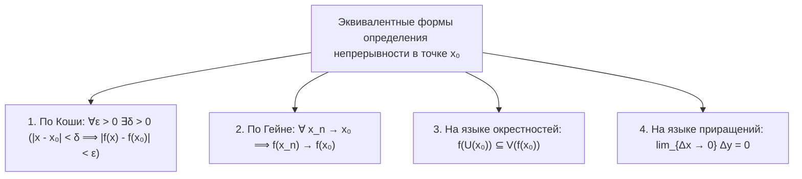
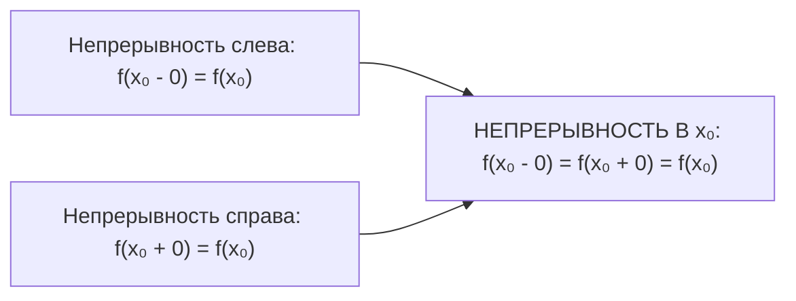
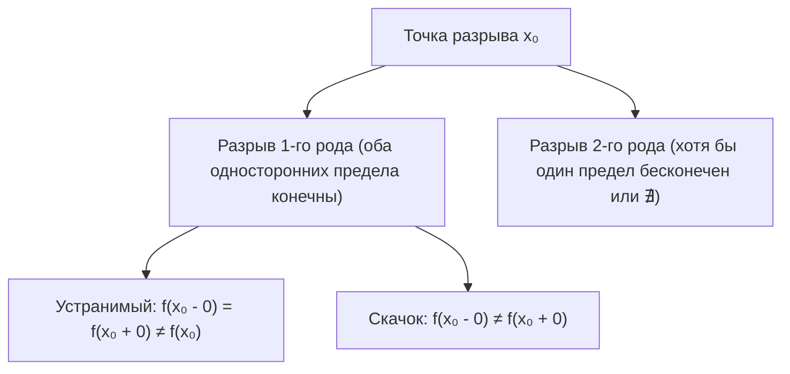
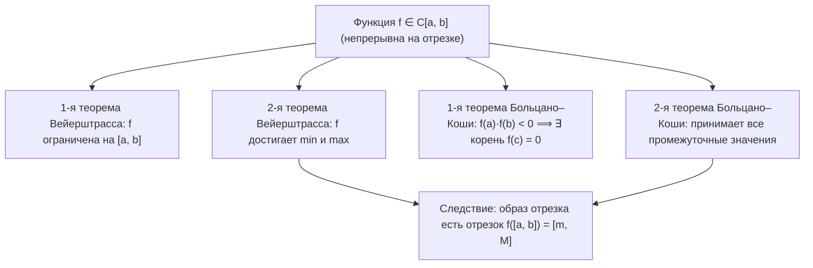

# Лекция 11: Непрерывность функции в точке и на множестве, односторонняя непрерывность, свойства непрерывных функций и теоремы Вейерштрасса и Больцано–Коши

> **Дисциплина**: Математический анализ  
> **Факультет**: ФИТиП (ИС), Университет ИТМО (Осенний семестр 2026)  
> **Ключевые темы**: Определение непрерывности функции в точке (по Коши, по Гейне, на языке окрестностей, на языке приращений аргумента и функции), эквивалентность определений, локальные свойства непрерывных функций (локальная ограниченность, сохранение знака, предельный переход под знаком непрерывной функции), арифметические свойства непрерывных функций, непрерывность сложной функции (композиции), односторонняя непрерывность (слева и справа) и критерий непрерывности в точке, классификация точек разрыва (устранимый, 1-го рода / скачок, 2-го рода), глобальные свойства функций на компакте $C[a, b]$: Первая теорема Вейерштрасса (об ограниченности функции на отрезке) и Вторая теорема Вейерштрасса (о достижении максимума и минимума), теоремы Больцано–Коши о промежуточных значениях и сохранении связности (образ отрезка есть отрезок).

---

## 1. Рекомендуемая литература

* **Г. М. Фихтенгольц — «Курс дифференциального и интегрального исчисления», Том 1**  
  *Глава II: «Предельный переход для функций непрерывного аргумента» (§5: Непрерывность функций; §6: Свойства функций, непрерывных на замкнутом промежутке).*
* **В. А. Зорич — «Математический анализ», Часть 1**  
  *Глава III: «Предел функции» (§3: Непрерывность функции в точке; локальные свойства непрерывных функций); Глава IV: «Непрерывные функции» (§1: Глобальные свойства функций на компакте).*
* **Л. Д. Кудрявцев — «Курс математического анализа», Том 1**  
  *Глава 2: «Предел и непрерывность функций одного переменного» (§9: Непрерывность функции в точке; §10: Свойства функций, непрерывных на отрезке).*

---

## 2. Определение непрерывности функции в точке

Пусть функция $f: D(f) \to \mathbb{R}$ определена на множестве $D(f) \subseteq \mathbb{R}$, и пусть точка $x_0 \in D(f)$.  
Если $x_0$ — изолированная точка множества $D(f)$ (то есть существует окрестность $U(x_0)$, не содержащая других точек $D(f)$), то функция $f$ считается **непрерывной в точке $x_0$ по определению**.  
Основной содержательный случай возникает, когда $x_0$ является **предельной точкой** области определения $D(f)$.

### 1. Определение на языке предела (Коши)
> **Определение 2.1 (Непрерывность по Коши)**: Функция $f$ называется непрерывной в точке $x_0 \in D(f)$, если:
> $$\lim_{x \to x_0} f(x) = f(x_0)$$
> На языке $\varepsilon$–$\delta$:
> $$\forall \varepsilon > 0 \; \exists \delta > 0 \; \forall x \in D(f): \quad |x - x_0| < \delta \implies |f(x) - f(x_0)| < \varepsilon$$
> *(Обратите внимание: окрестность точки $x_0$ здесь **непроколотая**, так как при $x = x_0$ неравенство $|f(x_0) - f(x_0)| = 0 < \varepsilon$ выполняется автоматически).*

### 2. Определение по Гейне (на языке последовательностей)
> **Определение 2.2 (Непрерывность по Гейне)**: Функция $f$ непрерывна в точке $x_0 \in D(f)$, если для любой последовательности $\{x_n\} \subset D(f)$, сходящейся к $x_0$, последовательность значений сходится к $f(x_0)$:
> $$\forall \{x_n\}_{n=1}^\infty \subset D(f): \quad \lim_{n \to \infty} x_n = x_0 \implies \lim_{n \to \infty} f(x_n) = f(x_0)$$

### 3. Топологическое определение (на языке окрестностей)
> **Определение 2.3**: Функция $f$ непрерывна в точке $x_0$, если для любой окрестности $V(f(x_0))$ значения $f(x_0)$ существует окрестность $U(x_0)$ точки $x_0$, образ которой целиком содержится в $V(f(x_0))$:
> $$\forall V(f(x_0)) \; \exists U(x_0): \quad f(U(x_0) \cap D(f)) \subseteq V(f(x_0))$$

### 4. Определение на языке приращений
Введём обозначения:
- **Приращение аргумента**: $\Delta x = x - x_0 \iff x = x_0 + \Delta x$.
- **Приращение функции**: $\Delta y = \Delta f(x_0) = f(x_0 + \Delta x) - f(x_0) = f(x) - f(x_0)$.

> **Определение 2.4**: Функция $f$ непрерывна в точке $x_0$, если бесконечно малому приращению аргумента соответствует бесконечно малое приращение функции:
> $$\lim_{\Delta x \to 0} \Delta y = \lim_{\Delta x \to 0} \bigl(f(x_0 + \Delta x) - f(x_0)\bigr) = 0$$

*Теорема 2.1*: Все четыре определения 2.1–2.4 логически эквивалентны.

---

## 3. Локальные свойства непрерывных функций

Пусть функция $f$ непрерывна в точке $x_0$. Тогда в некоторой окрестности этой точки справедливы следующие свойства:

1. **Локальная ограниченность**:  
   Существует окрестность $U(x_0)$ и число $M > 0$, такие что $|f(x)| \le M$ для всех $x \in U(x_0) \cap D(f)$.  
   *(Следует из определения по Коши при $\varepsilon = 1$: $|f(x)| \le |f(x_0)| + 1$).*

2. **Локальное сохранение знака**:  
   Если $f(x_0) \ne 0$, то существует окрестность $U(x_0)$, в которой знак функции совпадает со знаком $f(x_0)$, причём функция отделена от нуля:
   $$f(x_0) > 0 \implies \exists \delta > 0 \; \forall x \in U_\delta(x_0): \quad f(x) > \frac{f(x_0)}{2} > 0$$
   $$f(x_0) < 0 \implies \exists \delta > 0 \; \forall x \in U_\delta(x_0): \quad f(x) < \frac{f(x_0)}{2} < 0$$

3. **Предельный переход под знаком непрерывной функции**:  
   > **Теорема 3.1**: Если функция $g(x)$ имеет предел $\lim_{x \to a} g(x) = y_0$, а функция $f(y)$ **непрерывна** в точке $y_0$, то знак функции и знак предела можно менять местами:
   > $$\lim_{x \to a} f(g(x)) = f\left(\lim_{x \to a} g(x)\right) = f(y_0)$$
   > *(В отличие от общей теоремы о пределе композиции из Лекции 9, здесь **не требуется условие невозвращения** $g(x) \ne y_0$, так как значение в точке $f(y_0)$ непрерывно согласовано со своими пределами).*

---

## 4. Арифметические свойства и непрерывность элементарных функций

### Теорема 4.1 (Арифметика непрерывных функций)
> Пусть функции $f$ и $g$ непрерывны в точке $x_0$. Тогда:
> 1. Сумма и разность $f \pm g$ непрерывны в точке $x_0$.
> 2. Произведение $f \cdot g$ и умножение на константу $c \cdot f$ непрерывны в точке $x_0$.
> 3. Частное $\frac{f}{g}$ непрерывно в точке $x_0$, если $g(x_0) \ne 0$.

*Доказательство* непосредственно вытекает из арифметических свойств пределов функций:
$$\lim_{x \to x_0} (f(x) \pm g(x)) = \lim_{x \to x_0} f(x) \pm \lim_{x \to x_0} g(x) = f(x_0) \pm g(x_0)$$
Аналогично для произведения и частного. $\blacksquare$

### Теорема 4.2 (Непрерывность сложной функции / композиции)
> Пусть функция $g: X \to Y$ непрерывна в точке $x_0 \in X$, а функция $f: Y \to \mathbb{R}$ непрерывна в точке $y_0 = g(x_0) \in Y$.  
> Тогда композиция $(f \circ g)(x) = f(g(x))$ непрерывна в точке $x_0$.

*Доказательство по Гейне*:  
Пусть $x_n \to x_0$. В силу непрерывности $g$ в точке $x_0$ имеем $y_n = g(x_n) \to g(x_0) = y_0$.  
В силу непрерывности $f$ в точке $y_0$ имеем $f(y_n) = f(g(x_n)) \to f(y_0) = f(g(x_0))$. По определению Гейне, композиция непрерывна в точке $x_0$. $\blacksquare$

### Непрерывность основных элементарных функций
Все основные элементарные функции непрерывны в каждой точке своей области определения:
- Многочлены $P(x) = a_n x^n + \dots + a_0$ непрерывны на $\mathbb{R}$.
- Рациональные функции $R(x) = \frac{P(x)}{Q(x)}$ непрерывны всюду, где $Q(x) \ne 0$.
- Показательная функция $a^x$ ($a > 0$) и логарифмическая $\log_a x$ ($x > 0$).
- Тригонометрические функции: $\sin x$ и $\cos x$ непрерывны на $\mathbb{R}$; $\operatorname{tg} x$ при $x \ne \frac{\pi}{2} + \pi k$; $\operatorname{ctg} x$ при $x \ne \pi k$.
- Обратные тригонометрические функции: $\arcsin x, \arccos x$ на $[-1, 1]$; $\operatorname{arctg} x, \operatorname{arcctg} x$ на $\mathbb{R}$.
- Степенная функция $x^\alpha$.

---

## 5. Односторонняя непрерывность и критерий непрерывности

### Определение 5.1 (Односторонняя непрерывность)
1. Функция $f$ называется **непрерывной справа** в точке $x_0$, если:
   $$\lim_{x \to x_0 + 0} f(x) = f(x_0) \iff f(x_0 + 0) = f(x_0)$$
2. Функция $f$ называется **непрерывной слева** в точке $x_0$, если:
   $$\lim_{x \to x_0 - 0} f(x) = f(x_0) \iff f(x_0 - 0) = f(x_0)$$

### Теорема 5.1 (Критерий непрерывности в точке)
> Функция $f$ непрерывна в двусторонней предельной точке $x_0$ тогда и только тогда, когда она непрерывна в этой точке как справа, так и слева:
> $$f \text{ непрерывна в } x_0 \iff f(x_0 - 0) = f(x_0 + 0) = f(x_0)$$

*Замечание*: На концах отрезка $[a, b]$ непрерывность функции понимается как односторонняя: в точке $a$ — непрерывность справа ($f(a+0) = f(a)$), в точке $b$ — непрерывность слева ($f(b-0) = f(b)$).

---

## 6. Классификация точек разрыва

Если хотя бы одно из условий непрерывности в точке $x_0$ нарушено, точка $x_0$ называется **точкой разрыва**.

### 1. Точка устранимого разрыва
Существуют конечные односторонние пределы, и они совпадают между собой, но либо функция не определена в точке $x_0$, либо её значение не равно пределу:
$$f(x_0 - 0) = f(x_0 + 0) \ne f(x_0)$$
*Пример*: $f(x) = \frac{\sin x}{x}$ в точке $x = 0$. Пределы слева и справа равны $1$, доопределяя $f(0) = 1$, получаем непрерывную функцию.

### 2. Точка разрыва 1-го рода (скачок)
Односторонние пределы $f(x_0 - 0)$ и $f(x_0 + 0)$ существуют и конечны, но не равны между собой:
$$f(x_0 - 0) \ne f(x_0 + 0)$$
Величина $\Delta = f(x_0 + 0) - f(x_0 - 0)$ называется **скачком функции** в точке $x_0$.
*Пример*: $f(x) = \operatorname{sign}(x)$ в точке $x = 0$: $f(0+0) = 1$, $f(0-0) = -1$, скачок $\Delta = 2$.

### 3. Точка разрыва 2-го рода
Хотя бы один из односторонних пределов бесконечен ($+\infty, -\infty$) или вообще не существует в $\overline{\mathbb{R}}$.
*Примеры*:
- $f(x) = \frac{1}{x}$ в $x = 0$ ($f(0+0) = +\infty, f(0-0) = -\infty$).
- $f(x) = \sin(1/x)$ в $x = 0$ (пределы не существуют из-за бесконечных осцилляций).

---

## 7. Глобальные свойства функций на отрезке ($C[a, b]$)

Обозначим через $C[a, b]$ класс всех функций, непрерывных в каждой точке отрезка $[a, b]$ (включая одностороннюю непрерывность на концах).  
Отрезок $[a, b]$ является **компактом** (замкнутым и ограниченным множеством в $\mathbb{R}$). Непрерывные функции на компакте обладают фундаментальными свойствами, неверными для открытых интервалов $(a, b)$.

---

### Теорема 7.1 (Первая теорема Вейерштрасса — об ограниченности)
> Функция, непрерывная на замкнутом отрезке $[a, b]$, **ограничена** на этом отрезке:
> $$f \in C[a, b] \implies \exists M > 0 \; \forall x \in [a, b] : \quad |f(x)| \le M$$

#### Строгое доказательство (от противного с помощью Больцано–Вейерштрасса)
1. Предположим противное: функция $f$ не ограничена на $[a, b]$.
2. Это означает, что для каждого натурального числа $n \in \mathbb{N}$ найдётся точка $x_n \in [a, b]$ такая, что:
   $$|f(x_n)| > n$$
3. Получаем числовую последовательность $\{x_n\}_{n=1}^\infty \subset [a, b]$. Так как отрезок ограничен ($a \le x_n \le b$), по **теореме Больцано–Вейерштрасса** из последовательности $\{x_n\}$ можно выделить сходящуюся подпоследовательность:
   $$x_{n_k} \xrightarrow{k \to \infty} x_0$$
4. Так как отрезок $[a, b]$ замкнут, предельная точка принадлежит отрезку: $x_0 \in [a, b]$.
5. В силу непрерывности функции $f$ на $[a, b]$ (и в точке $x_0$ в частности), по определению Гейне:
   $$f(x_{n_k}) \xrightarrow{k \to \infty} f(x_0)$$
   Следовательно, последовательность значений $\{f(x_{n_k})\}$ обязана быть ограниченной числом $|f(x_0)| + 1$.
6. Однако по построению точек $x_n$:
   $$|f(x_{n_k})| > n_k \ge k \xrightarrow{k \to \infty} +\infty$$
7. Получено неустранимое противоречие ($f(x_{n_k})$ одновременно сходится к конечному числу и стремится к бесконечности). Значит, предположение неверно, и функция $f$ ограничена на $[a, b]$. $\blacksquare$

---

### Теорема 7.2 (Вторая теорема Вейерштрасса — о достижении экстремумов)
> Функция, непрерывная на замкнутом отрезке $[a, b]$, достигает на нём своих **наибольшего** и **наименьшего** значений:
> $$\exists x_*, x^* \in [a, b]: \quad f(x_*) = \inf_{x \in [a, b]} f(x), \quad f(x^*) = \sup_{x \in [a, b]} f(x)$$

#### Строгое доказательство (для супремума)
1. По Первой теореме Вейерштрасса функция $f$ ограничена на $[a, b]$, следовательно, множество её значений $E = \{f(x) \mid x \in [a, b]\}$ ограничено сверху и имеет точную верхнюю грань:
   $$M = \sup_{x \in [a, b]} f(x) < +\infty$$
2. Докажем, что существует точка $x^* \in [a, b]$, в которой $f(x^*) = M$.  
   Предположим противное: $f(x) \ne M$ для всех $x \in [a, b]$. Так как $M$ — супремум, то $f(x) < M$ для всех $x \in [a, b]$, то есть $M - f(x) > 0$.
3. Рассмотрим вспомогательную функцию:
   $$g(x) = \frac{1}{M - f(x)}$$
4. Так как знаменатель непрерывен и нигде на $[a, b]$ не обращается в ноль, функция $g(x)$ непрерывна на $[a, b]$ ($g \in C[a, b]$).
5. По Первой теореме Вейерштрасса непрерывная функция $g$ обязана быть ограниченной сверху некоторой положительной константой $K > 0$:
   $$g(x) \le K \implies \frac{1}{M - f(x)} \le K \implies M - f(x) \ge \frac{1}{K} \implies f(x) \le M - \frac{1}{K} \quad \forall x \in [a, b]$$
6. Но неравенство $f(x) \le M - \frac{1}{K}$ означает, что число $M - \frac{1}{K} < M$ является верхней гранью множества значений функции $f$, что противоречит тому, что $M$ — **наименьшая** верхняя грань ($\sup$).
7. Полученное противоречие доказывает, что найдётся точка $x^* \in [a, b]$, в которой $f(x^*) = M = \max_{x \in [a, b]} f(x)$.  
   Аналогично, рассматривая точную нижнюю грань $m = \inf f(x)$ и функцию $\frac{1}{f(x) - m}$, доказывается существование точки минимума $x_*$. $\blacksquare$

---

## 8. Теоремы Больцано–Коши о промежуточных значениях

### Теорема 8.1 (Первая теорема Больцано–Коши — о нуле непрерывной функции)
> Пусть функция $f$ непрерывна на отрезке $[a, b]$ и принимает на его концах значения разных знаков:
> $$f(a) \cdot f(b) < 0$$
> Тогда внутри отрезка существует хотя бы одна точка $c \in (a, b)$, в которой функция обращается в ноль:
> $$f(c) = 0$$

*Идея доказательства (метод дихотомии / бисекции)*:  
Делим отрезок $[a, b]$ пополам точкой $d = \frac{a+b}{2}$. Если $f(d) = 0$, то корень найден ($c = d$). Если нет, выбираем ту половину, на концах которой знаки противоположны. Получаем систему вложенных отрезков $[a_n, b_n]$ с $f(a_n) < 0$ и $f(b_n) > 0$. По принципу Кантора существует общая точка $c = \lim a_n = \lim b_n$. В силу непрерывности $f(c) = \lim f(a_n) \le 0$ и $f(c) = \lim f(b_n) \ge 0 \implies f(c) = 0$. $\blacksquare$

### Теорема 8.2 (Вторая теорема Больцано–Коши — о промежуточных значениях)
> Пусть функция $f$ непрерывна на отрезке $[a, b]$, и $f(a) \ne f(b)$.  
> Тогда для любого числа $C$, лежащего строго между $f(a)$ и $f(b)$, найдётся точка $\xi \in (a, b)$ такая, что:
> $$f(\xi) = C$$

*Доказательство*:  
Рассмотрим вспомогательную функцию $g(x) = f(x) - C$. Она непрерывна на $[a, b]$ и на концах принимает значения противоположных знаков: $g(a) \cdot g(b) = (f(a) - C)(f(b) - C) < 0$. По теореме 8.1 найдётся точка $\xi \in (a, b)$, в которой $g(\xi) = 0 \implies f(\xi) = C$. $\blacksquare$

### Следствие (Образ отрезка при непрерывном отображении)
> **Теорема 8.3**: Если функция $f$ непрерывна на отрезке $[a, b]$, то множество её значений (образ) также является **замкнутым отрезком**:
> $$f([a, b]) = [m, M], \quad \text{где } m = \min_{[a, b]} f(x), \quad M = \max_{[a, b]} f(x)$$
> *(По 2-й теореме Вейерштрасса значения $m$ и $M$ достигаются, а по 2-й теореме Больцано–Коши все промежуточные значения между $m$ и $M$ также принимаются).*

---

## 9. Примеры решения типовых задач

### Пример 9.1 (Исследование функции на непрерывность и точки разрыва)
Исследовать функцию на непрерывность и определить характер точек разрыва:
$$f(x) = \frac{|x + 1|}{x + 1} \cdot e^{\frac{1}{x}}$$

**Решение**:
Функция не определена в двух точках: $x_1 = -1$ и $x_2 = 0$. При всех остальных $x$ функция непрерывна как композиция и произведение непрерывных функций.
1. **Точка $x = -1$**:
   Множитель $e^{1/x}$ непрерывен в точке $-1$ и равен $e^{-1} = 1/e > 0$.  
   Множитель $\frac{|x+1|}{x+1}$:
   - Справа ($x > -1$): $x + 1 > 0 \implies \frac{x+1}{x+1} = 1 \implies f(-1 + 0) = 1 \cdot \frac{1}{e} = \frac{1}{e}$.
   - Слева ($x < -1$): $x + 1 < 0 \implies \frac{-(x+1)}{x+1} = -1 \implies f(-1 - 0) = -1 \cdot \frac{1}{e} = -\frac{1}{e}$.  
   Оба предела конечны, но не равны $\implies$ в точке $x = -1$ **разрыв 1-го рода (скачок)** со скачком $\Delta = \frac{2}{e}$.
2. **Точка $x = 0$**:
   Вблизи нуля множитель $\frac{|x+1|}{x+1} = \frac{x+1}{x+1} = 1$.
   - Справа ($x \to 0+0$): $\frac{1}{x} \to +\infty \implies e^{1/x} \to +\infty \implies f(0+0) = +\infty$.
   - Слева ($x \to 0-0$): $\frac{1}{x} \to -\infty \implies e^{1/x} \to 0 \implies f(0-0) = 1 \cdot 0 = 0$.  
   Так как предел справа бесконечен, в точке $x = 0$ **разрыв 2-го рода**.

*Ответ*: $x = -1$ — разрыв 1-го рода (скачок); $x = 0$ — разрыв 2-го рода.

---

### Пример 9.2 (Существование корней уравнения)
Доказать, что уравнение $x^5 - 3x - 1 = 0$ имеет хотя бы один вещественный корень на отрезке $[1, 2]$.

**Решение**:
Рассмотрим функцию $f(x) = x^5 - 3x - 1$.
1. Функция $f(x)$ непрерывна на всей числовой прямой $\mathbb{R}$ как многочлен, следовательно, $f \in C[1, 2]$.
2. Вычислим значения функции на концах отрезка:
   $$f(1) = 1^5 - 3(1) - 1 = 1 - 3 - 1 = -3 < 0$$
   $$f(2) = 2^5 - 3(2) - 1 = 32 - 6 - 1 = 25 > 0$$
3. Так как $f(1) \cdot f(2) = -3 \cdot 25 = -75 < 0$, по Первой теореме Больцано–Коши существует точка $c \in (1, 2)$ такая, что $f(c) = 0$, то есть $c$ является корнем уравнения. $\blacksquare$

---

## 10. Контрольные вопросы для самопроверки

1. **Вопрос**: В чём различие между локальными свойствами непрерывной функции и её глобальными свойствами на отрезке?  
   *Ответ*: Локальные свойства выполняются в малой окрестности одной конкретной точки (сохранение знака, локальная ограниченность). Глобальные свойства требуют непрерывности на всём компакте $[a, b]$ и гарантируют ограниченность на всём отрезке, достижение абсолютного максимума/минимума и прохождение через все промежуточные значения.
2. **Вопрос**: Почему теоремы Вейерштрасса перестают быть верными на интервале $(a, b)$? Приведите пример.  
   *Ответ*: Интервал не содержит своих граничных точек (не замкнут). Пример: $f(x) = \frac{1}{x}$ на $(0, 1)$ непрерывна, но не ограничена ($\sup = +\infty$). Функция $f(x) = x$ на $(0, 1)$ ограничена, но не достигает ни минимума ($0$), ни максимума ($1$).
3. **Вопрос**: Почему в теореме о пределе композиции непрерывной функции $\lim_{x \to a} f(g(x)) = f(\lim_{x \to a} g(x))$ не требуется условие невозвращения?  
   *Ответ*: Потому что непрерывная функция $f$ определена в предельной точке $y_0 = \lim g(x)$ и её значение $f(y_0)$ непрерывно согласовано со значениями в проколотой окрестности.
4. **Вопрос**: Каков геометрический смысл теоремы Больцано–Коши о промежуточных значениях?  
   *Ответ*: График непрерывной функции на отрезке представляет собой сплошную линию без разрывов. Прямая $y = C$, расположенная между концами графика, обязана пересечь этот график хотя бы в одной точке.
5. **Вопрос**: Докажите, что любой многочлен нечётной степени с вещественными коэффициентами имеет хотя бы один вещественный корень.  
   *Ответ*: Для $P(x) = x^{2n+1} + \dots$ при $x \to +\infty$ имеем $P(x) \to +\infty$, а при $x \to -\infty$ имеем $P(x) \to -\infty$. Значит, найдутся точки $a < 0 < b$ такие, что $P(a) < 0$ и $P(b) > 0$. По теореме Больцано–Коши на $[a, b]$ существует корень $P(c) = 0$.
