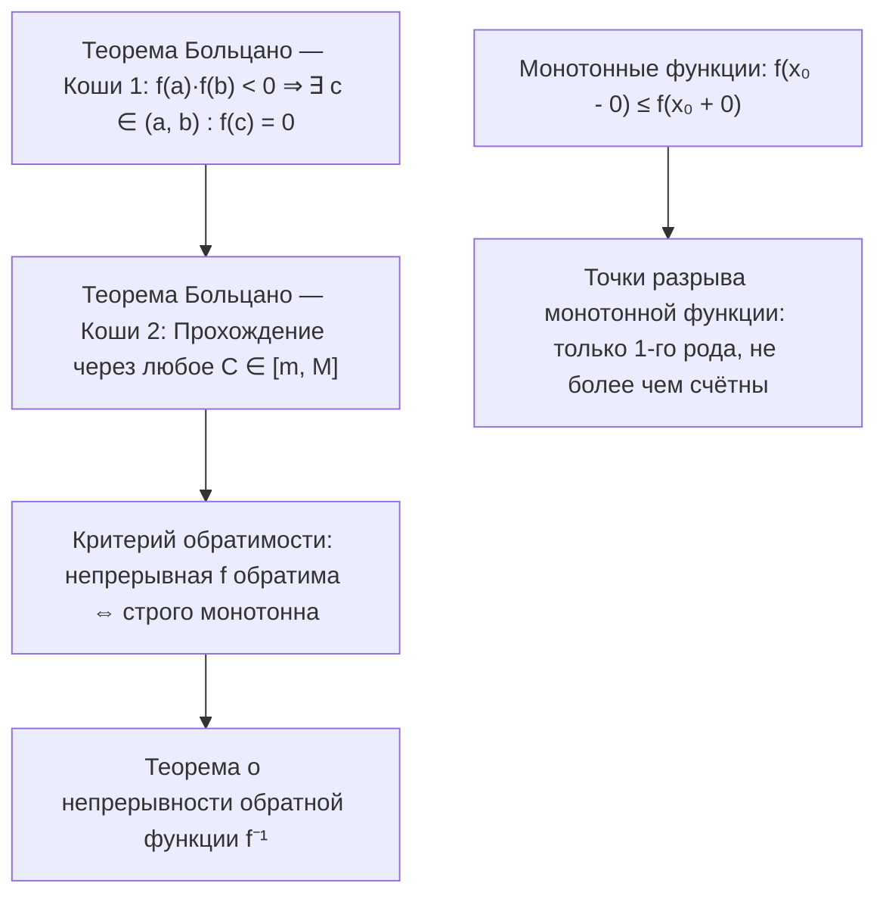

# Лекция 12: Теоремы Больцано — Коши о промежуточных значениях, свойства монотонных функций, структура точек разрыва и непрерывность обратной функции

> **Дисциплина**: Математический анализ  
> **Лектор**: ФИТиП (ИС), Университет ИТМО (Осенний семестр 2026)  
> **Ключевые темы**: Теорема Больцано — Коши о нуле непрерывной функции (Теорема 1), метод деления отрезка пополам (дихотомия / система стягивающихся отрезков Коши — Кантора), вторая теорема Больцано — Коши о промежуточном значении (Теорема 2, достижимость всех значений между $\min$ и $\max$), следствие о сохранении связности (образ промежутка при непрерывном отображении), односторонние пределы монотонной функции ($f(x_0 - 0) \le f(x_0 + 0)$), существование предела через супремум/инфимум ограниченных множеств, отсутствие точек разрыва второго рода у монотонных функций, теорема о не более чем счётности множества точек разрыва монотонной функции (инъекция в $\mathbb{Q}$ через непересекающиеся интервалы скачков), инъективность и сюръективность, критерий обратимости непрерывной функции (обратимость $\iff$ строгая монотонность), теорема о существовании, строгой монотонности и непрерывности обратной функции на промежутке $E = f(\langle a, b \rangle)$, приложения к элементарным трансцендентным функциям.

---

## 1. Рекомендуемая литература

* **Г. М. Фихтенгольц — «Курс дифференциального и интегрального исчисления», Том 1**  
  *Глава II: «Предельный переход для функций непрерывного аргумента» (§3: Свойства непрерывных функций — теоремы Больцано — Коши о нуле и о промежуточных значениях, непрерывность обратной функции).*
* **В. А. Зорич — «Математический анализ», Часть 1**  
  *Глава IV: «Непрерывные функции» (§2: Свойства непрерывных функций — глобальные свойства, промежуточные значения, монотонные функции, непрерывность обратной функции).*
* **Л. Д. Кудрявцев — «Курс математического анализа», Том 1**  
  *Глава 2: «Предел и непрерывность функций» (§8: Непрерывность монотонных функций, обратная функция).*
* **Б. П. Демидович — «Сборник задач и упражнений по математическому анализу»**  
  *Раздел: «Непрерывность функций, теоремы о промежуточных значениях, обратные функции».*

---

## 2. Теоремы Больцано — Коши о промежуточных значениях

На предыдущей лекции были доказаны локальные свойства непрерывных функций (сохранение знака, арифметические операции) и глобальные теоремы Вейерштрасса об ограниченности и достижении точных граней ($\min$ и $\max$) на замкнутом отрезке $[a, b]$.  
Следующая фундаментальная группа глобальных свойств непрерывных функций связана с геометрическим свойством «отсутствия разрывов и скачков» — график непрерывной функции не может перескочить через какое-либо значение, не приняв его.

---

### 2.1. Первая теорема Больцано — Коши (О нуле непрерывной функции)

> [!IMPORTANT] **Теорема 1 (Больцано — Коши о сохранении знака и нуле функции)**  
> Пусть функция $f$ непрерывна на замкнутом отрезке $[a, b]$ ($f \in C[a, b]$) и принимает на его концах значения противоположных знаков:  
> $$f(a) \cdot f(b) < 0$$  
> Тогда существует хотя бы одна промежуточная точка $c \in (a, b)$, в которой значение функции равно нулю:  
> $$f(c) = 0$$

#### Строгое доказательство (Метод деления отрезка пополам / стягивающихся отрезков Коши — Кантора):
1. Для определённости положим $f(a) < 0$ и $f(b) > 0$ (случай $f(a) > 0, f(b) < 0$ сводится к данному рассмотрением вспомогательной функции $-f$).
2. Обозначим исходный отрезок $I_0 = [a_0, b_0]$, где $a_0 = a, b_0 = b$. Имеем $f(a_0) < 0$, $f(b_0) > 0$.
3. Разделим отрезок $I_0$ пополам точкой $m_0 = \frac{a_0 + b_0}{2}$:
   * Если $f(m_0) = 0$, то точка $c = m_0$ найдена, и доказательство завершено.
   * Если $f(m_0) \ne 0$, то знак $f(m_0)$ совпадает либо со знаком $f(a_0)$, либо со знаком $f(b_0)$. Выберем из двух половин $[a_0, m_0]$ и $[m_0, b_0]$ ту, на концах которой функция принимает значения разных знаков. Обозначим выбранный отрезок $I_1 = [a_1, b_1]$. При этом $f(a_1) < 0$ и $f(b_1) > 0$, а длина отрезка $|I_1| = \frac{b - a}{2}$.
4. Продолжая этот процесс по индукции, мы либо на конечном $k$-м шаге встретим точку середины, где $f(m_k) = 0$ (теорема доказана), либо получим бесконечную последовательность вложенных замкнутых отрезков:
   $$I_0 \supset I_1 \supset I_2 \supset \dots \supset I_k \supset \dots$$
   обладающую следующими свойствами:
   * На левых концах: $f(a_k) < 0$ для всех $k \ge 0$.
   * На правых концах: $f(b_k) > 0$ для всех $k \ge 0$.
   * Длина $k$-го отрезка: $b_k - a_k = \frac{b - a}{2^k} \xrightarrow{k \to \infty} 0$.
5. По **принципу вложенных отрезков Кантора**, существует единственная точка $c \in [a, b]$, принадлежащая всем отрезкам $I_k$:
   $$\bigcap_{k=0}^\infty I_k = \{c\}, \quad \lim_{k \to \infty} a_k = \lim_{k \to \infty} b_k = c$$
6. Поскольку функция $f$ непрерывна в точке $c$, по определению непрерывности по Гейне:
   $$\lim_{k \to \infty} f(a_k) = f(c) \quad \text{и} \quad \lim_{k \to \infty} f(b_k) = f(c)$$
7. Предельный переход в неравенствах:
   * Так как $f(a_k) < 0$ для всех $k$, то $f(c) = \lim_{k \to \infty} f(a_k) \le 0$.
   * Так как $f(b_k) > 0$ для всех $k$, то $f(c) = \lim_{k \to \infty} f(b_k) \ge 0$.
   Объединяя оба неравенства: $0 \le f(c) \le 0 \implies f(c) = 0$.
8. Так как $f(a) \ne 0$ и $f(b) \ne 0$, точка $c$ лежит строго внутри интервала: $c \in (a, b)$. Теорема полностью доказана. $\blacksquare$

---

### 2.2. Вторая теорема Больцано — Коши (О промежуточном значении)

> [!IMPORTANT] **Теорема 2 (Больцано — Коши о прохождении через промежуточные значения)**  
> Пусть функция $f$ непрерывна на замкнутом отрезке $[a, b]$ ($f \in C[a, b]$), и пусть $A$ и $B$ — значения функции на концах отрезка: $f(a) = A, f(b) = B$.  
> Тогда для любого числа $C$, лежащего строго между $A$ и $B$ ($A < C < B$ или $B < C < A$), найдётся хотя бы одна внутренняя точка $c \in (a, b)$, такая что:  
> $$f(c) = C$$

#### Строгое доказательство:
Рассмотрим вспомогательную функцию:
$$g(x) = f(x) - C$$
1. Функция $g(x)$ непрерывна на $[a, b]$ как разность непрерывной функции $f(x)$ и константы $C$.
2. Вычислим значения функции $g(x)$ на концах отрезка:
   $$g(a) = f(a) - C = A - C, \quad g(b) = f(b) - C = B - C$$
3. Если $A < C < B$, то $g(a) = A - C < 0$, а $g(b) = B - C > 0$.  
   Следовательно, $g(a) \cdot g(b) < 0$.
4. По первой теореме Больцано — Коши существует точка $c \in (a, b)$, такая что $g(c) = 0$.
5. Раскрывая определение $g(c)$, получаем $f(c) - C = 0 \implies f(c) = C$. $\blacksquare$

---

### 2.3. Достижимость всех значений между минимумом и максимумом

> [!IMPORTANT] **Теорема 3 (О множестве значений непрерывной функции на отрезке)**  
> Пусть $f \in C[a, b]$. Обозначим через $m$ и $M$ точные грани (наименьшее и наибольшее значения функции, гарантированные второй теоремой Вейерштрасса):  
> $$m = \min_{x \in [a, b]} f(x), \quad M = \max_{x \in [a, b]} f(x)$$  
> Тогда множеством значений (образом) функции $f$ на отрезке $[a, b]$ является замкнутый отрезок $[m, M]$:  
> $$f([a, b]) = [m, M]$$

#### Доказательство:
1. По второй теореме Вейерштрасса существуют точки $x_m, x_M \in [a, b]$, такие что $f(x_m) = m$ и $f(x_M) = M$.
2. По определению минимума и максимума для любого $x \in [a, b]$ выполнено $m \le f(x) \le M$, откуда $f([a, b]) \subseteq [m, M]$.
3. Обратно, пусть $C \in [m, M]$ — любое число:
   * Если $C = m$ или $C = M$, то $C = f(x_m)$ или $C = f(x_M)$, значение достигается.
   * Если $m < C < M$, рассмотрим отрезок с концами $x_m$ и $x_M$ (это либо $[x_m, x_M]$, либо $[x_M, x_m]$). Функция $f$ непрерывна на этом отрезке и принимает на его концах значения $m$ и $M$. По теореме 2 о промежуточном значении существует точка $c$, лежащая между $x_m$ и $x_M$, в которой $f(c) = C$.
4. Следовательно, $[m, M] \subseteq f([a, b])$. Объединяя оба включения, получаем $f([a, b]) = [m, M]$. $\blacksquare$

> [!NOTE] **Топологическое следствие**  
> Непрерывный образ связного множества (промежутка: отрезка, интервала, полуинтервала) всегда является связным множеством (промежутком).

---

## 3. Свойства монотонных функций

Пусть функция $f: (a, b) \to \mathbb{R}$ задана на интервале $(a, b)$.

> [!NOTE] **Определение 1 (Монотонность)**  
> * Функция $f$ называется **возрастающей (неубывающей)** на $(a, b)$, если для любых $x_1, x_2 \in (a, b)$:  
>   $$x_1 < x_2 \implies f(x_1) \le f(x_2)$$  
> * Функция $f$ называется **строго возрастающей**, если:  
>   $$x_1 < x_2 \implies f(x_1) < f(x_2)$$  
> (Аналогично определяются убывающие и строго убывающие функции).

---

### 3.1. Теорема об односторонних пределах монотонной функции

> [!IMPORTANT] **Теорема 4 (О существовании односторонних пределов)**  
> Пусть функция $f$ возрастает на интервале $(a, b)$. Тогда в любой внутренней точке $x_0 \in (a, b)$ существуют конечные левый и правый пределы $f(x_0 - 0)$ и $f(x_0 + 0)$, причём выполнено двойное неравенство:  
> $$\sup_{x \in (a, x_0)} f(x) = f(x_0 - 0) \le f(x_0) \le f(x_0 + 0) = \inf_{x \in (x_0, b)} f(x)$$

#### Строгое доказательство:
1. Рассмотрим множество значений функции $f$ слева от точки $x_0$:  
   $$E^- = \{f(x) \mid x \in (a, x_0)\}$$
2. Так как функция возрастает, для любого $x \in (a, x_0)$ выполнено $f(x) \le f(x_0)$.  
   Следовательно, множество $E^-$ непусто и ограничено сверху числом $f(x_0)$.
3. По аксиоме полноты вещественных чисел у множества $E^-$ существует точная верхняя грань (супремум):  
   $$A = \sup E^- = \sup_{x \in (a, x_0)} f(x) \le f(x_0)$$
4. Докажем по определению Коши, что $\lim_{x \to x_0 - 0} f(x) = A$:  
   Зафиксируем произвольное $\varepsilon > 0$. По характеристическому свойству супремума:
   * Для всех $x \in (a, x_0)$ выполнено $f(x) \le A < A + \varepsilon$.
   * Найдётся точка $x_1 \in (a, x_0)$, такая что $f(x_1) > A - \varepsilon$.
5. Положим $\delta = x_0 - x_1 > 0$. Тогда для любого $x$, удовлетворяющего условию $x_0 - \delta < x < x_0$ (то есть $x_1 < x < x_0$), в силу монотонности функции имеем:  
   $$A - \varepsilon < f(x_1) \le f(x) \le A < A + \varepsilon \implies |f(x) - A| < \varepsilon$$  
   Это доказывает, что $\lim_{x \to x_0 - 0} f(x) = A = f(x_0 - 0)$. При этом $f(x_0 - 0) = A \le f(x_0)$.
6. Абсолютно симметрично рассматривается множество $E^+ = \{f(x) \mid x \in (x_0, b)\}$, ограниченное снизу числом $f(x_0)$. Его точная нижняя грань $B = \inf E^+$ совпадает с правым пределом:  
   $$f(x_0 + 0) = \inf_{x \in (x_0, b)} f(x) \ge f(x_0)$$
7. Сопоставляя левое и правое неравенства, получаем: $f(x_0 - 0) \le f(x_0) \le f(x_0 + 0)$. $\blacksquare$

---

### 3.2. Структура точек разрыва монотонной функции

> [!NOTE] **Следствие 1 (Классификация разрывов монотонной функции)**  
> Из теоремы 4 следует, что монотонная функция **не может иметь точек разрыва второго рода** (бесконечных или колебательных).  
> Любая точка разрыва монотонной функции является либо точкой устранимого разрыва, либо точкой разрыва первого рода (скачком). Величина скачка функции в точке $x_0$ строго положительна:  
> $$\Delta(x_0) = f(x_0 + 0) - f(x_0 - 0) > 0$$

> [!IMPORTANT] **Теорема 5 (О мощности множества точек разрыва монотонной функции)**  
> Множество $D$ всех точек разрыва монотонной функции $f$ на произвольном промежутке $\langle a, b \rangle$ **не более чем счётно** (конечно или счётно).

#### Строгое доказательство:
1. Пусть $f$ возрастает на $\langle a, b \rangle$, и $D \subset \langle a, b \rangle$ — множество всех точек её разрыва.
2. В каждой точке разрыва $x \in D$ выполнено $f(x - 0) < f(x + 0)$.  
   Сопоставим каждой точке разрыва $x \in D$ непустой открытый интервал значений:
   $$J_x = (f(x - 0), f(x + 0)) \subset \mathbb{R}$$
3. Покажем, что для любых двух различных точек разрыва $x_1, x_2 \in D$ ($x_1 < x_2$) соответствующие интервалы **не пересекаются**:  
   Выберем промежуточную точку $x^* \in (x_1, x_2)$. В силу монотонности функции $f$:
   $$f(x_1 + 0) \le f(x^*) \le f(x_2 - 0)$$
   Следовательно:
   $$\sup J_{x_1} = f(x_1 + 0) \le f(x_2 - 0) = \inf J_{x_2}$$
   Значит, интервалы $J_{x_1}$ и $J_{x_2}$ не имеют общих точек: $J_{x_1} \cap J_{x_2} = \emptyset$.
4. Получили семейство попарно непересекающихся непустых открытых интервалов $\{J_x\}_{x \in D}$ на вещественной прямой $\mathbb{R}$.
5. По свойству плотности рациональных чисел $\mathbb{Q}$ в $\mathbb{R}$, внутри каждого непустого открытого интервала $J_x$ существует хотя бы одно рациональное число $q_x \in J_x \cap \mathbb{Q}$.
6. Выберем для каждого $x \in D$ одно такое число $q_x$. Поскольку интервалы $J_x$ попарно не пересекаются, для $x_1 \ne x_2$ числа $q_{x_1}$ и $q_{x_2}$ обязательно различны.
7. Отображение $x \mapsto q_x$ является инъекцией из множества $D$ в счётное множество $\mathbb{Q}$.
8. Так как подмножество счётного множества не более чем счётно, множество точек разрыва $D$ не более чем счётно. $\blacksquare$

---

## 4. Обратимость и непрерывность обратной функции

Пусть функция $f: \langle a, b \rangle \to E$ задана на числовом промежутке $\langle a, b \rangle$ с множеством значений $E = f(\langle a, b \rangle)$.  
Отображение $f$ сюръективно на свой образ $E$ по построению. Для существования обратной функции $f^{-1}: E \to \langle a, b \rangle$ необходимо и достаточно, чтобы отображение $f$ было **инъективным**:
$$\forall x_1, x_2 \in \langle a, b \rangle: \quad x_1 \ne x_2 \implies f(x_1) \ne f(x_2)$$

---

### 4.1. Критерий обратимости непрерывной функции

> [!IMPORTANT] **Теорема 6 (Критерий строгой монотонности и обратимости)**  
> Непрерывная на промежутке $\langle a, b \rangle$ функция $f$ обратима (инъективна) тогда и только тогда, когда она **строго монотонна** (строго возрастает или строго убывает) на этом промежутке.

#### Строгое доказательство:
* $(\implies)$ **Достаточность**:  
  Пусть $f$ строго возрастает (или строго убывает). Если $x_1 \ne x_2$, то либо $x_1 < x_2 \implies f(x_1) < f(x_2)$, либо $x_1 > x_2 \implies f(x_1) > f(x_2)$. В обоих случаях $f(x_1) \ne f(x_2)$, следовательно, $f$ инъективна и обратима.
* $(\impliedby)$ **Необходимость (Доказательство от противного)**:  
  Пусть $f \in C(\langle a, b \rangle)$ обратима (инъективна), но предположим, что $f$ **не является строго монотонной**.
  1. Выберем две произвольные точки $x_1 < x_2$. Так как $f$ инъективна, $f(x_1) \ne f(x_2)$. Для определённости положим $f(x_1) < f(x_2)$.
  2. Так как $f$ не является строго возрастающей на всём промежутке, найдётся хотя бы одна пара точек, нарушающая строгое возрастание. Это означает, что существуют три точки $x_1 < x_2 < x_3$, для которых нарушается порядок значений (например, $f(x_2) > f(x_1)$ и $f(x_2) > f(x_3)$, либо $f(x_2) < f(x_1)$ и $f(x_2) < f(x_3)$).
  3. Разберём случай, когда $f(x_2)$ больше обоих значений $f(x_1)$ и $f(x_3)$ (наличие «локального пика»). Положим:  
     $$C = \max(f(x_1), f(x_3)) + \frac{f(x_2) - \max(f(x_1), f(x_3))}{2}$$  
     Тогда $f(x_1) < C < f(x_2)$ и $f(x_3) < C < f(x_2)$.
  4. Применяем теорему 2 Больцано — Коши:
     * На отрезке $[x_1, x_2]$: функция принимает значение $C$ в некоторой точке $c_1 \in (x_1, x_2)$, то есть $f(c_1) = C$.
     * На отрезке $[x_2, x_3]$: функция принимает то же значение $C$ в некоторой точке $c_2 \in (x_2, x_3)$, то есть $f(c_2) = C$.
  5. Так как $x_1 < c_1 < x_2 < c_2 < x_3$, точки $c_1$ и $c_2$ заведомо **различны** ($c_1 \ne c_2$), но $f(c_1) = f(c_2) = C$.  
  Это напрямую противоречит инъективности функции $f$!  
  Следовательно, наше предположение неверно, и функция $f$ обязана быть строго монотонной. $\blacksquare$

---

### 4.2. Теорема о непрерывности обратной функции

> [!IMPORTANT] **Теорема 7 (О существовании и непрерывности обратной функции)**  
> Пусть функция $f$ определена, непрерывна и строго возрастает (убывает) на промежутке $\langle a, b \rangle$.  
> Тогда на промежутке значений $E = f(\langle a, b \rangle)$ существует однозначная обратная функция $f^{-1}: E \to \langle a, b \rangle$, которая также является **строго возрастающей (убывающей) и непрерывной** на $E$.

#### Строгое доказательство:
1. **Существование и строгая монотонность $f^{-1}$**:  
   Так как $f$ строго возрастает, она инъективна, следовательно, обратная функция $f^{-1}: E \to \langle a, b \rangle$ существует. Пусть $y_1, y_2 \in E$ и $y_1 < y_2$. Обозначим $x_1 = f^{-1}(y_1), x_2 = f^{-1}(y_2)$. Если бы $x_1 \ge x_2$, то в силу возрастания $f$ имели бы $y_1 = f(x_1) \ge f(x_2) = y_2$, что противоречит условию. Значит, $x_1 < x_2$, и функция $f^{-1}$ строго возрастает.
2. **Непрерывность $f^{-1}$**:  
   Пусть $y_0 \in E$ — произвольная внутренняя точка промежутка $E$, и $x_0 = f^{-1}(y_0) \in \langle a, b \rangle$.  
   Зафиксируем произвольное $\varepsilon > 0$. Не ограничивая общности, выберем $\varepsilon$ настолько малым, чтобы интервал $(x_0 - \varepsilon, x_0 + \varepsilon) \subseteq \langle a, b \rangle$.  
   Положим:
   $$y_1 = f(x_0 - \varepsilon), \quad y_2 = f(x_0 + \varepsilon)$$
   Так как $f$ строго возрастает, $y_1 < f(x_0) = y_0 < y_2$.  
   Выберем $\delta = \min(y_0 - y_1, y_2 - y_0) > 0$.  
   Тогда для любого $y \in (y_0 - \delta, y_0 + \delta) \subset (y_1, y_2)$ в силу строгого возрастания обратной функции $f^{-1}$ получаем:  
   $$y_1 < y < y_2 \implies f^{-1}(y_1) < f^{-1}(y) < f^{-1}(y_2) \iff x_0 - \varepsilon < f^{-1}(y) < x_0 + \varepsilon$$  
   То есть $|f^{-1}(y) - f^{-1}(y_0)| < \varepsilon$.  
   Это доказывает непрерывность $f^{-1}$ в точке $y_0$. (Для граничных точек промежутка рассуждение аналогично с заменой окрестности на полуокрестность). $\blacksquare$

---

## 5. Приложения к базовым трансцендентным функциям

1. **Корень $n$-й степени**:  
   Функция $f(x) = x^n$ при $x \in [0, +\infty)$ ($n \in \mathbb{N}$) непрерывна и строго возрастает. Множество значений $E = [0, +\infty)$. По теореме 7 обратная функция $f^{-1}(y) = \sqrt[n]{y}$ существует, строго возрастает и непрерывна на $[0, +\infty)$.
2. **Экспонента и логарифм**:  
   Функция $f(x) = a^x$ ($a > 1$) строго возрастает и непрерывна на $\mathbb{R}$, $f(\mathbb{R}) = (0, +\infty)$. Обратная функция $f^{-1}(y) = \log_a y$ строго возрастает и непрерывна на $(0, +\infty)$.
3. **Обратные тригонометрические функции**:  
   * Функция $\sin x$ на $[-\pi/2, \pi/2]$ непрерывна и строго возрастает от $-1$ до $1$. Обратная функция $\arcsin x: [-1, 1] \to [-\pi/2, \pi/2]$ строго возрастает и непрерывна.
   * Функция $\cos x$ на $[0, \pi]$ непрерывна и строго убывает от $1$ до $-1$. Обратная функция $\arccos x: [-1, 1] \to [0, \pi]$ строго убывает и непрерывна.
   * Функция $\operatorname{tg} x$ на $(-\pi/2, \pi/2)$ непрерывна и строго возрастает от $-\infty$ до $+\infty$. Обратная функция $\operatorname{arctg} x: \mathbb{R} \to (-\pi/2, \pi/2)$ строго возрастает и непрерывна.
