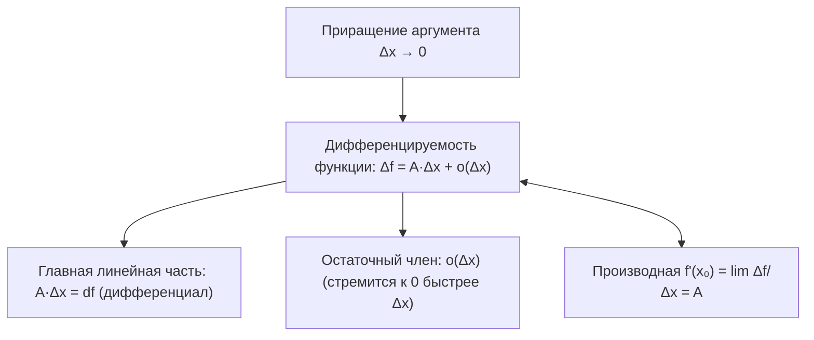

# Лекция 13: Дифференцируемость функции, производная, дифференциал, геометрический и механический смысл, правила дифференцирования

> **Дисциплина**: Математический анализ  
> **Лектор**: ФИТиП (ИС), Университет ИТМО (Осенний семестр 2026)  
> **Ключевые темы**: Приращение аргумента и приращение функции ($\Delta x$ и $\Delta f$), дифференцируемость как возможность локальной линейной аппроксимации ($\Delta f = A \Delta x + o(\Delta x)$), главная линейная часть приращения, определение производной в точке по Коши через предел отношения приращений ($f'(x_0) = \lim_{\Delta x \to 0} \frac{\Delta f}{\Delta x}$), теорема об эквивалентности дифференцируемости и существования конечной производной ($A = f'(x_0)$), дифференциал функции ($df = f'(x_0) dx$) как скорость приращения и линейная часть, геометрический смысл производной (угловой коэффициент касательной, секущие в пределе, уравнения касательной и нормали), геометрический смысл дифференциала (приращение ординаты касательной), механический смысл (мгновенная скорость прямолинейного движения), теорема о непрерывности дифференцируемой функции, контрпримеры к обратному (непрерывные, но недифференцируемые функции: модуль $|x|$, функция Вейерштрасса), односторонние производные ($f'_+(x_0)$ и $f'_-(x_0)$), вертикальные касательные и каспы, арифметические свойства производной (линейность, правило Лейбница для произведения, производная частного), теорема о производной сложной функции (цепное правило / Chain Rule), теорема о производной обратной функции ($(f^{-1})'(y_0) = 1 / f'(x_0)$), инвариантность формы первого дифференциала.

---

## 1. Рекомендуемая литература

* **Г. М. Фихтенгольц — «Курс дифференциального и интегрального исчисления», Том 1**  
  *Глава III: «Производная и дифференциал» (§1: Понятие производной; §2: Геометрический и механический смысл; §3: Дифференциал; §4: Основные правила дифференцирования; §5: Производная сложной и обратной функций).*
* **В. А. Зорич — «Математический анализ», Часть 1**  
  *Глава V: «Дифференциальное исчисление» (§1: Дифференцируемые функции — дифференцируемость и производная, касательная, дифференциал, правила вычисления производных).*
* **Л. Д. Кудрявцев — «Курс математического анализа», Том 1**  
  *Глава 3: «Производная и дифференциал» (§9: Дифференцируемость функций одной переменной; §10: Геометрический смысл дифференциала; §11: Производная композиции и обратной функции).*
* **Б. П. Демидович — «Сборник задач и упражнений по математическому анализу»**  
  *Раздел: «Дифференцирование функций одной переменной — нахождение производных по определению, правила дифференцирования, касательные и нормали».*

---

## 2. Дифференцируемость как локальная линейная аппроксимация

Пусть функция $f: E \to \mathbb{R}$ определена в некоторой окрестности $U(x_0)$ точки $x_0 \in \mathbb{R}$.  
Пусть аргумент получает смещение (приращение) $\Delta x$, такое что $x_0 + \Delta x \in U(x_0)$.

> [!NOTE] **Определение 1 (Приращение аргумента и функции)**  
> * **Приращением аргумента** в точке $x_0$ называется величина:  
>   $$\Delta x = x - x_0 \iff x = x_0 + \Delta x$$  
> * **Приращением функции** (откликом функции на смещение аргумента) называется разность:  
>   $$\Delta f(x_0) = \Delta f = f(x_0 + \Delta x) - f(x_0)$$

Фундаментальная идея математического анализа состоит в том, чтобы приблизить сложное нелинейное поведение приращения функции $\Delta f$ **простейшей линейной функцией** от приращения аргумента $\Delta x$.

> [!IMPORTANT] **Определение 2 (Дифференцируемость функции в точке)**  
> Функция $f$ называется **дифференцируемой в точке $x_0$**, если её приращение $\Delta f$ в этой точке может быть представлено в виде:  
> $$\Delta f = A \cdot \Delta x + \alpha(\Delta x) \cdot \Delta x$$  
> где $A \in \mathbb{R}$ — некоторая постоянная (не зависящая от $\Delta x$), а $\alpha(\Delta x) \to 0$ при $\Delta x \to 0$.  
> В терминах символики «$o$-малое»:  
> $$\Delta f = A \cdot \Delta x + o(\Delta x) \quad \text{при } \Delta x \to 0$$  
> Слагаемое $A \cdot \Delta x$ называется **главной линейной частью приращения функции**.

---

## 3. Производная функции в точке

> [!IMPORTANT] **Определение 3 (Производная функции по Коши)**  
> **Производной функции $f$ в точке $x_0$** называется предел отношения приращения функции к приращению аргумента при стремлении приращения аргумента к нулю (если этот предел существует и конечен):  
> $$f'(x_0) = \frac{df}{dx}(x_0) = \lim_{\Delta x \to 0} \frac{\Delta f}{\Delta x} = \lim_{\Delta x \to 0} \frac{f(x_0 + \Delta x) - f(x_0)}{\Delta x}$$  
> В эквивалентной форме при $x \to x_0$ ($x = x_0 + \Delta x$):  
> $$f'(x_0) = \lim_{x \to x_0} \frac{f(x) - f(x_0)}{x - x_0}$$

---

### 3.1. Связь дифференцируемости и существования производной

> [!IMPORTANT] **Теорема 1 (Критерий дифференцируемости функции одной переменной)**  
> Функция $f$ дифференцируема в точке $x_0$ тогда и только тогда, когда в этой точке существует конечная производная $f'(x_0)$. При этом коэффициент главной линейной части $A$ в точности равен значению производной:  
> $$A = f'(x_0)$$

#### Строгое доказательство:
* $(\implies)$ **Необходимость**:  
  Пусть $f$ дифференцируема в $x_0$, то есть $\Delta f = A \Delta x + o(\Delta x)$ при $\Delta x \to 0$.  
  Разделим обе части равенства на $\Delta x \ne 0$:  
  $$\frac{\Delta f}{\Delta x} = A + \frac{o(\Delta x)}{\Delta x}$$  
  Переходя к пределу при $\Delta x \to 0$:  
  $$\lim_{\Delta x \to 0} \frac{\Delta f}{\Delta x} = \lim_{\Delta x \to 0} \left( A + \frac{o(\Delta x)}{\Delta x} \right) = A + 0 = A$$  
  Предел существует и равен $A$. По определению производной $f'(x_0) = A$.
* $(\impliedby)$ **Достаточность**:  
  Пусть в точке $x_0$ существует конечный предел $\lim_{\Delta x \to 0} \frac{\Delta f}{\Delta x} = f'(x_0)$.  
  По определению предела функции величина $\alpha(\Delta x) = \frac{\Delta f}{\Delta x} - f'(x_0)$ является бесконечно малой при $\Delta x \to 0$: $\lim_{\Delta x \to 0} \alpha(\Delta x) = 0$.  
  Отсюда:  
  $$\frac{\Delta f}{\Delta x} = f'(x_0) + \alpha(\Delta x) \implies \Delta f = f'(x_0) \Delta x + \alpha(\Delta x) \Delta x = f'(x_0) \Delta x + o(\Delta x)$$  
  Это в точности означает, что функция $f$ дифференцируема в точке $x_0$, а $A = f'(x_0)$. $\blacksquare$

---

## 4. Понятие дифференциала функции

> [!IMPORTANT] **Определение 4 (Дифференциал функции)**  
> **Дифференциалом (первым дифференциалом)** дифференцируемой функции $f$ в точке $x_0$ называется главная линейная часть её приращения:  
> $$df(x_0) = A \cdot \Delta x = f'(x_0) \cdot \Delta x$$

Рассмотрим тождественную функцию $f(x) = x$. Её производная $f'(x) = (x)' = 1$ для любого $x$.  
Следовательно, дифференциал независимой переменной $x$ равен:  
$$dx = 1 \cdot \Delta x = \Delta x$$  
Поскольку $dx = \Delta x$, дифференциал любой дифференцируемой функции $f$ записывается в классической лейбницевской форме:  
$$df(x_0) = f'(x_0) dx \iff f'(x_0) = \frac{df}{dx}(x_0)$$

> [!NOTE] **Смысл дифференциала: скорость приращения и линейная аппроксимация**  
> 1. Дифференциал пропорционален приращению аргумента $\Delta x$, причём коэффициентом пропорциональности служит **мгновенная скорость изменения** функции $f'(x_0)$.  
> 2. Формула локальной аппроксимации:  
>    $$f(x_0 + \Delta x) \approx f(x_0) + df(x_0) = f(x_0) + f'(x_0) \Delta x$$  
>    с погрешностью порядка $o(\Delta x)$.

---

## 5. Геометрический и механический смысл производной и дифференциала

### 5.1. Геометрический смысл: касательная к кривой

Рассмотрим график функции $y = f(x)$ и зафиксируем на нём точку $M_0(x_0, f(x_0))$.  
Возьмём смещённую точку $M(x_0 + \Delta x, f(x_0 + \Delta x))$.  
Прямая $M_0 M$ называется **секущей**. Угловой коэффициент (тангенс угла наклона к оси $Ox$) секущей равен:
$$k_{\text{сек}} = \operatorname{tg} \varphi = \frac{\Delta y}{\Delta x} = \frac{f(x_0 + \Delta x) - f(x_0)}{\Delta x}$$

> [!IMPORTANT] **Определение 5 (Касательная)**  
> **Касательной** к графику функции $y = f(x)$ в точке $M_0(x_0, f(x_0))$ называется предельное положение секущей $M_0 M$, когда точка $M$ стремится к точке $M_0$ вдоль графика функции ($\Delta x \to 0$).

* **Угловой коэффициент касательной**:  
  $$k_{\text{кас}} = \operatorname{tg} \alpha = \lim_{\Delta x \to 0} \operatorname{tg} \varphi = \lim_{\Delta x \to 0} \frac{\Delta f}{\Delta x} = f'(x_0)$$
* **Уравнение касательной** в точке $x_0$:  
  $$y - f(x_0) = f'(x_0)(x - x_0) \iff y = f(x_0) + f'(x_0)(x - x_0)$$
* **Уравнение нормали** (прямой, проходящей через $M_0$ перпендикулярно касательной при $f'(x_0) \ne 0$):  
  $$y - f(x_0) = -\frac{1}{f'(x_0)} (x - x_0)$$

> [!NOTE] **Геометрический смысл дифференциала**  
> В то время как приращение функции $\Delta f$ равно приращению ординаты **графика функции**, дифференциал $df(x_0) = f'(x_0) \Delta x$ равен приращению ординаты **касательной прямой**, проведённой в точке $x_0$.

---

### 5.2. Механический (физический) смысл производной

Пусть материальная точка движется прямолинейно по закону $s = s(t)$, где $s(t)$ — координата в момент времени $t$.  
* За промежуток времени от $t_0$ до $t_0 + \Delta t$ перемещение точки составляет $\Delta s = s(t_0 + \Delta t) - s(t_0)$.  
* Средняя скорость движения за этот интервал: $v_{\text{ср}} = \frac{\Delta s}{\Delta t}$.  
* **Мгновенная скорость** точки в момент времени $t_0$ равна пределу средней скорости при $\Delta t \to 0$:  
  $$v(t_0) = \lim_{\Delta t \to 0} \frac{\Delta s}{\Delta t} = s'(t_0) = \frac{ds}{dt}(t_0)$$

---

## 6. Связь дифференцируемости и непрерывности

> [!IMPORTANT] **Теорема 2 (О непрерывности дифференцируемой функции)**  
> Если функция $f$ дифференцируема в точке $x_0$, то она непрерывна в этой точке:  
> $$f \text{ дифференцируема в } x_0 \implies f \in C(x_0)$$

#### Строгое доказательство:
Так как $f$ дифференцируема в $x_0$, её приращение представимо в виде $\Delta f = f'(x_0) \Delta x + o(\Delta x)$ при $\Delta x \to 0$.  
Вычислим предел приращения функции при $\Delta x \to 0$:  
$$\lim_{\Delta x \to 0} \Delta f = \lim_{\Delta x \to 0} \left( f'(x_0) \Delta x + o(\Delta x) \right) = f'(x_0) \cdot 0 + 0 = 0$$  
Равенство $\lim_{\Delta x \to 0} \Delta f = 0 \iff \lim_{x \to x_0} f(x) = f(x_0)$ является точным определением непрерывности функции в точке $x_0$. $\blacksquare$

---

### 6.1. Необратимость: Непрерывность НЕ влечёт дифференцируемость

Обратное утверждение в общем случае **неверно**: непрерывная в точке функция может не иметь производной в этой точке.

1. **Классический пример точки излома (угловой точки)**:  
   Функция $f(x) = |x|$ непрерывна на всей числовой прямой $\mathbb{R}$, включая $x_0 = 0$.  
   Вычислим односторонние пределы отношения приращений в нуле:  
   * Справа ($\Delta x > 0$): $\lim_{\Delta x \to +0} \frac{|\Delta x|}{\Delta x} = \lim_{\Delta x \to +0} \frac{\Delta x}{\Delta x} = 1 = f'_+(0)$.  
   * Слева ($\Delta x < 0$): $\lim_{\Delta x \to -0} \frac{|\Delta x|}{\Delta x} = \lim_{\Delta x \to -0} \frac{-\Delta x}{\Delta x} = -1 = f'_-(0)$.  
   Поскольку $f'_+(0) = 1 \ne -1 = f'_-(0)$, двустороннего предела не существует. Производной $f'(0)$ не существует.
2. **Патологический пример (Функция Вейерштрасса, 1872)**:  
   $$W(x) = \sum_{n=0}^\infty a^n \cos(b^n \pi x), \quad 0 < a < 1, \; ab > 1 + \frac{3}{2}\pi$$  
   Функция непрерывна во всех точках числовой оси $\mathbb{R}$, но **ни в одной точке не имеет конечной производной** (фрактальная структура).

---

## 7. Односторонние и бесконечные производные

> [!NOTE] **Определение 6 (Односторонние производные)**  
> * **Правая производная**: $f'_+(x_0) = \lim_{\Delta x \to +0} \frac{f(x_0 + \Delta x) - f(x_0)}{\Delta x}$.  
> * **Левая производная**: $f'_-(x_0) = \lim_{\Delta x \to -0} \frac{f(x_0 + \Delta x) - f(x_0)}{\Delta x}$.  
> Производная $f'(x_0)$ существует тогда и только тогда, когда $f'_+(x_0) = f'_-(x_0)$.

> [!NOTE] **Определение 7 (Бесконечные производные и вертикальные касательные)**  
> Если $\lim_{\Delta x \to 0} \frac{\Delta f}{\Delta x} = +\infty$ (или $-\infty$), говорят, что функция имеет **бесконечную производную**. В этой точке касательная к графику вертикальна (уравнение $x = x_0$).  
> * Пример 1 (гладкая вертикальная касательная): $f(x) = \sqrt[3]{x}$ в $x_0 = 0$. $\lim_{\Delta x \to 0} \frac{\sqrt[3]{\Delta x}}{\Delta x} = \lim_{\Delta x \to 0} \frac{1}{\Delta x^{2/3}} = +\infty$. Касательная вертикальна.  
> * Пример 2 (точка возврата / касп): $f(x) = \sqrt[3]{x^2}$ в $x_0 = 0$. $f'_+(0) = +\infty$, $f'_-(0) = -\infty$.

---

## 8. Арифметика производных (Правила дифференцирования)

> [!IMPORTANT] **Теорема 3 (Арифметические свойства производных)**  
> Пусть функции $u(x)$ и $v(x)$ дифференцируемы в точке $x$. Тогда:  
> 1. **Линейность**: для любых констант $\alpha, \beta \in \mathbb{R}$:  
>    $$(\alpha u + \beta v)' = \alpha u' + \beta v'$$  
> 2. **Правило Лейбница (производная произведения)**:  
>    $$(u \cdot v)' = u' v + u v'$$  
> 3. **Производная частного**: если $v(x) \ne 0$:  
>    $$\left( \frac{u}{v} \right)' = \frac{u' v - u v'}{v^2}$$

#### Строгие доказательства:
* **Для произведения**:  
  Приращение произведения:  
  $$\Delta(u v) = u(x + \Delta x) v(x + \Delta x) - u(x) v(x)$$  
  Прибавим и вычтем $u(x + \Delta x) v(x)$:  
  $$\Delta(u v) = u(x + \Delta x) [v(x + \Delta x) - v(x)] + v(x) [u(x + \Delta x) - u(x)] = u(x + \Delta x) \Delta v + v(x) \Delta u$$  
  Разделим на $\Delta x \ne 0$:  
  $$\frac{\Delta(u v)}{\Delta x} = u(x + \Delta x) \frac{\Delta v}{\Delta x} + v(x) \frac{\Delta u}{\Delta x}$$  
  По теореме 2 дифференцируемость $u$ влечет непрерывность: $\lim_{\Delta x \to 0} u(x + \Delta x) = u(x)$.  
  Переходя к пределу:  
  $$(u v)' = \lim_{\Delta x \to 0} \frac{\Delta(u v)}{\Delta x} = u(x) v'(x) + v(x) u'(x). \quad \blacksquare$$

* **Для частного**:  
  Приращение частного:  
  $$\Delta \left( \frac{u}{v} \right) = \frac{u(x + \Delta x)}{v(x + \Delta x)} - \frac{u(x)}{v(x)} = \frac{u(x + \Delta x) v(x) - u(x) v(x + \Delta x)}{v(x) v(x + \Delta x)}$$  
  Преобразуем числитель добавлением и вычитанием $u(x) v(x)$:  
  $$u(x + \Delta x) v(x) - u(x) v(x + \Delta x) = v(x) \Delta u - u(x) \Delta v$$  
  Разделим на $\Delta x$:  
  $$\frac{\Delta(u/v)}{\Delta x} = \frac{v(x) \frac{\Delta u}{\Delta x} - u(x) \frac{\Delta v}{\Delta x}}{v(x) v(x + \Delta x)}$$  
  В силу непрерывности $v$: $\lim_{\Delta x \to 0} v(x + \Delta x) = v(x) \ne 0$.  
  Переходя к пределу при $\Delta x \to 0$, получаем $\frac{u' v - u v'}{v^2}$. $\blacksquare$

---

## 9. Производная сложной и обратной функции

### 9.1. Производная сложной функции (Цепное правило / Chain Rule)

> [!IMPORTANT] **Теорема 4 (Цепное правило дифференцирования композиции)**  
> Пусть функция $u = g(x)$ дифференцируема в точке $x_0$, а функция $y = f(u)$ дифференцируема в точке $u_0 = g(x_0)$.  
> Тогда сложная функция $F(x) = (f \circ g)(x) = f(g(x))$ дифференцируема в точке $x_0$, и её производная равна произведению производных внешней и внутренней функций:  
> $$F'(x_0) = f'(g(x_0)) \cdot g'(x_0) = f'(u_0) \cdot g'(x_0)$$

#### Строгое доказательство:
По определению дифференцируемости $f$ в точке $u_0$:
$$\Delta y = f'(u_0) \Delta u + \alpha(\Delta u) \Delta u$$
где функция $\alpha(\Delta u) \to 0$ при $\Delta u \to 0$. Доопределим $\alpha(0) = 0$, тогда $\alpha$ непрерывна в нуле.  
Разделим равенство на $\Delta x \ne 0$:
$$\frac{\Delta y}{\Delta x} = f'(u_0) \frac{\Delta u}{\Delta x} + \alpha(\Delta u) \frac{\Delta u}{\Delta x}$$
Так как $g$ дифференцируема в $x_0$, то $\lim_{\Delta x \to 0} \frac{\Delta u}{\Delta x} = g'(x_0)$, и $g$ непрерывна в $x_0$, откуда $\lim_{\Delta x \to 0} \Delta u = 0$.  
Тогда $\lim_{\Delta x \to 0} \alpha(\Delta u) = \alpha(0) = 0$.  
Переходя к пределу при $\Delta x \to 0$:
$$F'(x_0) = \lim_{\Delta x \to 0} \frac{\Delta y}{\Delta x} = f'(u_0) g'(x_0) + 0 \cdot g'(x_0) = f'(u_0) \cdot g'(x_0). \quad \blacksquare$$

---

### 9.2. Производная обратной функции

> [!IMPORTANT] **Теорема 5 (О производной обратной функции)**  
> Пусть функция $f$ непрерывна и строго монотонна в окрестности точки $x_0$, дифференцируема в точке $x_0$, причём $f'(x_0) \ne 0$.  
> Тогда обратная функция $x = f^{-1}(y)$ дифференцируема в точке $y_0 = f(x_0)$, и её производная равна обратной величине производной исходной функции:  
> $$(f^{-1})'(y_0) = \frac{1}{f'(x_0)}$$

#### Строгое доказательство:
Пусть $y$ получает приращение $\Delta y = y - y_0 \ne 0$. Ему соответствует приращение аргумента $\Delta x = f^{-1}(y_0 + \Delta y) - f^{-1}(y_0) \ne 0$ (в силу строгой инъективности $f^{-1}$).  
Рассмотрим отношение приращений обратной функции:  
$$\frac{\Delta x}{\Delta y} = \frac{1}{\frac{\Delta y}{\Delta x}}$$  
По теореме 7 из Лекции 12 обратная функция $f^{-1}$ непрерывна в $y_0$, следовательно:  
$$\lim_{\Delta y \to 0} \Delta x = 0$$  
По условию функция $f$ дифференцируема в $x_0$ и $f'(x_0) \ne 0$, поэтому:  
$$(f^{-1})'(y_0) = \lim_{\Delta y \to 0} \frac{\Delta x}{\Delta y} = \lim_{\Delta x \to 0} \frac{1}{\frac{\Delta y}{\Delta x}} = \frac{1}{\lim_{\Delta x \to 0} \frac{\Delta y}{\Delta x}} = \frac{1}{f'(x_0)}. \quad \blacksquare$$

---

## 10. Инвариантность формы первого дифференциала

Пусть $y = f(u)$. Если $u$ — независимая переменная, то $du = \Delta u$, и $dy = f'(u) du$.  
Пусть теперь $u$ сама является дифференцируемой функцией от переменной $x$: $u = g(x)$.  
Тогда по теореме 4:
$$dy = (f(g(x)))' dx = f'(u) g'(x) dx$$
Но $g'(x) dx = du$ (дифференциал функции $u = g(x)$). Подставляя, получаем:
$$dy = f'(u) du$$

> [!IMPORTANT] **Теорема 6 (Инвариантность формы первого дифференциала)**  
> Форма первого дифференциала $dy = f'(u) du$ сохраняет свой внешний вид независимо от того, является ли её аргумент $u$ независимой переменной или дифференцируемой функцией от другого аргумента.
