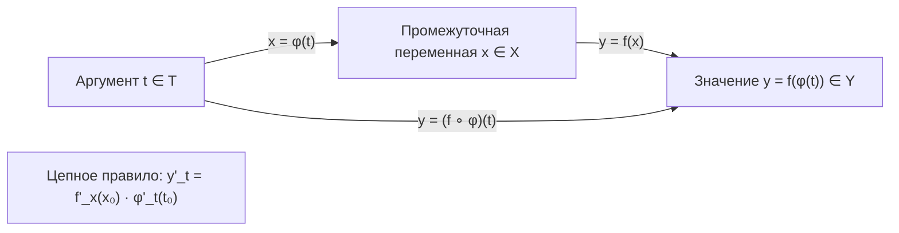
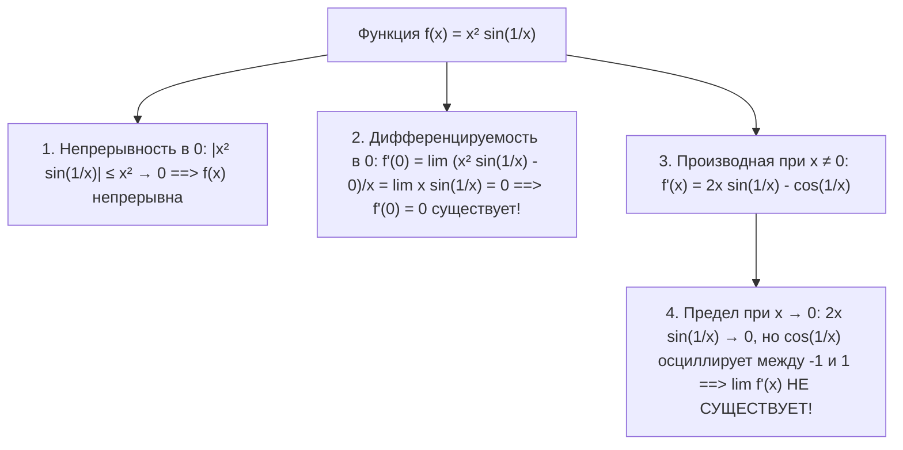
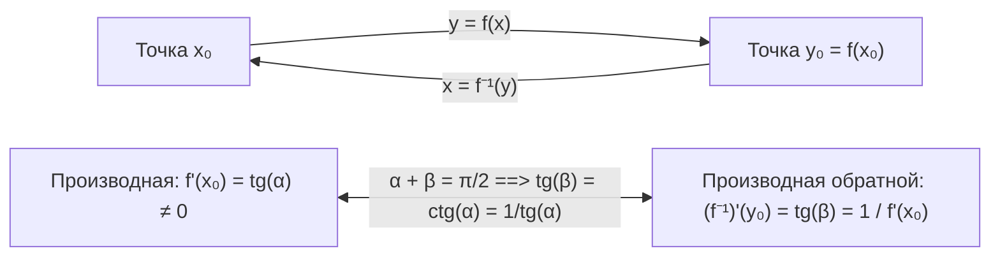
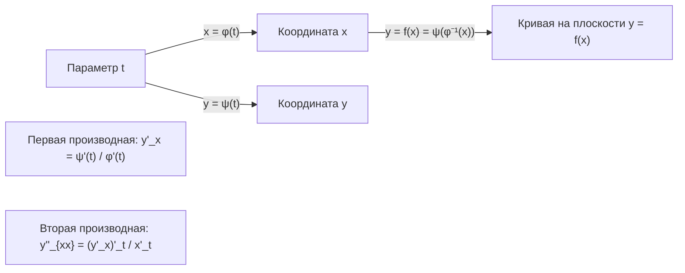

# Лекция 14: Дифференцирование композиции, пример несуществования предела производной, инвариантность формы первого дифференциала, производная обратной функции, дифференцирование параметрических функций

> **Дисциплина**: Математический анализ  
> **Лектор**: ФИТиП (ИС), Университет ИТМО (Осенний семестр 2026)  
> **Ключевые темы**: Теорема о производной композиции (сложной функции, цепное правило / Chain Rule: $(f \circ \phi)'(t_0) = f'(x_0) \cdot \phi'(t_0)$), строгое доказательство через непрерывное продолжение приращения $\alpha(\Delta x)$ (корректный учет возможности $\Delta x = 0$), классический контрпример функции, дифференцируемой во всех точках, но производная которой терпит разрыв второго рода и не имеет предела ($f(x) = x^2 \sin(1/x)$ при $x \ne 0$, $f(0) = 0$; $\lim_{x \to 0} f'(x)$ не существует), различие между классами $D$ (дифференцируемые функции) и $C^1$ (непрерывно дифференцируемые функции), теорема Дарбу о промежуточных значениях производной, инвариантность формы первого дифференциала ($dy = f'(x) dx$ для независимой переменной и для промежуточной функции), геометрический смысл инвариантности формы, неинвариантность дифференциалов второго и высших порядков ($d^2 y = f''(x) dx^2 + f'(x) d^2 x$), производная обратной функции, теорема о существовании и дифференцируемости обратной функции ($(f^{-1})'(y_0) = \frac{1}{f'(x_0)}$ при строгой монотонности, непрерывности и $f'(x_0) \ne 0$), строгое доказательство, геометрический смысл (взаимно дополнительные углы наклона касательной $\operatorname{tg} \beta = 1 / \operatorname{tg} \alpha$), дифференцирование обратных тригонометрических и гиперболических функций, дифференцирование функций, заданных параметрически ($x = \phi(t), y = \psi(t)$), локальная обратимость $x = \phi(t)$, формула первой производной $y'_x = \frac{y'_t}{x'_t} = \frac{\psi'(t)}{\phi'(t)}$, формула второй производной $y''_{xx} = \frac{(y'_x)'_t}{x'_t} = \frac{\psi''(t)\phi'(t) - \psi'(t)\phi''(t)}{(\phi'(t))^3}$, касательные и нормали к параметрическим кривым.

---

## 1. Рекомендуемая литература

* **Г. М. Фихтенгольц — «Курс дифференциального и интегрального исчисления», Том 1**  
  *Глава III: «Производная и дифференциал» (§4: Основные правила дифференцирования — дифференцирование сложной функции; §5: Дифференцирование обратной функции; §6: Дифференциалы высших порядков и неинвариантность; §7: Функции, заданные параметрически).*
* **В. А. Зорич — «Математический анализ», Часть 1**  
  *Глава V: «Дифференциальное исчисление» (§1: Дифференцируемые функции — дифференцирование композиции, дифференцирование обратной функции; §2: Основные теоремы дифференциального исчисления — теорема Дарбу).*
* **Л. Д. Кудрявцев — «Курс математического анализа», Том 1**  
  *Глава 3: «Производная и дифференциал» (§11: Производная сложной и обратной функции; §13: Дифференцирование функций, заданных параметрически).*
* **Б. П. Демидович — «Сборник задач и упражнений по математическому анализу»**  
  *Раздел II: «Дифференциальное исчисление функций одной переменной» (§3: Производная сложной функции; §4: Производная обратной функции; §6: Производные функций, заданных параметрически).*

---

## 2. Производная композиции (Сложная функция / Chain Rule)

Пусть заданы две функции:
$$x = \phi(t), \quad \phi: T \to X \subseteq \mathbb{R}$$
$$y = f(x), \quad f: X \to Y \subseteq \mathbb{R}$$
Тогда на множестве $T$ определена их композиция (суперпозиция, сложная функция):
$$y = (f \circ \phi)(t) = f(\phi(t))$$

> [!IMPORTANT] **Теорема 1 (О дифференцировании композиции / Chain Rule)**  
> Пусть функция $x = \phi(t)$ дифференцируема в точке $t_0 \in T$, а функция $y = f(x)$ дифференцируема в соответствующей точке $x_0 = \phi(t_0) \in X$.  
> Тогда сложная функция $y = F(t) = f(\phi(t))$ дифференцируема в точке $t_0$, и её производная вычисляется по формуле:
> $$F'(t_0) = (f \circ \phi)'(t_0) = f'(x_0) \cdot \phi'(t_0) = f'(\phi(t_0)) \cdot \phi'(t_0)$$
> В краткой форме Лейбница:
> $$\frac{dy}{dt} = \frac{dy}{dx} \cdot \frac{dx}{dt}$$

### Строгое доказательство теоремы:
> [!WARNING] **Предостережение от наивного доказательства**  
> Часто пытаются записать:
> $$\frac{\Delta y}{\Delta t} = \frac{\Delta y}{\Delta x} \cdot \frac{\Delta x}{\Delta t} \xrightarrow[\Delta t \to 0]{} f'(x_0) \cdot \phi'(t_0)$$
> Это рассуждение **не строго и ошибочно в общем случае**, поскольку в сколь угодно малой проколотой окрестности точки $t_0$ приращение $\Delta x = \phi(t_0 + \Delta t) - \phi(t_0)$ может обращаться в ноль (например, если $\phi(t) \equiv \operatorname{const}$ или $\phi(t) = t^2 \sin(1/t)$), что приводит к делению на ноль!

Для строгого доказательства воспользуемся определением дифференцируемости функции $f$ в точке $x_0$.  
Приращение $\Delta y = f(x_0 + \Delta x) - f(x_0)$ представимо в виде:
$$\Delta y = f'(x_0) \Delta x + \alpha(\Delta x) \cdot \Delta x$$
где функция $\alpha(\Delta x) \to 0$ при $\Delta x \to 0$.  
Доопределим функцию $\alpha$ в нуле, положив $\alpha(0) = 0$. Тогда равенство:
$$\Delta y = [f'(x_0) + \alpha(\Delta x)] \cdot \Delta x$$
выполняется **абсолютно при всех $\Delta x$**, в том числе и при $\Delta x = 0$ (так как при $\Delta x = 0$ обе части тождественно равны нулю: $0 = [f'(x_0) + 0] \cdot 0$). При этом функция $\alpha(\Delta x)$ непрерывна в точке $\Delta x = 0$.

Разделим обе части на приращение аргумента $\Delta t \ne 0$:
$$\frac{\Delta y}{\Delta t} = [f'(x_0) + \alpha(\Delta x)] \cdot \frac{\Delta x}{\Delta t}$$

Перейдем к пределу при $\Delta t \to 0$:
1. Поскольку функция $\phi(t)$ дифференцируема в $t_0$, она непрерывна в $t_0$, следовательно:
   $$\lim_{\Delta t \to 0} \Delta x = \lim_{\Delta t \to 0} [\phi(t_0 + \Delta t) - \phi(t_0)] = 0$$
2. В силу непрерывности функции $\alpha$ в нуле:
   $$\lim_{\Delta t \to 0} \alpha(\Delta x) = \alpha(0) = 0$$
3. Так как $\phi$ дифференцируема в $t_0$:
   $$\lim_{\Delta t \to 0} \frac{\Delta x}{\Delta t} = \phi'(t_0)$$

Применяя теоремы об арифметических свойствах пределов:
$$\lim_{\Delta t \to 0} \frac{\Delta y}{\Delta t} = \lim_{\Delta t \to 0} [f'(x_0) + \alpha(\Delta x)] \cdot \lim_{\Delta t \to 0} \frac{\Delta x}{\Delta t} = [f'(x_0) + 0] \cdot \phi'(t_0) = f'(x_0) \cdot \phi'(t_0)$$
Предел существует, конечен и равен $f'(x_0) \phi'(t_0)$. Теорема полностью доказана. $\blacksquare$

---

## 3. Пример функции, имеющей производную во всех точках, но производная которой не имеет предела

Фундаментальный вопрос математического анализа: **обязана ли производная дифференцируемой функции быть непрерывной?**  
Ответ: **нет!** Существуют функции, дифференцируемые на всей числовой прямой $\mathbb{R}$, производная которых имеет точки разрыва второго рода (неустранимые бесконечные осцилляции).

Рассмотрим классический пример:
$$f(x) = \begin{cases} x^2 \sin\left(\dfrac{1}{x}\right), & x \ne 0 \\ 0, & x = 0 \end{cases}$$

### Подробное аналитическое исследование:

1. **Непрерывность в точке $x = 0$**:  
   Так как $|\sin(1/x)| \le 1$, выполнена оценка:
   $$0 \le |f(x)| \le x^2 \xrightarrow[x \to 0]{} 0$$
   По теореме о зажатой функции (о двух милиционерах), $\lim_{x \to 0} f(x) = 0 = f(0)$. Функция непрерывна в нуле.

2. **Вычисление производной в точке $x = 0$ по определению**:  
   Применим определение производной через предел отношения приращений:
   $$f'(0) = \lim_{\Delta x \to 0} \frac{f(0 + \Delta x) - f(0)}{\Delta x} = \lim_{\Delta x \to 0} \frac{\Delta x^2 \sin\left(\frac{1}{\Delta x}\right) - 0}{\Delta x} = \lim_{\Delta x \to 0} \Delta x \sin\left(\frac{1}{\Delta x}\right)$$
   Поскольку $|\Delta x \sin(1/\Delta x)| \le |\Delta x| \to 0$, произведение бесконечно малой на ограниченную есть бесконечно малая:
   $$f'(0) = 0$$
   Таким образом, **производная в точке 0 существует и равна 0**!

3. **Вычисление производной при $x \ne 0$**:  
   При $x \ne 0$ функция представляет собой композицию и произведение элементарных функций. По стандартным правилам дифференцирования:
   $$f'(x) = (x^2)' \sin\left(\frac{1}{x}\right) + x^2 \left(\sin\left(\frac{1}{x}\right)\right)' = 2x \sin\left(\frac{1}{x}\right) + x^2 \cos\left(\frac{1}{x}\right) \cdot \left(-\frac{1}{x^2}\right)$$
   $$f'(x) = 2x \sin\left(\frac{1}{x}\right) - \cos\left(\frac{1}{x}\right)$$

4. **Исследование поведения производной при $x \to 0$**:  
   Рассмотрим предел $\lim_{x \to 0} f'(x)$:
   * Первое слагаемое: $\lim_{x \to 0} 2x \sin(1/x) = 0$ (бесконечно малая на ограниченную).
   * Второе слагаемое: $\lim_{x \to 0} \cos(1/x)$ **не существует**! При приближении к нулю аргумент $1/x \to \infty$, и косинус бесконечно часто осциллирует между $-1$ и $1$.  
     Действительно, выбрав две последовательности:
     $$x_n = \frac{1}{2\pi n} \to 0 \implies \cos\left(\frac{1}{x_n}\right) = \cos(2\pi n) = 1 \implies f'(x_n) \to -1$$
     $$x'_n = \frac{1}{\pi + 2\pi n} \to 0 \implies \cos\left(\frac{1}{x'_n}\right) = \cos(\pi + 2\pi n) = -1 \implies f'(x'_n) \to 1$$
   Следовательно, предел $\lim_{x \to 0} f'(x)$ **не существует**!

> [!IMPORTANT] **Глубокий теоретический вывод**  
> * Функция $f(x)$ дифференцируема во **всех** точках числовой прямой $\mathbb{R}$: её производная определена всюду:
>   $$f'(x) = \begin{cases} 2x \sin\left(\dfrac{1}{x}\right) - \cos\left(\dfrac{1}{x}\right), & x \ne 0 \\ 0, & x = 0 \end{cases}$$
> * Однако производная $f'(x)$ **разрывна в точке $x = 0$** (разрыв второго рода).  
> * Это доказывает строгое включение классов функций:
>   $$C^1(\mathbb{R}) \subsetneq D(\mathbb{R})$$
>   Класс непрерывно дифференцируемых функций $C^1$ является строгим подмножеством класса дифференцируемых функций $D$.

> [!NOTE] **Теорема Дарбу о промежуточных значениях производной**  
> Хотя производная $f'(x)$ может быть разрывной, её разрыв не может быть произвольным (например, производная **не может иметь разрывов первого рода — скачков**!).  
> **Теорема Дарбу**: Если функция $f$ дифференцируема на отрезке $[a, b]$, то её производная $f'(x)$ принимает **все промежуточные значения** между $f'(a)$ и $f'(b)$. То есть образ отрезка при отображении производной всегда является связным множеством (интервалом/отрезком).

---

## 4. Инвариантность формы первого дифференциала

На лекции 13 было введено понятие первого дифференциала функции $y = f(x)$:
$$dy = f'(x) \Delta x = f'(x) dx$$
где для независимой переменной $x$ дифференциал по определению совпадает с её приращением: $dx = \Delta x$.

Возникает фундаментальный вопрос: сохранится ли эта запись, если переменная $x$ сама перестает быть независимой, а является функцией от другого параметра $t$: $x = \phi(t)$?

> [!IMPORTANT] **Теорема 2 (Инвариантность формы первого дифференциала)**  
> Форма первого дифференциала:
> $$dy = f'(x) dx$$
> сохраняет свой вид независимо от того, является ли аргумент $x$ независимой переменной или дифференцируемой функцией другого аргумента $t$.

### Строгое доказательство:
1. **Случай 1: $x$ — независимая переменная**.  
   По определению дифференциала: $dx = \Delta x$, следовательно:
   $$dy = f'(x) dx$$
2. **Случай 2: $x = \phi(t)$ — функция от $t$**.  
   Тогда $y = f(\phi(t))$ — сложная функция от независимой переменной $t$.  
   По определению дифференциала функции по независимой переменной $t$:
   $$dy = y'_t \cdot dt$$
   По теореме о производной композиции (Теорема 1):
   $$y'_t = f'(x) \cdot \phi'(t) = f'(x) \cdot x'_t$$
   Подставляем это выражение в формулу дифференциала:
   $$dy = [f'(x) \cdot x'_t] \cdot dt = f'(x) \cdot [x'_t dt]$$
   Но величина $x'_t dt$ по определению есть не что иное, как дифференциал функции $x = \phi(t)$:
   $$dx = x'_t dt = \phi'(t) dt$$
   Следовательно:
   $$dy = f'(x) dx$$
Формула имеет в точности тот же самый вид! $\blacksquare$

### Неинвариантность дифференциалов высших порядков
> [!CAUTION] **Свойство инвариантности формы справедливо ТОЛЬКО для первого дифференциала!**  
> Для дифференциалов второго и более высоких порядков инвариантность формы **нарушается**.

Действительно, пусть $x$ — независимая переменная. Тогда $dx = \operatorname{const}$, $d(dx) = d^2 x = 0$, и:
$$d^2 y = d(dy) = d(f'(x) dx) = (f'(x))' dx \cdot dx = f''(x) dx^2$$

Если же $x = \phi(t)$ — функция, то $dx = \phi'(t) dt$ уже не является константой, и его дифференциал $d(dx) = d^2 x = \phi''(t) dt^2 \ne 0$.  
Дифференцируя $dy = f'(x) dx$ по правилу Лейбница для произведения:
$$d^2 y = d(f'(x) dx) = d(f'(x)) \cdot dx + f'(x) \cdot d(dx) = f''(x) dx^2 + f'(x) d^2 x$$

В формуле появилось дополнительное слагаемое $f'(x) d^2 x$!  
Таким образом, форма $d^2 y = f''(x) dx^2$ **не инвариантна**.

---

## 5. Производная обратной функции

Пусть функция $y = f(x)$ определена, строго монотонна (строго возрастает или строго убывает) и непрерывна в окрестности $U(x_0)$ точки $x_0$.  
Тогда по теореме о существовании и непрерывности обратной функции (Лекция 12), в окрестности точки $y_0 = f(x_0)$ определена однозначная, строго монотонная и непрерывная обратная функция:
$$x = f^{-1}(y)$$

> [!IMPORTANT] **Теорема 3 (О производной обратной функции)**  
> Пусть функция $y = f(x)$ строго монотонна и непрерывна в окрестности точки $x_0$, дифференцируема в точке $x_0$, и её производная отлична от нуля:
> $$f'(x_0) \ne 0$$
> Тогда обратная функция $x = g(y) = f^{-1}(y)$ дифференцируема в точке $y_0 = f(x_0)$, и её производная равна обратной величине производной прямой функции:
> $$(f^{-1})'(y_0) = \frac{1}{f'(x_0)} = \frac{1}{f'(f^{-1}(y_0))}$$
> В обозначениях Лейбница:
> $$\frac{dx}{dy} = \frac{1}{\dfrac{dy}{dx}}$$

### Строгое доказательство теоремы:
1. Зададим аргументу $y$ обратной функции приращение $\Delta y \ne 0$, такое что $y_0 + \Delta y$ лежит в окрестности точки $y_0$.
2. Этому приращению соответствует приращение аргумента $x$:
   $$\Delta x = f^{-1}(y_0 + \Delta y) - f^{-1}(y_0) = f^{-1}(y_0 + \Delta y) - x_0$$
3. Так как функция $f^{-1}$ строго монотонна, разным значениям аргумента соответствуют разные значения функции. Поэтому:
   $$\Delta y \ne 0 \implies \Delta x \ne 0$$
4. Рассмотрим отношение приращений для обратной функции:
   $$\frac{\Delta x}{\Delta y} = \frac{1}{\dfrac{\Delta y}{\Delta x}}$$
   Это равенство абсолютно законно, так как $\Delta x \ne 0$ и $\Delta y \ne 0$.
5. Устремим $\Delta y \to 0$.  
   Поскольку обратная функция $x = f^{-1}(y)$ непрерывна в точке $y_0$:
   $$\lim_{\Delta y \to 0} \Delta x = \lim_{\Delta y \to 0} [f^{-1}(y_0 + \Delta y) - f^{-1}(y_0)] = 0$$
6. Так как прямая функция $f$ дифференцируема в $x_0$ и её производная $f'(x_0) \ne 0$:
   $$\lim_{\Delta x \to 0} \frac{\Delta y}{\Delta x} = f'(x_0) \ne 0$$
7. По теореме о пределе частного:
   $$(f^{-1})'(y_0) = \lim_{\Delta y \to 0} \frac{\Delta x}{\Delta y} = \lim_{\Delta x \to 0} \frac{1}{\dfrac{\Delta y}{\Delta x}} = \frac{1}{\lim\limits_{\Delta x \to 0} \dfrac{\Delta y}{\Delta x}} = \frac{1}{f'(x_0)}$$
Теорема полностью доказана. $\blacksquare$

### Геометрический смысл:
График обратной функции $x = f^{-1}(y)$ получается из графика прямой функции $y = f(x)$ зеркальным отражением относительно биссектрисы первого и третьего координатных углов ($y = x$).  
Касательная к графику $y = f(x)$ образует угол $\alpha$ с осью $Ox$, так что $f'(x_0) = \operatorname{tg} \alpha$.  
Та же самая касательная прямая образует угол $\beta$ с осью $Oy$, причем $\alpha + \beta = \frac{\pi}{2}$.  
Производная обратной функции по определению равна тангенсу угла наклона к оси $Oy$:
$$(f^{-1})'(y_0) = \operatorname{tg} \beta = \operatorname{tg}\left(\frac{\pi}{2} - \alpha\right) = \operatorname{ctg} \alpha = \frac{1}{\operatorname{tg} \alpha} = \frac{1}{f'(x_0)}$$

---

## 6. Применение: Вывод производных обратных функций

С помощью теоремы об обратной функции выводятся производные фундаментальных функций:

### 1. Производная арксинуса: $y = \arcsin x$ ($x \in (-1, 1)$)
Прямая функция: $x = \sin y$, где $y \in \left(-\frac{\pi}{2}, \frac{\pi}{2}\right)$.  
Производная прямой функции: $x'_y = (\sin y)' = \cos y$.  
Так как $y \in (-\pi/2, \pi/2)$, $\cos y > 0$, поэтому $\cos y = \sqrt{1 - \sin^2 y} = \sqrt{1 - x^2}$.  
По теореме об обратной функции:
$$(\arcsin x)' = \frac{1}{x'_y} = \frac{1}{\cos y} = \frac{1}{\sqrt{1 - x^2}}$$

### 2. Производная арктангенса: $y = \operatorname{arctg} x$ ($x \in \mathbb{R}$)
Прямая функция: $x = \operatorname{tg} y$, где $y \in \left(-\frac{\pi}{2}, \frac{\pi}{2}\right)$.  
Производная прямой функции: $x'_y = \frac{1}{\cos^2 y} = 1 + \operatorname{tg}^2 y = 1 + x^2$.  
По теореме об обратной функции:
$$(\operatorname{arctg} x)' = \frac{1}{x'_y} = \frac{1}{1 + x^2}$$

### 3. Производная натурального логарифма: $y = \ln x$ ($x > 0$)
Прямая функция: $x = e^y$.  
Производная прямой функции: $x'_y = (e^y)' = e^y = x$.  
$$(\ln x)' = \frac{1}{x'_y} = \frac{1}{e^y} = \frac{1}{x}$$

---

## 7. Дифференцирование функций, заданных параметрически

Кривая на плоскости часто задается кинематически с помощью параметра $t$ (времени):
$$\begin{cases} x = \phi(t) \\ y = \psi(t) \end{cases}, \qquad t \in (\alpha, \beta)$$

> [!IMPORTANT] **Теорема 4 (О дифференцировании параметрической функции)**  
> Пусть функции $x = \phi(t)$ и $y = \psi(t)$ дифференцируемы в точке $t_0$, причем:
> 1. $\phi'(t_0) \ne 0$.
> 2. Функция $\phi(t)$ строго монотонна и непрерывна в некоторой окрестности точки $t_0$.  
> 
> Тогда в окрестности точки $x_0 = \phi(t_0)$ определена однозначная дифференцируемая функция $y = f(x)$, и её первая производная вычисляется по формуле:
> $$y'_x(x_0) = \frac{y'_t(t_0)}{x'_t(t_0)} = \frac{\psi'(t_0)}{\phi'(t_0)}$$

#### Доказательство:
1. Так как $\phi(t)$ строго монотонна и непрерывна в окрестности $t_0$, по теореме об обратной функции существует обратная функция $t = \phi^{-1}(x)$, определенная в окрестности точки $x_0 = \phi(t_0)$.  
   Она дифференцируема в точке $x_0$, и её производная равна:
   $$(\phi^{-1})'(x_0) = \frac{1}{\phi'(t_0)}$$
2. Подставим $t = \phi^{-1}(x)$ в уравнение для $y$:
   $$y = f(x) = \psi(\phi^{-1}(x))$$
3. Функция $f(x)$ представляет собой композицию дифференцируемых функций. По теореме о производной сложной функции (Теорема 1):
   $$y'_x(x_0) = \psi'(t_0) \cdot (\phi^{-1})'(x_0) = \psi'(t_0) \cdot \frac{1}{\phi'(t_0)} = \frac{\psi'(t_0)}{\phi'(t_0)}$$
Что и требовалось доказать. $\blacksquare$

---

### Вторая производная параметрически заданной функции

Найдем вторую производную $y''_{xx} = \frac{d^2 y}{dx^2}$.  
По определению, вторая производная по $x$ есть производная от первой производной $y'_x$ по переменной $x$:
$$y''_{xx} = (y'_x)'_x$$
Величина $y'_x = \frac{\psi'(t)}{\phi'(t)}$ является функцией параметра $t$.  
Применяя теорему о дифференцировании параметрической функции к функции $z(t) = y'_x(t)$:
$$y''_{xx} = \frac{(y'_x)'_t}{x'_t} = \frac{\dfrac{d}{dt}\left(\dfrac{\psi'(t)}{\phi'(t)}\right)}{\phi'(t)}$$

Дифференцируя дробь по правилу частного:
$$\frac{d}{dt}\left(\frac{\psi'(t)}{\phi'(t)}\right) = \frac{\psi''(t)\phi'(t) - \psi'(t)\phi''(t)}{(\phi'(t))^2}$$
Деля на $x'_t = \phi'(t)$, получаем окончательную строгую формулу:

> [!IMPORTANT] **Формула второй производной параметрической функции**  
> $$y''_{xx} = \frac{\psi''(t)\phi'(t) - \psi'(t)\phi''(t)}{(\phi'(t))^3} = \frac{y''_{tt} x'_t - y'_t x''_{tt}}{(x'_t)^3}$$

> [!CAUTION] **Грубейшая ошибка**  
> Категорически запрещено считать, что $y''_{xx} = \frac{y''_{tt}}{x''_{tt}}$! В знаменателе всегда стоит куб первой производной $(x'_t)^3$, а в числителе — дифференциальный определитель Вронского $\begin{vmatrix} \psi'' & \phi'' \\ \psi' & \phi' \end{vmatrix}$.

---

## 8. Касательная и нормаль к параметрической кривой

Пусть кривая задана параметрически: $x = \phi(t), y = \psi(t)$.  
В точке $M_0(x_0, y_0) = (\phi(t_0), \psi(t_0))$ угловой коэффициент касательной равен значению первой производной:
$$k = y'_x(x_0) = \frac{\psi'(t_0)}{\phi'(t_0)}$$

1. **Уравнение касательной прямой**:
   $$y - y_0 = y'_x(x_0) (x - x_0) \iff y - \psi(t_0) = \frac{\psi'(t_0)}{\phi'(t_0)} (x - \phi(t_0))$$
   или в канонической симметричной векторной форме:
   $$\frac{x - \phi(t_0)}{\phi'(t_0)} = \frac{y - \psi(t_0)}{\psi'(t_0)}$$
   Направляющим вектором касательной прямой является вектор скорости:
   $$\vec{v}(t_0) = (\phi'(t_0), \; \psi'(t_0))$$

2. **Уравнение нормали** (прямой, перпендикулярной касательной):
   $$y - y_0 = -\frac{1}{y'_x(x_0)} (x - x_0) \iff \phi'(t_0)(x - \phi(t_0)) + \psi'(t_0)(y - \psi(t_0)) = 0$$

---

## 9. Резюме лекции

1. **Производная сложной функции (Chain Rule)**: $(f \circ \phi)'(t) = f'(x) \cdot \phi'(t)$. Доказывается через формулу приращения $\Delta y = [f'(x_0) + \alpha(\Delta x)] \Delta x$, непрерывно продолженную в точку $\Delta x = 0$.
2. **Разрывность производной**: Функция $f(x) = x^2 \sin(1/x)$ ($f(0) = 0$) дифференцируема во всех точках $\mathbb{R}$ ($f'(0) = 0$), но $\lim_{x \to 0} f'(x)$ не существует. Это доказывает строгое включение $C^1 \subsetneq D$. По теореме Дарбу производная не может иметь разрывов со скачками (первого рода).
3. **Инвариантность формы первого дифференциала**: $dy = f'(x) dx$ справедливо как для независимой переменной, так и для функции $x = \phi(t)$. Для старших дифференциалов ($d^2 y$) инвариантность нарушается из-за появления слагаемого $f'(x) d^2 x$.
4. **Производная обратной функции**: $(f^{-1})'(y_0) = \frac{1}{f'(x_0)}$ при условии строгой монотонности, непрерывности и $f'(x_0) \ne 0$. Геометрически отражает взаимную перпендикулярность проекций касательной: $\operatorname{tg} \beta = 1 / \operatorname{tg} \alpha$.
5. **Дифференцирование параметрических функций**:
   $$y'_x = \frac{y'_t}{x'_t}, \qquad y''_{xx} = \frac{y''_{tt} x'_t - y'_t x''_{tt}}{(x'_t)^3}$$
   Вектор скорости $(\phi'(t), \psi'(t))$ служит направляющим вектором касательной прямой к кривой.
