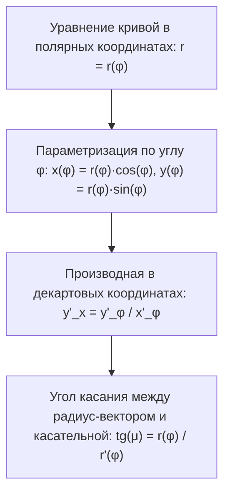
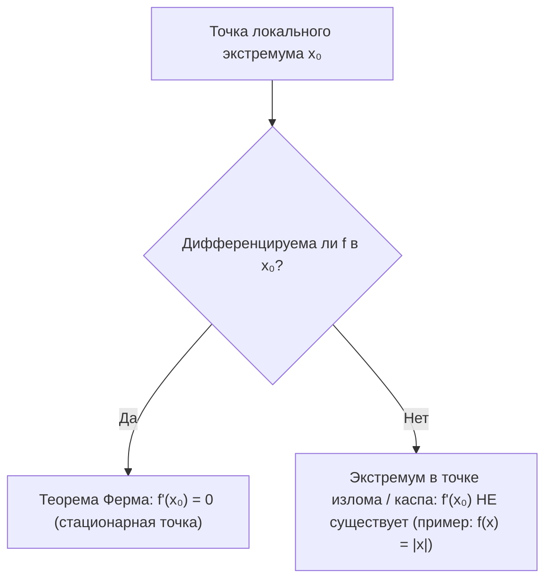
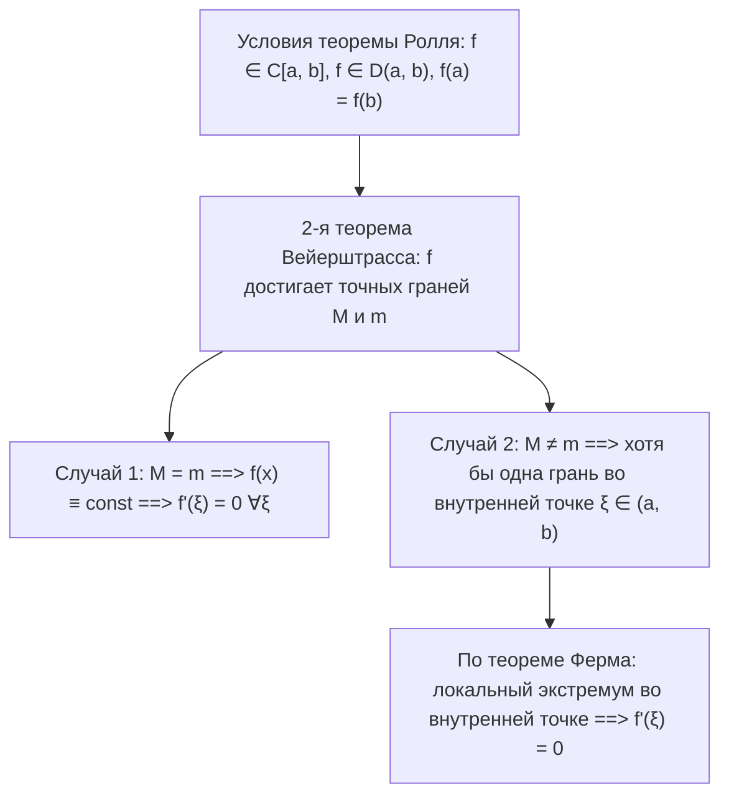
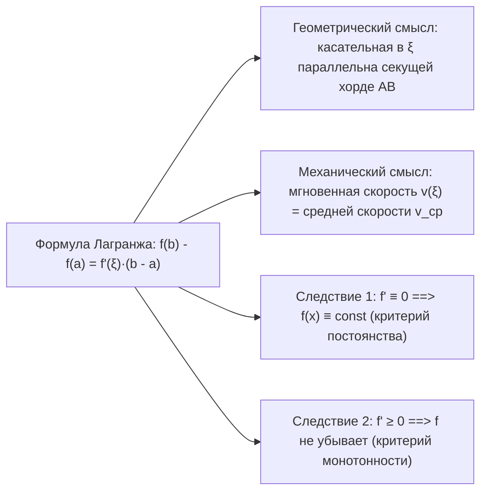

# Лекция 15: Дифференцирование в полярных координатах, угол касания, локальные экстремумы, теоремы Ферма, Ролля и Лагранжа

> **Дисциплина**: Математический анализ  
> **Лектор**: ФИТиП (ИС), Университет ИТМО (Осенний семестр 2026)  
> **Ключевые темы**: Полярная система координат (полюс $O$, полярная ось, полярный радиус $r \ge 0$, полярный угол $\phi$), параметрическое представление кривой в полярных координатах ($x = r(\phi) \cos\phi, y = r(\phi) \sin\phi$), теорема о производной $y'_x$ в полярных координатах ($y'_x = \frac{r' \sin\phi + r \cos\phi}{r' \cos\phi - r \sin\phi}$), геометрический угол касания $\mu$ (угол между радиус-вектором и касательной прямой), строгий вывод фундаментальной формулы $\operatorname{tg} \mu = \frac{r(\phi)}{r'(\phi)}$ через формулу вычитания углов для тангенса, логарифмическая спираль ($r = a e^{k\phi}$) как равноугольная кривая (spira mirabilis), локальные экстремумы функции (строгий и нестрогий локальный максимум и минимум), теорема Ферма о равенстве нулю производной в точке дифференцируемого локального экстремума ($f'(x_0) = 0$), строгое доказательство теоремы Ферма через односторонние пределы отношений приращений, геометрический смысл (горизонтальная касательная), критические (стационарные) точки, недостаточность условия Ферма (контрпример $f(x) = x^3$) и экстремумы в точках недифференцируемости (контрпример $f(x) = |x|$), теорема Ролля о нуле производной, строгое доказательство теоремы Ролля через вторую теорему Вейерштрасса о достижении точных граней $M$ и $m$, геометрический смысл и критичность условий гладкости, теорема Лагранжа о конечном приращении (формула конечных приращений $f(b) - f(a) = f'(\xi)(b - a)$), строгое доказательство теоремы Лагранжа через вспомогательную функцию и теорему Ролля, геометрический смысл (параллельность касательной и хорды), механический смысл (совпадение мгновенной скорости со средней скоростью), фундаментальные следствия формулы Лагранжа: критерий постоянства функции на промежутке ($f'(x) \equiv 0 \iff f(x) \equiv C$), критерии монотонности функций ($f'(x) \ge 0 \iff$ не убывает; $f'(x) > 0 \implies$ строго возрастает).

---

> [!TIP] Практика и домашнее задание к лекции
> Материалы домашнего задания с подробными решениями и задачами для самопроверки:
> - 📝 [ДЗ Матан лекция 15.md](./%D0%94%D0%97%20%D0%9C%D0%B0%D1%82%D0%B0%D0%BD%20%D0%BB%D0%B5%D0%BA%D1%86%D0%B8%D1%8F%2015.md)

---

## 1. Рекомендуемая литература

* **Г. М. Фихтенгольц — «Курс дифференциального и интегрального исчисления», Том 1**  
  *Глава III: «Производная и дифференциал» (§7: Функции в полярных координатах, угол касания); Глава IV: «Основные теоремы дифференциального исчисления» (§1: Теорема Ферма; §2: Теорема Ролля; §3: Теорема Лагранжа и формула конечных приращений).*
* **В. А. Зорич — «Математический анализ», Часть 1**  
  *Глава V: «Дифференциальное исчисление» (§2: Основные теоремы дифференциального исчисления — лемма Ферма, теоремы Ролля и Лагранжа, монотонность функций).*
* **Л. Д. Кудрявцев — «Курс математического анализа», Том 1**  
  *Глава 3: «Производная и дифференциал» (§14: Теоремы о среднем для дифференцируемых функций — теоремы Ферма, Ролля, Лагранжа).*
* **Б. П. Демидович — «Сборник задач и упражнений по математическому анализу»**  
  *Раздел II: «Дифференциальное исчисление» (§5: Геометрические приложения производной в полярных координатах; §7: Теоремы Ролля, Лагранжа и исследование монотонности).*

---

## 2. Дифференцирование функций в полярных координатах

Полярная система координат на плоскости определяется точкой $O$ (**полюс**) и исходящим из неё лучом $Ox$ (**полярная ось**).  
Положение любой точки $M \ne O$ однозначно задается парой чисел $(r, \phi)$:
* $r = |OM| \ge 0$ — **полярный радиус** (расстояние от полюса до точки).
* $\phi \in [0, 2\pi)$ (или $\phi \in (-\pi, \pi]$) — **полярный угол** (угол между полярной осью и вектором $\vec{OM}$, отсчитываемый против часовой стрелки).

Связь между полярными $(r, \phi)$ и декартовыми прямоугольными $(x, y)$ координатами выражается формулами:
$$\begin{cases} x = r \cos\phi \\ y = r \sin\phi \end{cases}$$

### 2.1. Уравнение кривой и производная $y'_x$
Пусть кривая на плоскости задана уравнением в полярных координатах:
$$r = r(\phi), \qquad \phi \in (\alpha, \beta)$$
Подставляя функцию $r(\phi)$ в формулы перехода, получаем **параметрическое задание кривой**, где роль вещественного параметра играет полярный угол $\phi$:
$$\begin{cases} x(\phi) = r(\phi) \cos\phi \\ y(\phi) = r(\phi) \sin\phi \end{cases}$$

Дифференцируя функции $x(\phi)$ и $y(\phi)$ по параметру $\phi$ по правилу произведения:
$$x'_\phi = r'(\phi) \cos\phi - r(\phi) \sin\phi$$
$$y'_\phi = r'(\phi) \sin\phi + r(\phi) \cos\phi$$

> [!IMPORTANT] **Теорема 1 (О производной функции в полярных координатах)**  
> Пусть функция $r(\phi)$ дифференцируема в точке $\phi_0$, и $x'_\phi(\phi_0) \ne 0$.  
> Тогда в окрестности точки $x_0 = r(\phi_0) \cos\phi_0$ определена однозначная дифференцируемая функция $y = f(x)$, и угловой коэффициент её касательной $k = \operatorname{tg} \alpha = y'_x$ вычисляется по формуле:
> $$y'_x = \frac{y'_\phi}{x'_\phi} = \frac{r'(\phi) \sin\phi + r(\phi) \cos\phi}{r'(\phi) \cos\phi - r(\phi) \sin\phi}$$

---

### 2.2. Геометрический угол касания $\mu$ (Угол между радиус-вектором и касательной)
Угловой коэффициент $y'_x = \operatorname{tg} \alpha$ задает угол наклона касательной прямой к декартовой оси абсцисс $Ox$.  
Однако в полярных координатах гораздо более естественной и инвариантной геометрической характеристикой является **угол $\mu$**, образованный касательной прямой к кривой в точке $M$ и продолжением радиус-вектора $\vec{OM}$.

Рассмотрим треугольник, образованный полярной осью $Ox$, радиус-вектором $\vec{OM}$ и касательной прямой.  
Внешний угол треугольника равен сумме двух внутренних не смежных с ним углов:
$$\alpha = \phi + \mu \iff \mu = \alpha - \phi$$

> [!IMPORTANT] **Теорема 2 (Фундаментальная формула для угла касания)**  
> Тангенс угла $\mu$ между радиус-вектором точки и касательной к кривой $r = r(\phi)$ выражается исключительно простой формулой:
> $$\operatorname{tg} \mu = \frac{r(\phi)}{r'(\phi)}$$

#### Строгое геометрическое и аналитическое доказательство:
Применим тригонометрическую формулу тангенса разности углов к равенству $\mu = \alpha - \phi$:
$$\operatorname{tg} \mu = \operatorname{tg}(\alpha - \phi) = \frac{\operatorname{tg} \alpha - \operatorname{tg} \phi}{1 + \operatorname{tg} \alpha \cdot \operatorname{tg} \phi}$$
Подставим в эту формулу $\operatorname{tg} \alpha = y'_x = \frac{y'_\phi}{x'_\phi}$ и $\operatorname{tg} \phi = \frac{\sin\phi}{\cos\phi}$:
$$\operatorname{tg} \mu = \frac{\dfrac{y'_\phi}{x'_\phi} - \dfrac{\sin\phi}{\cos\phi}}{1 + \dfrac{y'_\phi}{x'_\phi} \cdot \dfrac{\sin\phi}{\cos\phi}} = \frac{y'_\phi \cos\phi - x'_\phi \sin\phi}{x'_\phi \cos\phi + y'_\phi \sin\phi}$$

Теперь аккуратно подставим выражения для производных $x'_\phi$ и $y'_\phi$:
1. **Числитель**:
   $$\begin{aligned}
   y'_\phi \cos\phi - x'_\phi \sin\phi &= (r' \sin\phi + r \cos\phi) \cos\phi - (r' \cos\phi - r \sin\phi) \sin\phi \\
   &= r' \sin\phi \cos\phi + r \cos^2\phi - r' \cos\phi \sin\phi + r \sin^2\phi \\
   &= r (\cos^2\phi + \sin^2\phi) = r(\phi)
   \end{aligned}$$
2. **Знаменатель**:
   $$\begin{aligned}
   x'_\phi \cos\phi + y'_\phi \sin\phi &= (r' \cos\phi - r \sin\phi) \cos\phi + (r' \sin\phi + r \cos\phi) \sin\phi \\
   &= r' \cos^2\phi - r \sin\phi \cos\phi + r' \sin^2\phi + r \cos\phi \sin\phi \\
   &= r' (\cos^2\phi + \sin^2\phi) = r'(\phi)
   \end{aligned}$$

Разделив преобразованный числитель на знаменатель, получаем точное тождество:
$$\operatorname{tg} \mu = \frac{r(\phi)}{r'(\phi)}$$
Теорема полностью доказана! $\blacksquare$

---

### 2.3. Классический пример: Логарифмическая спираль
Рассмотрим кривую, заданную уравнением:
$$r(\phi) = a e^{k \phi}, \qquad a > 0, \; k \ne 0$$
Вычислим производную по полярному углу:
$$r'(\phi) = a k e^{k \phi} = k \cdot r(\phi)$$
Применим формулу угла касания:
$$\operatorname{tg} \mu = \frac{r(\phi)}{r'(\phi)} = \frac{r(\phi)}{k \cdot r(\phi)} = \frac{1}{k} = \operatorname{const}$$

> [!NOTE] **Spira mirabilis (Чудесная спираль Якоба Бернулли)**  
> Тангенс угла касания $\operatorname{tg} \mu = \frac{1}{k}$ постоянен во всех точках кривой! Это означает, что **касательная пересекает радиус-вектор под одним и тем же постоянным углом $\mu = \operatorname{arctg}(1/k)$ во всех точках спирали**.  
> По этой причине логарифмическая спираль называется **равноугольной спиралью**. По такой траектории движутся ночные насекомые на свет, закручиваются рукава спиральных галактик и раковины моллюсков *Nautilus*.

---

## 3. Локальные экстремумы функций

Пусть функция $f: E \to \mathbb{R}$ определена на множестве $E \subseteq \mathbb{R}$, и $x_0 \in E$ — внутренняя точка множества $E$.

> [!IMPORTANT] **Определение 1 (Локальные экстремумы)**  
> * Точка $x_0$ называется **точкой строгого локального максимума** функции $f$, если существует такая проколотая окрестность $\dot{U}(x_0) = (x_0 - \delta, x_0 + \delta) \setminus \{x_0\}$, что:
>   $$\forall x \in \dot{U}(x_0) : \quad f(x) < f(x_0)$$
> * Точка $x_0$ называется **точкой строгого локального минимума** функции $f$, если:
>   $$\forall x \in \dot{U}(x_0) : \quad f(x) > f(x_0)$$
> * Если в неравенствах допускается нестрогий знак ($f(x) \le f(x_0)$ или $f(x) \ge f(x_0)$), то точка называется точкой **нестрогого локального максимума (минимума)**.
> * Точки локальных максимумов и минимумов объединяются общим термином — **точки локального экстремума**.

---

## 4. Теорема Ферма (Необходимое условие экстремума)

> [!IMPORTANT] **Теорема 3 (Пьер де Ферма, 1638 — Необходимое условие экстремума)**  
> Пусть функция $f(x)$ определена в некоторой окрестности точки $x_0$, принимает в этой точке локальный экстремум (максимум или минимум) и **дифференцируема в точке $x_0$**.  
> Тогда производная функции в этой точке равна нулю:
> $$f'(x_0) = 0$$

### Строгое доказательство:
Для определенности предположим, что $x_0$ — точка локального максимума (для минимума доказательство проводится аналогично).  
1. По определению локального максимума, существует такая $\delta$-окрестность точки $x_0$, что для любого смещения $\Delta x \in (-\delta, \delta)$ выполнено неравенство:
   $$f(x_0 + \Delta x) \le f(x_0) \implies \Delta f = f(x_0 + \Delta x) - f(x_0) \le 0$$
2. Рассмотрим отношение приращений $\frac{\Delta f}{\Delta x}$:
   * **Случай $\Delta x > 0$** (приближение справа):  
     Так как числитель $\Delta f \le 0$, а знаменатель $\Delta x > 0$, получаем:
     $$\frac{\Delta f}{\Delta x} \le 0$$
     Переходя к пределу при $\Delta x \to +0$, по теореме о сохранении знака в нестрогом пределе:
     $$f'_+(x_0) = \lim_{\Delta x \to +0} \frac{\Delta f}{\Delta x} \le 0$$
   * **Случай $\Delta x < 0$** (приближение слева):  
     Числитель $\Delta f \le 0$, а знаменатель $\Delta x < 0$. Деление отрицательного на отрицательное дает неотрицательную дробь:
     $$\frac{\Delta f}{\Delta x} \ge 0$$
     Переходя к пределу при $\Delta x \to -0$:
     $$f'_-(x_0) = \lim_{\Delta x \to -0} \frac{\Delta f}{\Delta x} \ge 0$$
3. По условию теоремы функция $f$ дифференцируема в точке $x_0$.  
   Следовательно, односторонние производные существуют и совпадают с двусторонней производной:
   $$f'_-(x_0) = f'_+(x_0) = f'(x_0)$$
4. Совмещая неравенства $f'(x_0) \ge 0$ и $f'(x_0) \le 0$, получаем единственную возможность:
   $$f'(x_0) = 0$$
Теорема полностью доказана. $\blacksquare$

### Геометрический смысл теоремы Ферма
В точке дифференцируемого локального экстремума касательная к графику функции параллельна оси абсцисс $Ox$ (**горизонтальная касательная**).

### Предостережения: Стационарные и критические точки
> [!WARNING] **Условие $f'(x_0) = 0$ является лишь необходимым, но НЕ достаточным!**  
> 1. **Стационарная точка без экстремума**: Для функции $f(x) = x^3$ производная $f'(0) = 3(0)^2 = 0$. Однако в точке $x = 0$ экстремума нет: при $x < 0$ значения $x^3 < 0$, а при $x > 0$ значения $x^3 > 0$. Точка $x = 0$ является точкой перегиба.  
> 2. **Экстремум без равенства нулю производной**: Функция $f(x) = |x|$ имеет строгий глобальный минимум в точке $x = 0$ ($f(0) = 0 < |x|$ для всех $x \ne 0$). Однако $f'(0)$ не существует ($f'_-(0) = -1 \ne f'_+(0) = 1$). Теорема Ферма не применима, так как нарушено условие дифференцируемости!

---

## 5. Теорема Ролля (О нуле производной)

> [!IMPORTANT] **Теорема 4 (Мишель Ролль, 1691 — О нуле производной)**  
> Пусть функция $f(x)$ удовлетворяет трем условиям:
> 1. Непрерывна на замкнутом отрезке $[a, b]$ ($f \in C[a, b]$).
> 2. Дифференцируема на открытом интервале $(a, b)$ ($f \in D(a, b)$).
> 3. Принимает равные значения на концах отрезка:
>    $$f(a) = f(b)$$
> 
> Тогда внутри интервала существует хотя бы одна точка $\xi \in (a, b)$, в которой производная обращается в ноль:
> $$f'(\xi) = 0$$

### Строгое доказательство:
1. Так как функция $f$ непрерывна на компактном отрезке $[a, b]$, по **второй теореме Вейерштрасса** она достигает на этом отрезке своего точного максимума $M$ и точного минимума $m$:
   $$M = \max_{x \in [a, b]} f(x), \qquad m = \min_{x \in [a, b]} f(x)$$
2. Возможны два взаимно исключающих случая:
   * **Случай 1: $M = m$**.  
     Тогда для всех $x \in [a, b]$ выполнено $m \le f(x) \le M \implies f(x) \equiv M = \operatorname{const}$.  
     Производная постоянной функции тождественно равна нулю на всём интервале:
     $$f'(x) = 0 \quad \forall x \in (a, b)$$
     В качестве точки $\xi$ можно выбрать абсолютно любую точку интервала $(a, b)$.
   * **Случай 2: $M > m$**.  
     Поскольку по условию $f(a) = f(b)$, функция не может принимать оба экстремальных значения $M$ и $m$ исключительно на концах отрезка $\{a, b\}$.  
     Следовательно, хотя бы одно из значений $M$ или $m$ достигается в некоторой **внутренней точке** $\xi \in (a, b)$.  
     Тогда в точке $\xi$ функция принимает локальный экстремум.  
     Так как по условию функция дифференцируема во всех точках интервала $(a, b)$, она дифференцируема и в точке $\xi$.  
     Применяя **теорему Ферма**, заключаем:
     $$f'(\xi) = 0$$
Теорема полностью доказана. $\blacksquare$

### Критичность условий теоремы Ролля
Ни одно из трех условий теоремы Ролля нельзя отбросить:
* **Нарушение непрерывности на концах**: Функция $f(x) = x$ при $x \in [0, 1)$ и $f(1) = 0$. Условия $f(0) = f(1) = 0$ и дифференцируемость на $(0, 1)$ выполнены, но $f'(x) = 1 \ne 0$ всюду.
* **Нарушение дифференцируемости внутри**: Функция $f(x) = |x|$ на отрезке $[-1, 1]$. Непрерывна, $f(-1) = f(1) = 1$, но в точке $x = 0$ производной нет, и $f'(x) = \pm 1 \ne 0$.
* **Нарушение $f(a) = f(b)$**: Функция $f(x) = x$ на $[0, 1]$. Непрерывна и дифференцируема, но $f(0) \ne f(1)$, и $f'(x) = 1 \ne 0$.

---

## 6. Теорема Лагранжа о конечном приращении (Формула конечных приращений)

Теорема Ролля требует жесткого ограничения $f(a) = f(b)$. Великий французский математик **Жозеф Луи Лагранж** в 1797 году снял это ограничение, получив фундаментальнейшую теорему всего дифференциального исчисления.

> [!IMPORTANT] **Теорема 5 (Теорема Лагранжа о среднем значении)**  
> Пусть функция $f(x)$:
> 1. Непрерывна на замкнутом отрезке $[a, b]$ ($f \in C[a, b]$).
> 2. Дифференцируема на открытом интервале $(a, b)$ ($f \in D(a, b)$).
> 
> Тогда существует хотя бы одна промежуточная точка $\xi \in (a, b)$, такая что:
> $$f(b) - f(a) = f'(\xi)(b - a) \iff \frac{f(b) - f(a)}{b - a} = f'(\xi)$$

### Строгое аналитическое доказательство:
Рассмотрим секущую прямую, проходящую через концы графика функции $A(a, f(a))$ и $B(b, f(b))$.  
Её уравнение:
$$y = f(a) + \frac{f(b) - f(a)}{b - a}(x - a)$$

Введем вспомогательную функцию $F(x)$, равную вертикальному отклонению графика функции $f(x)$ от хорды $AB$:
$$F(x) = f(x) - f(a) - \frac{f(b) - f(a)}{b - a}(x - a)$$

Проверим для функции $F(x)$ выполнение всех трех условий теоремы Ролля:
1. $F(x)$ непрерывна на $[a, b]$ как разность непрерывной функции $f(x)$ и линейной функции.
2. $F(x)$ дифференцируема на $(a, b)$, причем:
   $$F'(x) = f'(x) - \frac{f(b) - f(a)}{b - a}$$
3. Проверим значения на концах отрезка:
   * $F(a) = f(a) - f(a) - 0 = 0$.
   * $F(b) = f(b) - f(a) - \frac{f(b) - f(a)}{b - a}(b - a) = f(b) - f(a) - (f(b) - f(a)) = 0$.  
   Следовательно, $F(a) = F(b) = 0$.

Все условия теоремы Ролля выполнены!  
По теореме Ролля существует точка $\xi \in (a, b)$, в которой:
$$F'(\xi) = 0 \iff f'(\xi) - \frac{f(b) - f(a)}{b - a} = 0$$
Откуда мгновенно следует:
$$\frac{f(b) - f(a)}{b - a} = f'(\xi) \iff f(b) - f(a) = f'(\xi)(b - a)$$
Теорема Лагранжа полностью доказана! $\blacksquare$

---

### Геометрический и механический смысл формулы Лагранжа
1. **Геометрический смысл**: Дробь $\frac{f(b) - f(a)}{b - a}$ равна угловому коэффициенту хорды $AB$. Значение $f'(\xi)$ равно угловому коэффициенту касательной к графику в точке $(\xi, f(\xi))$.  
   Теорема утверждает, что **на дуге гладкой кривой найдется точка, касательная в которой строго параллельна стягивающей хорде**.
2. **Механический смысл**: Если материальная точка движется прямолинейно по закону $s = f(t)$, то $\frac{f(b) - f(a)}{b - a}$ — это средняя скорость за промежуток времени $[a, b]$.  
   Теорема гарантирует, что **в некоторый промежуточный момент времени $\xi$ мгновенная скорость спидометра $v(\xi) = f'(\xi)$ в точности равнялась средней скорости пути**.

---

## 7. Фундаментальные следствия формулы Лагранжа

Формула Лагранжа является «золотым мостом», позволяющим по свойствам производной (локальной скорости) делать строгие глобальные выводы о поведении самой функции на всём промежутке!

### 7.1. Критерий постоянства функции
> [!IMPORTANT] **Следствие 1 (Критерий постоянства)**  
> Пусть функция $f$ непрерывна на промежутке $\langle a, b \rangle$ и во всех внутренних точках её производная равна нулю: $f'(x) = 0$.  
> Тогда функция $f$ тождественно постоянна на всём промежутке:
> $$f(x) \equiv C = \operatorname{const}$$

*Доказательство*: Зафиксируем произвольную точку $x_0 \in \langle a, b \rangle$. Для любой другой точки $x \in \langle a, b \rangle$ применим формулу Лагранжа на отрезке между $x_0$ и $x$:
$$f(x) - f(x_0) = f'(\xi)(x - x_0)$$
Поскольку $f'(\xi) = 0$, получаем $f(x) - f(x_0) = 0 \implies f(x) = f(x_0) = C$.

---

### 7.2. Критерий монотонности функции
> [!IMPORTANT] **Следствие 2 (Критерий монотонности функции)**  
> Пусть функция $f$ непрерывна на $[a, b]$ и дифференцируема на $(a, b)$.  
> 1. Функция $f(x)$ **не убывает** на $[a, b] \iff f'(x) \ge 0$ для всех $x \in (a, b)$.  
> 2. Функция $f(x)$ **не возрастает** на $[a, b] \iff f'(x) \le 0$ для всех $x \in (a, b)$.  
> 3. Если $f'(x) > 0$ всюду на $(a, b)$ (кроме, быть может, конечного числа изолированных точек), то функция $f(x)$ **строго возрастает** на $[a, b]$.

*Доказательство*: Пусть $x_1 < x_2$ — произвольные точки из $[a, b]$.  
По формуле Лагранжа на отрезке $[x_1, x_2]$:
$$f(x_2) - f(x_1) = f'(\xi)(x_2 - x_1), \qquad \xi \in (x_1, x_2)$$
Так как $x_2 - x_1 > 0$, знак разности $f(x_2) - f(x_1)$ полностью определяется знаком производной $f'(\xi)$:
* Если $f'(\xi) \ge 0$, то $f(x_2) \ge f(x_1)$ (функция не убывает).
* Если $f'(\xi) > 0$, то $f(x_2) > f(x_1)$ (функция строго возрастает).

---

## 8. Резюме лекции

1. **Полярные координаты**: Кривая $r = r(\phi)$ параметризуется как $x = r(\phi) \cos\phi, y = r(\phi) \sin\phi$. Производная:
   $$y'_x = \frac{r'(\phi) \sin\phi + r(\phi) \cos\phi}{r'(\phi) \cos\phi - r(\phi) \sin\phi}$$
2. **Угол касания $\mu$**: Угол между радиус-вектором и касательной задается формулой $\operatorname{tg} \mu = \frac{r(\phi)}{r'(\phi)}$. Для логарифмической спиSpiral $r = a e^{k\phi}$ угол $\mu = \operatorname{const}$ (равноугольная спираль).
3. **Теорема Ферма**: В точке дифференцируемого локального экстремума $f'(x_0) = 0$. Условие необходимо, но не достаточно (стационарные точки перегиба, недифференцируемые пики).
4. **Теорема Ролля**: Если $f \in C[a, b]$, $f \in D(a, b)$ и $f(a) = f(b)$, то $\exists \xi \in (a, b) : f'(\xi) = 0$. Доказывается через достижение точных граней Вейерштрасса.
5. **Теорема Лагранжа**: $f(b) - f(a) = f'(\xi)(b - a)$. Связывает приращение функции с мгновенной производной. Гарантирует параллельность касательной и секущей хорды.
6. **Следствия Лагранжа**: Доказывают фундаментальные критерии постоянства ($f' \equiv 0 \iff f \equiv C$) и монотонности ($f' \ge 0 \iff$ монотонное возрастание).

---

## Практика и домашнее задание к лекции
- 📝 [ДЗ Матан лекция 15.md](./%D0%94%D0%97%20%D0%9C%D0%B0%D1%82%D0%B0%D0%BD%20%D0%BB%D0%B5%D0%BA%D1%86%D0%B8%D1%8F%2015.md)
