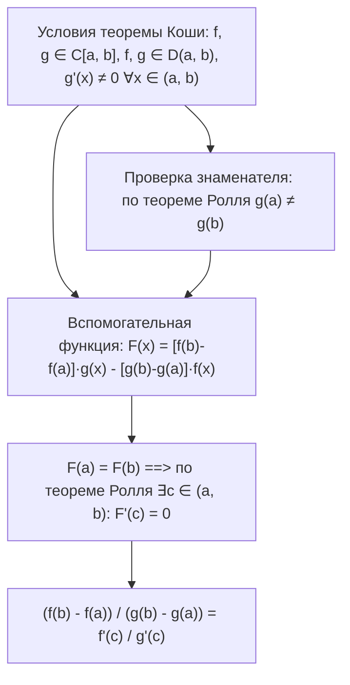
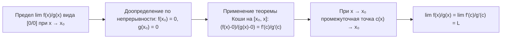

# Лекция 16: Теорема Коши о среднем, правило Лопиталя, производные высших порядков, формула Лейбница и формула Тейлора

> **Дисциплина**: Математический анализ  
> **Лектор**: ФИТиП (ИС), Университет ИТМО (Осенний семестр 2026)  
> **Ключевые темы**: Обобщенная теорема о среднем (теорема Коши о конечном приращении: $\frac{f(b) - f(a)}{g(b) - g(a)} = \frac{f'(c)}{g'(c)}$), строгое доказательство через вспомогательную функцию $F(x)$ и теорему Ролля, геометрический и механический смысл теоремы Коши (синхронизация скоростей в параметрическом движении), критерий постоянства функции ($f'(x) \equiv 0 \iff f(x) \equiv C$), критерии монотонности функций, правило Лопиталя для раскрытия неопределенностей вида $[0/0]$ и $[\infty/\infty]$, строгое доказательство правила Лопиталя через теорему Коши, сведение степенно-показательных неопределенностей $[1^\infty], [0^0], [\infty^0]$ и неопределенностей $[0 \cdot \infty], [\infty - \infty]$ к базовому виду, границы применимости правила Лопиталя и классические контрпримеры (несуществование предела производных при существующем пределе функций), производные высших порядков, индуктивное определение $f^{(n)}(x) = (f^{(n-1)}(x))'$, $n$-е производные основных элементарных функций ($e^{kx}, \sin x, \cos x, \ln x, x^\alpha$), формула Лейбница для $n$-й производной произведения $(u \cdot v)^{(n)} = \sum_{k=0}^n \binom{n}{k} u^{(n-k)} v^{(k)}$ со строгим доказательством по индукции, дифференциалы высших порядков ($d^n y = f^{(n)}(x) dx^n$), формула Тейлора, многочлен Тейлора степени $n$, формула Тейлора с остаточным членом в форме Пеано ($f(x) = \sum_{k=0}^n \frac{f^{(k)}(x_0)}{k!} (x - x_0)^k + o((x - x_0)^n)$), строгое доказательство формулы Пеано через правило Лопиталя, стандартные разложения Маклорена ($x_0 = 0$) функций $e^x, \sin x, \cos x, \ln(1+x), (1+x)^\alpha$, асимптотический анализ и вычисление пределов.

---

## 1. Рекомендуемая литература

* **Г. М. Фихтенгольц — «Курс дифференциального и интегрального исчисления», Том 1**  
  *Глава IV: «Основные теоремы дифференциального исчисления» (§4: Теорема Коши; §5: Раскрытие неопределенностей — правило Лопиталя; §6: Производные и дифференциалы высших порядков, формула Лейбница); Глава V: «Формула Тейлора» (§1: Формула Тейлора; §2: Разложение элементарных функций; §3: Применение к вычислению пределов).*
* **В. А. Зорич — «Математический анализ», Часть 1**  
  *Глава V: «Дифференциальное исчисление» (§2: Теорема Коши и правило Лопиталя; §3: Производные высших порядков, формула Тейлора с остатком в форме Пеано и Лагранжа).*
* **Л. Д. Кудрявцев — «Курс математического анализа», Том 1**  
  *Глава 3: «Производная и дифференциал» (§14: Теорема Коши; §15: Правило Лопиталя; §16: Формула Тейлора).*
* **Б. П. Демидович — «Сборник задач и упражнений по математическому анализу»**  
  *Раздел II: «Дифференциальное исчисление» (§8: Правило Лопиталя; §9: Формула Тейлора; §10: Производные высших порядков).*

---

## 2. Теорема Коши о конечном приращении (Обобщенная теорема о среднем)

Теорема Лагранжа связывает приращение одной функции с её производной. Французский математик **Огюстен Луи Коши** обобщил этот результат на случай отношения приращений **двух** функций, что лежит в основе аналитического аппарата вычисления пределов.

> [!IMPORTANT] **Теорема 1 (Огюстен Коши, 1821 — Обобщенная теорема о среднем)**  
> Пусть функции $f(x)$ и $g(x)$ удовлетворяют следующим условиям:
> 1. Обе функции непрерывны на замкнутом отрезке $[a, b]$ ($f, g \in C[a, b]$).
> 2. Обе функции дифференцируемы на открытом интервале $(a, b)$ ($f, g \in D(a, b)$).
> 3. Производная $g'(x)$ не обращается в ноль ни в одной точке интервала $(a, b)$:
>    $$g'(x) \ne 0 \quad \forall x \in (a, b)$$
> 
> Тогда:
> 1. Разность на концах $g(b) - g(a) \ne 0$ (знаменатель отличен от нуля).
> 2. Внутри интервала существует хотя бы одна точка $c \in (a, b)$, такая что:
>    $$\frac{f(b) - f(a)}{g(b) - g(a)} = \frac{f'(c)}{g'(c)}$$

### Строгое доказательство теоремы Коши:
1. **Шаг 1: Доказательство того, что $g(b) \ne g(a)$**.  
   Предположим от противного, что $g(b) = g(a)$.  
   Тогда для функции $g(x)$ на отрезке $[a, b]$ выполнены все условия теоремы Ролля (Лекция 15). По теореме Ролля должна существовать точка $\xi \in (a, b)$, в которой $g'(\xi) = 0$.  
   Однако по условию $g'(x) \ne 0$ всюду на $(a, b)$. Противоречие! Следовательно:
   $$g(b) - g(a) \ne 0$$
   Деление на разность $g(b) - g(a)$ абсолютно законно.
2. **Шаг 2: Введение вспомогательной функции**.  
   По аналогии с доказательством теоремы Лагранжа, введем функцию:
   $$F(x) = [f(b) - f(a)] \cdot g(x) - [g(b) - g(a)] \cdot f(x)$$
3. **Шаг 3: Проверка условий теоремы Ролля для $F(x)$**:  
   * $F(x)$ непрерывна на $[a, b]$ как линейная комбинация непрерывных функций $f$ и $g$.
   * $F(x)$ дифференцируема на $(a, b)$, и её производная равна:
     $$F'(x) = [f(b) - f(a)] \cdot g'(x) - [g(b) - g(a)] \cdot f'(x)$$
   * Проверим значения на концах отрезка:
     $$F(a) = [f(b) - f(a)] g(a) - [g(b) - g(a)] f(a) = f(b) g(a) - g(b) f(a)$$
     $$F(b) = [f(b) - f(a)] g(b) - [g(b) - g(a)] f(b) = -f(a) g(b) + g(a) f(b) = f(b) g(a) - g(b) f(a)$$
     Значения совпадают: $F(a) = F(b)$!
4. **Шаг 4: Применение теоремы Ролля**:  
   По теореме Ролля существует точка $c \in (a, b)$, такая что:
   $$F'(c) = 0 \iff [f(b) - f(a)] \cdot g'(c) - [g(b) - g(a)] \cdot f'(c) = 0$$
   Разделив обе части на $[g(b) - g(a)] \cdot g'(c) \ne 0$, получаем:
   $$\frac{f(b) - f(a)}{g(b) - g(a)} = \frac{f'(c)}{g'(c)}$$
Теорема Коши полностью доказана. $\blacksquare$

> [!NOTE] **Теорема Лагранжа как частный случай теоремы Коши**  
> Если положить функцию $g(x) = x$, то $g'(x) = 1$, $g(b) - g(a) = b - a$, и формула Коши превращается в классическую формулу Лагранжа: $\frac{f(b) - f(a)}{b - a} = f'(c)$.

---

### Геометрический и механический смысл теоремы Коши
1. **Геометрический смысл**: Пусть кривая на плоскости задана параметрически: $x = g(t), y = f(t)$ при $t \in [a, b]$.  
   Тогда $\frac{f(b) - f(a)}{g(b) - g(a)} = \frac{\Delta y}{\Delta x}$ — это угловой коэффициент секущей хорды, соединяющей начальную точку $A(g(a), f(a))$ и конечную точку $B(g(b), f(b))$.  
   Величина $\frac{f'(c)}{g'(c)} = y'_x(c)$ — это угловой коэффициент касательной к кривой в момент времени $t = c$.  
   Теорема Коши утверждает, что **на дуге гладкой параметрической кривой существует точка, касательная в которой строго параллельна хорде $AB$**.
2. **Механический смысл («Синхронизация скоростей»)**: Пусть две материальные точки движутся вдоль параллельных осей по законам $y = f(t)$ и $x = g(t)$. Отношение перемещений за весь период времени точно равно отношению мгновенных скоростей точек в некоторый промежуточный момент времени $c$.

---

## 3. Правило Лопиталя (Раскрытие неопределенностей)

Маркиз **Гийом де Лопиталь** в 1696 году опубликовал первый в истории печатный учебник по дифференциальному исчислению («Анализ бесконечно малых»), куда включил метод раскрытия неопределенностей, открытый его учителем Иоганном Бернулли.

### 3.1. Базовая теорема Лопиталя для неопределенности вида $[0/0]$
> [!IMPORTANT] **Теорема 2 (Правило Лопиталя для $[0/0]$)**  
> Пусть функции $f(x)$ и $g(x)$ удовлетворяют следующим условиям:
> 1. Обе функции определены и дифференцируемы в некоторой проколотой окрестности $\dot{U}(x_0) = (x_0 - \delta, x_0 + \delta) \setminus \{x_0\}$ точки $x_0$.
> 2. При приближении к точке $x_0$ обе функции являются бесконечно малыми:
>    $$\lim_{x \to x_0} f(x) = 0 \quad \text{и} \quad \lim_{x \to x_0} g(x) = 0$$
> 3. Производная $g'(x) \ne 0$ для всех $x \in \dot{U}(x_0)$.
> 4. Существует конечный или бесконечный предел отношения производных:
>    $$\lim_{x \to x_0} \frac{f'(x)}{g'(x)} = L \qquad (L \in \mathbb{R} \cup \{-\infty, +\infty\})$$
> 
> Тогда существует предел отношения самих функций, и он равен $L$:
> $$\lim_{x \to x_0} \frac{f(x)}{g(x)} = \lim_{x \to x_0} \frac{f'(x)}{g'(x)} = L$$

### Строгое доказательство:
1. Функции $f$ и $g$ априори могут быть не определены в самой точке $x_0$.  
   Доопределим их в точке $x_0$, положив:
   $$f(x_0) = 0, \qquad g(x_0) = 0$$
   Так как $\lim_{x \to x_0} f(x) = 0 = f(x_0)$ и $\lim_{x \to x_0} g(x) = 0 = g(x_0)$, доопределенные функции стали **непрерывными в точке $x_0$**.
2. Возьмем произвольную точку $x \in \dot{U}(x_0)$.  
   На замкнутом отрезке с концами $x_0$ и $x$ обе функции $f$ и $g$ непрерывны, а внутри интервала между ними дифференцируемы, причем $g'(t) \ne 0$.  
   Все условия теоремы Коши (Теорема 1) выполнены!
3. По теореме Коши между точками $x_0$ и $x$ существует промежуточная точка $c = c(x)$, такая что:
   $$\frac{f(x) - f(x_0)}{g(x) - g(x_0)} = \frac{f'(c)}{g'(c)}$$
   Подставляя $f(x_0) = 0$ и $g(x_0) = 0$, получаем тождество:
   $$\frac{f(x)}{g(x)} = \frac{f'(c)}{g'(c)}$$
4. Устремим $x \to x_0$. Поскольку точка $c$ лежит строго между $x_0$ и $x$:
   $$|c - x_0| < |x - x_0| \implies c \to x_0 \quad \text{при } x \to x_0$$
5. По условию 4 теоремы, предел отношения производных равен $L$:
   $$\lim_{x \to x_0} \frac{f'(x)}{g'(x)} = L \implies \lim_{c \to x_0} \frac{f'(c)}{g'(c)} = L$$
6. Следовательно:
   $$\lim_{x \to x_0} \frac{f(x)}{g(x)} = \lim_{x \to x_0} \frac{f'(c)}{g'(c)} = L$$
Теорема полностью доказана. $\blacksquare$

---

### 3.2. Расширения правила Лопиталя
* **Неопределенность вида $[\infty/\infty]$**: Теорема остается справедливой, если $\lim_{x \to x_0} |f(x)| = \infty$ и $\lim_{x \to x_0} |g(x)| = \infty$.
* **Предел на бесконечности ($x \to \infty$ или $x \to \pm\infty$)**: Заменой переменной $t = \frac{1}{x} \to 0$ предел сводится к точке $0$.
* **Многократное применение**: Если после дифференцирования отношение $\frac{f'(x)}{g'(x)}$ снова дает неопределенность $[0/0]$ или $[\infty/\infty]$, правило Лопиталя можно применять повторно:
  $$\lim \frac{f(x)}{g(x)} = \lim \frac{f'(x)}{g'(x)} = \lim \frac{f''(x)}{g''(x)} = \dots$$

---

### 3.3. Сведение прочих неопределенностей к базовым
Все другие типы неопределенностей алгебраически преобразуются к виду $[0/0]$ или $[\infty/\infty]$:
1. **Неопределенность $[0 \cdot \infty]$**: Записываем $f \cdot g = \dfrac{f}{1/g}$ (вид $[0/0]$) или $f \cdot g = \dfrac{g}{1/f}$ (вид $[\infty/\infty]$).
2. **Неопределенность $[\infty - \infty]$**: Приводим к общему знаменателю: $f - g = \dfrac{1/g - 1/f}{1/(fg)}$ (вид $[0/0]$).
3. **Степенно-показательные неопределенности $[1^\infty], [0^0], [\infty^0]$**:  
   Логарифмируем выражение:
   $$y = f(x)^{g(x)} \implies \ln y = g(x) \cdot \ln(f(x))$$
   Предел $\lim g(x) \ln f(x)$ имеет вид $[0 \cdot \infty]$. Найдя предел $A = \lim \ln y$, получаем исходный предел:
   $$\lim f(x)^{g(x)} = e^A$$

---

### 3.4. Границы применимости: когда правило Лопиталя бессильно
> [!CAUTION] **Существование предела отношения производных — достаточное, но НЕ необходимое условие!**  
> Если предел отношения производных $\lim \frac{f'(x)}{g'(x)}$ не существует, это **не означает**, что исходный предел $\lim \frac{f(x)}{g(x)}$ не существует!

#### Классический контрпример:
Рассмотрим предел при $x \to \infty$:
$$\lim_{x \to \infty} \frac{x + \sin x}{x}$$
* *Прямое вычисление*: $\frac{x + \sin x}{x} = 1 + \frac{\sin x}{x} \xrightarrow[x \to \infty]{} 1 + 0 = 1$. Предел существует и равен 1!
* *Попытка применить правило Лопиталя*:
  $$\lim_{x \to \infty} \frac{(x + \sin x)'}{(x)'} = \lim_{x \to \infty} \frac{1 + \cos x}{1}$$
  Предел $\lim_{x \to \infty} (1 + \cos x)$ **не существует** из-за бесконечных осцилляций косинуса.  
  *Вывод*: Правило Лопиталя неприменимо, хотя исходный предел легко вычисляется.

---

## 4. Производные высших порядков и формула Лейбница

### 4.1. Определение производных высших порядков
Пусть функция $f(x)$ дифференцируема на интервале $(a, b)$. Её производная $f'(x)$ сама является функцией от $x$.
> [!NOTE] **Определение 1 ($n$-я производная)**  
> **Второй производной** $f''(x)$ (или $f^{(2)}(x)$) называется производная от первой производной:
> $$f''(x) = (f'(x))'$$
> Индуктивно, **производной $n$-го порядка** $f^{(n)}(x)$ называется производная от производной порядка $n-1$:
> $$f^{(n)}(x) = \big( f^{(n-1)}(x) \big)', \qquad n \ge 2$$

#### Таблица $n$-х производных основных функций:
1. $(e^{kx})^{(n)} = k^n e^{kx}$
2. $(\sin x)^{(n)} = \sin\left(x + n \cdot \frac{\pi}{2}\right)$
3. $(\cos x)^{(n)} = \cos\left(x + n \cdot \frac{\pi}{2}\right)$
4. $(x^m)^{(n)} = m(m-1)\cdots(m - n + 1) x^{m - n} = \frac{m!}{(m-n)!} x^{m - n}$ (при $n > m$ производная равна 0)
5. $(\ln x)^{(n)} = \frac{(-1)^{n-1} (n - 1)!}{x^n}$
6. $\left(\frac{1}{x - a}\right)^{(n)} = \frac{(-1)^n n!}{(x - a)^{n+1}}$

---

### 4.2. Формула Лейбница для производной произведения
> [!IMPORTANT] **Теорема 3 (Готфрид Вильгельм Лейбниц, 1695 — Формула Лейбница)**  
> Если функции $u(x)$ и $v(x)$ имеют производные до порядка $n$ включительно, то их произведение $u(x) \cdot v(x)$ также $n$ раз дифференцируемо, и его $n$-я производная вычисляется по формуле:
> $$(u \cdot v)^{(n)} = \sum_{k=0}^n \binom{n}{k} u^{(n-k)} v^{(k)}$$
> где $\binom{n}{k} = \frac{n!}{k!(n-k)!}$ — биномиальные коэффициенты, $u^{(0)} = u, v^{(0)} = v$.

В развернутом виде:
$$(uv)^{(n)} = u^{(n)} v + n u^{(n-1)} v' + \frac{n(n-1)}{2!} u^{(n-2)} v'' + \dots + n u' v^{(n-1)} + u v^{(n)}$$

*Доказательство*: Проводится методом математической индукции по $n$ с использованием тождества для биномиальных коэффициентов $\binom{n}{k} + \binom{n}{k-1} = \binom{n+1}{k}$ абсолютно аналогично биному Ньютона. $\blacksquare$

---

## 5. Формула Тейлора и локальная полиномиальная аппроксимация

Главная задача дифференциального исчисления — приближение сложной нелинейной функции простыми полиномами.  
Дифференциал приближает функцию линейной функцией:
$$f(x) \approx f(x_0) + f'(x_0)(x - x_0)$$
Формула Тейлора обобщает эту идею на приближение **многочленом произвольной степени $n$**!

### 5.1. Многочлен Тейлора
> [!NOTE] **Определение 2 (Многочлен Тейлора)**  
> Многочленом Тейлора степени $n$ функции $f(x)$ в точке $x_0$ называется полином:
> $$P_n(x) = \sum_{k=0}^n \frac{f^{(k)}(x_0)}{k!} (x - x_0)^k = f(x_0) + f'(x_0)(x - x_0) + \frac{f''(x_0)}{2!}(x - x_0)^2 + \dots + \frac{f^{(n)}(x_0)}{n!}(x - x_0)^n$$
> Этот многочлен уникален тем, что в точке $x_0$ все его производные до порядка $n$ в точности совпадают с производными самой функции:
> $$P_n^{(k)}(x_0) = f^{(k)}(x_0), \qquad k = 0, 1, \dots, n$$

---

### 5.2. Формула Тейлора с остаточным членом в форме Пеано
> [!IMPORTANT] **Теорема 4 (Джузеппе Пеано — Формула Тейлора с остатком в форме Пеано)**  
> Пусть функция $f(x)$ имеет в точке $x_0$ производные до порядка $n$ включительно ($n \ge 1$).  
> Тогда при $x \to x_0$ имеет место асимптотическая формула:
> $$f(x) = \sum_{k=0}^n \frac{f^{(k)}(x_0)}{k!} (x - x_0)^k + o\big((x - x_0)^n\big)$$
> где $r_n(x) = o((x - x_0)^n)$ — остаточный член в форме Пеано, удовлетворяющий условию $\lim\limits_{x \to x_0} \frac{r_n(x)}{(x - x_0)^n} = 0$.

#### Строгое доказательство:
Рассмотрим разность $r_n(x) = f(x) - P_n(x)$.  
Требуется доказать, что:
$$\lim_{x \to x_0} \frac{f(x) - P_n(x)}{(x - x_0)^n} = 0$$
1. При $x \to x_0$ числитель и знаменатель стремятся к нулю (неопределенность вида $[0/0]$), так как $P_n(x_0) = f(x_0)$.
2. Применим правило Лопиталя $n-1$ раз.  
   На каждом шаге $k < n$:
   $$\big( (x - x_0)^n \big)^{(k)} = n(n-1)\cdots(n - k + 1) (x - x_0)^{n - k} \xrightarrow[x \to x_0]{} 0$$
   $$(f(x) - P_n(x))^{(k)} = f^{(k)}(x) - P_n^{(k)}(x) \xrightarrow[x \to x_0]{} f^{(k)}(x_0) - f^{(k)}(x_0) = 0$$
3. После $(n-1)$-го дифференцирования получаем предел:
   $$\lim_{x \to x_0} \frac{f^{(n-1)}(x) - P_n^{(n-1)}(x)}{n! \cdot (x - x_0)}$$
4. Заметим, что $P_n^{(n-1)}(x) = f^{(n-1)}(x_0) + f^{(n)}(x_0)(x - x_0)$. Подставляя это:
   $$\lim_{x \to x_0} \frac{f^{(n-1)}(x) - f^{(n-1)}(x_0) - f^{(n)}(x_0)(x - x_0)}{n! \cdot (x - x_0)} = \frac{1}{n!} \left[ \lim_{x \to x_0} \frac{f^{(n-1)}(x) - f^{(n-1)}(x_0)}{x - x_0} - f^{(n)}(x_0) \right]$$
5. По определению первой производной от $f^{(n-1)}$:
   $$\lim_{x \to x_0} \frac{f^{(n-1)}(x) - f^{(n-1)}(x_0)}{x - x_0} = \big( f^{(n-1)} \big)'(x_0) = f^{(n)}(x_0)$$
6. Следовательно, выражение в квадратных скобках равно $f^{(n)}(x_0) - f^{(n)}(x_0) = 0$!  
   Предел равен нулю, что и доказывает, что остаток равен $o((x - x_0)^n)$. $\blacksquare$

---

### 5.3. Пять фундаментальных разложений Маклорена ($x_0 = 0$)
Формула Тейлора при $x_0 = 0$ называется **формулой Маклорена**:
1. $$e^x = 1 + x + \frac{x^2}{2!} + \frac{x^3}{3!} + \dots + \frac{x^n}{n!} + o(x^n)$$
2. $$\sin x = x - \frac{x^3}{3!} + \frac{x^5}{5!} - \dots + (-1)^{m-1} \frac{x^{2m-1}}{(2m-1)!} + o(x^{2m})$$
3. $$\cos x = 1 - \frac{x^2}{2!} + \frac{x^4}{4!} - \dots + (-1)^m \frac{x^{2m}}{(2m)!} + o(x^{2m+1})$$
4. $$\ln(1 + x) = x - \frac{x^2}{2} + \frac{x^3}{3} - \dots + (-1)^{n-1} \frac{x^n}{n} + o(x^n)$$
5. $$(1 + x)^\alpha = 1 + \alpha x + \frac{\alpha(\alpha - 1)}{2!} x^2 + \dots + \frac{\alpha(\alpha - 1)\cdots(\alpha - n + 1)}{n!} x^n + o(x^n)$$

---

## 6. Резюме лекции

1. **Теорема Коши о среднем**: $\frac{f(b) - f(a)}{g(b) - g(a)} = \frac{f'(c)}{g'(c)}$. Обобщает теорему Лагранжа и моделирует отношение скоростей в параметрическом движении.
2. **Правило Лопиталя**: Позволяет раскрывать неопределенности $[0/0]$ и $[\infty/\infty]$ переходом к пределу отношения производных $\lim \frac{f'(x)}{g'(x)}$. Все остальные неопределенности ($0 \cdot \infty, \infty - \infty, 1^\infty, 0^0, \infty^0$) сводятся к ним.
3. **Производные высших порядков**: Определяются рекурсивно. Для произведения функций действует **формула Лейбница** $(uv)^{(n)} = \sum_{k=0}^n \binom{n}{k} u^{(n-k)} v^{(k)}$.
4. **Формула Тейлора**: Дает полиномиальную аппроксимацию функции с точностью до $o((x - x_0)^n)$. Является мощнейшим аппаратом для вычисления сложных пределов и асимптотического анализа.
