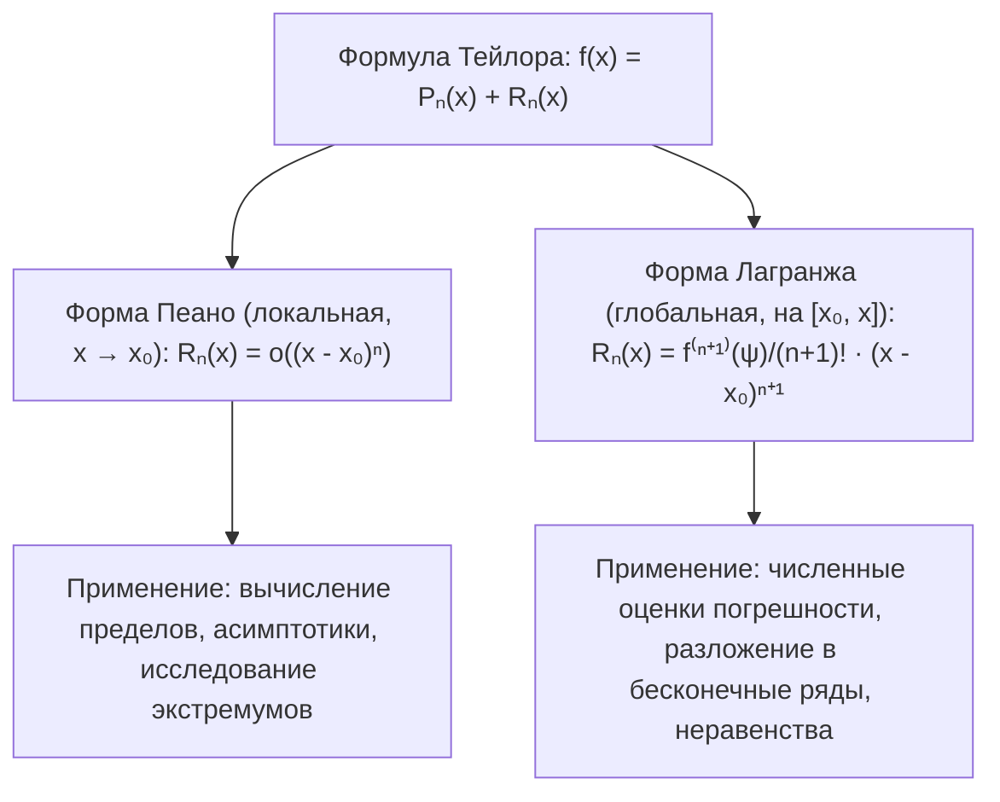

# Лекция 17: Формула Тейлора — дифференциальная запись, остатки в формах Пеано и Лагранжа, единственность и классические разложения Маклорена

> **Дисциплина**: Математический анализ  
> **Лектор**: ФИТиП (ИС), Университет ИТМО (Осенний семестр 2026)  
> **Ключевые темы**: Многочлен Тейлора через производные и через дифференциалы высших порядков ($P_n(x) = \sum_{k=0}^n \frac{d^k f(x_0)}{k!}$), теорема Пеано об остаточном члене $R_n(x) = o((x - x_0)^n)$ (локальная форма) со строгим доказательством, теорема о единственности многочлена Тейлора (разложение $f(x) = Q_n(x) + o((x-x_0)^n) \implies Q_n \equiv P_n$) с доказательством, классические разложения по формуле Маклорена ($e^x, \sin x, \cos x, \operatorname{sh} x, \operatorname{ch} x, \ln(1+x), (1+x)^\alpha, \frac{1}{1-x}, \operatorname{arctg} x, \operatorname{tg} x$), алгоритмы построения разложений сложных функций (суперпозиция, произведение, частное, отсечение старших степеней), формула Тейлора с остаточным членом в форме Лагранжа ($R_n(x) = \frac{f^{(n+1)}(\psi)}{(n+1)!}(x - x_0)^{n+1}$, $\psi$ между $x_0$ и $x$) со строгим доказательством через теорему Ролля/Коши и глобальная оценка погрешности приближений.

---

> [!TIP] Практика и домашнее задание к лекции
> Задачи на составление сложных разложений Тейлора («применение формулы Тейлора для нахождения сложных многочленов»), оценку остатка по Лагранжу и теоретические вопросы с полными пошаговыми решениями:
> - 📝 [ДЗ Матан лекция 17.md](./%D0%94%D0%97%20%D0%9C%D0%B0%D1%82%D0%B0%D0%BD%20%D0%BB%D0%B5%D0%BA%D1%86%D0%B8%D1%8F%2017.md)

---

## 1. Рекомендуемая литература

* **Г. М. Фихтенгольц — «Курс дифференциального и интегрального исчисления», Том 1**  
  *Глава V: «Формула Тейлора» (§1: Формула Тейлора с остаточными членами в форме Пеано, Лагранжа и Коши; §2: Единственность разложения, формула Маклорена; §3: Разложение сложных функций, приближенные вычисления).*
* **В. А. Зорич — «Математический анализ», Часть 1**  
  *Глава V: «Дифференциальное исчисление» (§3: Формула Тейлора — локальная форма Пеано, глобальная форма Лагранжа, единственность многочлена Тейлора, классические разложения).*
* **Л. Д. Кудрявцев — «Курс математического анализа», Том 1**  
  *Глава 3: «Производная и дифференциал» (§16: Формула Тейлора и её приложения).*
* **Б. П. Демидович — «Сборник задач и упражнений по математическому анализу»**  
  *Раздел II: «Дифференциальное исчисление» (§9: Формула Тейлора, разложение композиций функций и оценка погрешностей).*

---

## 2. Постановка задачи и многочлен Тейлора через дифференциалы

В Лекции 16 мы ввели понятие многочлена Тейлора $P_n(x)$ степени не выше $n$ для $n$ раз дифференцируемой в точке $x_0$ функции $f(x)$:
$$P_n(x) = \sum_{k=0}^n \frac{f^{(k)}(x_0)}{k!}(x - x_0)^k$$
Его фундаментальное свойство состоит в **соприкосновении $n$-го порядка** с графиком функции в точке $x_0$:
$$P_n^{(k)}(x_0) = f^{(k)}(x_0), \qquad \forall k \in \{0, 1, \dots, n\}$$

### 2.1. Запись многочлена Тейлора через дифференциалы высших порядков
Пусть $x$ — независимая переменная, а её приращение равно $\Delta x = dx = x - x_0$ (считаем $dx$ фиксированным относительно дифференцирования в точке $x_0$, то есть $d^2 x = 0$).  
Тогда, как было доказано в Лекции 16, дифференциал $k$-го порядка функции $f$ в точке $x_0$ выражается формулой:
$$d^k f(x_0) = f^{(k)}(x_0) \cdot (dx)^k = f^{(k)}(x_0) (x - x_0)^k, \qquad d^0 f(x_0) = f(x_0)$$

Подставляя $f^{(k)}(x_0)(x - x_0)^k = d^k f(x_0)$ в формулу многочлена Тейлора, получаем предельно компактную **инвариантно-дифференциальную запись**:
$$P_n(x) = \sum_{k=0}^n \frac{d^k f(x_0)}{k!} = f(x_0) + df(x_0) + \frac{d^2 f(x_0)}{2!} + \frac{d^3 f(x_0)}{3!} + \dots + \frac{d^n f(x_0)}{n!}$$
В частности, приращение функции $f(x_0 + dx) - f(x_0)$ аппроксимируется суммой дифференциалов:
$$\Delta f(x_0) \approx df(x_0) + \frac{d^2 f(x_0)}{2!} + \dots + \frac{d^n f(x_0)}{n!}$$

> [!NOTE] **Зачем нужны разные формы остаточного члена?**
> Представим функцию в виде $f(x) = P_n(x) + R_n(x)$, где $R_n(x) = f(x) - P_n(x)$ — **остаточный член (погрешность приближения)**.  
> В зависимости от задачи математического анализа остаток $R_n(x)$ записывают в двух основных формах:
> * **Локальная (асимптотическая) форма Пеано**: описывает *порядок малости* $R_n(x)$ при $x \to x_0$ (идеальна для вычисления пределов).
> * **Глобальная (конечная) форма Лагранжа**: дает *точное количественное выражение* для $R_n(x)$ на конечном отрезке (идеальна для оценки погрешности вычислений и доказательства неравенств).

---

## 3. Теорема Пеано (Остаток формулы Тейлора в форме Пеано)

> [!IMPORTANT] **Теорема 1 (Джузеппе Пеано — Локальная формула Тейлора)**  
> Если функция $f(x)$ дифференцируема $n$ раз в точке $x_0$ (то есть существует $(n-1)$-я производная $f^{(n-1)}(x)$ в некоторой окрестности $U(x_0)$ и существует конечная производная $f^{(n)}(x_0)$ в самой точке $x_0$), то в некоторой окрестности точки $x_0$ справедливо равенство:
> $$f(x) = P_n(x) + o\big((x - x_0)^n\big) \quad \text{при } x \to x_0$$
> то есть остаточный член $R_n(x) = f(x) - P_n(x)$ удовлетворяет условию:
> $$\lim_{x \to x_0} \frac{R_n(x)}{(x - x_0)^n} = 0$$

### Строгое доказательство теоремы Пеано:
Обозначим $R_n(x) = f(x) - P_n(x)$. Нам нужно доказать, что $\lim\limits_{x \to x_0} \frac{R_n(x)}{(x - x_0)^n} = 0$.

1. **Проверим значения производных остатка $R_n(x)$ в точке $x_0$**:  
   Поскольку $P_n^{(k)}(x_0) = f^{(k)}(x_0)$ для всех $k = 0, 1, \dots, n$, имеем:
   $$R_n(x_0) = R_n'(x_0) = R_n''(x_0) = \dots = R_n^{(n)}(x_0) = 0$$
2. **Случай $n = 1$ (база)**:  
   При $n = 1$ имеем $R_1(x) = f(x) - f(x_0) - f'(x_0)(x - x_0)$. По определению производной $f'(x_0)$:
   $$\lim_{x \to x_0} \frac{R_1(x)}{x - x_0} = \lim_{x \to x_0} \left( \frac{f(x) - f(x_0)}{x - x_0} - f'(x_0) \right) = f'(x_0) - f'(x_0) = 0$$
3. **Общий случай $n \ge 2$ (через правило Лопиталя)**:  
   В некоторой проколотой окрестности $\dot{U}(x_0)$ существуют производные $R_n^{(k)}(x)$ вплоть до порядка $n-1$, и знаменатели $((x - x_0)^n)^{(k)}$ не обращаются в нуль.  
   Последовательно применяем правило Лопиталя **$n-1$ раз** к неопределенности $[0/0]$:
   * На шаге $k$ ($0 \le k \le n - 2$):
     $$\lim_{x \to x_0} \frac{R_n^{(k)}(x)}{\frac{n!}{(n-k)!}(x - x_0)^{n-k}} \quad \text{имеет вид } \left[\frac{0}{0}\right], \quad \text{так как } R_n^{(k)}(x_0) = 0$$
   * После $(n-1)$-кратного дифференцирования числителя и знаменателя приходим к пределу:
     $$\lim_{x \to x_0} \frac{R_n^{(n-1)}(x)}{n! (x - x_0)}$$
   *(Замечание: на этом последнем шаге правило Лопиталя в точке $x_0$ применять уже нельзя, так как по условию $f^{(n)}(x)$ может не существовать в окрестности $x_0$ — она обязана существовать лишь в самой точке $x_0$!)*
4. **Завершающий шаг по определению производной**:  
   Вспомним, что $R_n^{(n-1)}(x_0) = 0$, поэтому:
   $$\lim_{x \to x_0} \frac{R_n^{(n-1)}(x)}{n! (x - x_0)} = \frac{1}{n!} \lim_{x \to x_0} \frac{R_n^{(n-1)}(x) - R_n^{(n-1)}(x_0)}{x - x_0} = \frac{1}{n!} \big(R_n^{(n-1)}\big)'(x_0) = \frac{R_n^{(n)}(x_0)}{n!} = \frac{0}{n!} = 0$$

Следовательно, по обратному применению правила Лопиталя исходный предел существует и равен $0$, то есть $R_n(x) = o((x - x_0)^n)$. $\blacksquare$

---

## 4. Теорема о единственности многочлена Тейлора

Часто на практике разложение функции получают не прямым дифференцированием, а алгебраическими трюками (подстановкой, умножением рядов, геометрической прогрессией). Возникает вопрос: *гарантировано ли, что найденный многочлен — именно многочлен Тейлора?*

> [!IMPORTANT] **Теорема 2 (О единственности разложения по формуле Тейлора)**  
> Пусть функция $f(x)$ дифференцируема $n$ раз в точке $x_0$, и пусть для некоторого многочлена $Q_n(x) = \sum_{k=0}^n b_k (x - x_0)^k$ степени не выше $n$ в окрестности точки $x_0$ справедливо асимптотическое разложение:
> $$f(x) = Q_n(x) + o\big((x - x_0)^n\big) \quad \text{при } x \to x_0$$
> Тогда $Q_n(x)$ **тождественно совпадает** с многочленом Тейлора $P_n(x)$ функции $f(x)$ в точке $x_0$ (то есть $b_k = \frac{f^{(k)}(x_0)}{k!}$ для всех $k = 0, \dots, n$).

### Строгое доказательство:
1. Поскольку функция $f(x)$ дифференцируема $n$ раз в точке $x_0$, по Теореме 1 (Теорема Пеано) она разлагается по своему многочлену Тейлора $P_n(x) = \sum_{k=0}^n a_k (x - x_0)^k$ ($a_k = \frac{f^{(k)}(x_0)}{k!}$):
   $$f(x) = P_n(x) + o\big((x - x_0)^n\big)$$
2. Вычтем из первого разложения данное в условии разложение $f(x) = Q_n(x) + o\big((x - x_0)^n\big)$:
   $$0 = f(x) - f(x) = \big(P_n(x) - Q_n(x)\big) + o\big((x - x_0)^n\big) - o\big((x - x_0)^n\big)$$
   По свойствам символов Ландау разность двух $o((x - x_0)^n)$ есть снова $o((x - x_0)^n)$, откуда:
   $$\sum_{k=0}^n (a_k - b_k)(x - x_0)^k = o\big((x - x_0)^n\big) \quad \text{при } x \to x_0$$
3. Обозначим $c_k = a_k - b_k$. Докажем методом математической индукции (или последовательным переходом к пределу), что $c_0 = c_1 = \dots = c_n = 0$:
   * **Шаг $k = 0$**: Устремим $x \to x_0$ в обеих частях равенства $\sum_{k=0}^n c_k (x - x_0)^k = o((x - x_0)^n)$. Левая часть стремится к $c_0$, правая — к $0$. Следовательно, $c_0 = 0$.
   * **Индукционный шаг**: Предположим, что $c_0 = c_1 = \dots = c_{m-1} = 0$ ($m \le n$). Тогда равенство принимает вид:
     $$\sum_{k=m}^n c_k (x - x_0)^k = o\big((x - x_0)^n\big)$$
     Поскольку $m \le n$, любая функция порядка $o((x - x_0)^n)$ тем более является $o((x - x_0)^m)$. Разделим обе части на $(x - x_0)^m \ne 0$:
     $$c_m + c_{m+1}(x - x_0) + \dots + c_n(x - x_0)^{n-m} = \frac{o((x - x_0)^n)}{(x - x_0)^m} \xrightarrow[x \to x_0]{} 0$$
     Переходя к пределу при $x \to x_0$, получаем:
     $$c_m = 0$$
4. По индукции $c_k = 0 \implies a_k = b_k$ для всех $k = 0, 1, \dots, n$.  
   Следовательно, $Q_n(x) \equiv P_n(x)$. $\blacksquare$

> [!TIP] **Практическое следствие (Закон подстановки и алгебраических операций)**  
> Благодаря теореме о единственности, если мы получили разложение вида $P(x) + o((x - x_0)^n)$ любым алгебраическим способом (подстановкой, перемножением или делением известных формул Маклорена), этот многочлен **автоматически является точным многочленом Тейлора**, и искать производные высоких порядков вручную не нужно!

---

## 5. Классические разложения по формуле Маклорена ($x_0 = 0$)

При $x_0 = 0$ формула Тейлора называется **формулой Маклорена**:
$$f(x) = \sum_{k=0}^n \frac{f^{(k)}(0)}{k!} x^k + o(x^n)$$

### Полная таблица базовых разложений (необходимо знать наизусть):

1. **Экспонента**:
   $$e^x = 1 + x + \frac{x^2}{2!} + \frac{x^3}{3!} + \dots + \frac{x^n}{n!} + o(x^n) = \sum_{k=0}^n \frac{x^k}{k!} + o(x^n)$$
2. **Синус** (нечетная функция — только нечетные степени, знаки чередуются):
   $$\sin x = x - \frac{x^3}{3!} + \frac{x^5}{5!} - \dots + (-1)^{m-1} \frac{x^{2m-1}}{(2m-1)!} + o(x^{2m})$$
3. **Косинус** (четная функция — только четные степени, знаки чередуются):
   $$\cos x = 1 - \frac{x^2}{2!} + \frac{x^4}{4!} - \dots + (-1)^m \frac{x^{2m}}{(2m)!} + o(x^{2m+1})$$
4. **Гиперболический синус и косинус** ($\operatorname{sh} x = \frac{e^x - e^{-x}}{2}$, $\operatorname{ch} x = \frac{e^x + e^{-x}}{2}$ — знаки все «$+$»):
   $$\operatorname{sh} x = x + \frac{x^3}{3!} + \frac{x^5}{5!} + \dots + \frac{x^{2m-1}}{(2m-1)!} + o(x^{2m})$$
   $$\operatorname{ch} x = 1 + \frac{x^2}{2!} + \frac{x^4}{4!} + \dots + \frac{x^{2m}}{(2m)!} + o(x^{2m+1})$$
5. **Натуральный логарифм** (без факториалов в знаменателе!):
   $$\ln(1 + x) = x - \frac{x^2}{2} + \frac{x^3}{3} - \frac{x^4}{4} + \dots + (-1)^{n-1} \frac{x^n}{n} + o(x^n)$$
   $$\ln(1 - x) = -x - \frac{x^2}{2} - \frac{x^3}{3} - \frac{x^4}{4} - \dots - \frac{x^n}{n} + o(x^n)$$
6. **Биномиальное разложение** ($\alpha \in \mathbb{R}$):
   $$(1 + x)^\alpha = 1 + \alpha x + \frac{\alpha(\alpha - 1)}{2!} x^2 + \frac{\alpha(\alpha - 1)(\alpha - 2)}{3!} x^3 + \dots + \binom{\alpha}{n} x^n + o(x^n)$$
   *Частные случаи (геометрические прогрессии при $\alpha = -1$)*:
   $$\frac{1}{1 - x} = 1 + x + x^2 + x^3 + \dots + x^n + o(x^n)$$
   $$\frac{1}{1 + x} = 1 - x + x^2 - x^3 + \dots + (-1)^n x^n + o(x^n)$$
   $$\sqrt{1 + x} = 1 + \frac{1}{2}x - \frac{1}{8}x^2 + \frac{1}{16}x^3 + o(x^3)$$
7. **Арктангенс** (без факториалов, только нечетные степени):
   $$\operatorname{arctg} x = x - \frac{x^3}{3} + \frac{x^5}{5} - \dots + (-1)^{m-1} \frac{x^{2m-1}}{2m-1} + o(x^{2m})$$
8. **Тангенс** (первые члены до $x^5$):
   $$\operatorname{tg} x = x + \frac{x^3}{3} + \frac{2}{15} x^5 + o(x^6)$$

---

## 6. Применение формулы Тейлора для нахождения разложений сложных функций

Чтобы найти многочлен Маклорена степени $n$ для сложной композиции функций (например, $e^{\sin x}$, $\ln(\cos x)$, $\frac{\operatorname{tg} x}{1 - x}$), производные порядка $n$ вычислять нерационально. Используют 4 стандартных алгебраических приема:

1. **Подстановка (Суперпозиция)**: Если $u(x) \to 0$ при $x \to 0$ и $u(x) = a_1 x + a_2 x^2 + \dots + o(x^n)$, то в формуле Маклорена для $f(u)$ заменяем $u$ на его разложение и раскрываем скобки, **немедленно отбрасывая слагаемые со степенью выше $n$** (отправляя их в $o(x^n)$).
   *Внимание*: Обязательно проверяйте, что $u(0) = 0$! Если $u(0) = c \ne 0$, сначала выделите константу (например, для $\sin(x + \frac{\pi}{4})$ или $e^{1 + x} = e \cdot e^x$).
2. **Умножение многочленов**: Перемножаем два многочлена Тейлора до порядка $n$, сохраняя слагаемые $x^k$ при $k \le n$ и поглощая все члены степени $> n$ остатком $o(x^n)$.
3. **Деление (через $\frac{1}{1+u}$)**: Преобразуем знаменатель $g(x) = c(1 + u(x))$, где $u(0) = 0$, и применяем геометрическую прогрессию $\frac{1}{1+u} = 1 - u + u^2 - \dots$, сводя деление к умножению!
4. **Арифметика остатков ($o$-символика)**:
   * $x^k \cdot o(x^m) = o(x^{k+m})$
   * $o(x^n) + o(x^m) = o(x^{\min(n, m)})$
   * $(o(x^k))^m = o(x^{km})$

*(Подробные разобранные примеры и тренировочные задания на составление сложных многочленов вынесены в [ДЗ Матан лекция 17.md](./%D0%94%D0%97%20%D0%9C%D0%B0%D1%82%D0%B0%D0%BD%20%D0%BB%D0%B5%D0%BA%D1%86%D0%B8%D1%8F%2017.md).)*

---

## 7. Формула Тейлора с остаточным членом в форме Лагранжа

Форма Пеано дает информацию только *в пределе при $x \to x_0$*, но ничего не говорит о величине ошибки $R_n(x)$ при конкретном фиксированном значении $x$ (например, при вычислении числа $e$ в точке $x = 1$). Этот пробел восполняет **теорема Лагранжа** для формулы Тейлора.

> [!IMPORTANT] **Теорема 3 (Жозеф Луи Лагранж — Формула Тейлора с остатком в форме Лагранжа)**  
> Пусть функция $f(x)$ определена на отрезке с концами $x_0$ и $x$ (обозначим его $[x_0, x]$ при $x > x_0$ или $[x, x_0]$ при $x < x_0$) и удовлетворяет условиям:
> 1. Функция $f$ и её производные $f', f'', \dots, f^{(n)}$ непрерывны на замкнутом отрезке между $x_0$ и $x$.
> 2. На открытом интервале между $x_0$ и $x$ существует производная $(n+1)$-го порядка $f^{(n+1)}$.
> 
> Тогда существует хотя бы одна промежуточная точка $\psi$ строго между $x_0$ и $x$ ($\psi = x_0 + \theta(x - x_0)$, где $0 < \theta < 1$), такая что остаточный член равен:
> $$R_n(x) = \frac{f^{(n+1)}(\psi)}{(n+1)!} (x - x_0)^{n+1}$$
> То есть справедлива **глобальная формула Тейлора**:
> $$f(x) = f(x_0) + f'(x_0)(x - x_0) + \dots + \frac{f^{(n)}(x_0)}{n!}(x - x_0)^n + \frac{f^{(n+1)}(\psi)}{(n+1)!}(x - x_0)^{n+1}$$

> [!NOTE] **Обобщение теоремы Лагранжа о конечном приращении**  
> При $n = 0$ формула превращается в классическую теорему Лагранжа (Лекция 15): $f(x) = f(x_0) + f'(\psi)(x - x_0)$.

### Строгое доказательство (через теорему Коши / Ролля):
Пусть для определенности $x > x_0$ (случай $x < x_0$ доказывается аналогично). Зафиксируем точку $x$ и будем рассматривать **переменную $t \in [x_0, x]$** (двигаемся по точке разложения!).

1. Определим вспомогательную функцию $\Phi(t)$ как разность между значением функции в фиксированной точке $x$ и её многочленом Тейлора, вычисленным в точке $t$:
   $$\Phi(t) = f(x) - f(t) - f'(t)(x - t) - \frac{f''(t)}{2!}(x - t)^2 - \dots - \frac{f^{(n)}(t)}{n!}(x - t)^n$$
2. Вычислим значения $\Phi(t)$ на концах отрезка $[x_0, x]$:
   * При $t = x$ все скобки $(x - t)^k = 0$, и $f(x) - f(x) = 0 \implies \Phi(x) = 0$.
   * При $t = x_0$ имеем $\Phi(x_0) = f(x) - P_n(x) = R_n(x)$.
3. Найдем производную $\Phi'(t)$ по $t \in (x_0, x)$, дифференцируя каждое слагаемое как произведение:
   $$\Phi'(t) = -f'(t) - \Big[f''(t)(x - t) - f'(t)\Big] - \left[\frac{f'''(t)}{2!}(x - t)^2 - \frac{f''(t)}{2!} \cdot 2(x - t)\right] - \dots$$
   $$\dots - \left[\frac{f^{(n+1)}(t)}{n!}(x - t)^n - \frac{f^{(n)}(t)}{n!} \cdot n(x - t)^{n-1}\right]$$
   Замечаем удивительное **телескопическое сокращение** всех попарных слагаемых! В живых остается только один последний член:
   $$\Phi'(t) = -\frac{f^{(n+1)}(t)}{n!}(x - t)^n$$
4. Введем вторую вспомогательную функцию $g(t) = (x - t)^{n+1}$ на отрезке $[x_0, x]$:
   * $g(x) = 0$, $g(x_0) = (x - x_0)^{n+1}$.
   * $g'(t) = -(n + 1)(x - t)^n \ne 0$ для всех $t \in (x_0, x)$.
5. Применим **обобщенную теорему Коши о среднем** (Лекция 16) к паре функций $\Phi(t)$ и $g(t)$ на $[x_0, x]$:
   Существует точка $\psi \in (x_0, x)$, такая что:
   $$\frac{\Phi(x) - \Phi(x_0)}{g(x) - g(x_0)} = \frac{\Phi'(\psi)}{g'(\psi)}$$
   Подставляем известные величины:
   $$\frac{0 - R_n(x)}{0 - (x - x_0)^{n+1}} = \frac{-\dfrac{f^{(n+1)}(\psi)}{n!}(x - \psi)^n}{-(n+1)(x - \psi)^n}$$
   Сокращая знаки «минус» и $(x - \psi)^n \ne 0$, получаем:
   $$\frac{R_n(x)}{(x - x_0)^{n+1}} = \frac{f^{(n+1)}(\psi)}{(n + 1)!}$$
   Умножая обе части на $(x - x_0)^{n+1}$, приходим к искомой формуле:
   $$R_n(x) = \frac{f^{(n+1)}(\psi)}{(n + 1)!}(x - x_0)^{n+1} \qquad \blacksquare$$

### Пример применения: оценка погрешности числа $e$
Разложим $e^x$ при $x_0 = 0$ в точке $x = 1$ до степени $n$:
$$e = 1 + 1 + \frac{1}{2!} + \dots + \frac{1}{n!} + R_n(1), \qquad R_n(1) = \frac{e^\psi}{(n + 1)!} \cdot 1^{n+1}, \quad \psi \in (0, 1)$$
Так как $e < 3$ и $\psi < 1$, имеем $e^\psi < e < 3$. Значит, ошибка приближения строго ограничена:
$$0 < R_n(1) < \frac{3}{(n + 1)!}$$
Например, уже при $n = 9$: $R_9(1) < \frac{3}{10!} = \frac{3}{3\,628\,800} < 10^{-6}$, что гарантирует 6 верных знаков после запятой!

---

## 8. Резюме лекции

1. **Дифференциальная запись**: Многочлен Тейлора представляется через дифференциалы высших порядков как $P_n(x) = \sum_{k=0}^n \frac{d^k f(x_0)}{k!}$.
2. **Форма Пеано**: При $n$-кратной дифференцируемости в точке $x_0$ остаток удовлетворяет $R_n(x) = o((x - x_0)^n)$ при $x \to x_0$.
3. **Теорема единственности**: Любое представление $f(x) = Q_n(x) + o((x - x_0)^n)$ с полиномом степени $\le n$ однозначно совпадает с многочленом Тейлора, что узаконивает алгебраические методы разложения.
4. **Форма Лагранжа**: При существовании $(n+1)$-й производной на интервале остаток равен $R_n(x) = \frac{f^{(n+1)}(\psi)}{(n+1)!}(x - x_0)^{n+1}$, что позволяет оценивать точность приближенных вычислений.

---

## Практика и домашнее задание к лекции
- 📝 [Перейти к разбору домашнего задания (ДЗ Матан лекция 17.md)](./%D0%94%D0%97%20%D0%9C%D0%B0%D1%82%D0%B0%D0%BD%20%D0%BB%D0%B5%D0%BA%D1%86%D0%B8%D1%8F%2017.md)
