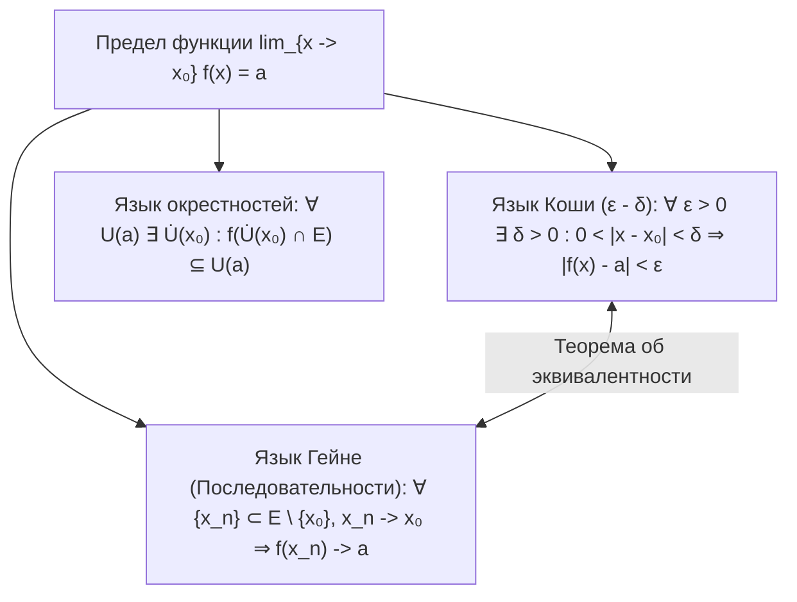
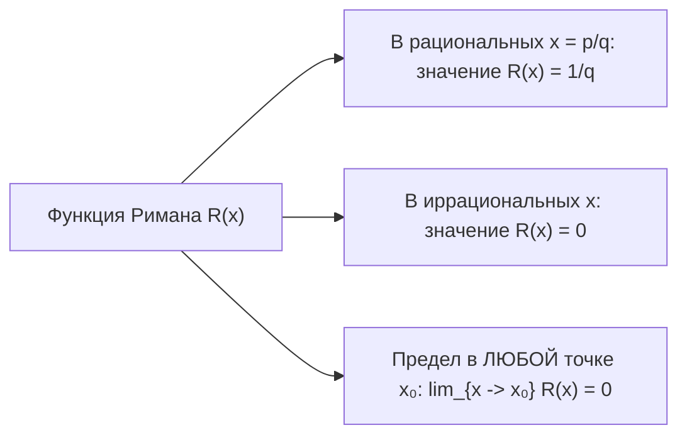
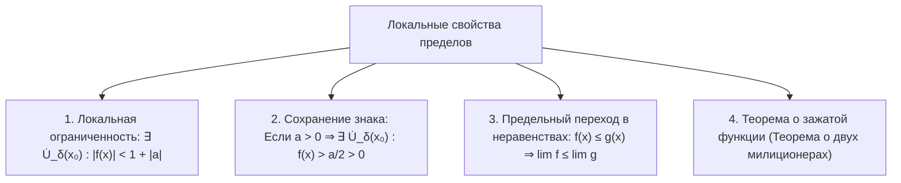

# Лекция 8: Предел функции в точке: определения по Коши и по Гейне, эквивалентность, свойства и патологические функции

> **Дисциплина**: Математический анализ  
> **Лектор**: ФИТиП (ИС), Университет ИТМО (Осенний семестр 2026)  
> **Ключевые темы**: Предельная точка области определения, определение предела по Коши ($\varepsilon$–$\delta$), топологическое определение на языке окрестностей, определение по Гейне (на языке последовательностей), теорема об эквивалентности определений Коши и Гейне, патологические функции (функция Дирихле и отсутствие предела, функция Римана и устранимая разрывность / теорема о «взрыве знаменателей»), локальные свойства пределов (локальная ограниченность, сохранение знака, предельный переход в неравенствах, теорема о зажатой функции).

---

## 1. Рекомендуемая литература

* **Г. М. Фихтенгольц — «Курс дифференциального и интегрального исчисления», Том 1**  
  *Глава II: «Предельный переход для функций непрерывного аргумента» (§1: Предел функции; §2: Бесконечно малые и бесконечно большие величины).*
* **В. А. Зорич — «Математический анализ», Часть 1**  
  *Глава III: «Предел функции» (§1: Предел функции в точке, базы окрестностей, критерий Коши, теорема эквивалентности Коши–Гейне).*
* **Л. Д. Кудрявцев — «Курс математического анализа», Том 1**  
  *Глава 2: «Предел и непрерывность функций одного переменного».*

---

## 2. Понятие предельной точки области определения

Пусть задана функция $f: E \to \mathbb{R}$, где область определения $E \subseteq \mathbb{R}$.  
Для того чтобы ставить вопрос о поведении функции $f(x)$ при приближении аргумента $x$ к точке $x_0$, необходимо, чтобы аргумент $x$ имел возможность приближаться к $x_0$, оставаясь в множестве $E$.

> [!IMPORTANT] **Определение 1 (Предельная точка области определения)**  
> Точка $x_0 \in \mathbb{R}$ называется **предельной точкой** множества $E \subseteq \mathbb{R}$, если любая её проколотая окрестность содержит хотя бы одну точку множества $E$:  
> $$\forall \delta > 0 : \quad \dot{U}_\delta(x_0) \cap E \ne \emptyset$$  
> где $\dot{U}_\delta(x_0) = \{x \in \mathbb{R} \mid 0 < |x - x_0| < \delta\} = (x_0 - \delta, x_0) \cup (x_0, x_0 + \delta)$.

> [!NOTE]
> Сама точка $x_0$ **не обязана принадлежать множеству $E$** (например, функция $\frac{\sin x}{x}$ не определена в $x_0 = 0$, однако $x_0 = 0$ является предельной точкой области определения $E = \mathbb{R} \setminus \{0\}$).

---

## 3. Определения предела функции в точке

Пусть $x_0$ — предельная точка множества $E$, $f: E \to \mathbb{R}$, и $a \in \mathbb{R}$.

---

### 3.1. Определение по Коши («на языке $\varepsilon$–$\delta$»)

> [!NOTE] **Определение 2 (Предел функции по Коши)**  
> Число $a \in \mathbb{R}$ называется **пределом функции $f(x)$ в точке $x_0$** (при $x \to x_0$), если:  
> $$\forall \varepsilon > 0 \quad \exists \delta = \delta(\varepsilon) > 0 : \quad \forall x \in E, \quad 0 < |x - x_0| < \delta \implies |f(x) - a| < \varepsilon$$  
> Обозначение:  
> $$\lim_{x \to x_0} f(x) = a \quad \text{или} \quad f(x) \xrightarrow[x \to x_0]{} a$$

#### Геометрическая интерпретация:
Какую бы горизонтальную полосу шириной $2\varepsilon$ вокруг прямой $y = a$ мы ни выбрали ($a - \varepsilon < y < a + \varepsilon$), найдется такой вертикальный интервал вокруг $x_0$ шириной $2\delta$ ($x_0 - \delta < x < x_0 + \delta$), что для всех $x \in E$ (кроме, возможно, самой точки $x = x_0$) график функции целиком попадает внутрь этой горизонтальной полосы.

---

### 3.2. Определение на языке окрестностей (Топологическое)

> [!NOTE] **Определение 3 (Предел на языке окрестностей)**  
> Число $a$ называется пределом функции $f$ при $x \to x_0$, если для любой $\varepsilon$-окрестности $U_\varepsilon(a)$ точки $a$ существует проколотая $\delta$-окрестность $\dot{U}_\delta(x_0)$ точки $x_0$ такая, что её образ целиком содержится в $U_\varepsilon(a)$:  
> $$\forall U_\varepsilon(a) \quad \exists \dot{U}_\delta(x_0) : \quad f\big(\dot{U}_\delta(x_0) \cap E\big) \subseteq U_\varepsilon(a)$$

---

### 3.3. Определение по Гейне («на языке последовательностей»)

> [!NOTE] **Определение 4 (Предел функции по Гейне)**  
> Число $a \in \mathbb{R}$ называется **пределом функции $f(x)$ в точке $x_0$**, если для любой последовательности точек $\{x_n\}_{n=1}^\infty \subset E \setminus \{x_0\}$, сходящейся к $x_0$ при $n \to \infty$:  
> $$\lim_{n \to \infty} x_n = x_0 \implies \lim_{n \to \infty} f(x_n) = a$$

---

## 4. Теорема об эквивалентности определений Коши и Гейне

> [!IMPORTANT] **Теорема 1 (Эквивалентность определений Коши и Гейне)**  
> Определение предела функции по Коши и определение предела по Гейне равносильны:  
> $$\lim_{x \to x_0}^{\text{(Коши)}} f(x) = a \iff \lim_{x \to x_0}^{\text{(Гейне)}} f(x) = a$$

### Строгое доказательство:

#### ЧАСТЬ 1: Необходимость ($\text{Коши} \implies \text{Гейне}$)
1. Пусть выполнен предел по Коши: для любого $\varepsilon > 0$ существует $\delta > 0$, что для любого $x \in E$, если $0 < |x - x_0| < \delta$, то $|f(x) - a| < \varepsilon$.
2. Возьмем произвольную последовательность $\{x_n\} \subset E \setminus \{x_0\}$, сходящуюся к $x_0$.
3. По определению предела числовой последовательности для найденного числа $\delta > 0$ найдется номер $N(\delta) \in \mathbb{N}$ такой, что:  
   $$\forall n > N(\delta) \implies 0 < |x_n - x_0| < \delta$$  
   (неравенство строго больше нуля, так как по условию Гейне $x_n \ne x_0$).
4. Тогда по условию Коши для всех $n > N(\delta)$ выполняется:  
   $$|f(x_n) - a| < \varepsilon$$
5. Это означает, что числовая последовательность $\{f(x_n)\}$ сходится к $a$, то есть $\lim_{n \to \infty} f(x_n) = a$.  
   Необходимость доказана.

#### ЧАСТЬ 2: Достаточность ($\text{Гейне} \implies \text{Коши}$)
Докажем методом от противного.
1. Предположим, что условие Гейне выполнено, но условие Коши нарушено.
2. Отрицание утверждения Коши:  
   $$\exists \varepsilon_0 > 0 \quad \forall \delta > 0 \quad \exists x \in E : \quad (0 < |x - x_0| < \delta) \land (|f(x) - a| \ge \varepsilon_0)$$
3. Поскольку это верно для любого $\delta > 0$, выберем последовательность $\delta_n = \frac{1}{n}$ для всех $n \in \mathbb{N}$.
4. Для каждого $n \in \mathbb{N}$ существует точка $x_n \in E$ такая, что:  
   $$0 < |x_n - x_0| < \frac{1}{n} \quad \text{и} \quad |f(x_n) - a| \ge \varepsilon_0$$
5. Из левого неравенства следует:  
   - $x_n \in E \setminus \{x_0\}$;  
   - $\lim_{n \to \infty} x_n = x_0$ (так как $|x_n - x_0| \to 0$).
6. Из правого неравенства следует, что последовательность значений $\{f(x_n)\}$ не может сходиться к $a$, поскольку все её члены отстоят от $a$ не менее чем на $\varepsilon_0 > 0$.
7. Мы построили последовательность $\{x_n\} \subset E \setminus \{x_0\}$, $x_n \to x_0$, для которой $f(x_n) \not\to a$.  
   Это напрямую противоречит тому, что условие Гейне выполнено для *любой* такой последовательности.  
8. Противоречие доказывает, что утверждение Коши обязано выполняться. $\blacksquare$

---

## 5. Патологические функции в теории пределов

### 5.1. Функция Дирихле и отсутствие предела

> [!NOTE] **Определение 5 (Функция Дирихле $\mathcal{D}(x)$)**  
> $$\mathcal{D}(x) = \begin{cases} 1, & x \in \mathbb{Q} \\ 0, & x \in \mathbb{R} \setminus \mathbb{Q} \end{cases}$$

> [!IMPORTANT] **Теорема 2 (Всюду разрывность и отсутствие предела функции Дирихле)**  
> Функция Дирихле $\mathcal{D}(x)$ не имеет предела ни в одной точке $x_0 \in \mathbb{R}$.

#### Доказательство через критерий Гейне:
1. Зафиксируем произвольную точку $x_0 \in \mathbb{R}$.
2. В силу плотности рациональных чисел $\mathbb{Q}$ и иррациональных чисел $\mathbb{R} \setminus \mathbb{Q}$ на вещественной прямой существуют две последовательности точек:  
   - Рациональная последовательность: $\{r_n\} \subset \mathbb{Q} \setminus \{x_0\}$, такая что $r_n \to x_0$ при $n \to \infty$.  
   - Иррациональная последовательность: $\{\xi_n\} \subset (\mathbb{R} \setminus \mathbb{Q}) \setminus \{x_0\}$, такая что $\xi_n \to x_0$ при $n \to \infty$.
3. Вычислим пределы значений функции на этих последовательностях:  
   $$\lim_{n \to \infty} \mathcal{D}(r_n) = \lim_{n \to \infty} 1 = 1$$  
   $$\lim_{n \to \infty} \mathcal{D}(\xi_n) = \lim_{n \to \infty} 0 = 0$$
4. Поскольку $1 \ne 0$, по определению Гейне предел $\lim_{x \to x_0} \mathcal{D}(x)$ не существует ни в одной точке $x_0 \in \mathbb{R}$. $\blacksquare$

---

### 5.2. Функция Римана (Тома) и теорема о «взрыве знаменателей»

> [!NOTE] **Определение 6 (Функция Римана / Тома $\mathcal{R}(x)$ на $[0, 1]$)**  
> $$\mathcal{R}(x) = \begin{cases} \frac{1}{q}, & x = \frac{p}{q} \in \mathbb{Q} \cap [0, 1], \; p \in \mathbb{Z}_{\ge 0}, \; q \in \mathbb{N}, \; \operatorname{НОД}(p, q) = 1 \\ 0, & x \in ([0, 1] \setminus \mathbb{Q}) \cup \{0\} \end{cases}$$

> [!IMPORTANT] **Лемма (О «взрыве знаменателей»)**  
> Пусть $x_0 \in \mathbb{R}$, и $\{x_n\} = \left\{\frac{p_n}{q_n}\right\} \subset \mathbb{Q}$ — последовательность попарно различных несократимых рациональных дробей.  
> Если $\lim_{n \to \infty} x_n = x_0$, то знаменатели дробей стремятся к бесконечности:  
> $$\lim_{n \to \infty} q_n = +\infty$$

#### Доказательство леммы:
1. Зафиксируем любое число $M > 0$. Рассмотрим множество всех несократимых дробей $\frac{p}{q} \in [x_0 - 1, x_0 + 1]$, у которых знаменатель $q \le M$.  
2. Знаменатель $q$ может принимать лишь конечное число значений $q \in \{1, 2, \dots, \lfloor M \rfloor\}$.  
3. Для каждого фиксированного $q$ числитель $p$ ограничен: $q(x_0 - 1) \le p \le q(x_0 + 1)$, то есть $p$ принимает лишь конечное число целочисленных значений.  
4. Следовательно, во всем интервале $[x_0 - 1, x_0 + 1]$ содержится лишь **конечное число дробей со знаменателем $q \le M$**.  
5. Пусть это конечное множество дробей есть $\{r_1, r_2, \dots, r_k\}$.  
6. Так как $x_n \to x_0$ и все члены последовательности попарно различны, последовательность $\{x_n\}$ может попадать в это конечное множество лишь конечное число раз.  
7. Значит, начиная с некоторого номера $N(M)$, все члены последовательности будут иметь $q_n > M$.  
   Это доказывает, что $q_n \to +\infty$. $\blacksquare$

> [!IMPORTANT] **Теорема 3 (Предел функции Римана)**  
> Для любой точки $x_0 \in [0, 1]$:  
> $$\lim_{x \to x_0} \mathcal{R}(x) = 0$$

#### Доказательство:
1. Зададим произвольное $\varepsilon > 0$.
2. Выберем целое число $q_0 \in \mathbb{N}$ такое, что $\frac{1}{q_0} < \varepsilon$.
3. На отрезке $[0, 1]$ существует лишь конечное множество рациональных точек вида $\frac{p}{q}$ с $q \le q_0$.  
   Выбросим из этого конечного набора саму точку $x_0$ (если она там была). Получим конечное множество точек $\{y_1, \dots, y_m\}$.
4. Выберем $\delta = \min_{1 \le i \le m} |x_0 - y_i| > 0$.
5. Тогда в проколотой окрестности $\dot{U}_\delta(x_0)$ вообще нет рациональных точек со знаменателем $q \le q_0$.
6. Следовательно, для любого $x \in \dot{U}_\delta(x_0)$:  
   - Если $x \notin \mathbb{Q}$, то $\mathcal{R}(x) = 0 \implies |\mathcal{R}(x) - 0| = 0 < \varepsilon$.  
   - Если $x \in \mathbb{Q}$, то $x = \frac{p}{q}$ с $q > q_0$, откуда $\mathcal{R}(x) = \frac{1}{q} < \frac{1}{q_0} < \varepsilon \implies |\mathcal{R}(x) - 0| < \varepsilon$.
7. По определению Коши: $\lim_{x \to x_0} \mathcal{R}(x) = 0$. $\blacksquare$

> [!TIP] **Вывод о непрерывности функции Римана**  
> Так как в иррациональных точках $\mathcal{R}(x_0) = 0 = \lim_{x \to x_0} \mathcal{R}(x)$, то функция Римана **непрерывна во всех иррациональных точках**.  
> В рациональных точках $x_0 = \frac{p}{q}$ значение $\mathcal{R}(x_0) = \frac{1}{q} \ne 0$, поэтому во всех рациональных точках функция Римана **терпит устранимый разрыв**.

---

## 6. Локальные свойства пределов функций

Пусть $\lim_{x \to x_0} f(x) = a \in \mathbb{R}$.

---

### 6.1. Теорема о локальной ограниченности

> [!NOTE] **Теорема 4 (О локальной ограниченности)**  
> Если функция $f(x)$ имеет конечный предел $\lim_{x \to x_0} f(x) = a$, то она **локально ограничена** в некоторой проколотой окрестности точки $x_0$:  
> $$\exists \delta > 0, \; \exists M > 0 : \quad \forall x \in \dot{U}_\delta(x_0) \cap E \implies |f(x)| \le M$$

#### Строгое доказательство:
1. В определении предела по Коши возьмем $\varepsilon = 1 > 0$.
2. По определению найдется $\delta > 0$ такое, что для всех $x \in E$, удовлетворяющих $0 < |x - x_0| < \delta$, выполняется:  
   $$|f(x) - a| < 1$$
3. По обратному неравенству треугольника для модуля:  
   $$|f(x)| - |a| \le |f(x) - a| < 1$$
4. Отсюда получаем оценку сверху для модуля значений функции:  
   $$|f(x)| < 1 + |a|$$
5. Обозначив константу $M = 1 + |a| > 0$, получаем, что для всех $x \in \dot{U}_\delta(x_0) \cap E$ выполняется $|f(x)| \le M$. $\blacksquare$

---

### 6.2. Теорема о сохранении знака функции

> [!NOTE] **Теорема 5 (О сохранении знака)**  
> Если $\lim_{x \to x_0} f(x) = a$ и $a > 0$ (соответственно $a < 0$), то существует проколотая окрестность $\dot{U}_\delta(x_0)$, в которой значения функции строго положительны (соответственно отрицательны):  
> $$\exists \delta > 0 : \quad \forall x \in \dot{U}_\delta(x_0) \cap E \implies f(x) > \frac{a}{2} > 0$$

#### Строгое доказательство:
1. Пусть $a > 0$. Выберем положительное число $\varepsilon = \frac{a}{2} > 0$.
2. По определению предела по Коши для данного $\varepsilon$ найдется такое $\delta > 0$, что для любого $x \in \dot{U}_\delta(x_0) \cap E$:  
   $$|f(x) - a| < \frac{a}{2}$$
3. Раскрывая абсолютную величину по определению:  
   $$-\frac{a}{2} < f(x) - a < \frac{a}{2}$$
4. Прибавляя $a$ ко всем частям двойного неравенства:  
   $$a - \frac{a}{2} < f(x) < a + \frac{a}{2} \implies \frac{a}{2} < f(x) < \frac{3a}{2}$$
5. Таким образом, $\forall x \in \dot{U}_\delta(x_0) \cap E$ выполняется:  
   $$f(x) > \frac{a}{2} > 0 \quad \blacksquare$$
*(Случай $a < 0$ доказывается абсолютно аналогично выбором $\varepsilon = \frac{|a|}{2} = -\frac{a}{2}$).*

---

### 6.3. Предельный переход в неравенствах

> [!NOTE] **Теорема 6 (Предельный переход в неравенствах)**  
> Пусть функции $f(x)$ и $g(x)$ имеют пределы при $x \to x_0$:  
> $$\lim_{x \to x_0} f(x) = a, \quad \lim_{x \to x_0} g(x) = b$$  
> Если в некоторой проколотой окрестности $\dot{U}(x_0)$ выполняется неравенство $f(x) \le g(x)$, то:  
> $$a \le b$$

#### Доказательство методом от противного:
1. Предположим обратное, то есть $a > b \implies a - b > 0$.
2. Рассмотрим вспомогательную функцию $h(x) = f(x) - g(x)$.  
   По арифметическим свойствам предела:  
   $$\lim_{x \to x_0} h(x) = \lim_{x \to x_0} (f(x) - g(x)) = a - b > 0$$
3. По теореме о сохранении знака (Теорема 5) найдется окрестность $\dot{U}_\delta(x_0)$, в которой:  
   $$h(x) > 0 \implies f(x) - g(x) > 0 \implies f(x) > g(x)$$
4. Это противоречит исходному условию, что $f(x) \le g(x)$ в проколотой окрестности.  
   Следовательно, предположение неверно, и $a \le b$. $\blacksquare$

> [!WARNING] **Строгое неравенство не сохраняется при предельном переходе!**  
> Даже если в окрестности выполняется строгое неравенство $f(x) < g(x)$, в пределе может возникнуть равенство $a = b$.  
> *Контрпример*: $f(x) = 0$, $g(x) = x^2$.  
> При $x \ne 0$ всегда $f(x) < g(x)$ ($0 < x^2$), однако при $x \to 0$:  
> $$\lim_{x \to 0} f(x) = 0 \le \lim_{x \to 0} g(x) = 0$$

---

### 6.4. Теорема о зажатой функции («О двух милиционерах»)

> [!NOTE] **Теорема 7 (О сжатой переменной)**  
> Пусть в некоторой проколотой окрестности $\dot{U}(x_0)$ справедливы неравенства:  
> $$g(x) \le f(x) \le h(x)$$  
> и существуют равные пределы граничных функций:  
> $$\lim_{x \to x_0} g(x) = \lim_{x \to x_0} h(x) = a$$  
> Тогда существует и предел промежуточной функции $f(x)$, причем:  
> $$\lim_{x \to x_0} f(x) = a$$
