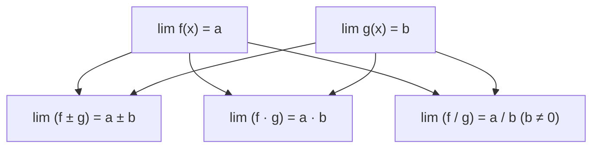
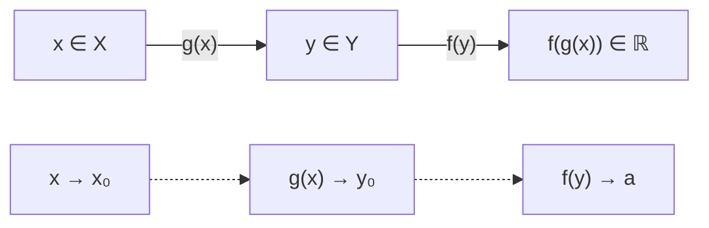
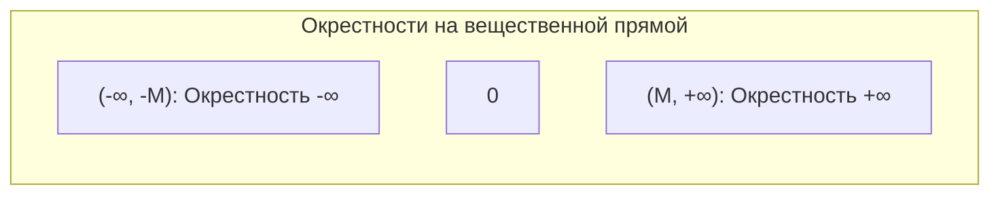
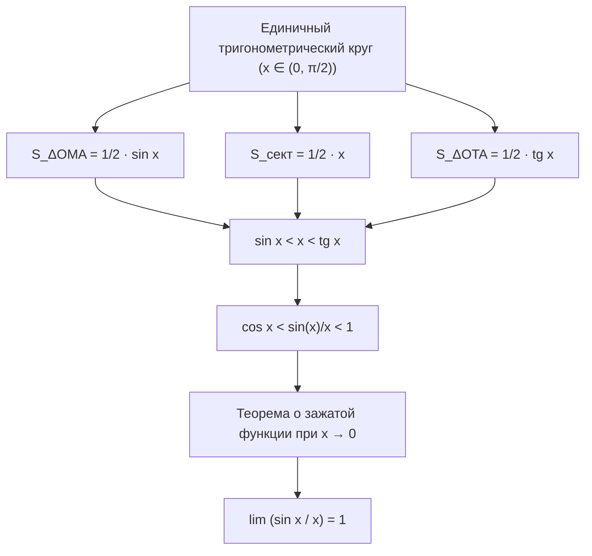
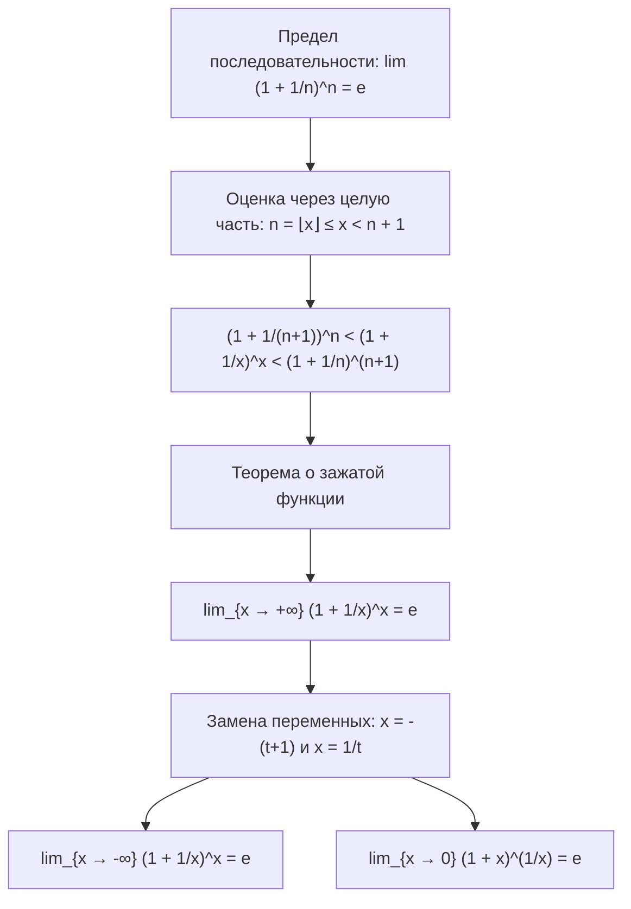

# Лекция 9: Арифметические свойства пределов, предел композиции, пределы в бесконечности и замечательные пределы

> **Дисциплина**: Математический анализ  
> **Факультет**: ФИТиП (ИС), Университет ИТМО (Осенний семестр 2026)  
> **Ключевые темы**: Арифметические свойства пределов функций (сумма, произведение, частное), связь с бесконечно малыми, теорема о пределе сложной функции (композиции) и обязательное условие невозвращения (контрпримеры), базы окрестностей $+\infty$, $-\infty$, $\infty$, классификация пределов в бесконечностях и бесконечных пределов, первый замечательный предел $\lim_{x \to 0} \frac{\sin x}{x} = 1$ (геометрическое доказательство через круговой сектор), следствия ($\operatorname{tg} x$, $1 - \cos x$, $\arcsin x$, $\operatorname{arctg} x$), второй замечательный предел $\lim_{x \to \pm\infty} (1 + 1/x)^x = e$ и $\lim_{x \to 0} (1+x)^{1/x} = e$ (доказательство через целую часть и зажатую функцию), следствия ($\ln(1+x)$, $e^x - 1$, $a^x - 1$, $(1+x)^\alpha - 1$), таблица асимптотических эквивалентностей при $x \to 0$, разбор типовых задач.

---

## 1. Рекомендуемая литература

* **Г. М. Фихтенгольц — «Курс дифференциального и интегрального исчисления», Том 1**  
  *Глава II: «Предельный переход для функций непрерывного аргумента» (§1: Предел функции; §2: Бесконечно малые и бесконечно большие величины; §3: Замечательные пределы).*
* **В. А. Зорич — «Математический анализ», Часть 1**  
  *Глава III: «Предел функции» (§1: Предел функции в точке; §2: Непрерывность и свойства пределов; композиция отображений).*
* **Л. Д. Кудрявцев — «Курс математического анализа», Том 1**  
  *Глава 2: «Предел и непрерывность функций одного переменного» (§5: Арифметика пределов; §6: Первый и второй замечательные пределы).*

---

## 2. Арифметические свойства пределов функций

Пусть $E \subseteq \mathbb{R}$, точка $x_0$ является предельной точкой множества $E$, и заданы функции $f: E \to \mathbb{R}$ и $g: E \to \mathbb{R}$.

### Теорема 2.1 (Арифметика пределов)
> Пусть существуют конечные пределы:
> $$\lim_{x \to x_0} f(x) = a \quad \text{и} \quad \lim_{x \to x_0} g(x) = b$$
> Тогда:
> 1. Существует предел суммы (разности):
>    $$\lim_{x \to x_0} \bigl(f(x) \pm g(x)\bigr) = a \pm b$$
> 2. Существует предел произведения:
>    $$\lim_{x \to x_0} \bigl(f(x) \cdot g(x)\bigr) = a \cdot b$$
>    *Следствие*: Постоянный множитель можно выносить за знак предела: $\lim_{x \to x_0} (c \cdot f(x)) = c \cdot a$.
> 3. Если $b \ne 0$, то в некоторой проколотой окрестности $\dot{U}(x_0)$ функция $g(x) \ne 0$, и существует предел частного:
>    $$\lim_{x \to x_0} \frac{f(x)}{g(x)} = \frac{a}{b}$$

### Доказательство через бесконечно малые функции
Вспомним лемму: равенство $\lim_{x \to x_0} f(x) = a$ равносильно представлению $f(x) = a + \alpha(x)$, где $\alpha(x)$ — бесконечно малая функция при $x \to x_0$ (то есть $\lim_{x \to x_0} \alpha(x) = 0$).

Аналогично, $g(x) = b + \beta(x)$, где $\lim_{x \to x_0} \beta(x) = 0$.

1. **Сумма**:
   $$f(x) + g(x) = (a + b) + \bigl(\alpha(x) + \beta(x)\bigr)$$
   Сумма двух бесконечно малых функций $\alpha(x) + \beta(x)$ есть бесконечно малая функция. Следовательно, $\lim_{x \to x_0} (f(x) + g(x)) = a + b$.

2. **Произведение**:
   $$f(x) g(x) = (a + \alpha(x))(b + \beta(x)) = ab + \underbrace{\bigl(a \beta(x) + b \alpha(x) + \alpha(x)\beta(x)\bigr)}_{\gamma(x)}$$
   Произведение константы на бесконечно малую и произведение двух бесконечно малых являются бесконечно малыми. Значит, $\gamma(x) \to 0$ при $x \to x_0$, откуда $\lim_{x \to x_0} (f(x) g(x)) = ab$.

3. **Частное**:
   Рассмотрим разность:
   $$\frac{f(x)}{g(x)} - \frac{a}{b} = \frac{a + \alpha(x)}{b + \beta(x)} - \frac{a}{b} = \frac{b \alpha(x) - a \beta(x)}{b (b + \beta(x))}$$
   Так как $b \ne 0$, по теореме о сохранении знака в некоторой проколотой окрестности $\dot{U}(x_0)$ выполнено $|g(x)| = |b + \beta(x)| > \frac{|b|}{2}$.  
   Числитель $b \alpha(x) - a \beta(x)$ бесконечно мал, а знаменатель ограничен снизу величиной $\frac{|b|^2}{2} > 0$. Значит, дробь представляет собой произведение бесконечно малой на ограниченную величину, то есть является бесконечно малой. Отсюда $\lim_{x \to x_0} \frac{f(x)}{g(x)} = \frac{a}{b}$. $\blacksquare$

### Классические неопределённости
Если условия теоремы не выполнены (например, знаменатель стремится к $0$ или аргументы уходят в бесконечность), возникают **неопределённости**:
$$\left[\frac{0}{0}\right], \quad \left[\frac{\infty}{\infty}\right], \quad [\infty - \infty], \quad [0 \cdot \infty], \quad [1^\infty], \quad [0^0], \quad [\infty^0]$$
Для их раскрытия используются замечательные пределы, формулы Тейлора или правила эквивалентностей.

---

## 3. Теорема о пределе сложной функции (композиции)

Пусть заданы отображения $g: X \to Y$ и $f: Y \to \mathbb{R}$, порождающие композицию $(f \circ g)(x) = f(g(x))$.

### Теорема 3.1 (Предел сложной функции)
> Пусть $x_0$ — предельная точка $X$, $y_0$ — предельная точка $Y$. Предположим, что:
> 1. Существует предел внутренней функции: $\lim_{x \to x_0} g(x) = y_0$.
> 2. Существует предел внешней функции: $\lim_{y \to y_0} f(y) = a$.
> 3. Выполнено хотя бы одно из двух условий согласования:
>    - **Условие невозвращения**: в некоторой проколотой окрестности $\dot{U}(x_0)$ значение $g(x) \ne y_0$:
>      $$\exists \delta_0 > 0 \; \forall x \in \dot{U}_{\delta_0}(x_0) \cap X : g(x) \ne y_0$$
>    - **Условие непрерывности**: внешняя функция $f$ непрерывна в точке $y_0$, то есть $f(y_0) = a$.
>
> Тогда существует предел композиции, причём:
> $$\lim_{x \to x_0} f(g(x)) = a$$

### Почему условие невозвращения критически необходимо? (Контрпример)
В определении предела по Коши $\lim_{y \to y_0} f(y) = a$ окрестность точки $y_0$ является **проколотой**: поведение функции в самой точке $y_0$ вообще не учитывается, значение $f(y_0)$ может быть любым или даже не существовать!

Рассмотрим следующий контрпример:
- Зададим внутреннюю функцию: $g(x) \equiv 0$ для всех $x \in \mathbb{R}$. Очевидно, $\lim_{x \to 0} g(x) = 0$, то есть $x_0 = 0, y_0 = 0$.
- Зададим внешнюю функцию:
  $$f(y) = \begin{cases} 
  1, & y \ne 0 \\ 
  0, & y = 0 
  \end{cases}$$
- Проверим пределы по отдельности:
  1. $\lim_{x \to 0} g(x) = 0 = y_0$.
  2. $\lim_{y \to 0} f(y) = 1 = a$ (так как при $y \ne 0$ всегда $f(y) = 1$).
  3. Однако условие невозвращения **нарушено**: $g(x) = 0 = y_0$ для всех $x$.
- Вычислим предел композиции напрямую:
  $$(f \circ g)(x) = f(g(x)) = f(0) = 0 \quad \text{для всех } x$$
  Следовательно:
  $$\lim_{x \to 0} f(g(x)) = 0 \ne 1 = a$$
  Теорема без условия невозвращения дала бы неверный ответ $1$, в то время как правильный предел равен $0$!

> [!IMPORTANT]
> При замене переменной $y = g(x)$ под знаком предела всегда проверяйте: либо $g(x) \ne y_0$ вблизи $x_0$, либо внешняя функция непрерывна в точке $y_0$.

---

## 4. Пределы в бесконечности и бесконечные пределы

Для унификации предельных переходов расширим вещественную прямую $\mathbb{R}$ символами бесконечности: $\overline{\mathbb{R}} = \mathbb{R} \cup \{-\infty, +\infty\}$.

### Базы окрестностей бесконечностей
Пусть $M > 0$ — произвольное положительное число.
1. **Окрестность $+\infty$**:
   $$U_M(+\infty) = \{x \in \mathbb{R} \mid x > M\} = (M, +\infty)$$
2. **Окрестность $-\infty$**:
   $$U_M(-\infty) = \{x \in \mathbb{R} \mid x < -M\} = (-\infty, -M)$$
3. **Проколотая окрестность точки $\infty$ (без знака)**:
   $$\dot{U}_M(\infty) = \{x \in \mathbb{R} \mid |x| > M\} = (-\infty, -M) \cup (M, +\infty)$$

### Формальные определения на языке $\varepsilon$–$\delta$ и $M$

1. **Конечный предел на плюс бесконечности**:
   $$\lim_{x \to +\infty} f(x) = a \iff \forall \varepsilon > 0 \; \exists M > 0 \; \forall x > M : |f(x) - a| < \varepsilon$$

2. **Бесконечный предел в конечной точке**:
   $$\lim_{x \to x_0} f(x) = +\infty \iff \forall M > 0 \; \exists \delta > 0 \; \forall x \in \dot{U}_\delta(x_0) : f(x) > M$$
   $$\lim_{x \to x_0} f(x) = \infty \iff \forall M > 0 \; \exists \delta > 0 \; \forall x \in \dot{U}_\delta(x_0) : |f(x)| > M$$

3. **Бесконечный предел на бесконечности**:
   $$\lim_{x \to +\infty} f(x) = +\infty \iff \forall M > 0 \; \exists K > 0 \; \forall x > K : f(x) > M$$

---

## 5. Первый замечательный предел

### Теорема 5.1 (Первый замечательный предел)
> Справедливо предельное соотношение:
> $$\lim_{x \to 0} \frac{\sin x}{x} = 1$$

### Геометрическое доказательство
1. **Случай $x \in (0, \pi/2)$**:
   Рассмотрим единичный круг ($R = 1$) с центром в начале координат $O(0, 0)$.
   Отложим угол величиной $x$ радиан. Обозначим:
   - $A(1, 0)$ — точка на оси абсцисс.
   - $M(\cos x, \sin x)$ — точка на окружности.
   - $T(1, \operatorname{tg} x)$ — точка пересечения луча $OM$ с касательной к окружности в точке $A$.

   Сопоставим площади трёх геометрических фигур:
   - Треугольник $\triangle OMA$: основание $OA = 1$, высота $h = \sin x$:
     $$S_{\triangle OMA} = \frac{1}{2} \cdot 1 \cdot \sin x = \frac{1}{2} \sin x$$
   - Круговой сектор $OMA$:
     $$S_{\text{сект } OMA} = \frac{1}{2} R^2 x = \frac{1}{2} x$$
   - Треугольник $\triangle OTA$: основание $OA = 1$, высота $AT = \operatorname{tg} x$:
     $$S_{\triangle OTA} = \frac{1}{2} \cdot 1 \cdot \operatorname{tg} x = \frac{1}{2} \operatorname{tg} x$$

   Очевидно геометрическое включение фигур: $\triangle OMA \subset \text{сектор } OMA \subset \triangle OTA$.
   Следовательно:
   $$S_{\triangle OMA} < S_{\text{сект } OMA} < S_{\triangle OTA} \implies \frac{1}{2} \sin x < \frac{1}{2} x < \frac{1}{2} \operatorname{tg} x$$
   Умножая на $2$:
   $$\sin x < x < \operatorname{tg} x$$

2. **Преобразование неравенства**:
   Так как $x \in (0, \pi/2)$, то $\sin x > 0$. Разделим все части неравенства на $\sin x$:
   $$1 < \frac{x}{\sin x} < \frac{1}{\cos x}$$
   Переходя к обратным величинам (при этом знаки неравенств меняются на противоположные):
   $$\cos x < \frac{\sin x}{x} < 1$$

3. **Распространение на $x \in (-\pi/2, 0)$**:
   Функция $\cos x$ чётная: $\cos(-x) = \cos x$.
   Функция $\frac{\sin x}{x}$ также чётная: $\frac{\sin(-x)}{-x} = \frac{-\sin x}{-x} = \frac{\sin x}{x}$.
   Значит, неравенство $\cos x < \frac{\sin x}{x} < 1$ верно для всех $x \in (-\pi/2, \pi/2) \setminus \{0\}$.

4. **Предельный переход**:
   При $x \to 0$ имеем $\lim_{x \to 0} \cos x = 1$ и $\lim_{x \to 0} 1 = 1$.  
   По теореме о зажатой функции (о двух милиционерах) функция $\frac{\sin x}{x}$, зажатая между ними, также стремится к $1$:
   $$\lim_{x \to 0} \frac{\sin x}{x} = 1 \quad \blacksquare$$

---

### Следствия из первого замечательного предела

1. **Тангенс**:
   $$\lim_{x \to 0} \frac{\operatorname{tg} x}{x} = \lim_{x \to 0} \left(\frac{\sin x}{x} \cdot \frac{1}{\cos x}\right) = 1 \cdot \frac{1}{1} = 1$$

2. **Косинус**:
   $$\lim_{x \to 0} \frac{1 - \cos x}{x^2} = \lim_{x \to 0} \frac{2 \sin^2(x/2)}{x^2} = 2 \lim_{x \to 0} \left(\frac{\sin(x/2)}{x/2}\right)^2 \cdot \frac{1}{4} = 2 \cdot 1^2 \cdot \frac{1}{4} = \frac{1}{2}$$

3. **Арксинус**:
   Сделаем замену переменной $t = \arcsin x \implies x = \sin t$. При $x \to 0$ имеем $t \to 0$:
   $$\lim_{x \to 0} \frac{\arcsin x}{x} = \lim_{t \to 0} \frac{t}{\sin t} = \lim_{t \to 0} \frac{1}{\frac{\sin t}{t}} = 1$$

4. **Арктангенс**:
   Сделаем замену переменной $t = \operatorname{arctg} x \implies x = \operatorname{tg} t$. При $x \to 0$ имеем $t \to 0$:
   $$\lim_{x \to 0} \frac{\operatorname{arctg} x}{x} = \lim_{t \to 0} \frac{t}{\operatorname{tg} t} = 1$$

---

## 6. Второй замечательный предел

### Теорема 6.1 (Второй замечательный предел для функций)
> Справедливы следующие предельные соотношения:
> 1. $\displaystyle \lim_{x \to +\infty} \left(1 + \frac{1}{x}\right)^x = e$
> 2. $\displaystyle \lim_{x \to -\infty} \left(1 + \frac{1}{x}\right)^x = e$
> 3. $\displaystyle \lim_{x \to 0} (1 + x)^{1/x} = e$

### Доказательство
Ранее для числовых последовательностей было установлено, что $\lim_{n \to \infty} \left(1 + \frac{1}{n}\right)^n = e$. Докажем переход к непрерывному аргументу $x \in \mathbb{R}$.

#### Шаг 1: Предел при $x \to +\infty$
Пусть $x \ge 1$. Обозначим $n = \lfloor x \rfloor$ — целую часть числа $x$. Тогда:
$$n \le x < n + 1, \quad \text{где } n \in \mathbb{N}$$
При $x \to +\infty$ целая часть $n \to \infty$.
Оценим дробь $\frac{1}{x}$:
$$\frac{1}{n+1} < \frac{1}{x} \le \frac{1}{n} \implies 1 + \frac{1}{n+1} < 1 + \frac{1}{x} \le 1 + \frac{1}{n}$$
Возводя в степень $x$ с учётом $n \le x < n + 1$:
$$\left(1 + \frac{1}{n+1}\right)^n < \left(1 + \frac{1}{x}\right)^x < \left(1 + \frac{1}{n}\right)^{n+1}$$

Вычислим пределы левой и правой границ при $n \to \infty$:
- Левая граница:
  $$\lim_{n \to \infty} \left(1 + \frac{1}{n+1}\right)^n = \lim_{n \to \infty} \frac{\left(1 + \frac{1}{n+1}\right)^{n+1}}{1 + \frac{1}{n+1}} = \frac{e}{1 + 0} = e$$
- Правая граница:
  $$\lim_{n \to \infty} \left(1 + \frac{1}{n}\right)^{n+1} = \lim_{n \to \infty} \left[\left(1 + \frac{1}{n}\right)^n \cdot \left(1 + \frac{1}{n}\right)\right] = e \cdot 1 = e$$

По теореме о зажатой функции:
$$\lim_{x \to +\infty} \left(1 + \frac{1}{x}\right)^x = e$$

#### Шаг 2: Предел при $x \to -\infty$
Сделаем замену переменной: пусть $x = -(t + 1)$. При $x \to -\infty$ аргумент $t \to +\infty$.
$$1 + \frac{1}{x} = 1 - \frac{1}{t+1} = \frac{t}{t+1} = \frac{1}{\frac{t+1}{t}} = \frac{1}{1 + \frac{1}{t}}$$
Возводим в степень $x = -(t + 1)$:
$$\left(1 + \frac{1}{x}\right)^x = \left(\frac{1}{1 + \frac{1}{t}}\right)^{-(t+1)} = \left(1 + \frac{1}{t}\right)^{t+1} = \left(1 + \frac{1}{t}\right)^t \cdot \left(1 + \frac{1}{t}\right)$$
Переходя к пределу при $t \to +\infty$:
$$\lim_{x \to -\infty} \left(1 + \frac{1}{x}\right)^x = \lim_{t \to +\infty} \left(1 + \frac{1}{t}\right)^t \cdot \lim_{t \to +\infty} \left(1 + \frac{1}{t}\right) = e \cdot 1 = e$$

Так как пределы при $x \to +\infty$ и $x \to -\infty$ равны, то $\lim_{x \to \infty} \left(1 + \frac{1}{x}\right)^x = e$.

#### Шаг 3: Предел при $x \to 0$
Сделаем замену $x = \frac{1}{t}$. Если $x \to 0$, то $t \to \infty$:
$$\lim_{x \to 0} (1 + x)^{1/x} = \lim_{t \to \infty} \left(1 + \frac{1}{t}\right)^t = e \quad \blacksquare$$

---

### Следствия из второго замечательного предела

1. **Натуральный логарифм**:
   $$\lim_{x \to 0} \frac{\ln(1+x)}{x} = \lim_{x \to 0} \ln(1+x)^{1/x} = \ln \left(\lim_{x \to 0} (1+x)^{1/x}\right) = \ln e = 1$$
   *(по непрерывности логарифма).*

2. **Экспонента**:
   Положим $t = e^x - 1 \implies x = \ln(1+t)$. При $x \to 0$ имеем $t \to 0$:
   $$\lim_{x \to 0} \frac{e^x - 1}{x} = \lim_{t \to 0} \frac{t}{\ln(1+t)} = \lim_{t \to 0} \frac{1}{\frac{\ln(1+t)}{t}} = \frac{1}{1} = 1$$

3. **Показательная функция с основанием $a > 0$**:
   Так как $a^x - 1 = e^{x \ln a} - 1$:
   $$\lim_{x \to 0} \frac{a^x - 1}{x} = \lim_{x \to 0} \left(\frac{e^{x \ln a} - 1}{x \ln a} \cdot \ln a\right) = 1 \cdot \ln a = \ln a$$

4. **Степенная функция с произвольным показателем $\alpha \in \mathbb{R}$**:
   Представим $(1+x)^\alpha - 1 = e^{\alpha \ln(1+x)} - 1$:
   $$\lim_{x \to 0} \frac{(1+x)^\alpha - 1}{x} = \lim_{x \to 0} \left(\frac{e^{\alpha \ln(1+x)} - 1}{\alpha \ln(1+x)} \cdot \alpha \cdot \frac{\ln(1+x)}{x}\right) = 1 \cdot \alpha \cdot 1 = \alpha$$

---

## 7. Сводная таблица замечательных пределов и эквивалентностей ($x \to 0$)

При $x \to 0$ справедливы асимптотические формулы эквивалентности ($\alpha(x) \sim \beta(x) \iff \lim_{x \to 0} \frac{\alpha(x)}{\beta(x)} = 1$):

| Формула предела | Асимптотическая эквивалентность при $x \to 0$ |
| :--- | :--- |
| $\displaystyle \lim_{x \to 0} \frac{\sin x}{x} = 1$ | $\sin x \sim x$ |
| $\displaystyle \lim_{x \to 0} \frac{\operatorname{tg} x}{x} = 1$ | $\operatorname{tg} x \sim x$ |
| $\displaystyle \lim_{x \to 0} \frac{\arcsin x}{x} = 1$ | $\arcsin x \sim x$ |
| $\displaystyle \lim_{x \to 0} \frac{\operatorname{arctg} x}{x} = 1$ | $\operatorname{arctg} x \sim x$ |
| $\displaystyle \lim_{x \to 0} \frac{1 - \cos x}{x^2} = \frac{1}{2}$ | $1 - \cos x \sim \frac{x^2}{2}$ |
| $\displaystyle \lim_{x \to 0} \frac{e^x - 1}{x} = 1$ | $e^x - 1 \sim x$ |
| $\displaystyle \lim_{x \to 0} \frac{a^x - 1}{x} = \ln a$ | $a^x - 1 \sim x \ln a$ |
| $\displaystyle \lim_{x \to 0} \frac{\ln(1+x)}{x} = 1$ | $\ln(1+x) \sim x$ |
| $\displaystyle \lim_{x \to 0} \frac{(1+x)^\alpha - 1}{x} = \alpha$ | $(1+x)^\alpha - 1 \sim \alpha x$ |

---

## 8. Примеры решения типовых задач

### Пример 8.1 (Тригонометрическая неопределённость $[0/0]$)
Вычислить предел:
$$\lim_{x \to 0} \frac{\cos(3x) - \cos(5x)}{x \cdot \sin(2x)}$$

**Решение**:
Преобразуем разность косинусов в произведение:
$$\cos(3x) - \cos(5x) = -2 \sin\left(\frac{3x+5x}{2}\right) \sin\left(\frac{3x-5x}{2}\right) = 2 \sin(4x) \sin(x)$$
Подставим в предел:
$$\lim_{x \to 0} \frac{2 \sin(4x) \sin(x)}{x \cdot \sin(2x)} = 2 \lim_{x \to 0} \left(\frac{\sin(4x)}{4x} \cdot 4 \cdot \frac{\sin(x)}{x} \cdot \frac{2x}{\sin(2x)} \cdot \frac{1}{2}\right)$$
Используя первый замечательный предел ($\lim_{u \to 0} \frac{\sin u}{u} = 1$):
$$= 2 \cdot 1 \cdot 4 \cdot 1 \cdot 1 \cdot \frac{1}{2} = 4$$

*Ответ*: $4$.

---

### Пример 8.2 (Степенно-показательная неопределённость $[1^\infty]$)
Вычислить предел:
$$\lim_{x \to \infty} \left(\frac{x^2 + 2x - 1}{x^2 - x + 2}\right)^{3x}$$

**Решение**:
Выделим единицу в основании:
$$\frac{x^2 + 2x - 1}{x^2 - x + 2} = 1 + \frac{(x^2 + 2x - 1) - (x^2 - x + 2)}{x^2 - x + 2} = 1 + \frac{3x - 3}{x^2 - x + 2}$$
При $x \to \infty$ величина $\alpha(x) = \frac{3x - 3}{x^2 - x + 2} \to 0$, поэтому имеем неопределённость вида $[1^\infty]$.
Применим второй замечательный предел:
$$\left(1 + \alpha(x)\right)^{3x} = \left[\left(1 + \alpha(x)\right)^{1/\alpha(x)}\right]^{\alpha(x) \cdot 3x}$$
Так как $\lim_{x \to \infty} (1 + \alpha(x))^{1/\alpha(x)} = e$, вычисляем предел показателя:
$$\lim_{x \to \infty} \bigl(\alpha(x) \cdot 3x\bigr) = \lim_{x \to \infty} \frac{3x(3x - 3)}{x^2 - x + 2} = \lim_{x \to \infty} \frac{9x^2 - 9x}{x^2 - x + 2} = 9$$
Следовательно:
$$\lim_{x \to \infty} \left(\frac{x^2 + 2x - 1}{x^2 - x + 2}\right)^{3x} = e^9$$

*Ответ*: $e^9$.

---

### Пример 8.3 (Сложная композиция с логарифмом и корнями)
Вычислить предел:
$$\lim_{x \to 0} \frac{\sqrt[3]{1 + 6x} - 1}{\ln(1 + 2x)}$$

**Решение**:
Используем таблицу асимптотических эквивалентностей при $x \to 0$:
- $\sqrt[3]{1 + 6x} - 1 = (1 + 6x)^{1/3} - 1 \sim \frac{1}{3} \cdot (6x) = 2x$.
- $\ln(1 + 2x) \sim 2x$.

Подставляем эквивалентные бесконечно малые:
$$\lim_{x \to 0} \frac{\sqrt[3]{1 + 6x} - 1}{\ln(1 + 2x)} = \lim_{x \to 0} \frac{2x}{2x} = 1$$

*Ответ*: $1$.

---

## 9. Контрольные вопросы для самопроверки

1. **Вопрос**: В чём заключается принципиальная разница между базой окрестностей точки $x \to +\infty$ и $x \to \infty$?  
   *Ответ*: База окрестностей $+\infty$ состоит из полупрямых $(M, +\infty)$, требующих положительности аргумента, тогда как окрестность $\infty$ объединяет оба направления: $(-\infty, -M) \cup (M, +\infty) = \{x \in \mathbb{R} \mid |x| > M\}$.
2. **Вопрос**: Сформулируйте условие невозвращения в теореме о пределе композиции и приведите пример, когда его нарушение приводит к ошибочному результату.  
   *Ответ*: Условие требует, чтобы в проколотой окрестности $\dot{U}(x_0)$ внутренняя функция не принимала значение своего предела: $g(x) \ne y_0$. Контрпример: $g(x) \equiv 0$, а $f(y) = 1$ при $y \ne 0$ и $f(0) = 0$.
3. **Вопрос**: Почему в доказательстве первого замечательного предела $\lim_{x \to 0} \frac{\sin x}{x} = 1$ площадь сектора $\frac{1}{2} x$ оказывается строго зажата между площадями двух треугольников?  
   *Ответ*: Треугольник $\triangle OMA$ геометрически содержится внутри кругового сектора $OMA$, а сам сектор целиком содержится внутри треугольника $\triangle OTA$, образованного касательной.
4. **Вопрос**: Чему равен предел $\lim_{x \to 0} \frac{1 - \cos x}{x^2}$ и почему этот предел равен $1/2$, а не $1$?  
   *Ответ*: $1 - \cos x = 2 \sin^2(x/2) \sim 2 (x/2)^2 = 2 \cdot \frac{x^2}{4} = \frac{x^2}{2}$. При делении на $x^2$ получаем коэффициент $1/2$.
5. **Вопрос**: Как свести предел функции при $x \to -\infty$ во втором замечательном пределе к пределу при $t \to +\infty$?  
   *Ответ*: С помощью замены $x = -(t + 1)$, которая переводит скобку $(1 + 1/x)^x$ в произведение $(1 + 1/t)^t \cdot (1 + 1/t) \to e \cdot 1 = e$.
