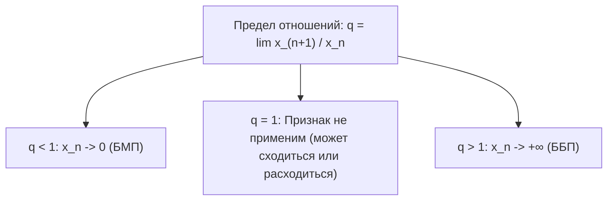
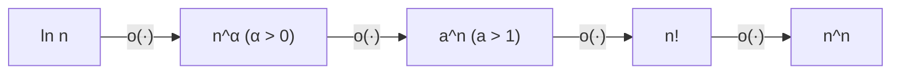

# Лекция 6: Символы Ландау, асимптотическое сравнение, признак Даламбера и шкала роста

> **Дисциплина**: Математический анализ  
> **Лектор**: Факультет ИВТ / ИСТ, Университет ИТМО (Осенний семестр 2026)  
> **Ключевые темы**: Критерий Коши для числовых рядов, гармонический ряд, бесконечно малые последовательности (БМП), бесконечно большие последовательности (ББП), символы Ландау $o$ и $O$, эквивалентные последовательности ($\sim$), асимптотическое равенство $a_n = b_n + o(b_n)$, алгебра символов Ландау, признак Даламбера (отношений) для последовательностей, иерархия (шкала) роста: $\ln n \ll n^\alpha \ll a^n \ll n! \ll n^n$.

---

## 1. Исследование гармонического ряда по Коши

На прошлой лекции был доказан фундаментальный **критерий Коши**: числовая последовательность $\{x_n\}$ сходится тогда и только тогда, когда она фундаментальна:
$$\forall \varepsilon > 0 \;\; \exists N \in \mathbb{N} : \;\; \forall n > N, \;\forall p \in \mathbb{N} \implies |x_{n+p} - x_n| < \varepsilon$$

Применим его к исследованию сходимости последовательности частичных сумм **гармонического ряда**:
$$h_n = \sum_{k=1}^n \frac{1}{k} = 1 + \frac{1}{2} + \frac{1}{3} + \dots + \frac{1}{n}$$

> [!NOTE] **Отрицание критерия Коши (Критерий расходимости)**  
> Последовательность $\{x_n\}$ **не сходится** (расходится) тогда и только тогда, когда существует такое $\varepsilon_0 > 0$, что для любого сколь угодно большого номера $N$ найдутся такие $n > N$ и $p \in \mathbb{N}$, что:  
> $$|x_{n+p} - x_n| \ge \varepsilon_0$$

### Доказательство расходимости гармонического ряда:
Положим $\varepsilon_0 = \frac{1}{2}$. Пусть $N \in \mathbb{N}$ — произвольный номер.  
Выберем $n = N$ и $p = n = N$ (то есть рассматриваем сдвиг на отрезок длины $n$):
$$|h_{n+p} - h_n| = |h_{2n} - h_n| = \frac{1}{n+1} + \frac{1}{n+2} + \dots + \frac{1}{2n}$$
В этой сумме ровно $n$ слагаемых, и каждое из них не меньше самого последнего $\frac{1}{2n}$:
$$|h_{2n} - h_n| \ge \underbrace{\frac{1}{2n} + \frac{1}{2n} + \dots + \frac{1}{2n}}_{n \text{ слагаемых}} = n \cdot \frac{1}{2n} = \frac{1}{2} = \varepsilon_0$$
Следовательно, условие фундаментальности нарушено для $\varepsilon_0 = 1/2$.  
Так как последовательность $h_n$ монотонно возрастает ($h_{n+1} - h_n = \frac{1}{n+1} > 0$) и не сходится к конечному числу, по теореме Вейерштрасса она неограниченно растет:
$$\lim_{n \to \infty} \sum_{k=1}^n \frac{1}{k} = +\infty$$
Гармонический ряд **расходится**. $\blacksquare$

---

## 2. Бесконечно малые и бесконечно большие последовательности

### 2.1. Бесконечно малые последовательности (БМП)
Последовательность $\{\alpha_n\}$ называется **бесконечно малой при $n \to \infty$**, если:
$$\lim_{n \to \infty} \alpha_n = 0 \iff \forall \varepsilon > 0 \; \exists N \in \mathbb{N} : \forall n > N \implies |\alpha_n| < \varepsilon$$

### 2.2. Бесконечно большие последовательности (ББП)
Последовательность $\{x_n\}$ называется **бесконечно большой**:
1. $\lim_{n \to \infty} x_n = \infty$, если:
   $$\forall M > 0 \; \exists N \in \mathbb{N} : \forall n > N \implies |x_n| > M$$
2. $\lim_{n \to \infty} x_n = +\infty$, если:
   $$\forall M > 0 \; \exists N \in \mathbb{N} : \forall n > N \implies x_n > M$$
3. $\lim_{n \to \infty} x_n = -\infty$, если:
   $$\forall M > 0 \; \exists N \in \mathbb{N} : \forall n > N \implies x_n < -M$$

> [!TIP] **Связь между БМП и ББП**  
> Если $\{x_n\}$ — бесконечно большая ($x_n \ne 0$), то $\alpha_n = \frac{1}{x_n}$ является бесконечно малой.  
> Обратно: если $\{\alpha_n\}$ — бесконечно малая ($\alpha_n \ne 0$), то $x_n = \frac{1}{\alpha_n}$ является бесконечно большой.

---

## 3. Символы Ландау: $o$-малое и $O$-большое

Для сравнения скоростей роста или убывания последовательностей Эдмунд Ландау ввел асимптотические символы.

### 3.1. Символ «$o$-малое» (Строго меньший порядок роста)

> [!NOTE] **Определение 1 ($o$-малое)**  
> Последовательность $\{a_n\}$ называется **$o$-малым** от последовательности $\{b_n\}$ при $n \to \infty$ (записывается $a_n = o(b_n)$), если существует бесконечно малая последовательность $\{\alpha_n\}$ ($\lim_{n \to \infty} \alpha_n = 0$), такая что:  
> $$a_n = \alpha_n \cdot b_n \quad \forall n \in \mathbb{N}$$  
> Если $b_n \ne 0$ начиная с некоторого номера, это равносильно:  
> $$\lim_{n \to \infty} \frac{a_n}{b_n} = 0$$

- *Смысл*: $a_n$ растет существенно медленнее $b_n$ (или убывает существенно быстрее).  
- *Частный случай*: запись $a_n = o(1)$ означает, что $\lim_{n \to \infty} a_n = 0$, то есть $\{a_n\}$ — БМП.

---

### 3.2. Символ «$O$-большое» (Один порядок роста или ограниченность отношения)

> [!NOTE] **Определение 2 ($O$-большое)**  
> Последовательность $\{a_n\}$ называется **$O$-большим** от последовательности $\{b_n\}$ при $n \to \infty$ (записывается $a_n = O(b_n)$), если существуют положительная константа $C > 0$ и номер $N_0 \in \mathbb{N}$, такие что:  
> $$|a_n| \le C \cdot |b_n| \quad \forall n > N_0$$  
> Если $b_n \ne 0$, это равносильно тому, что отношение $\frac{a_n}{b_n}$ является **ограниченной последовательностью**:  
> $$\exists C > 0 : \left| \frac{a_n}{b_n} \right| \le C$$

- *Частный случай*: запись $a_n = O(1)$ означает, что последовательность $\{a_n\}$ ограничена: $\exists C > 0 : |a_n| \le C$.

---

## 4. Эквивалентные последовательности

> [!NOTE] **Определение 3 (Асимптотическая эквивалентность)**  
> Последовательности $\{a_n\}$ и $\{b_n\}$ называются **асимптотически эквивалентными** при $n \to \infty$ (обозначается $a_n \sim b_n$), если существует последовательность $\{\gamma_n\}$, такая что:  
> $$a_n = \gamma_n \cdot b_n, \qquad \lim_{n \to \infty} \gamma_n = 1$$  
> При $b_n \ne 0$ это равносильно:  
> $$\lim_{n \to \infty} \frac{a_n}{b_n} = 1$$

> [!IMPORTANT] **Теорема 1 (Связь эквивалентности и $o$-малого)**  
> Последовательности $\{a_n\}$ и $\{b_n\}$ эквивалентны тогда и только тогда, когда:  
> $$a_n = b_n + o(b_n) \quad (n \to \infty)$$

#### Строгое доказательство:
1. **Необходимость ($\implies$)**:  
   Пусть $a_n \sim b_n$, то есть $a_n = \gamma_n b_n$, где $\gamma_n \to 1$.  
   Представим $\gamma_n = 1 + \alpha_n$, где $\alpha_n = \gamma_n - 1 \to 0$ (БМП).  
   Тогда:
   $$a_n = (1 + \alpha_n) b_n = b_n + \alpha_n b_n$$
   По определению $o$-малого, слагаемое $\alpha_n b_n = o(b_n)$.  
   Значит, $a_n = b_n + o(b_n)$.
2. **Достаточность ($\impliedby$)**:  
   Пусть $a_n = b_n + o(b_n)$.  
   По определению $o$-малого, существует $\alpha_n \to 0$, такое что $o(b_n) = \alpha_n b_n$.  
   Тогда:
   $$a_n = b_n + \alpha_n b_n = (1 + \alpha_n) b_n$$
   Обозначим $\gamma_n = 1 + \alpha_n$. Так как $\alpha_n \to 0$, то $\lim_{n \to \infty} \gamma_n = 1 + 0 = 1$.  
   Следовательно, $a_n \sim b_n$. $\blacksquare$

---

## 5. Алгебра символов Ландау

Символы $o$ и $O$ обозначают не конкретные функции, а **классы последовательностей**. Знак равенства в таких формулах выражает принадлежность классу (односторонняя транзитивность).

> [!IMPORTANT] **Теорема 2 (Арифметические свойства символов Ландау)**  
> Для любой базовой последовательности $\{b_n\}$ при $n \to \infty$ верны равенства:  
> 1. $o(o(b_n)) = o(b_n)$  
> 2. $O(O(b_n)) = O(b_n)$  
> 3. $o(b_n) + o(b_n) = o(b_n)$  
> 4. $O(b_n) + O(b_n) = O(b_n)$  
> 5. $O(b_n) \cdot o(b_n) = o(b_n^2)$ (в частности, $O(1) \cdot o(b_n) = o(b_n)$)  
> 6. $O(b_n) + o(b_n) = O(b_n)$

### Строгие доказательства:

1. **$o(o(b_n)) = o(b_n)$**:  
   Пусть $x_n = o(o(b_n))$. Это значит, что $x_n = \alpha_n \cdot y_n$, где $\alpha_n \to 0$, а $y_n = o(b_n) = \beta_n \cdot b_n$, где $\beta_n \to 0$.  
   Тогда $x_n = \alpha_n (\beta_n b_n) = (\alpha_n \beta_n) b_n$.  
   Так как произведение двух БМП $\alpha_n \beta_n \to 0$, то по определению $x_n = o(b_n)$. $\blacksquare$

2. **$O(O(b_n)) = O(b_n)$**:  
   Пусть $|x_n| \le C_1 |y_n|$ для $n > N_1$, и $|y_n| \le C_2 |b_n|$ для $n > N_2$.  
   Тогда для всех $n > \max(N_1, N_2)$: $|x_n| \le C_1 (C_2 |b_n|) = (C_1 C_2) |b_n|$.  
   Константа $C = C_1 C_2 > 0$ фиксирована, следовательно, $x_n = O(b_n)$. $\blacksquare$

3. **$o(b_n) + o(b_n) = o(b_n)$**:  
   Пусть $x_n = \alpha_n b_n$ и $y_n = \beta_n b_n$, где $\alpha_n \to 0$ и $\beta_n \to 0$.  
   Тогда $x_n + y_n = (\alpha_n + \beta_n) b_n$.  
   Сумма двух БМП является БМП: $\lim (\alpha_n + \beta_n) = 0 + 0 = 0$.  
   Значит, $x_n + y_n = o(b_n)$. $\blacksquare$

4. **$O(b_n) + O(b_n) = O(b_n)$**:  
   Пусть $|x_n| \le C_1 |b_n|$ и $|y_n| \le C_2 |b_n|$.  
   По неравенству треугольника: $|x_n + y_n| \le |x_n| + |y_n| \le (C_1 + C_2) |b_n|$.  
   Константа $C = C_1 + C_2$, значит, сумма есть $O(b_n)$. $\blacksquare$

5. **$O(1) \cdot o(b_n) = o(b_n)$**:  
   Пусть $x_n = O(1)$ (ограниченная: $|x_n| \le C$) и $y_n = \alpha_n b_n$, где $\alpha_n \to 0$.  
   Тогда $x_n y_n = (x_n \alpha_n) b_n$.  
   Произведение ограниченной последовательности на бесконечно малую есть бесконечно малая: $|x_n \alpha_n| \le C |\alpha_n| \to 0$.  
   Значит, $x_n y_n = o(b_n)$. $\blacksquare$

6. **$O(b_n) + o(b_n) = O(b_n)$**:  
   Так как всякое $o(b_n)$ автоматически является $O(b_n)$ (любая сходящаяся последовательность ограничена: $|\alpha_n| \le 1$ при больших $n$), то утверждение сводится к пункту 4: $O(b_n) + O(b_n) = O(b_n)$. $\blacksquare$

---

## 6. Признак Даламбера для числовых последовательностей

Для сравнения последовательности с геометрической прогрессией применяется признак отношений Даламбера.

> [!IMPORTANT] **Теорема 3 (Признак Даламбера для последовательностей)**  
> Пусть $\{x_n\}$ — последовательность со строго положительными членами ($x_n > 0$), и пусть существует предел отношений:  
> $$\lim_{n \to \infty} \frac{x_{n+1}}{x_n} = q$$  
> Тогда:  
> 1. Если $q < 1$, то $\lim_{n \to \infty} x_n = 0$ (последовательность стремится к нулю со сверхгеометрической скоростью).  
> 2. Если $q > 1$, то $\lim_{n \to \infty} x_n = +\infty$ (последовательность бесконечно большая).  
> 3. Если $q = 1$, признак ответа не дает (требуется более тонкое исследование).

### Строгое доказательство:

#### Случай 1 ($q < 1$):
Так как $q < 1$, выберем вещественное число $r$, строго разделяющее $q$ и $1$:
$$q < r < 1 \quad \left(\text{например, } r = \frac{q + 1}{2}\right)$$
Возьмем $\varepsilon = r - q > 0$.  
По определению предела последовательности $\frac{x_{n+1}}{x_n} \to q$, для этого $\varepsilon$ существует номер $N \in \mathbb{N}$, такой что для всех $n \ge N$:
$$\left| \frac{x_{n+1}}{x_n} - q \right| < \varepsilon \iff \frac{x_{n+1}}{x_n} < q + \varepsilon = r$$
Следовательно, для всех $n \ge N$:
$$x_{n+1} < r \cdot x_n$$
Применим это неравенство по индукции:
$$x_{N+1} < r \cdot x_N$$
$$x_{N+2} < r \cdot x_{N+1} < r^2 \cdot x_N$$
$$\dots$$
$$x_{N+k} < r^k \cdot x_N \quad \forall k \ge 1$$
Полагая $n = N + k$:
$$0 < x_n < x_N \cdot r^{-N} \cdot r^n = C \cdot r^n, \quad \text{где } C = \frac{x_N}{r^N} > 0$$
Так как $0 < r < 1$, то $\lim_{n \to \infty} r^n = 0$.  
По теореме о зажатой последовательности:
$$\lim_{n \to \infty} x_n = 0 \quad \blacksquare$$

#### Случай 2 ($q > 1$):
Выберем число $r$, такое что $1 < r < q$ (например, $r = \frac{q + 1}{2}$).  
Аналогично, начиная с некоторого номера $N$:
$$\frac{x_{n+1}}{x_n} > r \implies x_n > \left( \frac{x_N}{r^N} \right) \cdot r^n$$
Так как $r > 1$, то $\lim_{n \to \infty} r^n = +\infty$.  
Следовательно:
$$\lim_{n \to \infty} x_n = +\infty \quad \blacksquare$$

---

## 7. Шкала роста бесконечно больших последовательностей

При анализе сложности алгоритмов и пределов в анализе используется универсальная **иерархия (шкала) скоростей роста**:

$$\ln n \ll n^\alpha \ll a^n \ll n! \ll n^n \qquad (\alpha > 0, \; a > 1)$$

Обозначение $f(n) \ll g(n)$ означает, что $f(n) = o(g(n))$, то есть:
$$\lim_{n \to \infty} \frac{f(n)}{g(n)} = 0$$

### Строгие доказательства переходов шкалы:

#### 1. Степенная быстрее логарифмической: $\ln n = o(n^\alpha)$ при $\alpha > 0$
Требуется доказать, что $\lim_{n \to \infty} \frac{\ln n}{n^\alpha} = 0$.  
Сделаем замену $n = e^t$, где $t \to +\infty$:
$$\frac{\ln n}{n^\alpha} = \frac{t}{e^{\alpha t}}$$
По формуле Тейлора (или биному) для $e^{\alpha t}$ при $k = 2$:
$$e^{\alpha t} > 1 + \alpha t + \frac{(\alpha t)^2}{2} > \frac{\alpha^2 t^2}{2}$$
Тогда:
$$0 < \frac{t}{e^{\alpha t}} < \frac{t}{\frac{\alpha^2 t^2}{2}} = \frac{2}{\alpha^2 t} \xrightarrow{t \to \infty} 0$$
Следовательно, $\ln n = o(n^\alpha)$. В частности, $\ln n < n$ при всех $n \ge 1$. $\blacksquare$

#### 2. Показательная быстрее степенной: $n^\alpha = o(a^n)$ при $a > 1, \alpha > 0$
Применим признак Даламбера к последовательности $x_n = \frac{n^\alpha}{a^n}$:
$$\frac{x_{n+1}}{x_n} = \frac{(n+1)^\alpha}{a^{n+1}} \cdot \frac{a^n}{n^\alpha} = \frac{1}{a} \left(1 + \frac{1}{n}\right)^\alpha$$
Так как $\lim_{n \to \infty} \left(1 + \frac{1}{n}\right)^\alpha = 1^\alpha = 1$, получаем:
$$q = \lim_{n \to \infty} \frac{x_{n+1}}{x_n} = \frac{1}{a}$$
Так как $a > 1$, то $q = \frac{1}{a} < 1$.  
По признаку Даламбера: $\lim_{n \to \infty} \frac{n^\alpha}{a^n} = 0 \iff n^\alpha = o(a^n)$. $\blacksquare$

#### 3. Факториал быстрее показательной: $a^n = o(n!)$ при любом $a > 0$
Рассмотрим $x_n = \frac{a^n}{n!}$. Применим признак Даламбера:
$$\frac{x_{n+1}}{x_n} = \frac{a^{n+1}}{(n+1)!} \cdot \frac{n!}{a^n} = \frac{a}{n+1}$$
Предел:
$$q = \lim_{n \to \infty} \frac{a}{n+1} = 0 < 1$$
По признаку Даламбера: $\lim_{n \to \infty} \frac{a^n}{n!} = 0 \iff a^n = o(n!)$. $\blacksquare$

#### 4. $n^n$ быстрее факториала: $n! = o(n^n)$
Рассмотрим $x_n = \frac{n!}{n^n}$. Применим признак Даламбера:
$$\frac{x_{n+1}}{x_n} = \frac{(n+1)!}{(n+1)^{n+1}} \cdot \frac{n^n}{n!} = \frac{(n+1) \cdot n^n}{(n+1)^{n+1}} = \left(\frac{n}{n+1}\right)^n = \frac{1}{\left(1 + \frac{1}{n}\right)^n}$$
В силу второго замечательного предела $\lim_{n \to \infty} \left(1 + \frac{1}{n}\right)^n = e$:
$$q = \lim_{n \to \infty} \frac{x_{n+1}}{x_n} = \frac{1}{e} \approx \frac{1}{2.718} \approx 0.368 < 1$$
По признаку Даламбера: $\lim_{n \to \infty} \frac{n!}{n^n} = 0 \iff n! = o(n^n)$. $\blacksquare$

---

## 8. Сводная таблица асимптотик

| Отношение | Обозначение | Определение через пределы | Пример |
| :--- | :--- | :--- | :--- |
| **Строго медленнее** | $a_n = o(b_n)$ | $\lim \frac{a_n}{b_n} = 0$ | $n = o(n^2)$, $\ln n = o(\sqrt{n})$ |
| **Один порядок / не превосходит** | $a_n = O(b_n)$ | $\limsup \left\|\frac{a_n}{b_n}\right\| < \infty$ | $3n^2 + 5 = O(n^2)$, $\sin n = O(1)$ |
| **Эквивалентны** | $a_n \sim b_n$ | $\lim \frac{a_n}{b_n} = 1$ | $n^2 + n \sim n^2$, $\sin(1/n) \sim 1/n$ |
| **Тот же порядок величины** | $a_n = \Theta(b_n)$ | $0 < c_1 \le \frac{a_n}{b_n} \le c_2 < \infty$ | $5n^2 + 10 = \Theta(n^2)$ |
| **Строго быстрее** | $a_n = \omega(b_n)$ | $\lim \left\|\frac{a_n}{b_n}\right\| = \infty$ | $2^n = \omega(n^{10})$ |
