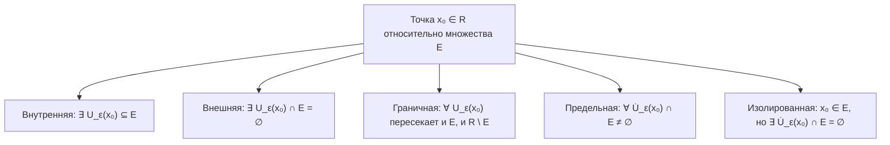

# Лекция 7: Топология вещественной прямой, предельные точки и теорема Гейне–Бореля

> **Дисциплина**: Математический анализ  
> **Лектор**: Факультет ИВТ / ИСТ, Университет ИТМО (Осенний семестр 2026)  
> **Ключевые темы**: Метрика на $\mathbb{R}$, окрестности и проколотые окрестности, классификация точек (внутренние, внешние, граничные, изолированные, предельные), критерий предельной точки, открытые и замкнутые множества, двойственность, алгебра открытых и замкнутых множеств, теорема Больцано–Вейерштрасса для числовых множеств, открытые покрытия, компактность, теорема Гейне–Бореля.

---

## 1. Метрика и окрестности на вещественной прямой $\mathbb{R}$

Основой топологической структуры действительной прямой $\mathbb{R}$ является понятие расстояния.

> [!NOTE] **Определение 1 (Метрика на $\mathbb{R}$)**  
> **Евклидовой метрикой (расстоянием)** между точками $x, y \in \mathbb{R}$ называется функция:  
> $$d(x, y) = |x - y|$$  
> удовлетворяющая трем аксиомам метрического пространства:  
> 1. **Неотрицательность и невырожденность**: $d(x, y) \ge 0$, причём $d(x, y) = 0 \iff x = y$;  
> 2. **Симметричность**: $d(x, y) = d(y, x)$;  
> 3. **Неравенство треугольника**: $\forall x, y, z \in \mathbb{R} \implies d(x, z) \le d(x, y) + d(y, z)$.

### 1.1. Окрестности точек

> [!NOTE] **Определение 2 ($\varepsilon$-окрестность)**  
> Пусть $x_0 \in \mathbb{R}$ и $\varepsilon > 0$. **$\varepsilon$-окрестностью точки $x_0$** называется открытый интервал радиуса $\varepsilon$ с центром в $x_0$:  
> $$U_\varepsilon(x_0) = \{x \in \mathbb{R} \mid |x - x_0| < \varepsilon\} = (x_0 - \varepsilon, \; x_0 + \varepsilon)$$

> [!NOTE] **Определение 3 (Проколотая $\varepsilon$-окрестность)**  
> **Проколотой $\varepsilon$-окрестностью точки $x_0$** называется окрестность с выброшенным центром $x_0$:  
> $$\dot{U}_\varepsilon(x_0) = U_\varepsilon(x_0) \setminus \{x_0\} = (x_0 - \varepsilon, x_0) \cup (x_0, x_0 + \varepsilon) = \{x \in \mathbb{R} \mid 0 < |x - x_0| < \varepsilon\}$$

---

## 2. Классификация точек относительно множества

Пусть $E \subseteq \mathbb{R}$ — произвольное подмножество вещественных чисел, и $x_0 \in \mathbb{R}$.

### 2.1. Определения типов точек

1. **Внутренняя точка**:  
   Точка $x_0 \in E$ называется **внутренней точкой множества $E$**, если она входит в $E$ вместе с некоторой своей окрестностью:  
   $$\exists \varepsilon > 0 : \quad U_\varepsilon(x_0) \subseteq E$$  
   Множество всех внутренних точек называется **внутренностью** множества $E$ и обозначается $\operatorname{int}(E)$ или $E^\circ$.
2. **Внешняя точка**:  
   Точка $x_0 \in \mathbb{R}$ называется **внешней точкой множества $E$**, если существует окрестность, не содержащая точек $E$:  
   $$\exists \varepsilon > 0 : \quad U_\varepsilon(x_0) \cap E = \emptyset$$  
   Множество всех внешних точек обозначается $\operatorname{ext}(E)$.
3. **Граничная точка**:  
   Точка $x_0 \in \mathbb{R}$ называется **граничной точкой множества $E$**, если в любой ее окрестности содержатся как точки множества $E$, так и точки его дополнения $\mathbb{R} \setminus E$:  
   $$\forall \varepsilon > 0 : \quad (U_\varepsilon(x_0) \cap E \ne \emptyset) \land (U_\varepsilon(x_0) \cap (\mathbb{R} \setminus E) \ne \emptyset)$$  
   Множество всех граничных точек называется **границей** множества $E$ и обозначается $\partial E$.
4. **Изолированная точка**:  
   Точка $x_0 \in E$ называется **изолированной точкой множества $E$**, если существует проколотая окрестность, не содержащая точек $E$:  
   $$\exists \varepsilon > 0 : \quad \dot{U}_\varepsilon(x_0) \cap E = \emptyset$$
5. **Предельная точка (точка накопления / limit point)**:  
   Точка $x_0 \in \mathbb{R}$ называется **предельной точкой множества $E$**, если любая ее проколотая окрестность содержит хотя бы одну точку множества $E$:  
   $$\forall \varepsilon > 0 : \quad \dot{U}_\varepsilon(x_0) \cap E \ne \emptyset$$  
   *(Внимание: предельная точка $x_0$ вовсе не обязана принадлежать самому множеству $E$!)*  
   Множество всех предельных точек множества $E$ называется его **производным множеством** и обозначается $E'$.

---

### 2.2. Критерий предельной точки через последовательности

> [!IMPORTANT] **Теорема 1 (Последовательностный критерий предельной точки)**  
> Точка $x_0 \in \mathbb{R}$ является предельной точкой множества $E$ тогда и только тогда, когда в множестве $E$ существует последовательность точек $\{x_n\}_{n=1}^\infty \subset E \setminus \{x_0\}$, сходящаяся к $x_0$:  
> $$x_0 \in E' \iff \exists \{x_n\} \subset E \setminus \{x_0\} : \lim_{n \to \infty} x_n = x_0$$

#### Строгое доказательство:
1. **Необходимость ($\implies$)**:  
   Пусть $x_0$ — предельная точка $E$. Для каждого $n \in \mathbb{N}$ рассмотрим проколотую окрестность $\dot{U}_{1/n}(x_0)$ с радиусом $\varepsilon_n = \frac{1}{n}$.  
   По определению предельной точки, в этой окрестности найдется элемент $x_n \in E$, отличный от $x_0$:
   $$x_n \in \dot{U}_{1/n}(x_0) \cap E \implies 0 < |x_n - x_0| < \frac{1}{n}$$
   Так как $\lim_{n \to \infty} \frac{1}{n} = 0$, по теореме о зажатой последовательности:
   $$\lim_{n \to \infty} |x_n - x_0| = 0 \iff \lim_{n \to \infty} x_n = x_0$$
   Последовательность построена.
2. **Достаточность ($\impliedby$)**:  
   Пусть существует последовательность $\{x_n\} \subset E \setminus \{x_0\}$, сходящаяся к $x_0$.  
   Зафиксируем произвольное $\varepsilon > 0$.  
   По определению предела последовательности, найдется номер $N \in \mathbb{N}$, такой что для всех $n > N$: $|x_n - x_0| < \varepsilon$.  
   Так как по условию $x_n \ne x_0$, то $0 < |x_n - x_0| < \varepsilon$, то есть $x_n \in \dot{U}_\varepsilon(x_0)$.  
   Следовательно, точка $x_n \in \dot{U}_\varepsilon(x_0) \cap E$, а значит, пересечение непусто.  
   Точка $x_0$ является предельной. $\blacksquare$

---

## 3. Открытые и замкнутые множества

### 3.1. Определения

> [!NOTE] **Определение 4 (Открытое множество)**  
> Множество $G \subseteq \mathbb{R}$ называется **открытым**, если каждая его точка является внутренней:  
> $$G = \operatorname{int}(G) \iff \forall x \in G \; \exists \varepsilon > 0 : U_\varepsilon(x) \subseteq G$$

*Примеры*: любой открытый интервал $(a, b)$, объединение интервалов, всё пространство $\mathbb{R}$ и пустое множество $\emptyset$.

> [!NOTE] **Определение 5 (Замкнутое множество)**  
> Множество $F \subseteq \mathbb{R}$ называется **замкнутым**, если оно содержит все свои предельные точки:  
> $$F' \subseteq F$$

*Замыканием* множества $E$ называется множество $\overline{E} = E \cup E'$. Множество замкнуто $\iff E = \overline{E}$.

---

### 3.2. Теорема о двойственности

> [!IMPORTANT] **Теорема 2 (Связь открытости и замкнутости)**  
> Подмножество $F \subseteq \mathbb{R}$ замкнуто тогда и только тогда, когда его дополнение $\mathbb{R} \setminus F$ открыто.

#### Строгое доказательство:
1. **Прямое утверждение ($\implies$)**:  
   Пусть $F$ замкнуто ($F' \subseteq F$). Покажем, что дополнение $G = \mathbb{R} \setminus F$ открыто.  
   Возьмем произвольную точку $x_0 \in G$. Это значит, что $x_0 \notin F$.  
   Так как $F$ замкнуто, $x_0$ не может быть предельной точкой $F$ (иначе $x_0 \in F' \subseteq F$).  
   Следовательно, $x_0 \notin F'$, то есть существует такая окрестность $\dot{U}_\varepsilon(x_0)$, которая не пересекает $F$: $\dot{U}_\varepsilon(x_0) \cap F = \emptyset$.  
   А так как и сама точка $x_0 \notin F$, то вся окрестность $U_\varepsilon(x_0) \cap F = \emptyset$.  
   Это значит, что $U_\varepsilon(x_0) \subseteq \mathbb{R} \setminus F = G$.  
   Точка $x_0$ — внутренняя для $G$. Множество $G$ открыто.
2. **Обратное утверждение ($\impliedby$)**:  
   Пусть $G = \mathbb{R} \setminus F$ открыто. Покажем, что $F' \subseteq F$.  
   Пусть $x_0 \in F'$ — произвольная предельная точка. Предположим от противного, что $x_0 \notin F$.  
   Тогда $x_0 \in G$. Так как $G$ открыто, существует окрестность $U_\varepsilon(x_0) \subseteq G = \mathbb{R} \setminus F$.  
   Но тогда $U_\varepsilon(x_0) \cap F = \emptyset$, что противоречит тому, что $x_0$ — предельная точка $F$.  
   Противоречие показывает, что $x_0 \in F$. Множество $F$ замкнуто. $\blacksquare$

---

### 3.3. Алгебра открытых и замкнутых множеств

> [!IMPORTANT] **Теорема 3 (Топологическая структура $\mathbb{R}$)**  
> 1. Объединение **произвольного (даже несчётного)** семейства открытых множеств открыто:  
>    $$\forall \alpha \in \mathcal{A}: G_\alpha \text{ открыто} \implies \bigcup_{\alpha \in \mathcal{A}} G_\alpha \text{ открыто}$$  
> 2. Пересечение **конечного** числа открытых множеств открыто:  
>    $$G_1, \dots, G_n \text{ открыты} \implies \bigcap_{i=1}^n G_i \text{ открыто}$$  
> 3. Пересечение **произвольного** семейства замкнутых множеств замкнуто:  
>    $$\forall \alpha \in \mathcal{A}: F_\alpha \text{ замкнуто} \implies \bigcap_{\alpha \in \mathcal{A}} F_\alpha \text{ замкнуто}$$  
> 4. Объединение **конечного** числа замкнутых множеств замкнуто:  
>    $$F_1, \dots, F_n \text{ замкнуты} \implies \bigcup_{i=1}^n F_i \text{ замкнуто}$$

> [!WARNING] **Опасные контрпримеры для бесконечных операций**  
> 1. **Бесконечное пересечение открытых множеств может не быть открытым**:  
>    Рассмотрим открытые интервалы $G_n = \left(-\frac{1}{n}, \frac{1}{n}\right)$.  
>    Их счетное пересечение:  
>    $$\bigcap_{n=1}^\infty \left(-\frac{1}{n}, \frac{1}{n}\right) = \{0\}$$  
>    Одноточечное множество $\{0\}$ является **замкнутым**, а не открытым!  
> 2. **Бесконечное объединение замкнутых множеств может не быть замкнутым**:  
>    Рассмотрим замкнутые отрезки $F_n = \left[\frac{1}{n}, 1 - \frac{1}{n}\right]$ ($n \ge 3$).  
>    Их объединение дает **открытый интервал**:  
>    $$\bigcup_{n=3}^\infty \left[\frac{1}{n}, 1 - \frac{1}{n}\right] = (0, 1)$$

---

## 4. Теорема Больцано–Вейерштрасса для множеств

> [!IMPORTANT] **Теорема 4 (Больцано–Вейерштрасса для числовых множеств)**  
> Всякое бесконечное ограниченное подмножество $E \subset \mathbb{R}$ имеет хотя бы одну предельную точку в $\mathbb{R}$:  
> $$|E| = \infty, \; E \text{ ограничено} \implies E' \ne \emptyset$$

#### Строгое доказательство:
Так как множество $E$ бесконечно, выберем из него счетное подмножество попарно различных элементов $\{x_n\}_{n=1}^\infty \subseteq E$.  
Так как $E$ ограничено, числовая последовательность $\{x_n\}$ является ограниченной.  
По теореме Больцано–Вейерштрасса для числовых последовательностей (Лекция 5), из ограниченной последовательности можно выделить сходящуюся подпоследовательность $\{x_{n_k}\}$:
$$\lim_{k \to \infty} x_{n_k} = x_0 \in \mathbb{R}$$
Так как все точки $x_{n_k}$ принадлежат множеству $E$ и попарно различны, в любой проколотой окрестности $\dot{U}_\varepsilon(x_0)$ содержится бесконечно много точек подпоследовательности.  
Следовательно, точка $x_0$ является предельной точкой множества $E$ ($x_0 \in E'$). $\blacksquare$

---

## 5. Компактность и теорема Гейне–Бореля

Понятие компактности — одно из ключевых обобщений конечности в математическом анализе.

### 5.1. Открытые покрытия

> [!NOTE] **Определение 6 (Открытое покрытие)**  
> Семейство открытых множеств $\{G_\alpha\}_{\alpha \in \mathcal{A}}$ называется **открытым покрытием** множества $E \subseteq \mathbb{R}$, если множество $E$ содержится в их объединении:  
> $$E \subseteq \bigcup_{\alpha \in \mathcal{A}} G_\alpha$$  
> Если некоторое конечное подсемейство $\{G_{\alpha_1}, G_{\alpha_2}, \dots, G_{\alpha_m}\}$ также покрывает $E$:  
> $$E \subseteq \bigcup_{i=1}^m G_{\alpha_i}$$  
> то оно называется **конечным подпокрытием**.

> [!NOTE] **Определение 7 (Компактное множество / Компакт)**  
> Множество $K \subseteq \mathbb{R}$ называется **компактным** (компактом), если из **любого** его открытого покрытия можно выделить **конечное подпокрытие**.

---

### 5.2. Контрпримеры к компактности

1. **Незамкнутое множество**: $E = (0, 1)$ (ограничено, но не замкнуто).  
   Построим покрытие интервалами: $G_n = \left(\frac{1}{n}, 1\right)$ для $n = 2, 3, \dots$  
   Объединение $\bigcup_{n=2}^\infty \left(\frac{1}{n}, 1\right) = (0, 1) = E$.  
   Любое конечное подсемейство имеет вид $\{G_{n_1}, \dots, G_{n_m}\}$, его объединение равно интервалу $\left(\frac{1}{N_{\max}}, 1\right)$, который не содержит точки из интервала $\left(0, \frac{1}{N_{\max}}\right]$.  
   Конечного подпокрытия нет! Интервал $(0, 1)$ **не компактен**.
2. **Неограниченное множество**: $E = \mathbb{R}$ (замкнуто, но не ограничено).  
   Построим покрытие $G_n = (-n, n)$ для $n \in \mathbb{N}$.  
   Объединение $\bigcup G_n = \mathbb{R}$. Любое конечное подсемейство покрывает максимум $(-N_{\max}, N_{\max})$, что не покрывает всю прямую.  
   Прямая $\mathbb{R}$ **не компактна**.

---

### 5.3. Теорема Гейне–Бореля

> [!IMPORTANT] **Теорема 5 (Гейне — Бореля / Критерий компактности в $\mathbb{R}$)**  
> Подмножество вещественных чисел $K \subset \mathbb{R}$ компактно тогда и только тогда, когда $K$ **замкнуто и ограничено**:  
> $$K \text{ компактно} \iff K \text{ замкнуто} \land K \text{ ограничено}$$

#### Строгое доказательство (для отрезка $K = [a, b]$):
Докажем, что отрезок $[a, b]$ компактен (лемма Гейне–Бореля о конечном покрытии отрезка).  
Пусть $\{G_\alpha\}$ — произвольное открытое покрытие отрезка $[a, b]$.  
Рассмотрим множество:
$$M = \{x \in [a, b] \mid \text{отрезок } [a, x] \text{ можно покрыть конечным числом множеств из } \{G_\alpha\}\}$$
1. $M \ne \emptyset$, так как точка $a \in [a, b]$ покрыта некоторым открытым $G_{\alpha_0}$, содержащим интервал $(a - \delta, a + \delta)$.
2. Множество $M$ ограничено сверху числом $b$.  
   По принципу непрерывности Дедекинда существует точная верхняя грань $c = \sup M \le b$.
3. Покажем, что $c = b$ и $b \in M$.  
   Точка $c \in [a, b]$ покрыта некоторым открытым множеством $G_{\alpha_c}$, следовательно, существует $\varepsilon > 0$, такое что $(c - \varepsilon, c + \varepsilon) \subseteq G_{\alpha_c}$.  
   По определению супремума, существует точка $x_1 \in M$, такая что $c - \varepsilon < x_1 \le c$.  
   Отрезок $[a, x_1]$ покрывается конечным числом множеств $G_{\alpha_1}, \dots, G_{\alpha_k}$.  
   Добавив к ним одно множество $G_{\alpha_c}$, мы покроем отрезок $[a, c + \varepsilon/2]$.  
   Если бы $c < b$, то точки правее $c$ вплоть до $c + \varepsilon/2$ принадлежали бы $M$, что противоречит тому, что $c = \sup M$.  
   Значит, $c = b$, и отрезок $[a, b]$ покрывается конечным числом элементов покрытия. $\blacksquare$

---

## 6. Сводная классификация подмножеств $\mathbb{R}$

| Подмножество | Открыто? | Замкнуто? | Ограничено? | Компактно? |
| :--- | :---: | :---: | :---: | :---: |
| Интервал $(0, 1)$ | **Да** | Нет | Да | Нет |
| Отрезок $[0, 1]$ | Нет | **Да** | **Да** | **Да** |
| Полуинтервал $[0, 1)$ | Нет | Нет | Да | Нет |
| $\mathbb{R}$ | **Да** | **Да** | Нет | Нет |
| $\emptyset$ | **Да** | **Да** | Да | **Да** |
| $\mathbb{Z}$ (целые числа) | Нет | **Да** | Нет | Нет |
| $\mathbb{Q}$ (рациональные) | Нет | Нет | Нет | Нет |
| $\{1/n \mid n \in \mathbb{N}\}$ | Нет | Нет | Да | Нет |
| $\{1/n \mid n \in \mathbb{N}\} \cup \{0\}$ | Нет | **Да** | **Да** | **Да** |
